<h1>
  <picture>
    <source media="(prefers-color-scheme: dark)" srcset="docs/assets/brand/fuzer-logo-dark.svg">
    
  </picture>
</h1>

Home-built asset data fusion for oil & gas: entity resolution, entity linking,
and a dated asset graph (physical, flow/allocation, data, documents) across
SAP S/4, JDE, Maximo, PI / PI AF, ADX, Energy Components, P&IDs and operator
logs.

Design and decisions: [docs/overview.md](docs/overview.md) and the pages it leads to ([site](https://areed145.github.io/fuzer/)).

## Architecture

```mermaid
flowchart LR
  subgraph SRC["Sources (fake exports today)"]
    direction TB
    ERP["SAP S/4, JDE, Maximo<br/>assets, notifications, work orders, materials"]
    PI["PI points, PI AF"]
    EC["Energy Components<br/>network, downtime, DAY001"]
    PID["P&ID sheets<br/>smart, text PDF, scans"]
    TXT["Operator logs"]
    DOC["Manuals, guides, procedures"]
  end

  subgraph PG["Postgres"]
    direction TB
    RAW[("source_record<br/>+ history")]
    LLM[("llm_extraction<br/>cached Claude readings")]
    REG[("entity, crosswalk, golden,<br/>edge, knowledge_index, lesson")]
    REV[("review_item, pinned_link,<br/>feedback")]
  end

  subgraph RB["Rebuild (no model calls)"]
    direction TB
    EXT["Extract<br/>pack grammars"] --> RES["Resolve<br/>match, stable IDs"]
    RES --> GOLD["Golden records"] --> TAX["ISO 14224 classes<br/>and models"]
    TAX --> GR["Graph links"] --> INC["Incidents"]
    INC --> KN["Knowledge index<br/>and lessons"]
  end

  SRC -->|"ingest (COPY)"| RAW
  RAW --> EXT
  LLM --> EXT
  KN --> REG
  REV <--> RES

  CL["Claude readers<br/>logs, comments, P&IDs, sections"]
  RAW -.->|"fuzer llm-link"| CL -.-> LLM

  TS["Time-series provider<br/>PI Web API, ADX or synthetic"]

  subgraph OUT["Users"]
    direction TB
    API["FastAPI"] --> UI["React web UI"]
    MCP["MCP server<br/>AI agents"]
    AG["Operations assistant<br/>Claude agents on MAF"] --> UI
  end
  REG --> API & MCP & AG
  REV <--> API
  TS --> API & MCP & AG

  DAG["Dagster<br/>sensor, schedules, checks"] -.->|"runs"| SRC
  DAG -.-> RB
  DAG -.-> CL
  PACK["Asset pack (YAML)<br/>+ ISO 14224 standard"] -.-> RB
```



Raw records, cached Claude readings and reviewer decisions are kept apart, so the
whole register can be rebuilt from them at any time (about 25 s at full size)
without calling Claude. Solid arrows are data, dotted arrows are runs and
configuration. More in [docs/deployment.md](docs/deployment.md).

## Quick start

Needs [uv](https://docs.astral.sh/uv/) and Node.js (for the web UI). Put your Anthropic key in `.env`
(`ANTHROPIC_API_KEY=...`), then:

```sh
uv sync
FUZER_AUTH_MODE=local uv run fuzer up    # trusted loopback development: http://127.0.0.1:8000
```

For a shared deployment, use the default Microsoft sign-in mode and follow
[application registration and owner setup](docs/deployment.md#microsoft-sign-in-and-first-owner).
Personal Microsoft and work/school accounts are supported. Owners approve accounts and manage
extensible application roles; workflow routing roles stay separate. Do not expose local attribution
mode through a public proxy. Approved visitors can follow **Home -> Start guided investigation**
without an AI key.

The first time, `fuzer up` makes the Okan field demo, loads it, has Claude read the operator logs,
P&ID drawings and document sections, builds the register and the web UI, and starts the server
(the Ask page is the operations assistant) and the scheduled jobs (Dagster on http://127.0.0.1:3000:
SRE scans, studies, refreshes, day close; `--no-jobs` leaves them out) and the agent worker, which runs
the workflow's agent steps such as drafting each daily report (log in `.fuzer/worker.log`; `--no-worker`
leaves it out). Later starts are quick: only
what changed is reloaded or read, and readings Claude stored without a rebuild are built in. `uv run fuzer up --fresh` starts over with a clean database; Claude's readings are kept, so
it doesn't pay to read the same text twice. Without a key everything runs except Claude's reading
the assistant and the agent worker.

### Okan field demo

The Okan field (NMA South Offshore) as fake data for the troubleshooting
assistant: OKA_PP, OK_GGCP with compression trains A/B/C, OKA_ST1, OKA_ST2,
OKA_NWP with its gas producers, 24 jackets and 177 wells (mostly gas lifted),
EGP export, and a gas lift network: GGCP compression feeds three lift gas headers
(GGCP, ST1, ST2), each supplying the jackets nearest it, some through another
jacket's manifold, down to each jacket's gas lift manifold and its wells (the
Network page's Gas lift view), with every source: SAP, PI / AF, EC network,
downtime and DAY001, operator logs, P&ID drawings, manuals and troubleshooting
guides, and GIS pipelines and facilities. Planted stories to troubleshoot: train
B bearing trips and the lift gas shortfalls they cause, train A after-cooler
fouling, inlet separator carryover, NWP gas producer hydrates, EGP curtailment,
gas lift valve failures, an export pump seal leak and a water breakthrough. It also
has an open work order backlog, maintenance and inspection plans (some overdue),
a 2026 turnaround (OK-TAR-2026), monthly well tests, lab results (separators,
gas plant, a wellhead) and wall thickness surveys at CMLs on every pipeline and
vessel, production chokes on every well, and OEM pump curves and choke
characteristics as vendor CSVs and datasheets (some scanned, some only a drawn
curve) that Claude reads into the review queue. More stories: an export pump
losing head to worn wear rings, an eroding choke on OK-J12-02 and a plugging one
on OK-NWP-G3. Details in
[fakeplant/src/fakeplant/okan.py](fakeplant/src/fakeplant/okan.py).

Optional, in `.env` (see `.env.example`):

- `FUZER_DATABASE_URL=...` to use your own Postgres (`docker compose up -d` gives
  one on localhost:5432); without it Fuzer runs a built-in one in `.fuzer/pgdata`.
- `FUZER_PROJECT=okan` to select the Okan project (its pack, data folder,
  mappings and time-series provider).

Everything else (Claude models and effort, schedules, detection thresholds,
caps) is a setting, stored in the database and changed on the **Settings** page
or with `fuzer settings`, not an environment variable.

Everything below is optional detail: each step `fuzer up` runs is also its own
command (`fuzer ingest`, `fuzer rebuild`, `fuzer llm-link`, `fuzer serve`), and
`uv run pytest -n auto --dist loadfile` runs the tests in parallel, each worker on its own throwaway database; `uv run pytest -m unit` runs only the quick ones (no database, a few seconds). The e2e tier (week-long replays and evals) is left out unless asked for with `-m e2e`; CI runs it on main. Tests run in random order (pytest-randomly; `-p no:randomly` turns it off) and never see `ANTHROPIC_API_KEY`.

### Operations assistant (Claude agents)

```sh
uv run fuzer ask "Why does lift gas keep running short, and what should go in the next turnaround to fix it?"
uv run fuzer chat          # a conversation; or the Ask page in the web UI
```

A team of Claude agents on Microsoft Agent Framework answers questions across
everything Fuzer links: troubleshooting, production surveillance and
efficiency, constraints, wells, reliability and inspection, work orders and
turnarounds. An orchestrator answers simple lookups itself and hands domain
work to three specialists (troubleshooter, production, maintenance), running
them at the same time when a question spans domains. Each agent has its own
read-only Fuzer tools and skills (`src/fuzer/agents/skills/`); every fact in an
answer cites the record it came from, and it never tells anyone to operate the
plant. Needs `ANTHROPIC_API_KEY`. A cross-domain answer on Okan takes one to
two minutes and costs about a dollar on Claude Opus 5.5; each answer shows its
cost per model. `fuzer settings set agents.specialist_model claude-sonnet-5-5` runs the
specialists on Sonnet (the orchestrator stays on `agents.model`). `uv run fuzer eval --agents` scores it per domain against
`answer_keys/assistant.json`. Every tool, the agents that use it and the calc checks are listed in
[docs/capabilities.md](docs/capabilities.md), generated from the capability registry. Settings, CLI commands and the
database schema have generated reference pages too: [docs/settings.md](docs/settings.md),
[docs/cli.md](docs/cli.md) and [docs/schema.md](docs/schema.md) (`uv run python -m fuzer.reference`).

Answers can include interactive charts (Plotly; `src/fuzer/plots/`): trends,
incident timelines, correlation heatmaps, vibration against ISO 20816 zones,
decline curves with Arps fits, water diagnostics, gas lift performance curves
and allocation, wall thickness by CML, Weibull / Crow-AMSAA and bad actors.
The server builds each chart from Fuzer data; the agent sees only a summary of
it and places it with a `[[figure:<id>]]` marker. Click a point to open its
record; `/figures/<id>.html` opens one on its own. On the Ask page you can also
attach or paste images (a PI Vision screenshot, a spectrum photo, a datasheet
page) for Claude to read.

### Live PI and ADX (fake)

```sh
uv run fakeplant historian                 # fake PI Web API + ADX on :8100
```

Then set the servers once: `fuzer settings set sources.pi.url http://127.0.0.1:8100/piwebapi`,
`sources.adx.url http://127.0.0.1:8100` and `sources.adx.database OKAN` (or `FUZER_PI_WEB_API_URL`,
`FUZER_ADX_URL`, `FUZER_ADX_DATABASE` in `.env`), and the project's `timeseries: adx` (or `pi`) in
`projects/<name>.yaml` or `fuzer projects save`. On the next `fuzer ingest` each server becomes a connection in
the source catalog (`fuzer sources connections`) and `pi_points`, `pi_af` and `adx_series` move onto it: the point
list and AF tree come from PI Web API and the series catalog from ADX, and trends and the troubleshooting brief
read values from them. A second PI server is another connection (`fuzer sources add-connection`); passwords and
tokens are references (`env:NAME`), never values. The same steps point at a real server.

On Okan, the fake values come from a small process model of the plant
(`process_model.json`, written with the demo data; `src/fuzer/sources/process_model.py`):
compressor trains, lift gas headers, wells with chokes and gas lift, separators,
pumps and meters, linked by simple relations with time lags. Values move
together the way the plant would: vibration rises before temperature, a train
trip drops the lift gas header, and the gas lifted wells and oil export follow.

### Measuring quality

```sh
uv run fuzer eval     # answer keys in the project data folder's answer_keys/
```

Scores the loaded register against answer keys: knowledge search (hit@1, hit@3,
MRR), document links and section failure modes (precision / recall), and
operator-log reading (mentions, and event types once Claude has run). The fake
generator writes keys for its data; for a real asset, curate the same JSON
files (format in `src/fuzer/evals/evaluate.py`).

```sh
uv run fuzer --pack okan eval --ops --since 2024-11-03 --until 2024-11-13
```

Replays the operations detectors over a fake plant's history in 6-hour windows,
without letting them see later data, and scores what they raise against the
process model's injected upsets: recall and time to detect per kind, precision,
false alarms per week. Runs are kept; it exits 1 if recall fell since the last
run of the same period ([docs/evals.md](docs/evals.md)). With `--full` it scores everything scheduled: SRE detection and
grouping, diagnosis (a scripted Claude unless `--live`), daily reports and the opportunity scan. It fails
under each score's floor. CI runs it on the fake Okan plant.

### Project and asset pack

A **project** picks everything for one asset in one name: its pack, data folder, mappings, time-series
provider and timezone (`fuzer --project okan …` or `FUZER_PROJECT=okan`; `fuzer projects list`). Its
config is stored in the database, and `projects/<name>.yaml` is used when the database has none
(`fuzer projects save <name>` stores it).

**Settings.** Tunable values are declared once in `src/fuzer/core/settings.py`, each with a type, default,
valid range and description, and set per project or for all projects. They are grouped as LLM providers
(provider, endpoint, API-key reference, models, effort, fallbacks), Agents, Schedule, Database, SRE
(detection and grouping, hand-off caps), Signals (instrument
health, change detection), Alarms, Opportunities, Reports and Studies. Change them on the **Settings**
page (`#/settings`), which shows each value, its default and range, who changed it last, and the history
with reasons. From the command line: `fuzer settings list | get | set | reset | history`. A project value
beats the global one, which beats the default. The old variables (`FUZER_LLM_MODEL`, `FUZER_AGENT_*`,
`FUZER_DAY_CLOSE_CRON`, `FUZER_WORK_LEASE_SECONDS`, `FUZER_WORK_MEM`) still work for one release, with a
deprecation warning. PI and ADX connections and the alert webhook stay in the environment until the
source settings move (#132).

The Okan pack and project are the supported reference configuration. The pack
defines tag and well naming, aliases, classification onto the ISO 14224
taxonomy, maintenance and downtime codes, and survivorship. Generate or load
the Okan data with `uv run fakeplant generate` or `uv run fakeplant demo`.
Use `uv run fuzer bench` to time queries on the loaded data.

Review answers return at once: a chosen value is
applied immediately, and match answers queue one background rebuild (the UI
shows "Updating…").

### Claude reads operator logs and P&ID drawings

```sh
export ANTHROPIC_API_KEY=...       # or `ant auth login`
uv run fuzer llm-link --dry-run    # how many entries / requests / tokens, calls nothing
uv run fuzer llm-link --limit 40   # try a small sample first
uv run fuzer llm-link --batch      # everything, via the Batches API at half price (results within ~1 h)
uv run fuzer llm-link --source pids --limit 5   # just P&ID drawings (or --source logs)
uv run fuzer pid-score             # fake data only: tags and piping found / missed / wrong vs. the answer key
```

For each log entry Claude gets a numbered list of candidates from the asset
register (ambiguous short tags in every area, equipment in any area named in
the text) and picks from it, or says it can't tell. It also pulls out events
(trip, start, changeover, shut-in, choke change, alarm, leak, instrument fault,
...) which become `event` entities linked to the log entry and to the tags and
wells involved. Results are cached per entry; rebuilds never call the model,
and an entry is only re-read when its text changes (`--force` re-reads all).
P&ID drawings (`fakeplant` draws every sheet: clean exports for smart and
text-PDF sheets, damaged scans for the rest, with an answer key in
`pid_truth.json` that is never ingested) are sent as overlapping tiles; smart
P&IDs aren't sent, their tags and piping are exact already. Claude transcribes
every tag and line number as drawn, says where each sits, and reads the piping
between equipment. Fuzer turns each reading into a tag key with the asset
pack's grammar and checks it against the register. Readings that aren't tags,
tags missing from the register, and title blocks that disagree with the
document register are kept as findings rather than links. Each drawing is cached
by the SHA-256 of its image, so it's only re-read when it changes.
`fuzer pid-score` reports tag and piping recall / precision.

On a P&ID's page the UI shows the drawing with every reading marked where it
sits (linked to the register, not in the register, not a tag, line number;
click a linked tag to open it), the piping and the findings. Manuals and
procedures show their file inline on their page.

Model defaults to `claude-opus-5-5` (`--model` or the `llm.model` setting to change),
with server-side refusal fallback on.

Ingest treats each export file as a full snapshot: records no longer in it are
removed and their entities retired (IDs are kept and revived if they return).

### Lake tables (Parquet / Delta)

Each table can be a CSV export, a `.parquet` file, a lake-style folder of
Parquet part files or a Delta table, a GeoJSON file, an Excel sheet (`book.xlsx`
for its first sheet, `book.sheet` for one of several; the header row is found
under any title rows) or JSON records (`.jsonl`, or a `.json` list a mapping
names), found by name in the data folder (`sap_equipment/`,
`sap_equipment.parquet`, `sap_equipment.csv`, ...).

```sh
uv run fakeplant generate --format parquet --out fakeplant/data/okan_lake
uv run fuzer ingest --data fakeplant/data/lake     # unchanged tables are skipped; --full reads all
```

`uv run fuzer sources list` shows every dataset with its system, connector, mapping, status, load mode and
state (new, unchanged, changed, held for review, paused), and the tables in the data folder no dataset covers
(unmapped); `uv run fuzer sources preview <table>` shows a sample, any column drift since the last load, and
what the rows would make: the entities and links of a mapped table, or the draft mapping rules suggest for a
new one. Neither loads anything.

Each dataset keeps its fingerprint, columns and watermark. An unchanged table isn't read at all. If a column
disappears or changes type, the table is held (its records stay as they were) and a **Schema changes** item
appears in the review queue; accept it to load the new shape (a dataset's `drift_policy` can also hold on
added columns, or ignore changes). Append-only lake tables (operator logs) read only rows at or after the last
timestamp.

### The source catalog (new sources without code)

Every system of record, its connections, each dataset (where it is, its key, how it loads, its schedule and
owner) and what each column means are rows in the database, edited on the **Sources** page, through
`/sources/...` or with `fuzer sources`, and every change is kept with who made it and why
([docs/sources.md](docs/sources.md)). The mapping files in [src/fuzer/mappings/](src/fuzer/mappings/) seed a
fresh database (`fuzer sources seed`; it never overwrites what a person changed).

```sh
uv run fuzer sources show sap_equipment          # connection, mapping versions, recent runs, changes
uv run fuzer sources edit sap_floc --set schedule="0 * * * *" --set expected_hours=24 --reason "hourly drop"
uv run fuzer sources add-check sap_equipment not_null --column manufacturer --blocking
uv run fuzer sources health                      # stale, held, failed, failing checks, profile drift
uv run fuzer sources impact my_change.yaml       # what a mapping change would do, before approving it
uv run fuzer sources why <fuzer_id> manufacturer  # the records, mapping version and load behind a value
uv run fuzer sources export --out review/        # the catalog as YAML, for review or another environment
```

A new table needs only its file in the data folder and a mapping, from **Sources > New tables**, a suggestion
(below), or a file (`fuzer sources import instrument_index.yaml`, then `fuzer sources approve <id>`):

```yaml
source: einx
record_type: instrument
shape: records             # records, hierarchy, network, timeseries, events, documents, reference
dataset: instrument_index  # instrument_index.csv / .parquet / folder / Delta table
key: tag_no
entity:
  kind: tag
  key: {from: tag_no, as: tag}    # read with the pack's tag grammar, so it merges with SAP / PI
  fields: [service, [range_high, {from: range_high, as: number}]]
links:
  - rel: instrument_of
    when: equipment
    to: {kind: tag, from: equipment, as: tag}
```

Logic that really is source-specific (EC downtime reasons, document
applicability, P&ID formats, ISO 14224 code lookups) is a named hook in
[extract.py](src/fuzer/sources/extract.py) that a mapping lists. The full syntax is at
the top of [mappings.py](src/fuzer/sources/mappings.py).

### Suggested mappings for new tables

Drop a table Fuzer doesn't know into a data folder and ask for a draft mapping:

```sh
uv run fuzer suggest-mappings --data fakeplant/data/okan/incoming            # rules only
uv run fuzer suggest-mappings --data fakeplant/data/okan/incoming --claude   # Claude names what rules can't
```

Fuzer profiles a sample of each column and names its meaning: from the header,
from values (tags, wells, plant locations, dates, units, known manufacturers),
and from values that are keys of records it already holds (an equipment number
in a work order). Each table becomes a **New tables** item in the review queue
with the column meanings, why each was chosen, and an editable mapping. Accept
(or edit and save) it and the next `fuzer ingest` loads the table; approved
mappings are versions in the source catalog. `fuzer eval` scores the suggestions
(`schema`) against answer keys for the built-in and incoming fake tables.

### Map and GIS

GIS exports load like any other table: a GeoJSON file in the data folder
(`gis_facilities`, `gis_pipelines`, `gis_wells`, or your own with a mapping). The
**Map** page shows everything with a location (platforms, jackets, pads, plants,
pipelines and flowlines by service, wells); click anything to open it. Each
entity page has a map of where it is, or the platform it belongs to, with the
lines and wells connected there. The basemap is OpenStreetMap; untick it to work
offline.

GIS often lacks asset IDs, so an asset pack can add links by distance
(`spatial_links`): a wellhead to the pad or jacket it stands on, the ends of a
pipeline to the facilities it reaches. They're scored by distance and checked by
`fuzer eval` (`spatial`) against the fake plants' answer keys.

### Scheduled jobs (Dagster)

```sh
export FUZER_PROJECT=okan   # the project: its data folder (where exports land) and pack
uv run fuzer jobs                  # Dagster UI on http://127.0.0.1:3000 (Ctrl+C to stop)
```

`fuzer up` starts the same Dagster process alongside the web UI (its log in `.dagster/dagster.log`), so
`fuzer jobs` on its own is for running the schedules without the UI, or after `fuzer up --no-jobs`.

- One asset per dataset in the source catalog (each loads only itself, as its
  load mode says), then `register` (the rebuild), then the Claude readers.
- **`dataset_schedules` sensor** (on): a dataset with its own schedule (a cron on
  the Sources page) loads then.
- **`new_exports` sensor** (on): drop a changed export into the data folder and
  that source is loaded and the register rebuilt, usually within a minute.
- **Schedules**: `refresh_logs` hourly and `refresh_all` daily at 02:00 (on);
  `claude_reading` nightly at 03:00 (**off**: it costs money; turn it on in the
  UI). Scheduled Claude runs use the Batches API and cap each run at 2,000 log
  entries and 200 drawings. `work_tick` every 5 minutes (on) fires work-engine
  timers and escalates overdue tasks. Times are in the project's timezone (default UTC).
- **Checks on the register** (warnings): review backlog under 5% of tags and
  equipment, PI points attached to a tag or well, every tag present in SAP. Each
  source asset has a check too: its dataset's checks and health.
- **Alerts**: failed runs are posted to the alert webhook (the setting `alerts.webhook`;
  Teams, Slack or any JSON webhook) when it's set. `source_health` every 30 minutes
  opens a work item for a source's owner when it goes stale, fails, is held or its
  checks fail, and posts it too.
- Run history lives in `.dagster/` locally; in Azure, Dagster's own storage
  would go in Postgres (`dagster-postgres`).

### Operating limits and IOWs

Alarm limits (PI AF, DCS exports) and integrity operating windows land per PI point with the
rebuild (#101), and show on trends and through the `limits` MCP tool. Learned normal ranges,
checks and excursions are run on demand (the SRE will run them every 6 hours):

```sh
uv run fuzer limits learn    # normal ranges per point and operating mode, last 90 days
uv run fuzer limits issues   # limits that look wrong or are missing
uv run fuzer limits scan     # excursions in the last 6 hours; IOW breaches past their time open work
```

### Work engine (BPMN)

Moves work between agents and people (#97). Processes are BPMN 2.0 files, run by
Fuzer's own engine for a subset of BPMN, with all state in Postgres: start and end
events, user tasks (a person, by lane role) and service tasks with `fuzer:agent`
(an agent), exclusive and parallel gateways, timer and message events, and call
activities. The starting processes (`upset`, `daily_report`, `iow_breach`) are in
`src/fuzer/workflow/definitions/` and load when the API starts.

```sh
uv run fuzer work load      # import and publish the starting processes
uv run fuzer work worker    # run agent steps with the assistant's specialists (Claude; costs money; fuzer up starts one)
uv run fuzer work tick      # fire due timers and escalate overdue tasks once (Dagster does it every 5 min)
```

- Definitions go draft -> checked -> published. Publishing needs the
  `workflow_admin` role and is refused, with the element named, if a file uses
  anything outside the subset, names an unknown role or agent, puts a
  `requiresHuman` task in an agent lane, has an unreachable step or a gateway
  branch without a condition, or gives a person's task no SLA.
- Agents can't complete, claim or take over a `requiresHuman` step. An agent step
  that keeps failing goes to a person; a step that can't go on becomes a task for
  the process owner.
- A second detection of the same incident is sent to the open process as new
  evidence instead of starting another one (`correlate: true` on `POST /work/processes`).
- Behaviour is checked against SpiffWorkflow on the files in `tests/workflow/bpmn/`.
- Person tasks use [form-js](https://bpmn.io/toolkit/form-js/) forms: the `fuzer:form` key on a
  `userTask` names a `.form` file in `definitions/` (loaded as versions in `work_form`). A form can
  declare bulk actions (`fuzer.bulk`, such as "Close as false alarm"); bulk never applies to a
  `requiresHuman` step.
- The modeler's endpoints: `POST /work/definitions/draft` (the open draft, or a new one
  copied from a version), `PUT /work/definitions/{id}` (save over a draft; published
  versions never change), `GET /work/definitions/{id}/compare`, `GET /work/monitor/{process_key}`
  and `GET /work/roles`.

### Web UI

Needs Node 20+.

```sh
cd ui && npm install && npm run build   # then `fuzer serve` shows the UI at /
npm run dev                             # or: live-reload UI at :5173 (keep `fuzer serve` running)
```

Screens:

- **Browse**: search everything. **Map**: everything with a location.
- **Entity detail**: chosen values and what each source says, source records,
  dated links, flow trace, all with an "as of" date. Its **Graph** tab draws
  the neighbourhood (click a node for details, double-click to expand, filter
  by link type, choose a layout).
- **Network**: the whole production / allocation flow, left to right, as of
  any date.
- **Downtime**, **Incidents**, **Daily reports**: deferment by cause, upsets on
  one unit with their events and downtime, and the daily operations report,
  reviewed and published on its page.
- **Ask**: the operations assistant. **Lessons**: lessons learned. **Studies**:
  correlation and clustering studies.
- **Work board** (Operations): open work ranked by value and risk.
- **Admin**: **Ontology** is the data model: a diagram of the register (kinds
  sized by count, link types with counts) and the kinds and link types
  themselves, defined and described there, with what a new dataset brings that
  needs a definition. **Data review**: yes/no on possible matches, pick the right
  value when sources disagree, accept changed schemas and new mappings, held
  loads. **Sources**, **Jobs**, **Settings**, and a link to these docs.
- **Workflows**: **Inbox** is everything waiting for you, most urgent first
  (escalated to you, assigned to you or to someone you cover for, unclaimed in
  your roles), with inline claim and bulk actions; a task opens as a page with its
  form, evidence, hand-off and where it sits in its process. **Cases** lists every
  piece of work (filter by kind, state, person or role, overdue; bulk reassign);
  a case page has its process diagram, open steps, details, history and actions
  (reassign, priority, due date, close, cancel). **Processes** lists each process
  with its health (running, overdue, cycle time, SLA missed); each opens with
  Overview, Running (its cases), Model (the bpmn-js modeler: draft, check,
  compare, publish), Monitor (where work piles up) and SLAs & routing (who does
  each step, its SLA and where it escalates). **Teams & routing** edits roles
  (default SLA, escalation, round-robin or least-loaded assignment), people (roles,
  workload, away with who covers) and shows agents' queues and failures. Who you
  are is set once in the sidebar.
- **Jobs**: the scheduled jobs and their runs. **Sources**: the source catalog.
  **+ Add a source** walks through system, connection (any folder, PI Web API or
  ADX), table, mapping (suggested, with a date-format hint) and how it loads,
  then saves and loads it. Datasets lists them all with their health; a dataset
  opens with its connection, how it loads, its mapping (edited column by column,
  YAML under Advanced; a draft shows its diff and impact before approval), runs, profile, checks, match statistics and
  history. Systems & connections and Rules edit the rest. **Settings** and
  **Architecture**. On an entity page, **why?** next to a value shows the
  records, mapping versions and loads behind it.

### MCP server (AI agents)

```sh
uv run fuzer mcp           # stdio, for Claude Code / Claude Desktop
uv run fuzer mcp --http    # streamable HTTP on http://127.0.0.1:8001/mcp
```

Claude Code picks it up from `.mcp.json` in this folder (approve it once when
asked). Five work tools let an agent take part in processes as its role, on the
same engine paths as the API: `my_work`, `claim_work`, `complete_work`, `hand_off`
and `send_evidence` (steps that need a person refuse them). The rest are read-only: the graph (`get_ontology`, `search`, `get_entity`, `get_events`,
`trace_flow`, `equipment_history`, ...), troubleshooting (`troubleshooting_brief`,
`process_values`, `lessons_learned`, ...) and asset-wide operations
(`production_summary`, `deferment_pareto`, `production_constraints`,
`well_performance`, `bad_actors`, `work_order_backlog`, `maintenance_compliance`,
`turnaround_scope`), `source_health` and `why_value` (is the data behind an answer fresh, and where a value
came from), and `value_score`: the shared value / risk score that ranks upsets,
work, plans and opportunities in money, with every input and source shown. Anything that takes a `ref` accepts a tag in any style, a well,
a PI point, a source key or a Fuzer ID. Try asking: *"What fed the production
separator on 2024-01-01, and what changed after?"* or *"Which pumps were
swapped, and what replaced them?"*

### API

Try:

```sh
curl "localhost:8000/entities?q=OSB.20PT1001A.PV"
curl "localhost:8000/lookup?text=Lined%20up%20A-03%20to%20test%20sep"
curl "localhost:8000/review"
curl "localhost:8000/entities/<fuzer_id>/trace?direction=up&as_of=2024-01-01"
curl "localhost:8000/work/inbox?person=alice"
```

## Layout

| Path | What |
|---|---|
| `src/fuzer/packs/*.yaml` | Asset packs: tag grammar, aliases, thresholds; they seed the survivorship and match rules |
| `src/fuzer/sources/catalog.py` | The source catalog: systems, connections, datasets, mapping versions, seed / export / import, audit |
| `src/fuzer/sources/ingest.py` | Load each catalog dataset into `source_record`, with runs, profiles and checks |
| `src/fuzer/sources/connections.py` | Connection types (folder, PI Web API, ADX): connector, test, discover |
| `src/fuzer/sources/quality.py`, `rules.py`, `impact.py` | Profiles, checks, health; survivorship and match rules; impact preview and lineage |
| `src/fuzer/graph/operations.py` | Asset-wide queries: production, deferment, constraints, wells, reliability, backlog, TAR |
| `src/fuzer/agents/` | The operations assistant: agent team, skills, API service |
| `src/fuzer/sources/connectors.py` | CSV / Parquet / Delta / Excel / JSON / GeoJSON readers |
| `src/fuzer/sources/mappings.py`, `mappings/` | What each source's columns mean; one compiled extractor (the files seed the catalog) |
| `src/fuzer/sources/extract.py` | Transforms, resolvers and hooks the mappings name |
| `src/fuzer/core/tags.py`, `nel.py` | Tag / well grammars, text entity linking |
| `src/fuzer/graph/resolve.py` | Matching, clustering, stable IDs, review queue |
| `src/fuzer/graph/golden.py` | Per-field survivorship and conflict review |
| `src/fuzer/graph/edges.py` | Dated edges and flow tracing |
| `src/fuzer/graph/queries.py` | Read queries shared by the API and MCP server |
| `src/fuzer/api/` | REST API (also serves the built UI) |
| `src/fuzer/agents/mcp_server.py` | MCP server for AI agents |
| `src/fuzer/graph/llm_links.py` | Claude reads operator logs: links and events |
| `src/fuzer/sources/llm_pids.py` | Claude reads P&ID drawings: tags, piping, positions |
| `src/fuzer/ops/jobs.py` | Dagster assets, schedules, sensors, checks and alerts |
| `src/fuzer/workflow/` | Work engine: BPMN subset, publish checks, processes on Postgres, agent worker |
| `ui/` | React + TypeScript web UI (Vite) |
| `fakeplant/` | Fake plants (separate package, not imported by Fuzer): exports, drawings, documents, answer keys |
