# Fuzer

Home-built asset data fusion for oil & gas: entity resolution, entity linking,
and a dated asset graph (physical, flow/allocation, data, documents) across
SAP S/4, JDE, Maximo, PI / PI AF, ADX, Energy Components, P&IDs and operator
logs.

Design and decisions: [docs/design.md](docs/design.md).

## Architecture

```mermaid
flowchart LR
  subgraph SRC["Sources (fake exports today)"]
    direction TB
    ERP["SAP S/4, JDE, Maximo<br/>assets, notifications, work orders, materials"]
    PI["PI points, PI AF"]
    EC["Energy Components<br/>network, downtime, DAY001"]
    PID["P&ID sheets<br/>smart, text PDF, scans"]
    TXT["Operator logs"]
    DOC["Manuals, guides, procedures"]
  end

  subgraph PG["Postgres"]
    direction TB
    RAW[("source_record<br/>+ history")]
    LLM[("llm_extraction<br/>cached Claude readings")]
    REG[("entity, crosswalk, golden,<br/>edge, knowledge_index, lesson")]
    REV[("review_item, pinned_link,<br/>feedback")]
  end

  subgraph RB["Rebuild (no model calls)"]
    direction TB
    EXT["Extract<br/>pack grammars"] --> RES["Resolve<br/>match, stable IDs"]
    RES --> GOLD["Golden records"] --> TAX["ISO 14224 classes<br/>and models"]
    TAX --> GR["Graph links"] --> INC["Incidents"]
    INC --> KN["Knowledge index<br/>and lessons"]
  end

  SRC -->|"ingest (COPY)"| RAW
  RAW --> EXT
  LLM --> EXT
  KN --> REG
  REV <--> RES

  CL["Claude readers<br/>logs, comments, P&IDs, sections"]
  RAW -.->|"fuzer llm-link"| CL -.-> LLM

  TS["Time-series provider<br/>PI Web API, ADX or synthetic"]

  subgraph OUT["Users"]
    direction TB
    API["FastAPI"] --> UI["React web UI"]
    MCP["MCP server<br/>AI agents"]
    AG["Operations assistant<br/>Claude agents on MAF"] --> UI
  end
  REG --> API & MCP & AG
  REV <--> API
  TS --> API & MCP & AG

  DAG["Dagster<br/>sensor, schedules, checks"] -.->|"runs"| SRC
  DAG -.-> RB
  DAG -.-> CL
  PACK["Asset pack (YAML)<br/>+ ISO 14224 standard"] -.-> RB
```



Raw records, cached Claude readings and reviewer decisions are kept apart, so the
whole register can be rebuilt from them at any time (about 25 s at full size)
without calling Claude. Solid arrows are data, dotted arrows are runs and
configuration. More in [docs/design.md](docs/design.md).

## Quick start

Needs [uv](https://docs.astral.sh/uv/) and Node.js (for the web UI). One command:

```sh
uv sync
uv run fuzer up          # then open http://127.0.0.1:8000
```

`fuzer up` makes a small fake plant the first time, loads it, builds the
register and the web UI, and starts the server. Later starts are quick: it only
reloads what changed. `uv run fuzer up --fresh` starts over with a clean database.

### Okan field demo

```sh
uv run fuzer up --demo okan --fresh     # later starts: uv run fuzer up --demo okan
```

The Okan field (NMA South Offshore) as fake data for the troubleshooting
assistant: OKA_PP, OK_GGCP with compression trains A/B/C, OKA_ST1, OKA_ST2,
OKA_NWP with its gas producers, 24 jackets and 177 wells (mostly gas lifted),
EGP export, and a gas lift network: GGCP compression feeds three lift gas headers
(GGCP, ST1, ST2), each supplying the jackets nearest it, some through another
jacket's manifold, down to each jacket's gas lift manifold and its wells (the
Network page's Gas lift view), with every source: SAP, PI / AF, EC network,
downtime and DAY001, operator logs, P&ID drawings, manuals and troubleshooting
guides, and GIS pipelines and facilities. Planted stories to troubleshoot: train
B bearing trips and the lift gas shortfalls they cause, train A after-cooler
fouling, inlet separator carryover, NWP gas producer hydrates, EGP curtailment,
gas lift valve failures, an export pump seal leak and a water breakthrough. It also
has an open work order backlog, maintenance and inspection plans (some overdue),
a 2026 turnaround (OK-TAR-2026) and monthly well tests. Details in
[fakeplant/src/fakeplant/okan.py](fakeplant/src/fakeplant/okan.py).

Optional, in a `.env` file (copy `.env.example`):

- `ANTHROPIC_API_KEY=...` and `fuzer up` also has Claude read the P&ID drawings
  (a few cents on the small plant).
- `FUZER_DATABASE_URL=...` to use your own Postgres (`docker compose up -d` gives
  one on localhost:5432); without it Fuzer runs a built-in one in `.fuzer/pgdata`.
- `FUZER_DATA_DIR=...` to load your own exports instead of the fake plant.

Everything below is optional detail: each step `fuzer up` runs is also its own
command (`fuzer ingest`, `fuzer rebuild`, `fuzer llm-link`, `fuzer serve`), and
`uv run pytest` runs the tests on a throwaway database.

### Operations assistant (Claude agents)

```sh
uv sync --extra agents
uv run fuzer ask "Why does lift gas keep running short, and what should go in the next turnaround to fix it?"
uv run fuzer chat          # a conversation; or the Ask page in the web UI
```

A team of Claude agents on Microsoft Agent Framework answers questions across
everything Fuzer links: troubleshooting, production surveillance and
efficiency, constraints, wells, reliability and inspection, work orders and
turnarounds. An orchestrator answers simple lookups itself and hands domain
work to three specialists (troubleshooter, production, maintenance), running
them at the same time when a question spans domains. Each agent has its own
read-only Fuzer tools and skills (`src/fuzer/agents/skills/`); every fact in an
answer cites the record it came from, and it never tells anyone to operate the
plant. Needs `ANTHROPIC_API_KEY`. A cross-domain answer on Okan takes one to
two minutes and costs about a dollar on Claude Opus 5.5 (shown under each
answer). `uv run fuzer eval --agents` scores it per domain against
`answer_keys/assistant.json`.

### Live PI and ADX (fake)

```sh
uv run fakeplant historian --asset okan   # fake PI Web API + ADX on :8100
```

Then in `.env`: `FUZER_PI_WEB_API_URL=http://127.0.0.1:8100/piwebapi`,
`FUZER_ADX_URL=http://127.0.0.1:8100`, `FUZER_ADX_DATABASE=OKAN` and
`FUZER_TIMESERIES=adx` (or `pi`). `fuzer ingest` now reads the point list and AF
tree from PI Web API and the series catalog from ADX, and trends and the
troubleshooting brief read values from them. The same settings point at a real
server.

### Measuring quality

```sh
uv run fuzer eval     # answer keys in $FUZER_DATA_DIR/answer_keys
```

Scores the loaded register against answer keys: knowledge search (hit@1, hit@3,
MRR), document links and section failure modes (precision / recall), and
operator-log reading (mentions, and event types once Claude has run). The fake
generator writes keys for its data; for a real asset, curate the same JSON
files (format in `src/fuzer/evaluate.py`).

### Other assets

Everything asset-specific lives in an asset pack (`src/fuzer/packs/*.yaml`):
tag and well naming, aliases, classification onto the ISO 14224 taxonomy (and
extra classes), maintenance and downtime codes, survivorship. A fake onshore
field shows a very different asset running on the same core:

```sh
export FUZER_PACK=onshore_demo
uv run fakeplant demo --asset onshore   # 40 pads, 480 wells on ESPs, pad separators / tanks / LACTs
```

### Bigger fake data

```sh
uv run fakeplant demo --size medium   # ~1/10 of a real offshore asset: 60 areas, ~7.9k tags,
                                  # ~17k PI points, ~2k equipment, 40 wells, 480 P&IDs, 3k log entries
uv run fakeplant generate --size medium --areas 90 --trains 10 --logs 10000   # or tune any part
uv run fakeplant demo --size large    # close to a real asset: 58k tags, 163k PI points, ~300k records
uv run fuzer bench                # time the main queries on whatever is loaded
```

`small` (the default) is the hand-checked asset the tests use. A full rebuild of
`medium` takes about 4 s. Review answers return at once: a chosen value is
applied immediately, and match answers queue one background rebuild (the UI
shows "Updating…").

### Claude reads operator logs and P&ID drawings

```sh
export ANTHROPIC_API_KEY=...       # or `ant auth login`
uv run fuzer llm-link --dry-run    # how many entries / requests / tokens, calls nothing
uv run fuzer llm-link --limit 40   # try a small sample first
uv run fuzer llm-link --batch      # everything, via the Batches API at half price (results within ~1 h)
uv run fuzer llm-link --source pids --limit 5   # just P&ID drawings (or --source logs)
uv run fuzer pid-score             # fake data only: tags and piping found / missed / wrong vs. the answer key
```

For each log entry Claude gets a numbered list of candidates from the asset
register (ambiguous short tags in every area, equipment in any area named in
the text) and picks from it, or says it can't tell. It also pulls out events
(trip, start, changeover, shut-in, choke change, alarm, leak, instrument fault,
...) which become `event` entities linked to the log entry and to the tags and
wells involved. Results are cached per entry; rebuilds never call the model,
and an entry is only re-read when its text changes (`--force` re-reads all).
P&ID drawings (`fakeplant` draws every sheet: clean exports for smart and
text-PDF sheets, damaged scans for the rest, with an answer key in
`pid_truth.json` that is never ingested) are sent as overlapping tiles; smart
P&IDs aren't sent, their tags and piping are exact already. Claude transcribes
every tag and line number as drawn, says where each sits, and reads the piping
between equipment. Fuzer turns each reading into a tag key with the asset
pack's grammar and checks it against the register. Readings that aren't tags,
tags missing from the register, and title blocks that disagree with the
document register are kept as findings rather than links. Each drawing is cached
by the SHA-256 of its image, so it's only re-read when it changes.
`fuzer pid-score` reports tag and piping recall / precision.

On a P&ID's page the UI shows the drawing with every reading marked where it
sits (linked to the register, not in the register, not a tag, line number;
click a linked tag to open it), the piping and the findings. Manuals and
procedures show their file inline on their page.

Model defaults to `claude-opus-5-5` (`--model` or `FUZER_LLM_MODEL` to change),
with server-side refusal fallback on.

Ingest treats each export file as a full snapshot: records no longer in it are
removed and their entities retired (IDs are kept and revived if they return).

### Lake tables (Parquet / Delta)

Each table can be a CSV export, a `.parquet` file, or a lake-style folder of
Parquet part files or a Delta table (`uv sync --extra delta`), found by name in
the data folder (`sap_equipment/`, `sap_equipment.parquet`, `sap_equipment.csv`).

```sh
uv run fakeplant generate --size medium --format parquet --out fakeplant/data/lake
uv run fuzer ingest --data fakeplant/data/lake     # unchanged tables are skipped; --full reads all
```

Fuzer remembers each table's fingerprint, columns and watermark
(`dataset_state`). An unchanged table isn't read at all. If a column disappears
or changes type, the table is held (its records stay as they were) and a
**Schema changes** item appears in the review queue; accept it to load the new
shape. Append-only lake tables (operator logs) read only rows at or after the
last timestamp.

### Mapping files (new sources without code)

What each column means is set in YAML, one file per source record type, in
[src/fuzer/mappings/](src/fuzer/mappings/). Put extra or site-specific
mappings in a folder named by `FUZER_MAPPINGS` (later files win for the same
source and record type). A new table needs only a mapping and its file in the
data folder:

```yaml
source: einx
record_type: instrument
shape: records             # records, hierarchy, network, timeseries, events, documents, reference
dataset: instrument_index  # instrument_index.csv / .parquet / folder / Delta table
key: tag_no
entity:
  kind: tag
  key: {from: tag_no, as: tag}    # read with the pack's tag grammar, so it merges with SAP / PI
  fields: [service, [range_high, {from: range_high, as: number}]]
links:
  - rel: instrument_of
    when: equipment
    to: {kind: tag, from: equipment, as: tag}
```

Logic that really is source-specific (EC downtime reasons, document
applicability, P&ID formats, ISO 14224 code lookups) is a named hook in
[extract.py](src/fuzer/extract.py) that a mapping lists. The full syntax is at
the top of [mappings.py](src/fuzer/mappings.py).

### Suggested mappings for new tables

Drop a table Fuzer doesn't know into a data folder and ask for a draft mapping:

```sh
uv run fuzer suggest-mappings --data fakeplant/data/offshore/incoming            # rules only
uv run fuzer suggest-mappings --data fakeplant/data/offshore/incoming --claude   # Claude names what rules can't
```

Fuzer profiles a sample of each column and names its meaning: from the header,
from values (tags, wells, plant locations, dates, units, known manufacturers),
and from values that are keys of records it already holds (an equipment number
in a work order). Each table becomes a **New tables** item in the review queue
with the column meanings, why each was chosen, and an editable mapping. Accept
(or edit and save) it and the next `fuzer ingest` loads the table; approved
mappings are versioned in Postgres. `fuzer eval` scores the suggestions
(`schema`) against answer keys for the built-in and incoming fake tables.

### Map and GIS

GIS exports load like any other table: a GeoJSON file in the data folder
(`gis_facilities`, `gis_pipelines`, `gis_wells`, or your own with a mapping). The
**Map** page shows everything with a location (platforms, jackets, pads, plants,
pipelines and flowlines by service, wells); click anything to open it. Each
entity page has a map of where it is, or the platform it belongs to, with the
lines and wells connected there. The basemap is OpenStreetMap; untick it to work
offline.

GIS often lacks asset IDs, so an asset pack can add links by distance
(`spatial_links`): a wellhead to the pad or jacket it stands on, the ends of a
pipeline to the facilities it reaches. They're scored by distance and checked by
`fuzer eval` (`spatial`) against the fake plants' answer keys.

### Scheduled jobs (Dagster)

```sh
uv sync --extra jobs
export FUZER_DATA_DIR=fakeplant/data/offshore    # the folder the exports land in
uv run fuzer jobs                  # Dagster UI on http://127.0.0.1:3000 (Ctrl+C to stop)
```

- One asset per source export (each loads only its own file, as a full
  snapshot), then `register` (the rebuild), then the Claude readers.
- **`new_exports` sensor** (on): drop a changed export into the data folder and
  that source is loaded and the register rebuilt, usually within a minute.
- **Schedules**: `refresh_logs` hourly and `refresh_all` daily at 02:00 (on);
  `claude_reading` nightly at 03:00 (**off**: it costs money; turn it on in the
  UI). Scheduled Claude runs use the Batches API and cap each run at 2,000 log
  entries and 200 drawings. Times are in `FUZER_TIMEZONE` (default UTC).
- **Checks on the register** (warnings): review backlog under 5% of tags and
  equipment, PI points attached to a tag or well, every tag present in SAP.
- **Alerts**: failed runs are posted to `FUZER_ALERT_WEBHOOK` (Teams, Slack or any
  JSON webhook) when it's set.
- Run history lives in `.dagster/` locally; in Azure, Dagster's own storage
  would go in Postgres (`dagster-postgres`).

### Web UI

Needs Node 20+.

```sh
cd ui && npm install && npm run build   # then `fuzer serve` shows the UI at /
npm run dev                             # or: live-reload UI at :5173 (keep `fuzer serve` running)
```

Screens:

- **Browse**: search everything.
- **Entity detail**: chosen values and what each source says, source records,
  dated links, flow trace, all with an "as of" date. Its **Graph** tab draws
  the neighbourhood (click a node for details, double-click to expand, filter
  by link type, choose a layout).
- **Ontology**: the data model as a diagram (kinds sized by count, link types
  with counts) with physical / flow / data / documents views; click a kind for
  its fields, field coverage and feeding sources.
- **Network**: the whole production / allocation flow, left to right, as of
  any date.
- **Review**: yes/no on possible matches, pick the right value when sources
  disagree.

### MCP server (AI agents)

```sh
uv run fuzer mcp           # stdio, for Claude Code / Claude Desktop
uv run fuzer mcp --http    # streamable HTTP on http://127.0.0.1:8001/mcp
```

Claude Code picks it up from `.mcp.json` in this folder (approve it once when
asked). 30 read-only tools: the graph (`get_ontology`, `search`, `get_entity`, `get_events`,
`trace_flow`, `equipment_history`, ...), troubleshooting (`troubleshooting_brief`,
`process_values`, `lessons_learned`, ...) and asset-wide operations
(`production_summary`, `deferment_pareto`, `production_constraints`,
`well_performance`, `bad_actors`, `work_order_backlog`, `maintenance_compliance`,
`turnaround_scope`). Anything that takes a `ref` accepts a tag in any style, a well,
a PI point, a source key or a Fuzer ID. Try asking: *"What fed the production
separator on 2024-01-01, and what changed after?"* or *"Which pumps were
swapped, and what replaced them?"*

### API

Try:

```sh
curl "localhost:8000/entities?q=OSB.20PT1001A.PV"
curl "localhost:8000/lookup?text=Lined%20up%20A-03%20to%20test%20sep"
curl "localhost:8000/review"
curl "localhost:8000/entities/<fuzer_id>/trace?direction=up&as_of=2024-01-01"
```

## Layout

| Path | What |
|---|---|
| `src/fuzer/packs/*.yaml` | Asset packs: tag grammar, aliases, thresholds, survivorship rules |
| `src/fuzer/ingest.py` | Land source exports into `source_record` |
| `src/fuzer/operations.py` | Asset-wide queries: production, deferment, constraints, wells, reliability, backlog, TAR |
| `src/fuzer/agents/` | The operations assistant: agent team, skills, API service |
| `src/fuzer/connectors.py` | CSV / Parquet / Delta connectors |
| `src/fuzer/mappings.py`, `mappings/` | What each source's columns mean; one compiled extractor |
| `src/fuzer/extract.py` | Transforms, resolvers and hooks the mappings name |
| `src/fuzer/tags.py`, `nel.py` | Tag / well grammars, text entity linking |
| `src/fuzer/resolve.py` | Matching, clustering, stable IDs, review queue |
| `src/fuzer/golden.py` | Per-field survivorship and conflict review |
| `src/fuzer/graph.py` | Dated edges and flow tracing |
| `src/fuzer/queries.py` | Read queries shared by the API and MCP server |
| `src/fuzer/api.py` | REST API (also serves the built UI) |
| `src/fuzer/mcp_server.py` | MCP server for AI agents |
| `src/fuzer/llm_links.py` | Claude reads operator logs: links and events |
| `src/fuzer/llm_pids.py` | Claude reads P&ID drawings: tags, piping, positions |
| `src/fuzer/jobs.py` | Dagster assets, schedules, sensors, checks and alerts |
| `ui/` | React + TypeScript web UI (Vite) |
| `fakeplant/` | Fake plants (separate package, not imported by Fuzer): exports, drawings, documents, answer keys |
