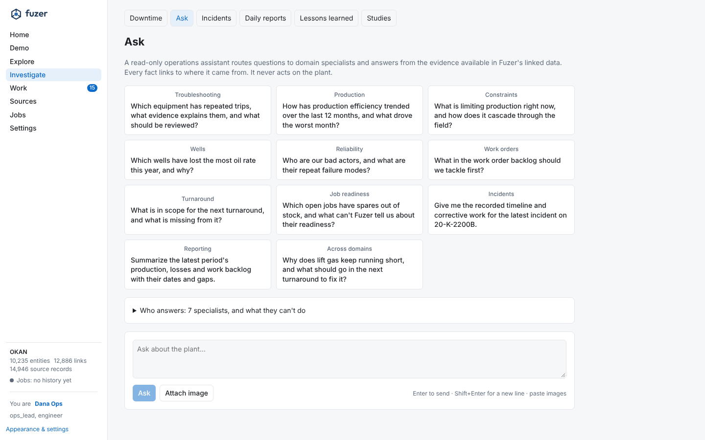

# Agents and capabilities

The operations assistant, its domain specialists, persona coverage, skills and tools.

## Operations assistant

{ loading=lazy }
A team of agents built with `create_harness_agent` from Microsoft Agent Framework (MAF), using the
provider selected by `agents.provider` (`anthropic` by default; `openai`, `azure_openai` and `ollama`
are also supported):

- **Orchestrator.** Answers simple lookups and routes domain work to specialists as MAF
  *background agents*, which may run at the same time. It synthesizes cited findings using its
  `answering` skill and never gives plant-operating instructions.
- **Seven domain specialists.** Production & Surveillance; Wells & Subsurface; Field Operations &
  Facilities; Maintenance & Integrity; Work Management & Supply Chain; HSE & Incident Management;
  Asset Performance & Reporting. The complete persona-to-domain, skill ownership, tool, evidence
  prerequisite, output, limitation and human-decision matrix is generated in
  [capabilities](capabilities.md) from the central registry.

  Skills are reused across roles when their evidence and methods fit; a role does not imply its
  sources are configured. All specialists are read-only and report unknown or unsupported inputs. The orchestrator can draft work for a person's queue with `draft_work_item`; see [workflow](workflow.md#work-the-assistant-proposes).
- **Tools** are the MCP server's functions called in-process, so outside MCP clients see the same
  tool surface. They run in threads so concurrent specialists don't block each other. Asset-wide
  questions use `operations.py`: production summary and PE, deferment Pareto, constraints with
  trend and cascade causes, well-test performance, bad actors and MTBF, work order backlog, PM and
  inspection compliance, and turnaround scope. All are read-only, compact, and dated from the data's
  latest daily report.
- **Provider settings.** `agents.model` selects the orchestrator model and
  `agents.specialist_model` for the specialists; effort is `high` for the orchestrator and `medium`
  for the specialists. Each answer reports calls, tokens and cost per model, as the API reports the
  serving model; a model missing from `pricing.py` is flagged as unpriced. Anthropic prompt caching
  and server-side refusal fallback are provider-specific; `agents.fallbacks` controls the latter.
  Install `uv sync --extra openai` to use OpenAI, Azure OpenAI or Ollama. `agents.base_url` sets a
  custom endpoint and `agents.api_key` stores an environment-variable reference, not a key value.
  Ollama defaults to `http://localhost:11434/v1` and needs no API key. Anthropic's adapter uses its
  default adaptive thinking; supported OpenAI reasoning models receive the configured effort. Web search and file memory are
  off. The agent framework is a core dependency. `agent-framework-anthropic` still declares `anthropic<2`, so a uv override keeps Fuzer's 2.x
  SDK; the tests run the adapter against it.
- **Surfaces.** `fuzer ask` / `fuzer chat`, and the Ask page. The page uses `/assistant/ask`, which
  starts a background job, and polls `/assistant/jobs/{id}` to show which agent is calling which
  tool. Every answer is stored in `assistant_answer` with its tools, tokens and cost, and engineers
  rate it through `feedback` (`answer:<id>`).
- **Conversations** are kept in Postgres (`agents/history.py`, #93), so they survive a restart and a
  follow-up can carry on after one. A MAF history provider writes each message to `assistant_message`
  as MAF serialises it, in a `json` column (not `jsonb`) so provider-specific history comes back byte for
  byte, which a follow-up needs. Attached images are stored once per conversation in `assistant_image`
  and referenced from the messages. `assistant_conversation` holds each conversation's asker, title and
  dates. The Ask page lists your recent conversations and reopens one (`/assistant/conversations`).
  The setting `assistant.retention_days` (0 keeps everything) removes conversations idle that long,
  with their messages, images and answers.
- **Memory** (`agents/memory.py`, #93) follows Graphiti / Zep (arXiv 2501.13956) in Postgres. Answers in
  `assistant_answer` are the episodes. When an answer is rated useful (after the rating's response), or an
  engineer marks a statement "Remember this", one low-effort Claude call extracts at most eight short facts
  into `assistant_fact`. Each fact has its entities, the period it holds in the plant (`valid_from` /
  `valid_to`, often open), `learned_at`, and its sources (the answer and the records it cited). The same call
  sees the current facts on the answer's entities and names the ones each new fact replaces. A replaced fact
  that shares an entity with the new one is ended (`status` 'ended', `valid_to`, `invalidated_by`), never
  deleted. Facts that read as reusable lessons also go to the lessons review queue as suggestions. Rating
  an answer not useful drops the facts learned from it that no engineer has touched.
- **Recall.** For the entities a question names (`link_text`), the current facts about them and their
  units go in a "Known from earlier conversations" block. The block is added to the user's turn after the
  question, so it never changes the history prefix that Claude's thinking blocks are bound to. Answers
  cite facts as `fact:<id>`, learned from a conversation. `recall(ref)` gives more, and
  `assistant_answer.recalled` records which facts each question got. The entity page's "What the
  assistant remembers" lets engineers correct, end or delete facts (`/assistant/facts`). Everyone
  sees everything for now; group access follows #29.
- **Quality.** `fuzer eval --agents` asks the questions in `answer_keys/assistant.json` (each
  domain, across domains, missing data and escalation, on Okan). It scores the facts each answer must name, citations,
  absence of operating instructions, and routing to specialists, with cost and time per answer.
  Tests drive the whole team with a scripted fake SDK client (no network).
- **Charts.** Each chart is a tool (`plot_*`, `src/fuzer/plots/`): the server reads the data
  (measurements, the time-series provider, operations queries), runs any fit (Arps decline after the
  last step change, the gas lift curve with decline taken out and failed-valve tests left out, CML
  loss rates, Weibull by median ranks, Crow-AMSAA, Pearson and lagged correlation) and stores a Plotly
  figure in `assistant_figure`. The agent gets an id, a `[[figure:<id>]]` marker and a summary of a few
  hundred tokens with the exact numbers, never the arrays; specialists pass markers up and the
  orchestrator keeps the useful ones. Specs come only from server code, from allow-listed trace types,
  and are checked again before storing (no HTML beyond plain formatting, no images, scripts or links;
  20k points at most). The browser loads plotly.js (cartesian bundle, its own 1.4 MB chunk) only when
  an answer has a chart and applies the page theme. `plot_custom` takes small inline data the agent
  worked out, labelled as assistant-entered. `look_at_figure` renders a stored figure to PNG
  (matplotlib, no browser) as an image in the tool result, only when the summary isn't enough; the eval
  counts how often it's used. Users can attach up to four images to a question; values read off them
  are reported as approximate. Pump and choke charts need an OEM curve for that model. Not yet:
  vibration spectra (overall mm/s comes from PI; there is no condition-monitoring source), and process
  values that move together in the synthetic historian, so correlation and XY charts on the demo show
  how the generator shapes upsets rather than plant physics.

## Migration and coverage boundaries

The generated [catalog](capabilities.md) has the agents, routing, the persona matrix, every skill with its owner,
data, output and human boundary, and what no agent can do yet. `src/fuzer/agents/capabilities/catalog.py` holds that
data. An agent's prompt is built from its entry, so its limits and human decisions reach the model; the
same entry feeds the docs and the Ask page (`/assistant/agents`). Tools are declared once by `@capability`, naming
their domains; there is no mapping from old agent names.

| Was | Now |
|---|---|
| `troubleshooter` agent | Unit and upset diagnosis: Field Operations & Facilities. Failure history: Maintenance & Integrity. Incident records: HSE & Incident Management. |
| `production` agent | Production & Surveillance. Well questions go to Wells & Subsurface, with its own tool set. |
| `maintenance` agent | Maintenance & Integrity. Backlog, turnaround and spares planning go to Work Management & Supply Chain. |
| `troubleshooter/troubleshooting` | `field-operations-facilities/troubleshooting` |
| `production/*` | `production-surveillance/*`; `gas-lift` and `production-engineering` are reused by Wells & Subsurface, `constraint-management` and `back-pressure` by Field Operations & Facilities |
| `maintenance/reliability` | `maintenance-integrity/reliability` |
| `maintenance/turnarounds`, `maintenance/work-orders` | `work-management-supply-chain/*`, reused by Maintenance & Integrity |
| `orchestrator/answering`, `shared/charts` | Unchanged |

New skills: `well-review`, `shift-handover`, `alarms-and-instruments`, `integrity`, `job-readiness`,
`incident-evidence`, `operations-summary` and the shared `analysis`. New charts: `plot_backlog`, `plot_compliance`.

**Conversations and workflows.** Saved conversations keep the agent ids they were asked under, and the Ask page shows
the old ones as plain words. New processes and the built-in `upset` process use domain agent roles. `schema.sql` adds
those roles to databases that already have roles. The retired roles `troubleshooter`, `production` and `maintenance`
stay valid so steps in flight on published versions finish; the worker maps them to their domain agents and the
modeler no longer offers them.

**Personas.** The Data Scientist / Operations Research Analyst persona uses the shared `analysis` skill through the
domain agents, not an extra agent. Data Steward / Platform Administrator stays in platform administration,
Sources/Settings/Jobs and governance workflows. No platform permission comes with persona coverage.

**Limits.** Only current data-backed methods are enabled. Every numeric claim needs loaded evidence with units, time
range and provenance. Every stored chart reports `coverage` in its summary: the dates it spans, its points, how many
are missing, how many records back it and whose numbers they are. Synthetic time-series data is labeled as
synthetic. Agents organize evidence and propose questions; they don't authorize or execute field, control,
maintenance, HSE, emergency, schedule, resource or commercial decisions.

**The human-decision boundary is the server's (P4.4).** Every tool a domain agent holds is read-only; the work tools
are MCP-only and act through the engine as the agent. The engine refuses an agent setting the data a person decides
(`decision`, `approved`, `approval`, `approved_by`, `disposition`), any field on a person step's form, or any key a
person has already set on the process, whether it arrives as a step result, through the worker or as a message. A
worker whose agent crosses it hands the step to a person with the reason. `tests/agents/test_agent_boundary.py` and
the boundary tests in `tests/workflow/test_workflow.py` hold this.

`fuzer eval --agents` is the check on routing: its keys name the expected domain per question, including
missing-data and escalation cases. Offline tests prove what reaches each agent, not how well Claude routes.

### Adding a persona, skill or capability

[Extend Fuzer](extend.md#add-an-agent-skill) walks through a skill end to end.

- **Persona:** add it to its owning `AgentDefinition` in `catalog.py`, and to at least one `SkillDefinition`.
- **Skill:** add `skills/<owning-agent>/<name>/SKILL.md` and a `SkillDefinition` with its agents (owner first),
  personas, data, output and boundary. Name tools in backticks; the catalog reads them from there. Every agent that
  loads the skill must have those tools.
- **Tool:** declare it with `@capability` and the domains that can act on its evidence.
- **Waiting for a source:** add it to `UNAVAILABLE` rather than a skill that estimates.

Then run `uv run pytest tests/agents` and `uv run python -m fuzer.agents.capabilities > docs/capabilities.md`.
Add new analysis only when current data and validation support it.

## The agentic watch (in shadow)

`ops/watch.py` (P3.3a, #931) is an agent that reads one process area at a time, the way an engineer scans the day,
and proposes what looks unusual that no detector raised. It is shown the stretches the area's own multivariate model
can't explain (read below the multivariate detector's bar), the detections and open exceptions already there, the
alarms, the operator log and the maintenance notifications, each with an id to cite. Each proposal says why it is
unusual, cites its evidence and says what it ruled out. A proposal on something a detection already covers is
dropped, and one that cites an id it wasn't shown is marked uncited.

In wave 4 it runs in shadow: proposals are kept in `watch_proposal` and scored on replay (P3.3b), never routed, so
no exception and no case come from it. Each run has a spend cap (`watch.max_usd`) and reads up to `watch.max_areas`
areas. With no model provider configured the watch is off and says so, and nothing else changes. Live mode, where a
proposal becomes an agentic finding that always goes to a person for triage, is wave 5.

`evals/watch_eval.py` (P3.3b) scores it in shadow on a fake plant's history. The SRE scan runs over the period first,
so the watch sees what the rules found, then the watch reads it a day at a time. Each injected upset is caught if a
detection or an exception landed on one of its units within it, and uncaught otherwise. A proposal matches an upset
when what it names or cites is on one of the upset's units and its time overlaps. The scores per bundle are the share
of proposals matching an uncaught upset (the bar is half), precision (matching any upset), recall over the uncaught
upsets and the share fully cited. They are kept in `ops_eval` as `shadow:watch` and shown on the Detection page. CI
tests the wiring with a scripted model; a live score needs a provider key and is run by hand with
`fuzer eval --watch --since ... --until ...`.

**From confirmed findings to a rule (P3.4).** A person confirms or rejects a proposal; on replay the fake plant's events
do (`watch_eval.judge`). A confirmed proposal is read into a pattern: the measurement role of the point it names, its
equipment class and which way the value moved against the week before, with how far and for how long. Once
`watch.promote_after` proposals of one pattern are confirmed, `ops/promote.py` drafts a deterministic rule: points of
that role on that class whose average over a fitted duration moves past a fitted threshold (0.8 of the smallest confirmed
shift), scored on the bundle's replay. A person, never an agent, publishes it, and it runs as the `promoted_rules`
window detector in the SRE scan. The watch then leaves alone a stretch on equipment a detection covers (or one of its
train), so once the rule catches the pattern the question isn't asked and nothing is spent. On Okan,
`tests/ops/test_promote.py` takes 20-K-2300A's discharge temperature climbing before its 2024 trips to a published rule
that catches the held-out July 2025 trip. The alarm limits catch that climb too, so on a full scan the watch already
leaves it alone: the test shows the promotion with the rule as the only detector.

On the Detection page (Settings), **Watch findings and promoted rules** lists the latest proposals with Confirm and
Reject, the patterns with how many are confirmed against how many are needed and a Draft button once there are enough,
and each rule with its fit, its replay score and who drafted, published or retired it. Publishing or retiring takes a
reason, and the server refuses an agent either. A draft made on the page is unscored, because the replay is an eval:
`fuzer eval --promoted --since … --until …` scores each unscored draft on the bundle and the page shows it. A person's
verdict names no event kind, so that score counts every upset in the window, not only the pattern's kind. On a real asset
there is no replay, and the reviewer has the confirmed examples and the fit to go on.

## How detection and agents are performing

Work performance (`#/performance`) has a **By detector** view (P7.4a, `ops/earning.py`). Each case is put down to the
registered detector behind it, the same way the close-outs on the Detection page are (`ops/tuning.py`). Per detector
it shows:

- the cases raised and how many are closed out, with their confirmed and false-alarm rates;
- the median hours from the start of what was found to the case opening;
- the value at stake on the cases confirmed as a real problem, where a case carries one;
- whether the confirmed cases were found by a rule, an agent or another system.

A detector is **earning its keep** when most of its close-outs are confirmed. It **needs tuning** when at least
`earning.MIN_CLOSED` (5) cases are closed out and half or more of them are false alarms or duplicates. Below five
close-outs the view says there are too few to tell. Each count opens its cases. **Tuning proposed** opens the case of
a tuning proposal open for the detector (P6.3b); otherwise **Tune** opens the detector on the Detection page. A case whose finding records no origin counts as "not recorded". On a bundle, cases raised from
replayed history open at the wall-clock time, so hours to case means something only on live data.

The **By skill** view (P7.4b, `agents/earning.py`) covers each skill a specialist owns. Shared skills are loaded by
every agent, so nothing counts against them. Per skill it shows:

- the case briefs its pack wrote and their agent cost per case;
- how far the person who decided followed each brief's proposal (the latest verdict: yes, partly or no);
- how engineers rated the assistant answers its specialist worked on. As with the shortfalls (P6.4a), an answer counts
  against every skill its specialists own;
- its published versions, and a drafted change waiting for review, linked to the case that holds the review.

A skill **needs a change** when at least `MIN_RATED` (5) of its briefs and answers have a verdict and half or more fell
short. It is **earning its keep** under a quarter. Below it, a card gives each specialist's agent steps, the cases they
were on and the spend per case, from the ledgers (P4.4).

## Views and agent tools

**Charts:**
- `plot_propagation(upset)`: an SRE upset's units on a timeline of when each was first detected, with
  the plant model's links between them and the likely first cause starred. Train C's trip starts at
  20-V-2001.
- `plot_operating_window(point)`: the value against each limit, and the minutes outside per day.
- `plot_loss_waterfall(period)`: oil potential, then planned losses, unplanned losses by reason, losses
  no downtime record explains, then actual, priced with the pack's oil price.
- `plot_score_breakdown(ref)`: the #100 components, urgency and effort for one item.
- `plot_flare(period)`: daily flare from DAY001 and its CO2 per barrel, estimated at 2 t CO2 per kSm3.
  Fuel gas and venting aren't in DAY001.

**Tools (`cases.py`):**
- `compare_periods(ref, before, after)`: each point's median in two windows and the change. Welch's t,
  with each window's sample cut to its effective size for autocorrelation, says whether it is
  significant. It closes the loop on "did the fix work".
- `similar_cases(ref)`: past incidents like this one (an incident, an upset's incident, or a unit's
  latest), with the work orders done for each and whether the fix held (no incident on the unit within
  90 days).

## Tools

Every tool and the agents that use it: [capabilities](capabilities.md).
