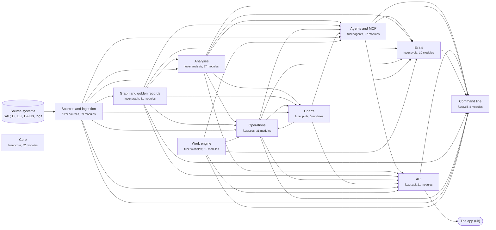
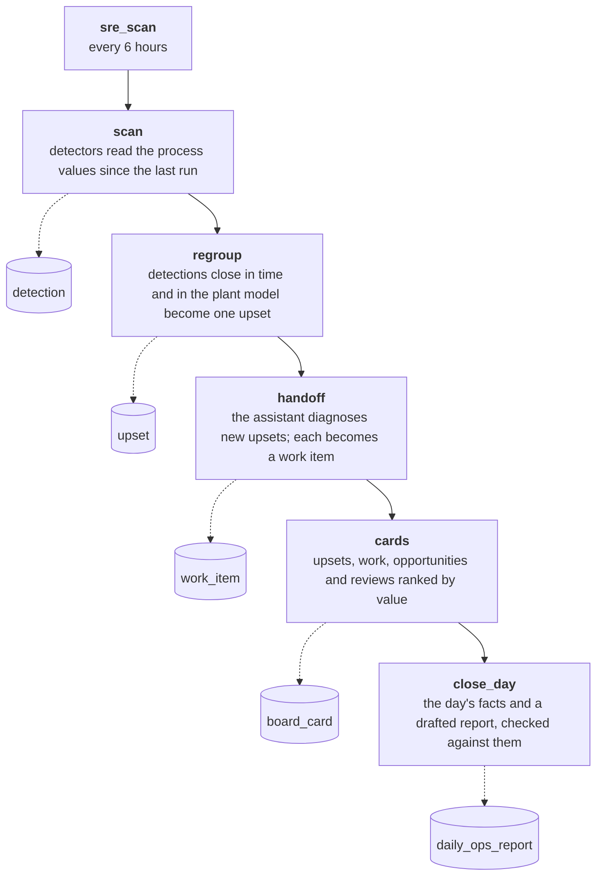

# Architecture

Generated from the code: package imports, mappings, the capability and settings registries, the schedules and the modules' `schema.sql`; don't edit by hand (`uv run python -m fuzer.reference`).
Each box is a package under `src/fuzer`; click one to open it. An arrow points from a package to the ones that use it, so data flows along the arrows. Everything uses core, so its arrows are left out.

## Components

## What feeds which entities

From the mapping files in `src/fuzer/mappings` (source → entity kind). Claude's reads of logs, drawings and documents add events, links and mentions on top.

```mermaid
flowchart LR
  src_accounting[/"accounting"/]
  src_adx[/"adx"/]
  src_ec[/"ec"/]
  src_edms[/"edms"/]
  src_gis[/"gis"/]
  src_inspection[/"inspection"/]
  src_jde[/"jde"/]
  src_maximo[/"maximo"/]
  src_moc[/"moc"/]
  src_oplog[/"oplog"/]
  src_pi[/"pi"/]
  src_pi_af[/"pi_af"/]
  src_pid[/"pid"/]
  src_ptw[/"ptw"/]
  src_rounds[/"rounds"/]
  src_safeguards[/"safeguards"/]
  src_sap[/"sap"/]
  src_teams[/"teams"/]
  kind_accounting_volume(["accounting_volume"])
  kind_bypass(["bypass"])
  kind_change(["change"])
  kind_conversation(["conversation"])
  kind_demand(["demand"])
  kind_document(["document"])
  kind_document_section(["document_section"])
  kind_downtime(["downtime"])
  kind_equipment(["equipment"])
  kind_isolation(["isolation"])
  kind_ledger_entry(["ledger_entry"])
  kind_log_entry(["log_entry"])
  kind_maintenance_plan(["maintenance_plan"])
  kind_material(["material"])
  kind_notification(["notification"])
  kind_permit(["permit"])
  kind_pipeline(["pipeline"])
  kind_pipeline_feature(["pipeline_feature"])
  kind_pipeline_segment(["pipeline_segment"])
  kind_plant_hierarchy__facility__area__tag__well(["plant hierarchy: facility, area, tag, well"])
  kind_production_day(["production_day"])
  kind_purchase_order(["purchase_order"])
  kind_round_point(["round_point"])
  kind_safeguard(["safeguard"])
  kind_timeseries(["timeseries"])
  kind_well(["well"])
  kind_well_test(["well_test"])
  kind_work_center(["work_center"])
  kind_work_order(["work_order"])
  src_accounting --> kind_accounting_volume
  src_accounting --> kind_ledger_entry
  src_adx --> kind_timeseries
  src_ec --> kind_downtime
  src_ec --> kind_plant_hierarchy__facility__area__tag__well
  src_ec --> kind_production_day
  src_ec --> kind_well_test
  src_edms --> kind_document
  src_edms --> kind_document_section
  src_gis --> kind_pipeline
  src_gis --> kind_pipeline_segment
  src_gis --> kind_plant_hierarchy__facility__area__tag__well
  src_gis --> kind_well
  src_inspection --> kind_pipeline_feature
  src_jde --> kind_equipment
  src_maximo --> kind_equipment
  src_moc --> kind_change
  src_oplog --> kind_log_entry
  src_pi --> kind_timeseries
  src_pi_af --> kind_plant_hierarchy__facility__area__tag__well
  src_pid --> kind_document
  src_ptw --> kind_isolation
  src_ptw --> kind_permit
  src_rounds --> kind_round_point
  src_safeguards --> kind_bypass
  src_safeguards --> kind_demand
  src_safeguards --> kind_safeguard
  src_sap --> kind_equipment
  src_sap --> kind_maintenance_plan
  src_sap --> kind_material
  src_sap --> kind_notification
  src_sap --> kind_plant_hierarchy__facility__area__tag__well
  src_sap --> kind_purchase_order
  src_sap --> kind_work_center
  src_sap --> kind_work_order
  src_teams --> kind_conversation
```

## A scheduled scan, start to finish

## Scheduled jobs

| Job | When (cron) | What it does |
|---|---|---|
| `refresh_logs` | `0 * * * *` | Load the operator logs and rebuild. |
| `refresh_all` | `0 2 * * *` | Load every export and rebuild. |
| `claude_reading` | `0 3 * * *` | Claude reads new log entries and drawings (costs money). |
| `work_tick` | `*/5 * * * *` | Work engine timers and SLAs: re-checks that are due, reminders and escalations. |
| `work_notify` | `* * * * *` | Notifications: work sent, handed back, escalated or coming due, told to the person within a minute. |
| `writeback_run` | `* * * * *` | Write-backs: approved changes sent to source systems by their cadence; nothing unapproved. |
| `closeout_sweep` | `*/5 * * * *` | Close-out: ask whether a fix held when its re-check is due; reopen a case whose problem returned. |
| `sre_scan` | `0 */6 * * *` | SRE every 6 hours: detect, group into upsets, prioritise, diagnose (capped) and hand off. |
| `studies_job` | `*/5 * * * *` | Big correlation and clustering studies, queued from the API or an agent. |
| `day_close` | `0 7 * * *` | Daily operations report: facts from the day's records, a new version when they change, the ops lead's review in the workflow (the reporter agent drafts it). |
| `source_health` | `*/30 * * * *` | Source health: stale data, failed or held loads, failing checks -> exceptions, cases and alerts. |
| `providers_poll` | `*/15 * * * *` | Detection providers: polled alert tables read when changed -> findings joined to cases. |
| `detect_5min` | `*/5 * * * *` | Detectors every 5min: each from its own watermark (P3.2). |
| `detect_30min` | `*/30 * * * *` | Detectors every 30min: each from its own watermark (P3.2). |
| `detect_hourly` | `7 * * * *` | Detectors every hourly: each from its own watermark (P3.2). |
| `detect_6h` | `20 */6 * * *` | Detectors every 6h: each from its own watermark (P3.2). |
| `detect_daily` | `40 2 * * *` | Detectors every daily: each from its own watermark (P3.2). |

## Each component

### Sources and ingestion

The source catalog (systems, connections, datasets, mapping versions, runs) drives loading; connectors read each table; mappings turn rows into records, entities and links; Claude reads logs, P&IDs and documents. More in [sources](sources.md).

- **Code:** [`src/fuzer/sources`](https://github.com/areed145/fuzer/tree/main/src/fuzer/sources): `_catalog_common`, `_catalog_entities`, `_catalog_io`, `_catalog_packs`, `_catalog_versions`, `adx`, `alerts`, `aliases`, `catalog`, `connections`, `connectors`, `curves`, `dexpi`, `documents`, `extract`, `formats`, `impact`, `ingest`, `instruments`, `learned`, `llm_curves`, `llm_docs`, `llm_pids`, `mapper`, `mappings`, `onboard`, `packs`, `pi_web_api`, `preview`, `process_model`, `providers`, `quality`, `relative_dates`, `rules`, `scorecard`, `suggest`, `teams`, `timeseries`, `workflows`
- **Uses:** core
- **Writes:** `curve_digitised`, `detection_provider`, `entity_alias`, `learned_rule`, `llm_extraction`, `mapping_version`, `provider_poll`, `provider_trust`, `review_item`, `source_audit`, `source_check`, `source_check_result`, `source_connection`, `source_dataset`, `source_exception_rule`, `source_match_stat`, `source_profile`, `source_record`, `source_record_history`, `source_rule`, `source_run`, `source_score`, `source_system` ([schema](schema.md))
- **Owns:** `source_record`, `llm_extraction`, `source_record_history`, `source_system`, `source_connection`, `source_dataset`, `mapping_version`, `source_run`, `source_profile`, `source_check`, `source_check_result`, `source_match_stat`, `source_score`, `source_rule`, `source_audit`, `equipment_curve`, `curve_digitised`, `source_exception_rule`, `entity_alias`, `learned_rule`, `detection_provider`, `provider_poll`, `provider_trust` (its `schema.sql`)
- **Settings:** `providers.triage_role` ([settings](settings.md))
- **Tests:** [`tests/sources`](https://github.com/areed145/fuzer/tree/main/tests/sources)

### Graph and golden records

Resolves records into one entity per real thing, links them, and answers queries over the graph. More in [identity](identity.md).

- **Code:** [`src/fuzer/graph`](https://github.com/areed145/fuzer/tree/main/src/fuzer/graph): `calibration`, `contextualized`, `criticality`, `curation`, `data_work`, `edges`, `gaps`, `golden`, `incidents`, `investigation`, `knowledge`, `lessons`, `llm_links`, `measurements`, `ontology`, `operations`, `placement`, `positions`, `proposals`, `quality`, `queries.documents`, `queries.downtime`, `queries.maintenance`, `queries.network`, `queries.records`, `resolve`, `review`, `roles`, `spatial`, `structure`, `topology`
- **Uses:** core, sources
- **Writes:** `assertion`, `crosswalk`, `edge`, `entity`, `geo_index`, `golden`, `id_event`, `lesson`, `lesson_history`, `llm_extraction`, `match_calibration`, `match_score`, `measurement_role`, `measurement_role_pin`, `ontology_kind`, `ontology_relation`, `pinned_link`, `placement_decision`, `register_summary`, `review_item`, `review_rule`, `reviewed_value`, `source_dataset`, `source_new_record`, `steward_fix`, `steward_proposal`, `unlinked` ([schema](schema.md))
- **Owns:** `entity`, `id_event`, `crosswalk`, `entity_key`, `entity_label`, `register_summary`, `assertion`, `golden`, `edge`, `unlinked`, `placement_decision`, `review_item`, `pinned_link`, `review_rule`, `match_score`, `match_calibration`, `reviewed_value`, `source_new_record`, `knowledge_index`, `lesson`, `lesson_history`, `value_ranking`, `feedback`, `geo_index`, `measurement`, `measurement_role`, `measurement_role_pin`, `steward_fix`, `steward_proposal` (its `schema.sql`)
- **Settings:** `stewardship.bulk_accept_at` ([settings](settings.md))
- **Tests:** [`tests/graph`](https://github.com/areed145/fuzer/tree/main/tests/graph)

### Analyses

Signals, limits, calcs, hydraulics, studies and clustering over the graph and the process values. More in [analyses](analyses.md).

- **Code:** [`src/fuzer/analysis`](https://github.com/areed145/fuzer/tree/main/src/fuzer/analysis): `accounting`, `alarm_journal`, `alarm_performance`, `alarms`, `backlog`, `calcs`, `capacity_bounds`, `cases`, `clusters`, `completeness`, `compression`, `condition`, `costs`, `drivers`, `equipment`, `facilities`, `flare`, `flare_review`, `flow_capacity`, `forecast`, `forecast_actual`, `gas_balance`, `gas_lift`, `gas_lift_stability`, `hydraulics`, `ili`, `incident_followup`, `integrity`, `interventions`, `kpis`, `ldar`, `limits`, `loops`, `metering`, `production_efficiency`, `prognosis`, `protection`, `quality`, `quality_trend`, `recip`, `record_quality`, `records`, `reservoir_pressure`, `rotating`, `signals`, `spares`, `studies`, `surveillance`, `treating`, `trips`, `value`, `values`, `water_injection`, `well_diagnostics`, `well_test_factor`, `well_tests`, `work_execution`
- **Uses:** core, graph, sources
- **Writes:** `debottleneck_option`, `excursion`, `point_normal` ([schema](schema.md))
- **Owns:** `point_limit`, `point_normal`, `excursion`, `debottleneck_option` (its `schema.sql`)
- **Settings:** `alarms.failed_start_minutes`, `alarms.flood_per_10min`, `alarms.standing_hours`, `alarms.target_per_hour`, `records.log_tolerance_hours`, `records.lookback_days`, `records.notification_categories`, `records.notification_tolerance_days`, `sre.hops`, `studies.max_points`, `studies.max_values`, `studies.workers` ([settings](settings.md))
- **Tests:** [`tests/analysis`](https://github.com/areed145/fuzer/tree/main/tests/analysis)

### Operations

The scheduled loop: SRE detection and grouping, hand-off, the board, daily reports, opportunities and studies. More in [workflow](workflow.md).

- **Code:** [`src/fuzer/ops`](https://github.com/areed145/fuzer/tree/main/src/fuzer/ops): `around`, `at_risk`, `board`, `cadence`, `cascades`, `closeout`, `corrections`, `daily_report`, `disposition`, `exceptions`, `fleet`, `handover`, `intake`, `jobs`, `metrics`, `opportunities`, `performance`, `pipeline`, `plan`, `readiness`, `rounds`, `routing`, `safeguards`, `simops`, `skill_review`, `sre`, `sre_handoff`, `study`, `suppression`, `turnaround`, `writeback`
- **Uses:** analysis, core, graph, plots, sources, workflow
- **Writes:** `board_card`, `board_history`, `board_pin`, `board_project`, `case_disposition`, `case_repeat`, `daily_ops_report`, `detection`, `detector_tier_run`, `exception_kind`, `exception_record`, `field_photo`, `measurement`, `opportunity`, `plan_item`, `point_baseline`, `register_summary`, `review_item`, `round_reading`, `round_run`, `shift_handover`, `source_closeout`, `source_correction`, `sre_run`, `sre_suppress`, `study`, `suppressed_finding`, `suppression`, `upset`, `work_item`, `writeback`, `writeback_event` ([schema](schema.md))
- **Owns:** `sre_run`, `detector_run`, `detector_tier_run`, `detection`, `point_baseline`, `upset`, `sre_suppress`, `board_card`, `board_pin`, `board_history`, `board_project`, `daily_ops_report`, `opportunity`, `study`, `exception_record`, `field_photo`, `exception_kind`, `suppression`, `suppressed_finding`, `plan_item`, `source_closeout`, `shift_handover`, `writeback`, `writeback_event`, `source_correction`, `case_disposition`, `case_repeat`, `round_run`, `round_reading` (its `schema.sql`)
- **Settings:** `closeout.apply_to_exports`, `closeout.recheck_days`, `daily_report.close_cron`, `daily_report.mover_pct`, `detectors.cadence`, `exceptions.around_after_hours`, `exceptions.around_before_hours`, `exceptions.join_hours`, `exceptions.max_shelve_days`, `exceptions.suppress_planned_work`, `handover.shift_times`, `intake.sap_notifications`, `intake.sap_notifications.due_hours`, `intake.sap_notifications.max_age_days`, `opportunities.gas_lift_breakeven`, `opportunities.material`, `opportunities.stale_days`, `readiness.permit_types`, `sre.drift_rise`, `sre.group_gap_hours`, `sre.handoff.max_diagnoses`, `sre.handoff.max_usd`, `sre.handoff.min_detections`, `sre.hops`, `sre.learned_minutes`, `sre.lookback_hours`, `sre.merge_minutes`, `sre.spe_minutes`, `sre.step_minutes`, `studies.max_values` ([settings](settings.md))
- **Tests:** [`tests/ops`](https://github.com/areed145/fuzer/tree/main/tests/ops)

### Charts

Interactive charts the agents and the app build from Fuzer data. More in [agents](agents.md).

- **Code:** [`src/fuzer/plots`](https://github.com/areed145/fuzer/tree/main/src/fuzer/plots): `analytics`, `general`, `maintenance`, `production`, `troubleshooting`
- **Uses:** analysis, core, graph, ops, sources
- **Writes:** `assistant_figure` ([schema](schema.md))
- **Owns:** `assistant_figure` (its `schema.sql`)
- **Tests:** [`tests/plots`](https://github.com/areed145/fuzer/tree/main/tests/plots)

### Work engine

BPMN processes that move work between agents and people. More in [workflow](workflow.md).

- **Code:** [`src/fuzer/workflow`](https://github.com/areed145/fuzer/tree/main/src/fuzer/workflow): `assignment`, `bpmn`, `canvas`, `conformance`, `definitions`, `engine`, `home`, `model_changes`, `notify`, `operating_model`, `roles`, `runtime`, `views`, `work_drafts`, `work_items`
- **Uses:** core
- **Writes:** `exception_kind`, `operating_model_applied`, `operating_model_deviation`, `work_definition`, `work_draft`, `work_event`, `work_form`, `work_home_seen`, `work_item`, `work_notification`, `work_notify_cursor`, `work_notify_pref`, `work_person`, `work_process`, `work_role`, `work_token`, `work_view`, `work_watch` ([schema](schema.md))
- **Owns:** `work_definition`, `work_form`, `work_person`, `work_person_cover`, `work_role`, `work_item`, `work_draft`, `work_process`, `work_token`, `work_event`, `work_notification`, `work_notify_cursor`, `work_notify_pref`, `work_home_seen`, `work_watch`, `work_view`, `operating_model_applied`, `operating_model_deviation`, `operating_model_version`, `operating_model_rollout` (its `schema.sql`)
- **Settings:** `notify.app_url`, `notify.from`, `work.agent_fallback_minutes`, `work.due_soon_minutes` ([settings](settings.md))
- **Tests:** [`tests/workflow`](https://github.com/areed145/fuzer/tree/main/tests/workflow)

### Agents and MCP

The operations assistant, its specialists, and the MCP server with their tools. More in [agents](agents.md).

- **Code:** [`src/fuzer/agents`](https://github.com/areed145/fuzer/tree/main/src/fuzer/agents): `assistant`, `brief`, `capabilities.__main__`, `capabilities.catalog`, `capabilities.graph`, `capabilities.maintenance`, `capabilities.metrics`, `capabilities.operations`, `capabilities.plots`, `capabilities.production`, `capabilities.sources`, `capabilities.studies`, `capabilities.troubleshooting`, `capabilities.work`, `context`, `history`, `ledger`, `mcp_server`, `memory`, `packs`, `service`, `shortfalls`, `skill_drafts`, `skill_gate`, `skill_versions`, `worker`, `workflow`
- **Uses:** analysis, core, graph, ops, plots, sources, workflow
- **Writes:** `assistant_answer`, `assistant_conversation`, `assistant_fact`, `assistant_image`, `assistant_message`, `lesson`, `skill_version`, `work_event`, `work_token` ([schema](schema.md))
- **Owns:** `assistant_answer`, `assistant_conversation`, `assistant_message`, `assistant_image`, `assistant_fact`, `skill_version` (its `schema.sql`)
- **Settings:** `agents.brief_cap_usd`, `agents.briefs`, `agents.case_cap_usd`, `agents.effort`, `agents.fallbacks`, `agents.model`, `agents.provider`, `agents.skill_drafts`, `agents.specialist_effort`, `agents.specialist_model`, `assistant.concurrent_questions`, `assistant.retention_days`, `assistant.timeout_seconds`, `work.lease_seconds` ([settings](settings.md))
- **Tools:** asset-performance-reporting 50, field-operations-facilities 88, hse-incident-management 50, maintenance-integrity 80, orchestrator 23, production-surveillance 80, wells-subsurface 71, work-management-supply-chain 36 ([capabilities](capabilities.md))
- **Tests:** [`tests/agents`](https://github.com/areed145/fuzer/tree/main/tests/agents)

### Evals

Answer keys, the history replay and the ops eval that score it all. More in [evals](evals.md).

- **Code:** [`src/fuzer/evals`](https://github.com/areed145/fuzer/tree/main/src/fuzer/evals): `evaluate`, `loop`, `ops_eval`, `packs_eval`, `pid2graph`, `replay`, `roles`, `runs`, `steward_eval`, `sweep`
- **Uses:** agents, analysis, core, graph, ops, sources, workflow
- **Writes:** `assistant_answer`, `assistant_fact`, `golden`, `lesson`, `llm_extraction`, `ops_eval`, `point_normal`, `source_record`, `work_event`, `work_item` ([schema](schema.md))
- **Owns:** `ops_eval` (its `schema.sql`)
- **Settings:** `agents.model`, `opportunities.gas_lift_breakeven` ([settings](settings.md))
- **Tests:** [`tests/evals`](https://github.com/areed145/fuzer/tree/main/tests/evals)

### API

The HTTP API the app uses. More in [deployment](deployment.md).

- **Code:** [`src/fuzer/api`](https://github.com/areed145/fuzer/tree/main/src/fuzer/api): `assistant`, `auth`, `catalog`, `deps`, `entities`, `graph`, `home`, `hooks`, `investigation`, `jobs`, `knowledge`, `metrics`, `onboarding`, `ontology`, `ops`, `security`, `settings`, `sources`, `standards`, `stewardship`, `workflow`
- **Uses:** agents, analysis, core, graph, ops, plots, sources, workflow
- **Writes:** `access_login`, `access_session`, `feedback`, `pinned_link`, `value_ranking` ([schema](schema.md))
- **Settings:** `access.session_hours`, `agents.case_cap_usd`, `demo.enabled`, `notify.app_url` ([settings](settings.md))
- **Tests:** [`tests/api`](https://github.com/areed145/fuzer/tree/main/tests/api)

### Command line

The fuzer command: up, eval, settings and the rest. More in [cli](cli.md).

- **Code:** [`src/fuzer/cli`](https://github.com/areed145/fuzer/tree/main/src/fuzer/cli): `demo_seed`, `deploy`, `sources`, `up`
- **Uses:** agents, analysis, api, core, evals, graph, ops, sources, workflow
- **Writes:** `llm_extraction` ([schema](schema.md))
- **Tests:** [`tests/cli`](https://github.com/areed145/fuzer/tree/main/tests/cli)

### Core

Database, settings, projects and packs, Claude calls, tags and units: used by everything. More in [deployment](deployment.md).

- **Code:** [`src/fuzer/core`](https://github.com/areed145/fuzer/tree/main/src/fuzer/core): `access`, `assistant`, `audit`, `bugreports`, `bundles`, `capabilities`, `clock`, `db`, `detectors`, `events`, `exceptions`, `findings`, `gates`, `jsonsafe`, `labels`, `llm`, `methods`, `metrics`, `model`, `models`, `nel`, `ontology`, `pack`, `plan`, `pricing`, `projects`, `roles`, `settings`, `tags`, `taxonomy`, `units`, `work`
- **Uses:** nothing else in fuzer
- **Writes:** `access_account`, `access_area_grant`, `access_event`, `access_membership`, `access_project_grant`, `access_role`, `access_session`, `detector_run`, `event_outbox`, `gate_decision`, `gate_policy`, `ontology_audit`, `ontology_kind`, `ontology_relation`, `project`, `schema_version`, `setting`, `setting_history`, `work_person` ([schema](schema.md))
- **Owns:** `schema_version`, `access_account`, `access_role`, `access_membership`, `access_session`, `access_project_grant`, `access_area_grant`, `access_login`, `access_event`, `setting`, `setting_history`, `project`, `ontology_kind`, `ontology_relation`, `ontology_audit`, `event_outbox`, `gate_policy`, `gate_decision` (its `schema.sql`)
- **Settings:** `access.session_hours`, `llm.effort`, `llm.model`, `sre.handoff.max_usd` ([settings](settings.md))
- **Tests:** [`tests/core`](https://github.com/areed145/fuzer/tree/main/tests/core)
