# Fuzer design

Fuzer is our own version of the core of Cognite Data Fusion. It pulls asset data
from many systems, works out which records describe the same real thing, links
them into one graph, and serves that graph to apps, AI agents and engineers.

The first target is one medium offshore asset (20–60 wells, 50k–150k tags,
100k–300k PI points, a few thousand P&ID sheets). The core must not be specific
to offshore: onshore, midstream and downstream assets plug in as **asset packs**.

## Decisions

| Topic | Decision |
|---|---|
| Hosting | Azure, next to ADX. Login with Entra ID later. |
| Architecture | Postgres-first modular monolith. Seams left so we can add a lakehouse / graph DB later. |
| Equipment master | SAP S/4 is the long-term master. JDE and Maximo are legacy sources matched against it. |
| P&IDs | Mix of smart files, text PDFs and scanned images; each handled differently. |
| Time series | Stays in PI and ADX. Fuzer stores only metadata and pointers. |
| Matching | Sure matches merge on their own; unsure ones go to a review queue. Reviewer answers are pinned and survive reruns. |
| Source conflicts | Per-field priority rules, plus human review for fields we care about (manufacturer, model). |
| History | Links have `valid_from` / `valid_to`, so "what was true on date X" works. |
| AI | Claude, for messy text (operator logs) and hard P&ID images. Not in the first slice. |
| Access | Everyone signed in sees everything (for now). |
| Users | API for apps/dashboards, MCP server for AI agents, web UI for engineers. |
| Languages | Python backend, TypeScript/React web UI. |

## Big picture

```mermaid
flowchart LR
  subgraph SRC["Sources (fake exports today)"]
    direction TB
    ERP["SAP S/4, JDE, Maximo<br/>assets, notifications, work orders, materials"]
    PI["PI points, PI AF"]
    EC["Energy Components<br/>network, downtime, DAY001"]
    PID["P&ID sheets<br/>smart, text PDF, scans"]
    TXT["Operator logs"]
    DOC["Manuals, guides, procedures"]
  end

  subgraph PG["Postgres"]
    direction TB
    RAW[("source_record<br/>+ history")]
    LLM[("llm_extraction<br/>cached Claude readings")]
    REG[("entity, crosswalk, golden,<br/>edge, knowledge_index, lesson")]
    REV[("review_item, pinned_link,<br/>feedback")]
  end

  subgraph RB["Rebuild (no model calls)"]
    direction TB
    EXT["Extract<br/>pack grammars"] --> RES["Resolve<br/>match, stable IDs"]
    RES --> GOLD["Golden records"] --> TAX["ISO 14224 classes<br/>and models"]
    TAX --> GR["Graph links"] --> INC["Incidents"]
    INC --> KN["Knowledge index<br/>and lessons"]
  end

  SRC -->|"ingest (COPY)"| RAW
  RAW --> EXT
  LLM --> EXT
  KN --> REG
  REV <--> RES

  CL["Claude readers<br/>logs, comments, P&IDs, sections"]
  RAW -.->|"fuzer llm-link"| CL -.-> LLM

  TS["Time-series provider<br/>PI Web API, ADX or synthetic"]

  subgraph OUT["Users"]
    direction TB
    API["FastAPI"] --> UI["React web UI"]
    MCP["MCP server<br/>AI agents"]
  end
  REG --> API & MCP
  REV <--> API
  TS --> API & MCP

  DAG["Dagster<br/>sensor, schedules, checks"] -.->|"runs"| SRC
  DAG -.-> RB
  DAG -.-> CL
  PACK["Asset pack (YAML)<br/>+ ISO 14224 standard"] -.-> RB
```



The pipeline is: **land → extract → resolve → golden → taxonomy → graph →
incidents → knowledge → serve**.
Every step after landing can be rerun from scratch at any time. That is the
point: we can change matching rules and rerun without losing anything, because
raw data and reviewer decisions are kept separately.

## Key ideas

### 1. Tags are not equipment
A **tag** (functional location, e.g. `20-P-1001B`) is a position in the process.
**Equipment** is the physical item installed there (the pump with serial
`SN40123`). Pumps get swapped; the tag stays. Fuzer keeps them as separate
entities joined by an `installed_at` edge with dates. Mixing these up is the
most common cause of bad merges.

### 2. Tag grammar does most of the matching
Each asset pack defines how its tags are written. One parser reads all the
styles we see and turns them into one canonical key:

| Source | As written | Canonical key |
|---|---|---|
| SAP FLOC | `OSB-20-PT1001A` | `20-PT-1001A` |
| PI (new) | `OSB.20PT1001A.PV` | `20-PT-1001A` |
| PI (DCS) | `OSB:23-PT-1001A.DACA.PV` | `23-PT-1001A` |
| PI (legacy) | `27PT1001A_PV` | `27-PT-1001A` |
| JDE text | `OIL EXPORT PUMP - 27-P1001-A` | `27-P-1001A` |
| Maximo | `OSB/20/P-1001A` | `20-P-1001A` |
| P&ID bubble | `PT` / `1001A` on two lines | `27-PT-1001A` (area from sheet title) |

Wells get the same treatment (`A07`, `A-7`, `OSB_A-07` → `A-07`;
`A07A`, `A-07 ST1` → `A-07 ST1`).

### 3. Matching = exact keys first, then scoring
1. Records with the same kind and canonical key (tag key, well key, normalized
   serial number) merge automatically.
2. Equipment without a shared serial is compared with others **at the same
   tag** using manufacturer and description similarity.
   - score ≥ 0.90 → merge
   - 0.60–0.90 → review queue
   - below → leave apart
3. Two items at the same tag with different serials can never merge.
4. If one record could match two different things, it goes to review.

The scorer is small on purpose. When we need more power we swap in
[Splink](https://github.com/moj-analytical-services/splink) behind the same
interface.

### 4. Stable IDs
Fuzer gives every entity its own ID (`fz-tag-…`, `fz-equipment-…`) and keeps a
**crosswalk** from every source record to it. On rerun, each cluster keeps the
ID most of its members already had. When two clusters merge, the losing ID
points to the winner (`merged_into`). IDs are never reused. Every mint, merge
and split is logged in `id_event`.

### 5. Assertions → golden records
Every field from every source is stored as an **assertion** with where it came
from. The **golden record** is computed from assertions using per-field rules
in the asset pack:

```yaml
manufacturer: {priority: [review, sap, maximo, jde], review_on_conflict: true}
uom:          {priority: [review, pi, pi_af]}
```

If sources really disagree on a `review_on_conflict` field, a review item is
raised. A reviewer's choice is stored as an assertion with source `review`,
which always wins and survives reruns.

### 6. One graph, many views
All entities share one node table. Each "ontology" is a set of edge types:

| View | Edges | From |
|---|---|---|
| Physical | `part_of`, `installed_at`, `sidetrack_of` | SAP, PI AF |
| Flow / allocation | `flows_to` (dated) | Energy Components, later P&IDs |
| Data | `has_timeseries` | PI AF attributes, PI point names |
| Documents / text | `mentions` | P&IDs, operator logs |

Edges have `valid_from` / `valid_to`, so you can trace "which wells fed the
production separator on 2024-01-01".

### 7. Entity linking in text
Operator logs and P&ID text are scanned for:
- tags (tag grammar; area taken from context when missing),
- wells (well grammar),
- known phrases from the pack (`"test sep"` → `20-V-2002`).

A short tag like `PT-2001` exists in several areas; if it can't be pinned to one
it is left unlinked rather than guessed. Claude will later handle the hard
cases (pronouns, "the B pump", context from earlier entries).

### 8. Asset packs
Everything asset-specific lives in `src/fuzer/packs/<name>.yaml`: tag function
codes, area digits, well platforms, phrase aliases, matching thresholds and
survivorship rules. A new onshore or downstream asset is a new pack, not new
core code. `onshore_demo` (pads with hundreds of wells on ESPs, SAP + PI + EC
only, pattern-based well names like `RB 07-03H`, an ESP class the pack adds)
runs end to end on the same code as the offshore pack; `FUZER_PACK` selects the
pack for the API, MCP server and jobs.

### 9. Equipment classes and models (ISO 14224, CFIHOS)
`standards/iso14224.yaml` holds the ISO 14224 categories, equipment classes and
types, each with its CFIHOS class name (CFIHOS IDs to be filled from the RDL).
The asset pack's `classification` rules map local signals onto it: ISA function
letters, PI AF templates and description words to a class or type, plus
manufacturer spellings to one name. Packs can add classes (e.g. fired heaters
downstream) or point at another taxonomy file, without code changes.

After golden values are chosen, each tag is `classified_as` a class; equipment
takes the class of the position it's installed at and is an `instance_of` an
`equipment_model` (manufacturer + model), which `is_a` class. Facility, area,
tag and equipment carry their ISO 14224 taxonomy level and ISA-95 level. Models
and classes are where manuals, procedures and failure history attach.

Entity pages and agent tools return at most 100 (50 for agents) links per
relationship with the true total, so hubs like "Pumps" stay fast; members of a
class (including subtypes) or a model are listed with paging.

### 10. Maintenance history (ISO 14224 reliability codes)
SAP PM notifications and work orders become `notification` and `work_order`
entities that `concerns` the equipment (by SAP equipment number) and the tag;
work orders link `for_notification`. The standards file holds ISO 14224 failure
modes, failure mechanisms, failure causes and maintenance activities; the pack's
`maintenance_codes` maps the site's SAP catalog codes onto them. A notification on
a tag within 3 days of a logged event on that tag is linked `related_to` it (one
set-based statement). Failure history rolls up from a tag or piece of equipment
to every instance of its model and every member of its class.

### 11. Downtime and daily reports (Energy Components)
EC downtime / deferment records become `downtime` entities that `affects` a well
or the facility and are `caused_by` the tags named in their comment (rules, then
Claude), with duration and lost oil / gas. The pack maps EC reason codes to a
name and category; a record whose comment names equipment but whose reason is in
another category is flagged (`reason_check`, a Dagster check, a list in the UI).
Lost oil is ranked by causing tag, by the class of the causing equipment and by
reason. DAY001 daily reports become `daily_report` entities with their figures,
`reports_on` the facility and `mentions` what their comments name. Claude's text
reader covers operator logs, daily report comments and downtime comments, each
cached per record.

### 12. Incidents
Logged events (`involves`), downtime (`caused_by`) and notifications (`concerns`)
are signals on a tag; instrument tags roll up to the equipment tag they're
`part_of`. Signals on a unit within 3 days of each other form a group, and a
group with downtime or at least two kinds of signal becomes an `incident`
(`about` the unit, `includes` each signal) with lost oil, failure modes and
event types. Similar past incidents come from the same unit or class, ranked by
shared failure modes and event types. Teams threads (#22) will join as another
signal kind.

### 13. Documents
An EDMS-style export (manifest + files) is read into one `document` entity per
revision (number, revision, type, status, effective date) and one
`document_section` per section (heading, page, text), split on Markdown headings
or numbered PDF headings with page numbers kept; PDFs without a text layer are
flagged for OCR. Revisions link `supersedes`. EDMS metadata gives the first
links: an OEM manual `applies_to` its equipment model (manufacturer spellings
folded as for equipment), a procedure to its class, a guide to the tags it
references; sections `mentions` the tags in their text. A SharePoint / EDMS
connector replaces the folder later.

### 14. Scoped knowledge search
`knowledge_index` (kept by every rebuild) holds document sections and incidents
with a weighted full-text vector (headings over body) and the IDs each is linked
to. Searching "for" an entity works out its scope (the entity, the tag or
equipment it's installed at, its model, its classes up the hierarchy, its parent
tags and area) and keeps items linked to anything in it (one GIN array overlap).
Score = text rank x closeness (this tag > model > class > area) x authority (OEM
manual / procedure > site guide > past incident); questions match on any of
their words. Results are cited passages (document, revision, page, section,
snippet, why it applies). Superseded revisions are left out by default.
Sections carry the ISO 14224 failure modes they address: keyword rules in the
standards file (packs can add more), refined by an optional cached Claude reader
that can also narrow a section to one model / class / tag from its candidates.
Searches can boost a failure mode, and each incident gets suggested reading:
sections in scope of its unit that cover its failure modes.
Embeddings (pgvector) can be added beside full text once an embedding model is
chosen (an external service).

### 15. Lessons learned
Per equipment model (or class) and ISO 14224 failure mode, incidents with
corrective work orders draft a lesson: the corrective actions that were done,
how many incidents it rests on, and how often the fix held for 30 days, with the
incidents as evidence. Lessons live in their own table: engineers approve, edit
or reject them on the Lessons page, and rebuilds refresh only a draft's evidence
and numbers. Approved lessons join knowledge search (authority between site
guides and past incidents), scoped to their model or class. Teams thread
summaries (#22) will feed the same drafts.

### 16. Spare parts
SAP materials (manufacturer part number, stock, bin) and equipment BOMs: equipment
`uses_part` material. Document sections that name a manufacturer part number
`mentions` that material (one compiled pattern over all part numbers, one pass
over section text). Spares for a tag (via what's installed), equipment or model
list each part with stock (zero flagged), bin, how many units use it and the
manual sections naming it.

### 17. Piping from P&IDs
Smart P&IDs carry piping (DEXPI-style from / to / line number) and the Claude
drawing reader returns connections read off scans; both become directional
`pipes_to` links between tags, kept apart from Energy Components' `flows_to`
(allocation). The Network page switches between the two, flow traces can
follow either, and a comparison lists EC flows with no piping path on the P&IDs
and piping between EC nodes with no EC flow path (API and a Dagster check).

### 18. Troubleshooting brief
One call (`troubleshooting_brief` in MCP, `/entities/{id}/brief`) gathers, for an
incident or a unit's latest incident: the timeline, similar past incidents,
approved lessons for its model or class (and unreviewed drafts, labelled),
manual / guide sections covering its failure modes, documents that apply,
maintenance history, downtime, spares in stock and suggested checks — each with
the id it came from. An MCP prompt (`troubleshoot`) tells agents to start there,
cite everything and never instruct anyone to operate plant directly. Engineers'
ratings go to a `feedback` table.

Process values come through a pluggable time-series provider (`FUZER_TIMESERIES`):
Fuzer asks for values when needed and never copies them. `pi` reads interpolated
values from PI Web API by point name; `adx` reads them from Azure Data Explorer
through the pointer the series catalog put on each timeseries entity (ADX bins
them); `synthetic` (the default, needs nothing) makes plausible signals per PI
point with the asset's incidents in them. Values around an incident centre on
its first timed signal (log entry or downtime start) and show as small-multiple
trend charts on incident pages, in the MCP `process_values` tool and in the
brief. Each series carries a summary for agents: min / max / mean / last and
`lead_in`, the 12 h before the centre against the hours before that, so "what
moved" needs no chart.

The incident page shows the brief (checks, what moved, lessons, spares) with a
Useful / Not useful rating and comment; the Incidents page shows how many past
incidents have been rated and the next ones to rate (`/feedback/briefs`).

### 18b. PI Web API and ADX connectors
With `FUZER_PI_WEB_API_URL` set, the `pi_points` and `pi_af` datasets load from
PI Web API instead of files (`pi_web_api.py`): the point list paged, point and
element attributes through `/batch`, yielding the same rows as the file exports,
so mappings don't change. With `FUZER_ADX_URL` set, `adx_series` reads the series
catalog (`adx.py`) and the `adx_series.yaml` mapping merges cluster, database,
table and series id onto the PI point's timeseries entity. Live datasets have no
cheap change marker, so the file sensor skips them and the daily `refresh_all`
loads them; an unchanged server is still skipped by content hash.

`uv run fakeplant historian` serves a fake PI Web API and ADX (a small KQL subset)
over a fake plant's points, with upsets taken from the plant's own downtime and
log records, for development and tests.

Coupled synthetic values (#91): a fake plant can ship a process model
(`process_model.json`). It lists its units (compressor trains, compressors,
coolers, vessels, lift gas headers, jackets, wells, pumps, meters, valves), which
PI point measures which variable, and its stories as timed events taken from the
same downtime and log records. `process_model.py` evaluates it with numpy on a
fixed 5-minute grid in absolute time: inputs are stateless, lags are truncated
convolutions with 12 h of warm-up, and values are interpolated to the requested
times. A timestamp therefore reads the same value from any window or step, and
the fake PI / ADX serve the same numbers. Relations: compressor discharge
pressure and temperature by stage, heat from a failing bearing after a lag, a
trip taking a train's capacity out of the lift gas header, header pressure
setting wells' injection rate and casing pressure, oil from lift gas by each
well's performance curve, wellhead pressure through an equal-percentage choke,
pump head and power from a quadratic curve, a hunting level transmitter, and
liquid carryover between vessels. On Okan, 998 points are modelled; the rest,
and the offshore asset, keep the per-point signals. A month of 12 points reads
in about 20 ms.

### 18b2. Gas lift network
Energy Components network edges carry a `service`. Lift gas edges become `lift_gas_to` links, separate
from production `flows_to`, so a production trace never wanders into the lift gas system. The mapping
language's `when` / `unless` can test a column's value for this. Network nodes with a `site` are
`located_at` it (a jacket's production and gas lift manifolds sit on the jacket).
- **Okan's layout.** GGCP compression feeds the GGCP lift gas header, which feeds the ST1 and ST2
  headers and NWP. Each jacket belongs to its nearest hub. It is piped through a neighbouring jacket
  when that saves a lot of pipe, so its lift gas and oil pass through that jacket's manifolds. Each gas
  lift manifold feeds its jacket's gas lifted wells. Well tests follow a gas lift performance curve
  per well, so each well's response to lift gas can be measured.
- **What sees it.** `trace_flow(network="lift_gas")` and the Network page's Gas lift view.
  `gas_lift_network` (operations.py, MCP) gives:
  - per header: jackets, wells, lift gas and oil
  - per well: supply path, oil per lift gas, and response to more gas (slope of rate on injection,
    decline removed)
  - least and most responsive wells, and wells lifting mostly water
- **Agents.** The production specialist's `gas-lift` skill explains the method; the troubleshooting
  skill traces a dead well's lift gas supply.

### 18c. Operations assistant (Claude agents)
A team of agents built with `create_harness_agent` from Microsoft Agent Framework (MAF), calling Claude
through MAF's Anthropic client with the same key as the Claude readers (`src/fuzer/agents/`):

- **Orchestrator.** Answers lookups itself and hands domain work to specialists as MAF
  *background agents*, which run at the same time. It writes the final answer using its `answering`
  skill: a source on every fact, units and dates, gaps stated, and next steps. It never gives
  plant-operating instructions.
- **Specialists**, split by the data they work from rather than one agent per topic:
  - `troubleshooter`: one unit or incident.
  - `production`: surveillance and optimisation, efficiency and deferment, constraints, wells.
  - `maintenance`: reliability and inspection, work orders, turnarounds.

  Each has its own tool subset and skills; it loads a skill's method only when it needs it.
- **Tools** are the MCP server's functions called in-process, so outside MCP clients see the same
  tool surface. They run in threads so concurrent specialists don't block each other. Asset-wide
  questions use `operations.py`: production summary and PE, deferment Pareto, constraints with
  trend and cascade causes, well-test performance, bad actors and MTBF, work order backlog, PM and
  inspection compliance, and turnaround scope. All are read-only, compact, and dated from the data's
  latest daily report.
- **Claude settings.** `claude-opus-5-5` by default (`FUZER_AGENT_MODEL` for the orchestrator,
  `FUZER_AGENT_SPECIALIST_MODEL` for the specialists), effort `high` for the orchestrator and `medium`
  for the specialists. Each answer reports calls, tokens and cost per model, as the API reports the
  serving model; a model missing from `pricing.py` is flagged as unpriced. Automatic prompt caching
  is on. The server-side refusal fallback is on (`FUZER_AGENT_FALLBACKS=0` turns it off). No `thinking` parameter is sent: MAF's adapter only knows
  the older budget form, and Opus 5.5 thinks adaptively by default. Web search and file memory are
  off. The agent framework is a core dependency. `agent-framework-anthropic` still declares `anthropic<2`, so a uv override keeps Fuzer's 2.x
  SDK; the tests run the adapter against it.
- **Surfaces.** `fuzer ask` / `fuzer chat`, and the Ask page. The page uses `/assistant/ask`, which
  starts a background job, and polls `/assistant/jobs/{id}` to show which agent is calling which
  tool. Every answer is stored in `assistant_answer` with its tools, tokens and cost, and engineers
  rate it through `feedback` (`answer:<id>`).
- **Quality.** `fuzer eval --agents` asks the questions in `answer_keys/assistant.json` (one per
  domain plus one across domains, on Okan). It scores the facts each answer must name, citations,
  absence of operating instructions, and routing to specialists, with cost and time per answer.
  Tests drive the whole team with a scripted fake SDK client (no network).
- **Charts (#89).** Each chart is a tool (`plot_*`, `src/fuzer/plots/`): the server reads the data
  (measurements, the time-series provider, operations queries), runs any fit (Arps decline after the
  last step change, the gas lift curve with decline taken out and failed-valve tests left out, CML
  loss rates, Weibull by median ranks, Crow-AMSAA, Pearson and lagged correlation) and stores a Plotly
  figure in `assistant_figure`. The agent gets an id, a `[[figure:<id>]]` marker and a summary of a few
  hundred tokens with the exact numbers, never the arrays; specialists pass markers up and the
  orchestrator keeps the useful ones. Specs come only from server code, from allow-listed trace types,
  and are checked again before storing (no HTML beyond plain formatting, no images, scripts or links;
  20k points at most). The browser loads plotly.js (cartesian bundle, its own 1.4 MB chunk) only when
  an answer has a chart and applies the page theme. `plot_custom` takes small inline data the agent
  worked out, labelled as assistant-entered. `look_at_figure` renders a stored figure to PNG
  (matplotlib, no browser) as an image in the tool result, only when the summary isn't enough; the eval
  counts how often it's used. Users can attach up to four images to a question; values read off them
  are reported as approximate. Not yet: pump curves (no OEM curve data), choke Cv (no choke
  characteristics), vibration spectra (no condition-monitoring source), and process values that move
  together in the synthetic historian, so correlation and XY charts on the demo show how the
  generator shapes upsets rather than plant physics.

### 18d. OEM curves (#92)

Pump curves (head, efficiency, NPSHr, power against flow) and choke characteristics (Cv against
opening) are reference data per equipment model, in `equipment_curve`, so every pump or choke of a model
gets its curve through `instance_of`. They arrive two ways:

- **Vendor exports:** CSV rows through a mapping with a `curves` block (`oem_curve.yaml`: of the
  model by `"{manufacturer}|{model}"` as `model_key`, series, x, y, units), plus rating figures (BEP,
  minimum continuous stable flow, preferred / allowable operating regions, max Cv, trim, xT).
- **Datasheets:** `llm_curves.py` sends each current datasheet once, with its page images and any text
  layer, and gets structured output back. Results are cached by file hash and become `curve` review
  items. Only accepted readings (`curve_digitised`, as read or corrected) land on the next rebuild.
  `fuzer eval` scores readings against the fake plant's true curves, per series the sheet shows. Live
  on Okan (Sonnet 5.5, $0.04 for 5 sheets): a text PDF with a table, a scan with a table, and three
  scans with only a drawn curve were all within 3% (curve-only head error 0.2-0.3%, efficiency
  0.5-0.8%).

Charts: `plot_pump_curve` puts PI operating points (head from discharge minus suction pressure) on the
OEM curve, with head against the curve month by month. `plot_choke` computes effective Cv (oil wells:
the test's liquid rate and the pressure drop to the jacket header; gas wells: PI rate against upstream
pressure, scaled on the early points) against the characteristic, with replacements as new series.
Without a curve, the chart says which datasheet is waiting. On Okan the process model follows the same
curves, so the stories read off the charts: export pump A down 8% of head by August 2025 until new wear
rings; OK-J12-02's choke passing 1.6x its curve until replaced on 15 October 2025; OK-NWP-G3's choke
restricted by about 35% in August until the bean change.

### 18e. Operating limits, IOWs and excursions (#101)

An excursion needs a limit, and "high" depends on what the unit is doing. Limits are data, per PI
point, dated and with their source record, in `point_limit`:

- **Alarm limits** (HiHi / Hi / Lo / LoLo): PI AF limit traits on an attribute (`pi_af_element.yaml`,
  a `limits` block over each attribute) and DCS / SCADA alarm exports (`dcs_alarm.yaml`: one row per
  alarm, the DCS's names for the types mapped, enabled flag, priority, last change). When both give
  one, the first source in the pack's `limits.priority` counts (Okan: the DCS, which actually alarms).
- **Integrity operating windows** (API RP 584, `iow_window.yaml`): class (critical / standard /
  informational), low and high limit, time allowed outside ("2 h", "24 hours"), damage mechanism and
  response, effective and superseded dates. A register written against an instrument tag counts for
  that tag's one point.
- **Learned normal ranges** (`point_normal`, `fuzer limits learn`): the 1st, 50th and 99th percentile
  of each point per operating mode of its unit over a window (default 90 days). A point with no
  source limits uses the running range, with a margin, labelled learned. Positions operators set
  (chokes, valves) are left out (`limits.not_learned`).

**Operating mode.** A point's unit is the equipment tag its instrument belongs to, or the well. A unit
runs when its run signal, the first of its points matching the pack's `limits.run_signals` (Okan:
motor power, turbine speed, vibration, choke opening), is above a level; it is in `startup` for
`settle_minutes` after it starts. Units without a signal (scrubbers, coolers) follow the units in the
same area and train (the trailing letter of the tag), else the area. Excursions count only while
running, so a stopped pump's low flow, or a standby pump, raises nothing.

**Checks** (`limits.issues`, `fuzer limits issues`, `/limits/issues`): sources disagreeing (AF not
updated after an MOC), out of order (Hi above HiHi), disabled, standing (inside the learned normal
range), implausible (many times the normal value: often psi typed against barg), and missing (no
alarm limits where most points measuring the same thing have some). Limits flagged standing,
implausible or out of order aren't used for excursions.

**Excursions** (`limits.scan`, `fuzer limits scan`, the `excursion` table): stretches outside a
limit while running, with start, end (open while still outside), peak and minutes outside. An
excursion ends only once the value is back inside by a 1% deadband, as an alarm's does, and back
outside within 30 minutes is the same one. A scan extends an excursion still open from the last one.
An IOW breach past its allowed time (critical or standard) starts an `iow_breach` work item (engineer
review, `requiresHuman`, then a notification if inspection or repair is needed), one per IOW while open;
later breaches go to it as evidence. The SRE (#96) will run the scan every 6 hours and group what it
finds.

Limits show on trends (dashed lines, IOWs solid, learned grey; off-scale ones named), on each series
from `/entities/{id}/values`, in the troubleshooting brief, and through the `limits(ref)` MCP tool.

Okan's limits are set from its process model run without the stories (choke moves kept), so the
stories cross them: train A's fouled 3rd stage after-cooler breaches IOW-001 (critical, 144 degC, 2 h)
on hot afternoons in summer 2025 and IOW-004 (standard) for weeks; the inlet separator's high level in
November 2024. Planted faults (answer key `limits.json`): AF Hi typed in psi, DCS limits moved without
AF, alarms disabled, Hi above HiHi, a Lo inside the normal range, points with no limits, and an IOW on
a tag that doesn't exist. The checks find all of them and nothing else (learning on a quiet quarter).

### 18f. Replaying history to score the detectors (#103)

The SRE (#96) runs unattended, so nobody checks each thing it raises. Before trusting it, and after
every detector change, it is replayed over a fake plant's past, where the process model's events are
the ground truth (`replay.py`, `fuzer eval --ops`).

**Replay.** The period is walked in 6-hour windows, as the schedule runs. Each window's detector call
gets a time-series source that refuses values after the window's end (`Peek`), so a detector can't
use what happened later. Normal ranges are learned from the 90 days before the period and again every
30 days, then put back. A detection still open at a window's end and picked up in the next is one
detection, first seen at the end of the window that raised it.

**Ground truth.** Upsets (trips, shutdowns, shut-ins, bearing wear, fouling, high discharge
temperature, high level, a bad instrument, a gas lift valve failing open, hydrate restriction, pump
head loss, choke wear) are what a detector should find. Routine events (choke moves, pump changeovers,
planned downtime, curtailment, bypass opening) don't need finding but explain what they cause. A ramp
runs from where it leaves zero to where it returns.

**Matching.** An upset is found by a detection on its own unit (a train: any of its machines; a field
shutdown: anything) starting from an hour before it to 6 hours after it ends. A detection that finds
none is explained if it is on something an event affects at the time, downstream in the model: a trip
reaches the lift gas headers, their child headers, the wells and jackets on them, the export meters
and their pumps; a slow ramp only its own unit, else months of fouling would excuse every alarm. The
rest are false alarms.

**Scores.** Recall and median hours to detect per kind of upset (with the missed ones), precision,
false alarms per week, seconds per window. Each `fuzer eval --ops` run is kept in `ops_eval`; it exits
1 if overall or any kind's recall fell since the last run of the same detector and period.
`tests/test_replay.py` is the CI check: it replays 3–13 November 2024 on Okan, with a scripted
detector to test the scoring and the `limits` detector (the #101 excursions, standing in until #96).
Grouping, diagnosis, daily reports and the opportunity scan are scored later.

### 18g. Diagnostic calcs that return numbers (#105)

The charts were built for a person asking a question; detectors, the replay scorer and workflow steps
need the number behind them. Each check is a plain function used three ways: a `plot_*` chart for
people, an MCP tool for agents, and (from #96) a detector. They return one shape to keep as evidence and
cite: `{value, expected, deviation, deviation_pct, flag, basis, sources}`. `flag` is a short code only
when value and expected disagree enough to act on.

**Calcs (`calcs.py`, the `calc` tool).** The fits that lived inside the plot builders moved here, and
the charts draw from them (every chart on Okan is unchanged): the latest well test against its Arps
decline (`step_down`, `below_decline`), lift gas against the optimum on the well's curve (`more_gas`,
`less_gas`, `below_curve` for a valve failed open), a pump's head against its OEM curve at the same flow
(`head_loss`), a choke's effective Cv against its characteristic, judged on the readings since any
replacement (`eroded`, `restricted`), Weibull or Crow-AMSAA beta (`wear_out`, `early_life`,
`failures_accelerating`), and the fastest CML's wall loss against the item's median with remaining life
(`retire_soon`, `localised`). Each takes `until` so it can run as of a past time. `CHECKS` records who
uses each one.

**Instrument health (`signals.py`, `instrument_health`).** Whether a reading can be trusted, apart from
whether the process is upset. A reading is *frozen* when it doesn't change for 2 h, *stuck* when its
step-to-step jitter falls under a tenth of its usual for 6 h, and *noisy* when the jitter is over 4×
its usual for 1 h. Frozen and stuck only count while the unit runs. "Usual" means the 7 days before the
window. *Out of range* is sitting at or past the range end for 30 min, and *redundant drift* is A / B
transmitters on one unit moving apart from their usual offset for 2 h. Findings within 4 h of each
other merge. On Okan it finds 20-LT-2001 hunting from 02:10 on 4 November to 11:30 on 12 November
2024 (injected 02:00 to 12:30). The pressure transmitter on the same vessel stays clean.

**Change detection (`detect_changes`).** These checks find where a series steps, drifts or changes
its jitter, and when. A *step* is a move between the medians of the windows either side (3 h, or 6
steps) that stands out from how far those windows usually move in that series. A daily swing moves
them every day; a trip moves them once. A *variance* change is a jitter ratio of 4× or more that also
stands out from the series' usual ratios, and isn't next to a step. A *drift* is a straight-line trend
in the window medians between steps that clears the spread left around it (r² ≥ 0.7). On Okan these
find:
- train C's two trips as steps on every machine point;
- the transmitter fault starting and ending;
- each summer's after-cooler fouling as a drift ending at the clean;
- OK-NWP-G3's choke plugging as a gas-rate drift down, then a step at the bean change.

Both read only up to `until`. The replay's `Peek` is a `BaseException`, so a "skip an unreadable
point" handler can't hide a look into the future.

**What changed (`operations.what_changed`).** These are the records whose own time falls between two
times:
- log events and new notifications;
- work orders started and finished;
- downtime started and ended, and incidents;
- equipment installed or removed;
- limits taking or ending effect, and excursions;
- new well tests.

It is the starting snapshot for each SRE run and daily report. Dates without a time (SAP) count on every
window that overlaps their day. SAP notifications carry no closing date, so closed ones aren't listed.

### 18h. SRE detection (#96, no Claude yet)

`sre.py` finds upsets in the process data itself, every 6 hours (`sre_scan` in Dagster, `fuzer sre`).
Each detector is a window function, so the replay (#103, `fuzer eval --ops --detector sre`) scores it
exactly as the schedule runs it:

- **excursions:** outside alarm limits, IOWs or the learned normal range while the unit runs (#101).
  A learned-range excursion must last an hour: nobody set that limit, and brief wanders of
  day-night-swinging wellhead temperatures were most of the baseline's false alarms.
- **stops:** a unit with its own run signal going from running to stopped.
- **steps:** `detect_changes` steps on running units, judged against how the point moved over the
  day before the window.
- **drifts** (once a day): a month of what wears and fouls (vibration, bearing, discharge and cooler
  outlet temperatures, differential pressure) at 3-hour steps, still climbing at the end and up 5% or
  more.
- **instruments:** `signals.health`, skipping positions operators set (chokes, valves); this is
  instrument work, not an upset.
- **models** (once a day): pumps against their OEM curve over the last 30 days running, and gas lifted
  wells below their curve (a valve failed open). Optimisation opportunities (more or less lift gas)
  aren't upsets and go to the opportunity scan (#102).

A run covers the time since the last one ended (`sre_run`), less an hour's overlap, in 6-hour windows,
so a missed run catches up. Detections go to `detection`. One still going at the end of its window is
extended by the next run rather than raised again. Grouping into upsets, diagnosis and hand-off follow
(#96b, #96c).

### 19. Performance at full size
`fakeplant generate --size large` makes an asset close to a real offshore one: 58k
tags, 163k PI points, 3.9k pieces of equipment, 15k notifications, 26k work
orders, 20k log entries (~300k source records, 289k entities, 510k links).

- **Rebuilds** sync instead of rewrite: rows are staged in a temporary table
  and only the differences are deleted, updated or inserted (hash joins, with
  `work_mem` raised for the rebuild transaction). Only reviewer choices are
  stored as assertions; per-source values are re-derived from an entity's own
  records when its page is opened. No per-row foreign-key checks on tables the
  rebuild owns. Labels are a table kept by the rebuild, and the ontology summary
  is computed once per rebuild. Large: ingest 5 s, first rebuild ~37 s, later
  rebuilds ~25 s, ~1.1 GB peak memory. Medium (1/10): ~7 s.
- **Reads** (large, `fuzer bench`): search 13 ms, tag page 6 ms, hub page
  190 ms (links capped per relationship), 2-step neighbourhood 14 ms, flow trace
  1 ms, ontology 1 ms, incidents 16 ms, review list 7 ms, class members 116 ms,
  class-wide maintenance history 490 ms.
- **Graph database**: not needed. Traversals Fuzer does (flow traces,
  neighbourhoods, class hierarchies) are milliseconds in Postgres at full size;
  revisit only if multi-asset graphs or deep path queries change that (#37).

### 20. Sources as connectors, shapes and mappings
Today each export has a hand-written loader and each source / record type a
hand-written extractor, so every new source is new code. Landing is already
generic (every record is source + type + key + JSON payload). The plan is to
describe every dataset by three independent things, so a new source is mostly
configuration:

**Connector: how data arrives.** Each yields records plus a schema fingerprint;
a changed fingerprint (column added, renamed, retyped) sends the mapping back
for review instead of failing quietly.

| Connector | Examples | Reads |
|---|---|---|
| Lake table | Parquet / Delta in ADLS (SAP, EC, Maximo extracts) | Streamed with column projection; incremental by file, table version or watermark column |
| API | SAP OData, PI Web API, GIS feature services | Paged; incremental by change date |
| Time-series store | PI, ADX, OPC UA | Metadata only (AF templates / elements / attributes, ADX schemas and tag columns); values stay put and are read through `timeseries.Provider` |
| File / document store | EDMS, SharePoint, P&ID scans, inspection photos | Listed and fingerprinted; only changed files re-read |
| Messages | Teams, operator logs | Incremental by timestamp |
| Standard exchange file | DEXPI (smart P&IDs), CFIHOS handover, WITSML / PRODML, PODS, GeoPackage | Parsed by a standard reader into the shapes below, no Claude needed |

Built so far (#57): CSV, Parquet (file or folder of part files) and Delta
connectors behind one interface; `dataset_state` keeps each dataset's
fingerprint, columns and watermark, so unchanged datasets are skipped (large
asset re-ingest 2.4 s -> 0.4 s), added columns load, removed or retyped columns
hold the dataset behind a `schema` review item, and watermarked lake tables read
only new rows. Medium asset from Parquet: same records and eval scores as CSV;
large first load 3.6 s either way.

Mappings (#58): every source record type is a YAML file read by one compiled
extractor (`mappings.py`); `extract.py` keeps only named value transforms
(tag, well, serial, number), resolvers that read kind and key together (FLOC,
AF path, EC node) and six hooks (ISO 14224 codes, sidetracks, EC downtime,
document applicability, section failure modes, P&ID formats). All 77,585
records of the small, medium and onshore assets give identical candidates and
links to the old extractors; medium eval and large entity / link counts are
unchanged; large extraction 1.0 s -> 1.4 s.

Suggested mappings (#59, `suggest.py`): profile a sample per column; rules name
meanings from headers, value patterns (pack grammars, dates, units, known
manufacturers) and values that are keys of records already held (ties between
overlapping number ranges go to the target whose key column has the same
name); Claude names columns rules could only call `code` or `other` (cached,
never in rebuilds). Drafts are `mapping` review items; accepted versions live
in `mapping_version` and load after the built-in files. Eval on 18 fake tables
(12 built-in, 6 with messy headers): key 1.0, references 1.0, columns 0.99
(rules), 1.0 with Claude on the opaque table.

Geospatial (#60): GeoJSON connector and `geospatial` shape; `geo_index` (box,
centre, geometry per located entity, rebuilt with the register) serves the map
and nearby queries without PostGIS (100k features: field-sized box 5 ms, wider
box 36 ms, entity map 12 ms). `spatial_links` rules in the pack link what GIS
didn't carry as IDs by distance (wells to pads / jackets, legacy pipeline ends
to facilities), scored by distance; eval on the Okan and onshore plants:
precision 1.0, recall 1.0. PostGIS waits until polygons or exact geometry
operations are needed (Azure Database for PostgreSQL supports it).

Measurements (#62): a `measurements` block in a mapping names what was measured
(a list of endpoints tried in order: tag, well, pipeline or the record itself),
when, how and where on it (a CML, a sample point), and one or more quantities
per row (a well test gives five; a LIMS row names its analyte). The rebuild lands
them in `measurement` against the resolved entity, after the graph. Units go
through reference data (`units.yaml`: stored unit, spellings, conversions), so a
2019 survey in inches is stored in mm with what the source said kept; "<5" is
kept as a below-detection-limit qualifier. They appear on the entity page next
to process values, in the troubleshooting brief and through the `measurements`
MCP tool, one series per quantity and location with the change per year (wall
loss, decline). Large asset: 89,710 readings on 1,190 entities; a well's test
history 0.6 ms (4 ms cold).

**Shape: what kind of data it is.** One generic extractor per shape:

| Shape | Today | Anticipated |
|---|---|---|
| Records (things with attributes) | SAP equipment, JDE, Maximo, materials | Line lists, instrument index, cable schedules, vendors, contracts |
| Hierarchy | FLOCs, PI AF | ISA-95 site / area / unit, ISO 14224 trees, org units |
| Network (nodes + edges) | EC allocation, P&ID piping | Pipeline and gathering networks, electrical single-lines, cause & effect matrices and trip logic (input -> trips -> output) |
| Time-series metadata | PI points, AF attributes | ADX tables, SCADA, OPC UA nodes |
| Measurements (sparse, landed) | Well tests, LIMS results, inspection thickness readings (CMLs) | Vibration routes, emissions / LDAR surveys |
| Limits (per point, dated) | PI AF limit traits, DCS alarm exports, IOW registers | Safe operating limits, trip setpoints from cause & effect, equipment design envelopes |
| Events (time + text + references) | Logs, downtime, notifications, DAY001 | Teams threads, alarm journals, trips |
| Cases (records with a workflow) | Notifications, work orders | Management of change, permits to work, isolations, HAZOP / LOPA actions, inspection findings |
| Documents | Manuals, guides, procedures | Any PDF / Office file, datasheets, inspection reports |
| Geospatial features | none | GIS wells, pads, pipelines, rights-of-way, facility outlines |
| Positions along a line | none | Pipeline stationing and in-line inspection anomalies (PODS); well trajectories, completions and depth logs by MD / TVD (WITSML, LAS) |
| Reference data / code lists | Pack maintenance codes, ISO 14224 | Site catalogs, units of measure, EC reason codes, CFIHOS reference data library |

Measurements differ from PI data: they are few, manual and not in a historian,
so they are landed and kept. Drawings and documents are not shapes but
**extractions**: a reader (Claude, OCR, a DEXPI parser) turns a sheet or file into
derived records / network / references that flow through the shapes above,
each carrying a link back to the sheet, tile or page it came from. 3D plant
models and laser scans fit later as records with plant coordinates and a
viewer link.

**Mapping: what each column means.** A YAML file per dataset names the shape,
the Fuzer kind or ISO 14224 class, and which column is key, tag, description,
parent, from / to, timestamp, unit, value or geometry. Today's extractors
become mapping files plus a few named hooks for logic that truly is
source-specific. **Schema detection proposes the mapping**: profile columns
(types, uniqueness, distinct values, nulls), match values against the pack's
tag / well / FLOC grammars, spot dates, units, coordinates and from / to pairs,
and let Claude name the rest from headers and sample rows (structured output
limited to Fuzer's field meanings). A person approves it in the review queue;
the approved mapping is versioned, and rebuilds never call Claude.

New linking methods come with new shapes: **spatial** (a well within 50 m of a
pad, a pipeline segment crossing a road) on PostGIS, which keeps the
Postgres-first decision, and **along-line** (an anomaly at station 12+340 on
segment X). Both produce scored candidate links like every other matcher;
identities, history, review and the graph stay as they are.

## Data model (Postgres)

| Table | What it holds |
|---|---|
| `source_record` | Raw records exactly as received (JSON), keyed by source + type + key |
| `source_record_history` | Previous versions of changed or removed source records |
| `entity` | One row per Fuzer ID, with kind and `merged_into` |
| `crosswalk` | Source record → Fuzer ID, with how it was matched |
| `entity_key` | Canonical keys (tag key, serial, well key) → Fuzer ID |
| `assertion` | Reviewer choices (per-source values are re-derived from records on demand) |
| `golden` | The chosen value per entity and field, and why |
| `edge` | Typed links with dates, sources and confidence |
| `measurement` | Landed readings (well tests, lab results, wall thickness) on the entity they were taken on, in stored units |
| `point_limit` | Alarm limits and IOWs per PI point, dated, from their source record, in stored units |
| `point_normal` | Normal ranges learned per point and operating mode of its unit |
| `excursion` | Times a point was outside a limit while its unit ran, and any work item opened for them |
| `review_item` | Open/decided match and conflict questions |
| `pinned_link` | Reviewer must-link / cannot-link decisions |
| `id_event` | Mint / merge / split history |

## Source plan

| Source | First version | Later |
|---|---|---|
| SAP S/4 | CSV export of FLOCs and equipment | OData / CDS views |
| JDE, Maximo | CSV export | Scheduled DB extracts until retired |
| PI AF | JSON export of element tree + attributes, or PI Web API | |
| PI points | CSV point list, or PI Web API; ADX series catalog | |
| Energy Components | JSON of network nodes and dated edges | EC database views |
| P&IDs | Smart: tag list. Text PDF: extracted text. Image: flagged `needs_ocr` | DEXPI parsing, OCR (Azure Document Intelligence), Claude vision, line tracing |
| Operator logs | CSV of entries | Claude for hard mentions and event extraction |
| EC DAY001 daily reports | (planned) | Comments read by Claude into links and events |
| EC downtime / deferment | (planned) | `downtime` events with reason codes, lost volume, comments |
| Teams channels | (planned) | Selected channels via Microsoft Graph; thread summaries and links |
| Manuals, guides, procedures | (planned) | SharePoint / EDMS; sections linked to models, classes, tags |

## What the first slice includes

- Fake data generator: a messy offshore asset across all sources.
- Tag and well grammars, phrase aliases.
- Ingest → resolve → golden → graph pipeline on Postgres.
- Review queue with pinned decisions.
- REST API: search, entity detail, lookup by source key or free text, dated
  flow tracing, review.

Since added: React web UI (browse, entity detail with graph tab, ontology,
flow network, review); a read-only MCP server for AI agents; a `medium` fake
asset (~1/10 real size) with COPY-based rebuilds (~4 s) and background
rebuilds after review answers; Claude reading operator logs into links and
`event` entities, and reading tags off scanned P&IDs (tiled images, grammar +
register check, findings for misreads and missing tags), all cached and never
called during rebuilds; snapshot ingest that retires entities whose records
disappear; Dagster jobs (per-source assets, export-folder sensor, hourly /
daily schedules, opt-in nightly Claude run, data-quality checks, failure
webhook).

Not yet: Entra ID login, Azure deployment.

## Roadmap

### Done (on fake data)

Core pipeline, review queue, REST API, web UI (browse, entity detail with graph,
ontology, flow network, review), MCP server, `medium` fake asset, Claude reading
operator logs and scanned P&IDs, snapshot ingest, Dagster jobs.

### Next

The roadmap is tracked in GitHub: one [milestone](https://github.com/areed145/fuzer/milestones) per phase and
one issue per item (label [`roadmap`](https://github.com/areed145/fuzer/issues?q=label%3Aroadmap)). Each issue
has its scope, a "done when" checklist and the issues it depends on. The
sections below explain the thinking behind the bigger items.

1. **[Prove it on real data](https://github.com/areed145/fuzer/milestone/1)**: real exports for one area (#9), tag
   grammar on real names (#10), Claude reader accuracy (#11), Azure (#12),
   Entra ID (#13), Dagster in Azure (#14).
2. **[Live process data](https://github.com/areed145/fuzer/milestone/2)**: PI Web API (#15), ADX (#16), process values
   around an event (#17).
3. **[Equipment models & maintenance](https://github.com/areed145/fuzer/milestone/3)**: equipment models and classes,
   ISO 14224 (#18); SAP notifications and work orders (#19). Models come first
   because a manual describes a model, not one pump.
4. **[Operational history & conversations](https://github.com/areed145/fuzer/milestone/4)**: EC DAY001 daily reports
   (#20), EC downtime and deferment (#21), Teams threads (#22), incidents (#23),
   lessons learned (#24).
5. **[Documents & knowledge](https://github.com/areed145/fuzer/milestone/5)**: ingest (#25), linking (#26), scoped
   search (#27), revisions (#28), group-based access (#29), quality (#30).
6. **[Troubleshooting assistant](https://github.com/areed145/fuzer/milestone/6)**: #31.
7. **[Later](https://github.com/areed145/fuzer/milestone/7)**: P&ID flow connectivity (#32), source record history
   (#33), spares and BOM (#34), onshore asset pack (#35), Splink matcher (#36),
   graph DB read replica (#37).
8. **[Source framework](https://github.com/areed145/fuzer/milestone/8)** (section 20): connector contract and
   lake-table connector (#57), mapping files and generic per-shape extractors
   (#58), schema profiling and suggested mappings (#59), geospatial shape and
   PostGIS (#60), pipeline stationing and well depths (#61), measurements (#62),
   DEXPI and CFIHOS handover readers (#63).

### Operational history and conversations

Goal: the record of what actually happened on the asset, and how people fixed
it, is linked to the equipment and wells involved and can be searched next to
the manuals.

- **DAY001 daily reports (EC)**: one per day: production and injection figures,
  downtime, and free-text comments. Figures stay in EC / ADX (Fuzer keeps a
  pointer); comments are read by Claude like operator logs, into links and
  events.
- **Downtime and deferment history (EC)**: structured records (start, end, well
  or facility, reason code, lost volume) plus comments. Each becomes a
  `downtime` event linked to its wells and, from the comment, to the equipment
  that caused it. Lost volume on each event makes it possible to rank problems
  by cost, and to check reason codes against what the comment actually says.
- **Teams channels (Microsoft Graph)**: only channels the asset team chooses
  (e.g. operations troubleshooting, upset recovery). A thread (first message +
  replies) is the unit: Claude links it to tags, wells and incidents, and
  summarises what the problem was, what was tried and what fixed it. Fuzer stores
  the link back to the Teams message and the summary, not a second copy of
  everyone's chat.
- **Lessons learned**: those summaries become *suggested* troubleshooting
  steps for a model or tag. An engineer reviews them before they appear next to
  the official guides, so tribal knowledge turns into reviewed knowledge.
- **Care needed with chat**: Graph's channel-message permissions need tenant
  admin consent; people's names and anything personal should be minimised or
  redacted; retention and legal-hold rules apply; and access should follow
  channel membership. Worth agreeing with IT, legal and the asset team before
  building.

### Documents and knowledge

Goal: every manual, guide and procedure is linked to the entities it applies
to, and searchable in the context of an entity ("how do I reset the seal
flush on 20-P-1001B?").

- **Types**: OEM manuals and datasheets, site troubleshooting guides, operating
  procedures and work instructions, inspection reports and certificates, MOCs.
- **Ingest**: PDFs and Office files from a document system (SharePoint / an
  EDMS), with document number, revision, status and effective date. Text layer
  first, OCR (Azure Document Intelligence) for scans. Split into sections that
  keep their headings, page numbers and figures.
- **Link at the right level**: an OEM manual applies to an equipment *model*
  (and through it to every pump of that model); a site guide applies to tags,
  systems or areas; a procedure may apply to an equipment *class*. Claude reads
  each document's front matter and sections, and picks from register candidates
  (models, tags, classes) the way it does for logs, with low-confidence links
  sent to the review queue.
- **One search across knowledge**: the same scoped search covers manuals,
  guides, reviewed lessons learned, Teams thread summaries and past incidents,
  each labelled by how authoritative it is (OEM manual vs. a chat thread).
- **Section-level links**: sections are linked to the components, failure
  modes and tags they discuss, so search can return the right page, not just the
  right document.
- **Search**: full-text plus embeddings (pgvector) over sections, always scoped
  by the graph (the entity, its model, its class, its area), returning cited
  passages with page numbers. Exposed in the UI (a Documents tab per entity and a
  viewer with highlighted passages) and as an MCP tool.
- **Revisions**: superseded revisions are kept but not served by default;
  links follow the current revision.
- **Access**: manuals can be licensed or confidential, so this is where role- or
  group-based access (currently "everyone sees everything") would start.
- **Quality**: answer-key sets for document linking and for search, measured
  like the P&ID reader; reviewer feedback on links and search results.
