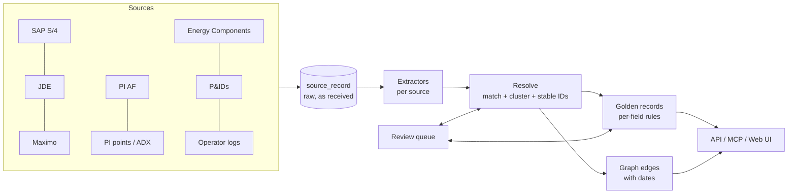

# Fuzer design

Fuzer is our own version of the core of Cognite Data Fusion. It pulls asset data
from many systems, works out which records describe the same real thing, links
them into one graph, and serves that graph to apps, AI agents and engineers.

The first target is one medium offshore asset (20–60 wells, 50k–150k tags,
100k–300k PI points, a few thousand P&ID sheets). The core must not be specific
to offshore: onshore, midstream and downstream assets plug in as **asset packs**.

## Decisions

| Topic | Decision |
|---|---|
| Hosting | Azure, next to ADX. Login with Entra ID later. |
| Architecture | Postgres-first modular monolith. Seams left so we can add a lakehouse / graph DB later. |
| Equipment master | SAP S/4 is the long-term master. JDE and Maximo are legacy sources matched against it. |
| P&IDs | Mix of smart files, text PDFs and scanned images; each handled differently. |
| Time series | Stays in PI and ADX. Fuzer stores only metadata and pointers. |
| Matching | Sure matches merge on their own; unsure ones go to a review queue. Reviewer answers are pinned and survive reruns. |
| Source conflicts | Per-field priority rules, plus human review for fields we care about (manufacturer, model). |
| History | Links have `valid_from` / `valid_to`, so "what was true on date X" works. |
| AI | Claude, for messy text (operator logs) and hard P&ID images. Not in the first slice. |
| Access | Everyone signed in sees everything (for now). |
| Users | API for apps/dashboards, MCP server for AI agents, web UI for engineers. |
| Languages | Python backend, TypeScript/React web UI. |

## Big picture



The pipeline is: **land → extract → resolve → golden → graph → serve**.
Every step after landing can be rerun from scratch at any time. That is the
point: we can change matching rules and rerun without losing anything, because
raw data and reviewer decisions are kept separately.

## Key ideas

### 1. Tags are not equipment
A **tag** (functional location, e.g. `20-P-1001B`) is a position in the process.
**Equipment** is the physical item installed there (the pump with serial
`SN40123`). Pumps get swapped; the tag stays. Fuzer keeps them as separate
entities joined by an `installed_at` edge with dates. Mixing these up is the
most common cause of bad merges.

### 2. Tag grammar does most of the matching
Each asset pack defines how its tags are written. One parser reads all the
styles we see and turns them into one canonical key:

| Source | As written | Canonical key |
|---|---|---|
| SAP FLOC | `OSB-20-PT1001A` | `20-PT-1001A` |
| PI (new) | `OSB.20PT1001A.PV` | `20-PT-1001A` |
| PI (DCS) | `OSB:23-PT-1001A.DACA.PV` | `23-PT-1001A` |
| PI (legacy) | `27PT1001A_PV` | `27-PT-1001A` |
| JDE text | `OIL EXPORT PUMP - 27-P1001-A` | `27-P-1001A` |
| Maximo | `OSB/20/P-1001A` | `20-P-1001A` |
| P&ID bubble | `PT` / `1001A` on two lines | `27-PT-1001A` (area from sheet title) |

Wells get the same treatment (`A07`, `A-7`, `OSB_A-07` → `A-07`;
`A07A`, `A-07 ST1` → `A-07 ST1`).

### 3. Matching = exact keys first, then scoring
1. Records with the same kind and canonical key (tag key, well key, normalized
   serial number) merge automatically.
2. Equipment without a shared serial is compared with others **at the same
   tag** using manufacturer and description similarity.
   - score ≥ 0.90 → merge
   - 0.60–0.90 → review queue
   - below → leave apart
3. Two items at the same tag with different serials can never merge.
4. If one record could match two different things, it goes to review.

The scorer is small on purpose. When we need more power we swap in
[Splink](https://github.com/moj-analytical-services/splink) behind the same
interface.

### 4. Stable IDs
Fuzer gives every entity its own ID (`fz-tag-…`, `fz-equipment-…`) and keeps a
**crosswalk** from every source record to it. On rerun, each cluster keeps the
ID most of its members already had. When two clusters merge, the losing ID
points to the winner (`merged_into`). IDs are never reused. Every mint, merge
and split is logged in `id_event`.

### 5. Assertions → golden records
Every field from every source is stored as an **assertion** with where it came
from. The **golden record** is computed from assertions using per-field rules
in the asset pack:

```yaml
manufacturer: {priority: [review, sap, maximo, jde], review_on_conflict: true}
uom:          {priority: [review, pi, pi_af]}
```

If sources really disagree on a `review_on_conflict` field, a review item is
raised. A reviewer's choice is stored as an assertion with source `review`,
which always wins and survives reruns.

### 6. One graph, many views
All entities share one node table. Each "ontology" is a set of edge types:

| View | Edges | From |
|---|---|---|
| Physical | `part_of`, `installed_at`, `sidetrack_of` | SAP, PI AF |
| Flow / allocation | `flows_to` (dated) | Energy Components, later P&IDs |
| Data | `has_timeseries` | PI AF attributes, PI point names |
| Documents / text | `mentions` | P&IDs, operator logs |

Edges have `valid_from` / `valid_to`, so you can trace "which wells fed the
production separator on 2024-01-01".

### 7. Entity linking in text
Operator logs and P&ID text are scanned for:
- tags (tag grammar; area taken from context when missing),
- wells (well grammar),
- known phrases from the pack (`"test sep"` → `20-V-2002`).

A short tag like `PT-2001` exists in several areas; if it can't be pinned to one
it is left unlinked rather than guessed. Claude will later handle the hard
cases (pronouns, "the B pump", context from earlier entries).

### 8. Asset packs
Everything asset-specific lives in `src/fuzer/packs/<name>.yaml`: tag function
codes, area digits, well platforms, phrase aliases, matching thresholds and
survivorship rules. A new onshore or downstream asset is a new pack, not new
core code.

### 9. Equipment classes and models (ISO 14224, CFIHOS)
`standards/iso14224.yaml` holds the ISO 14224 categories, equipment classes and
types, each with its CFIHOS class name (CFIHOS IDs to be filled from the RDL).
The asset pack's `classification` rules map local signals onto it: ISA function
letters, PI AF templates and description words to a class or type, plus
manufacturer spellings to one name. Packs can add classes (e.g. fired heaters
downstream) or point at another taxonomy file, without code changes.

After golden values are chosen, each tag is `classified_as` a class; equipment
takes the class of the position it's installed at and is an `instance_of` an
`equipment_model` (manufacturer + model), which `is_a` class. Facility, area,
tag and equipment carry their ISO 14224 taxonomy level and ISA-95 level. Models
and classes are where manuals, procedures and failure history attach.

Entity pages and agent tools return at most 100 (50 for agents) links per
relationship with the true total, so hubs like "Pumps" stay fast; members of a
class (including subtypes) or a model are listed with paging.

### 10. Maintenance history (ISO 14224 reliability codes)
SAP PM notifications and work orders become `notification` and `work_order`
entities that `concerns` the equipment (by SAP equipment number) and the tag;
work orders link `for_notification`. The standards file holds ISO 14224 failure
modes, failure mechanisms, failure causes and maintenance activities; the pack's
`maintenance_codes` maps the site's SAP catalog codes onto them. A notification on
a tag within 3 days of a logged event on that tag is linked `related_to` it (one
set-based statement). Failure history rolls up from a tag or piece of equipment
to every instance of its model and every member of its class.

### 11. Downtime and daily reports (Energy Components)
EC downtime / deferment records become `downtime` entities that `affects` a well
or the facility and are `caused_by` the tags named in their comment (rules, then
Claude), with duration and lost oil / gas. The pack maps EC reason codes to a
name and category; a record whose comment names equipment but whose reason is in
another category is flagged (`reason_check`, a Dagster check, a list in the UI).
Lost oil is ranked by causing tag, by the class of the causing equipment and by
reason. DAY001 daily reports become `daily_report` entities with their figures,
`reports_on` the facility and `mentions` what their comments name. Claude's text
reader covers operator logs, daily report comments and downtime comments, each
cached per record.

### 12. Incidents
Logged events (`involves`), downtime (`caused_by`) and notifications (`concerns`)
are signals on a tag; instrument tags roll up to the equipment tag they're
`part_of`. Signals on a unit within 3 days of each other form a group, and a
group with downtime or at least two kinds of signal becomes an `incident`
(`about` the unit, `includes` each signal) with lost oil, failure modes and
event types. Similar past incidents come from the same unit or class, ranked by
shared failure modes and event types. Teams threads (#22) will join as another
signal kind.

### 13. Performance at full size
`fuzer generate --size large` makes an asset close to a real offshore one: 58k
tags, 163k PI points, 3.9k pieces of equipment, 15k notifications, 26k work
orders, 20k log entries (~300k source records, 289k entities, 510k links).

- **Rebuilds** sync instead of rewrite: rows are staged in a temporary table
  and only the differences are deleted, updated or inserted (hash joins, with
  `work_mem` raised for the rebuild transaction). Only reviewer choices are
  stored as assertions; per-source values are re-derived from an entity's own
  records when its page is opened. No per-row foreign-key checks on tables the
  rebuild owns. Labels are a table kept by the rebuild, and the ontology summary
  is computed once per rebuild. Large: ingest 5 s, first rebuild ~37 s, later
  rebuilds ~25 s, ~1.1 GB peak memory. Medium (1/10): ~7 s.
- **Reads** (large, `fuzer bench`): search 13 ms, tag page 6 ms, hub page
  190 ms (links capped per relationship), 2-step neighbourhood 14 ms, flow trace
  1 ms, ontology 1 ms, incidents 16 ms, review list 7 ms, class members 116 ms,
  class-wide maintenance history 490 ms.
- **Graph database**: not needed. Traversals Fuzer does (flow traces,
  neighbourhoods, class hierarchies) are milliseconds in Postgres at full size;
  revisit only if multi-asset graphs or deep path queries change that (#37).

## Data model (Postgres)

| Table | What it holds |
|---|---|
| `source_record` | Raw records exactly as received (JSON), keyed by source + type + key |
| `entity` | One row per Fuzer ID, with kind and `merged_into` |
| `crosswalk` | Source record → Fuzer ID, with how it was matched |
| `entity_key` | Canonical keys (tag key, serial, well key) → Fuzer ID |
| `assertion` | Reviewer choices (per-source values are re-derived from records on demand) |
| `golden` | The chosen value per entity and field, and why |
| `edge` | Typed links with dates, sources and confidence |
| `review_item` | Open/decided match and conflict questions |
| `pinned_link` | Reviewer must-link / cannot-link decisions |
| `id_event` | Mint / merge / split history |

## Source plan

| Source | First version | Later |
|---|---|---|
| SAP S/4 | CSV export of FLOCs and equipment | OData / CDS views |
| JDE, Maximo | CSV export | Scheduled DB extracts until retired |
| PI AF | JSON export of element tree + attributes | PI Web API |
| PI points | CSV point list | PI Web API / ADX |
| Energy Components | JSON of network nodes and dated edges | EC database views |
| P&IDs | Smart: tag list. Text PDF: extracted text. Image: flagged `needs_ocr` | DEXPI parsing, OCR (Azure Document Intelligence), Claude vision, line tracing |
| Operator logs | CSV of entries | Claude for hard mentions and event extraction |
| EC DAY001 daily reports | (planned) | Comments read by Claude into links and events |
| EC downtime / deferment | (planned) | `downtime` events with reason codes, lost volume, comments |
| Teams channels | (planned) | Selected channels via Microsoft Graph; thread summaries and links |
| Manuals, guides, procedures | (planned) | SharePoint / EDMS; sections linked to models, classes, tags |

## What the first slice includes

- Fake data generator: a messy offshore asset across all sources.
- Tag and well grammars, phrase aliases.
- Ingest → resolve → golden → graph pipeline on Postgres.
- Review queue with pinned decisions.
- REST API: search, entity detail, lookup by source key or free text, dated
  flow tracing, review.

Since added: React web UI (browse, entity detail with graph tab, ontology,
flow network, review); a read-only MCP server for AI agents; a `medium` fake
asset (~1/10 real size) with COPY-based rebuilds (~4 s) and background
rebuilds after review answers; Claude reading operator logs into links and
`event` entities, and reading tags off scanned P&IDs (tiled images, grammar +
register check, findings for misreads and missing tags), all cached and never
called during rebuilds; snapshot ingest that retires entities whose records
disappear; Dagster jobs (per-source assets, export-folder sensor, hourly /
daily schedules, opt-in nightly Claude run, data-quality checks, failure
webhook).

Not yet: P&ID line tracing, Entra ID login, source record history, Azure deployment.

## Roadmap

### Done (on fake data)

Core pipeline, review queue, REST API, web UI (browse, entity detail with graph,
ontology, flow network, review), MCP server, `medium` fake asset, Claude reading
operator logs and scanned P&IDs, snapshot ingest, Dagster jobs.

### Next

The roadmap is tracked in GitHub: one [milestone](https://github.com/areed145/fuzer/milestones) per phase and
one issue per item (label [`roadmap`](https://github.com/areed145/fuzer/issues?q=label%3Aroadmap)). Each issue
has its scope, a "done when" checklist and the issues it depends on. The
sections below explain the thinking behind the bigger items.

1. **[Prove it on real data](https://github.com/areed145/fuzer/milestone/1)**: real exports for one area (#9), tag
   grammar on real names (#10), Claude reader accuracy (#11), Azure (#12),
   Entra ID (#13), Dagster in Azure (#14).
2. **[Live process data](https://github.com/areed145/fuzer/milestone/2)**: PI Web API (#15), ADX (#16), process values
   around an event (#17).
3. **[Equipment models & maintenance](https://github.com/areed145/fuzer/milestone/3)**: equipment models and classes,
   ISO 14224 (#18); SAP notifications and work orders (#19). Models come first
   because a manual describes a model, not one pump.
4. **[Operational history & conversations](https://github.com/areed145/fuzer/milestone/4)**: EC DAY001 daily reports
   (#20), EC downtime and deferment (#21), Teams threads (#22), incidents (#23),
   lessons learned (#24).
5. **[Documents & knowledge](https://github.com/areed145/fuzer/milestone/5)**: ingest (#25), linking (#26), scoped
   search (#27), revisions (#28), group-based access (#29), quality (#30).
6. **[Troubleshooting assistant](https://github.com/areed145/fuzer/milestone/6)**: #31.
7. **[Later](https://github.com/areed145/fuzer/milestone/7)**: P&ID flow connectivity (#32), source record history
   (#33), spares and BOM (#34), onshore asset pack (#35), Splink matcher (#36),
   graph DB read replica (#37).

### Operational history and conversations

Goal: the record of what actually happened on the asset, and how people fixed
it, is linked to the equipment and wells involved and can be searched next to
the manuals.

- **DAY001 daily reports (EC)**: one per day: production and injection figures,
  downtime, and free-text comments. Figures stay in EC / ADX (Fuzer keeps a
  pointer); comments are read by Claude like operator logs, into links and
  events.
- **Downtime and deferment history (EC)**: structured records (start, end, well
  or facility, reason code, lost volume) plus comments. Each becomes a
  `downtime` event linked to its wells and, from the comment, to the equipment
  that caused it. Lost volume on each event makes it possible to rank problems
  by cost, and to check reason codes against what the comment actually says.
- **Teams channels (Microsoft Graph)**: only channels the asset team chooses
  (e.g. operations troubleshooting, upset recovery). A thread (first message +
  replies) is the unit: Claude links it to tags, wells and incidents, and
  summarises what the problem was, what was tried and what fixed it. Fuzer stores
  the link back to the Teams message and the summary, not a second copy of
  everyone's chat.
- **Lessons learned**: those summaries become *suggested* troubleshooting
  steps for a model or tag. An engineer reviews them before they appear next to
  the official guides, so tribal knowledge turns into reviewed knowledge.
- **Care needed with chat**: Graph's channel-message permissions need tenant
  admin consent; people's names and anything personal should be minimised or
  redacted; retention and legal-hold rules apply; and access should follow
  channel membership. Worth agreeing with IT, legal and the asset team before
  building.

### Documents and knowledge

Goal: every manual, guide and procedure is linked to the entities it applies
to, and searchable in the context of an entity ("how do I reset the seal
flush on 20-P-1001B?").

- **Types**: OEM manuals and datasheets, site troubleshooting guides, operating
  procedures and work instructions, inspection reports and certificates, MOCs.
- **Ingest**: PDFs and Office files from a document system (SharePoint / an
  EDMS), with document number, revision, status and effective date. Text layer
  first, OCR (Azure Document Intelligence) for scans. Split into sections that
  keep their headings, page numbers and figures.
- **Link at the right level**: an OEM manual applies to an equipment *model*
  (and through it to every pump of that model); a site guide applies to tags,
  systems or areas; a procedure may apply to an equipment *class*. Claude reads
  each document's front matter and sections, and picks from register candidates
  (models, tags, classes) the way it does for logs, with low-confidence links
  sent to the review queue.
- **One search across knowledge**: the same scoped search covers manuals,
  guides, reviewed lessons learned, Teams thread summaries and past incidents,
  each labelled by how authoritative it is (OEM manual vs. a chat thread).
- **Section-level links**: sections are linked to the components, failure
  modes and tags they discuss, so search can return the right page, not just the
  right document.
- **Search**: full-text plus embeddings (pgvector) over sections, always scoped
  by the graph (the entity, its model, its class, its area), returning cited
  passages with page numbers. Exposed in the UI (a Documents tab per entity and a
  viewer with highlighted passages) and as an MCP tool.
- **Revisions**: superseded revisions are kept but not served by default;
  links follow the current revision.
- **Access**: manuals can be licensed or confidential, so this is where role- or
  group-based access (currently "everyone sees everything") would start.
- **Quality**: answer-key sets for document linking and for search, measured
  like the P&ID reader; reviewer feedback on links and search results.
