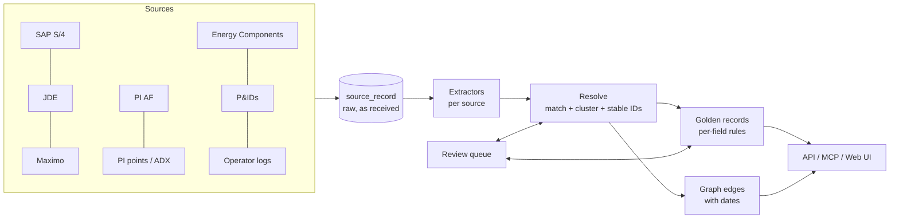

# Fuzer design

Fuzer is our own version of the core of Cognite Data Fusion. It pulls asset data
from many systems, works out which records describe the same real thing, links
them into one graph, and serves that graph to apps, AI agents and engineers.

The first target is one medium offshore asset (20–60 wells, 50k–150k tags,
100k–300k PI points, a few thousand P&ID sheets). The core must not be specific
to offshore: onshore, midstream and downstream assets plug in as **asset packs**.

## Decisions

| Topic | Decision |
|---|---|
| Hosting | Azure, next to ADX. Login with Entra ID later. |
| Architecture | Postgres-first modular monolith. Seams left so we can add a lakehouse / graph DB later. |
| Equipment master | SAP S/4 is the long-term master. JDE and Maximo are legacy sources matched against it. |
| P&IDs | Mix of smart files, text PDFs and scanned images; each handled differently. |
| Time series | Stays in PI and ADX. Fuzer stores only metadata and pointers. |
| Matching | Sure matches merge on their own; unsure ones go to a review queue. Reviewer answers are pinned and survive reruns. |
| Source conflicts | Per-field priority rules, plus human review for fields we care about (manufacturer, model). |
| History | Links have `valid_from` / `valid_to`, so "what was true on date X" works. |
| AI | Claude, for messy text (operator logs) and hard P&ID images. Not in the first slice. |
| Access | Everyone signed in sees everything (for now). |
| Users | API for apps/dashboards, MCP server for AI agents, web UI for engineers. |
| Languages | Python backend, TypeScript/React web UI. |

## Big picture



The pipeline is: **land → extract → resolve → golden → graph → serve**.
Every step after landing can be rerun from scratch at any time. That is the
point: we can change matching rules and rerun without losing anything, because
raw data and reviewer decisions are kept separately.

## Key ideas

### 1. Tags are not equipment
A **tag** (functional location, e.g. `20-P-1001B`) is a position in the process.
**Equipment** is the physical item installed there (the pump with serial
`SN40123`). Pumps get swapped; the tag stays. Fuzer keeps them as separate
entities joined by an `installed_at` edge with dates. Mixing these up is the
most common cause of bad merges.

### 2. Tag grammar does most of the matching
Each asset pack defines how its tags are written. One parser reads all the
styles we see and turns them into one canonical key:

| Source | As written | Canonical key |
|---|---|---|
| SAP FLOC | `OSB-20-PT1001A` | `20-PT-1001A` |
| PI (new) | `OSB.20PT1001A.PV` | `20-PT-1001A` |
| PI (DCS) | `OSB:23-PT-1001A.DACA.PV` | `23-PT-1001A` |
| PI (legacy) | `27PT1001A_PV` | `27-PT-1001A` |
| JDE text | `OIL EXPORT PUMP - 27-P1001-A` | `27-P-1001A` |
| Maximo | `OSB/20/P-1001A` | `20-P-1001A` |
| P&ID bubble | `PT` / `1001A` on two lines | `27-PT-1001A` (area from sheet title) |

Wells get the same treatment (`A07`, `A-7`, `OSB_A-07` → `A-07`;
`A07A`, `A-07 ST1` → `A-07 ST1`).

### 3. Matching = exact keys first, then scoring
1. Records with the same kind and canonical key (tag key, well key, normalized
   serial number) merge automatically.
2. Equipment without a shared serial is compared with others **at the same
   tag** using manufacturer and description similarity.
   - score ≥ 0.90 → merge
   - 0.60–0.90 → review queue
   - below → leave apart
3. Two items at the same tag with different serials can never merge.
4. If one record could match two different things, it goes to review.

The scorer is small on purpose. When we need more power we swap in
[Splink](https://github.com/moj-analytical-services/splink) behind the same
interface.

### 4. Stable IDs
Fuzer gives every entity its own ID (`fz-tag-…`, `fz-equipment-…`) and keeps a
**crosswalk** from every source record to it. On rerun, each cluster keeps the
ID most of its members already had. When two clusters merge, the losing ID
points to the winner (`merged_into`). IDs are never reused. Every mint, merge
and split is logged in `id_event`.

### 5. Assertions → golden records
Every field from every source is stored as an **assertion** with where it came
from. The **golden record** is computed from assertions using per-field rules
in the asset pack:

```yaml
manufacturer: {priority: [review, sap, maximo, jde], review_on_conflict: true}
uom:          {priority: [review, pi, pi_af]}
```

If sources really disagree on a `review_on_conflict` field, a review item is
raised. A reviewer's choice is stored as an assertion with source `review`,
which always wins and survives reruns.

### 6. One graph, many views
All entities share one node table. Each "ontology" is a set of edge types:

| View | Edges | From |
|---|---|---|
| Physical | `part_of`, `installed_at`, `sidetrack_of` | SAP, PI AF |
| Flow / allocation | `flows_to` (dated) | Energy Components, later P&IDs |
| Data | `has_timeseries` | PI AF attributes, PI point names |
| Documents / text | `mentions` | P&IDs, operator logs |

Edges have `valid_from` / `valid_to`, so you can trace "which wells fed the
production separator on 2024-01-01".

### 7. Entity linking in text
Operator logs and P&ID text are scanned for:
- tags (tag grammar; area taken from context when missing),
- wells (well grammar),
- known phrases from the pack (`"test sep"` → `20-V-2002`).

A short tag like `PT-2001` exists in several areas; if it can't be pinned to one
it is left unlinked rather than guessed. Claude will later handle the hard
cases (pronouns, "the B pump", context from earlier entries).

### 8. Asset packs
Everything asset-specific lives in `src/fuzer/packs/<name>.yaml`: tag function
codes, area digits, well platforms, phrase aliases, matching thresholds and
survivorship rules. A new onshore or downstream asset is a new pack, not new
core code.

## Data model (Postgres)

| Table | What it holds |
|---|---|
| `source_record` | Raw records exactly as received (JSON), keyed by source + type + key |
| `entity` | One row per Fuzer ID, with kind and `merged_into` |
| `crosswalk` | Source record → Fuzer ID, with how it was matched |
| `entity_key` | Canonical keys (tag key, serial, well key) → Fuzer ID |
| `assertion` | Every field value from every source, plus reviewer choices |
| `golden` | The chosen value per entity and field, and why |
| `edge` | Typed links with dates, sources and confidence |
| `review_item` | Open/decided match and conflict questions |
| `pinned_link` | Reviewer must-link / cannot-link decisions |
| `id_event` | Mint / merge / split history |

## Source plan

| Source | First version | Later |
|---|---|---|
| SAP S/4 | CSV export of FLOCs and equipment | OData / CDS views |
| JDE, Maximo | CSV export | Scheduled DB extracts until retired |
| PI AF | JSON export of element tree + attributes | PI Web API |
| PI points | CSV point list | PI Web API / ADX |
| Energy Components | JSON of network nodes and dated edges | EC database views |
| P&IDs | Smart: tag list. Text PDF: extracted text. Image: flagged `needs_ocr` | DEXPI parsing, OCR (Azure Document Intelligence), Claude vision, line tracing |
| Operator logs | CSV of entries | Claude for hard mentions and event extraction |

## What the first slice includes

- Fake data generator: a messy offshore asset across all sources.
- Tag and well grammars, phrase aliases.
- Ingest → resolve → golden → graph pipeline on Postgres.
- Review queue with pinned decisions.
- REST API: search, entity detail, lookup by source key or free text, dated
  flow tracing, review.

Since added: React web UI (browse, entity detail, review) and a read-only MCP
server for AI agents.

Not yet: Dagster orchestration, Claude linking, OCR,
P&ID line tracing, Entra ID login, source record history.

## Roadmap

1. **Slice (now):** everything above, on fake data.
2. **Phase 1:** real exports for one area; Dagster jobs; React review/browse UI;
   Azure deploy (Container Apps + Azure Database for PostgreSQL).
3. **Phase 2:** PI Web API and ADX connectors; Claude for operator
   logs and P&ID images; OCR.
4. **Phase 3:** P&ID flow connectivity; second asset pack (onshore) to prove the
   core is general; graph DB read replica if traversal gets slow.
