# Extend Fuzer

Fuzer is meant to be reused, not forked. A new facility, a new system of record, a new kind of analysis
for the assistant and a new way of routing work are each **configuration or a small, named addition** in
one place, with a test and a generated reference page to show it took. This guide walks through the
five most common extensions:

1. [Add a project](#add-a-project): a facility with its own asset pack and data.
2. [Add a data source](#add-a-data-source): a new export, table or live system, from the UI or as YAML.
3. [Write a source pack](#write-a-source-pack): one type of system, with its datasets, the work it raises and
   its detectors, installed in one step.
4. [Add an agent skill](#add-an-agent-skill): a method the assistant's specialists can follow, and the tools
   it needs.
5. [Add a workflow](#add-a-workflow): a BPMN process that routes work between agents and people.

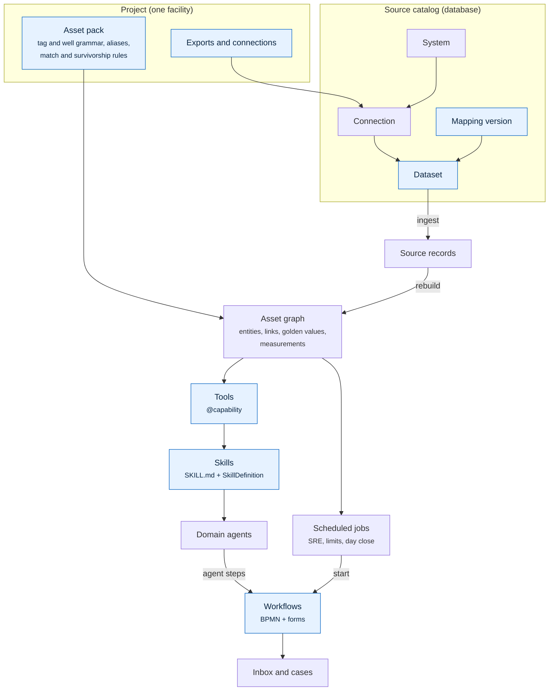

The highlighted boxes are what you add or change. Everything else (identity resolution, golden records,
the work engine, the UI) picks the addition up without code changes.

!!! note "Rules that apply to every extension"
    These come from [adapter boundaries](adapter-boundaries.md) and the repository's `AGENTS.md`:

    - Keep business rules in their owning domain (`sources`, `graph`, `analysis`, `workflow`), never in an
      API route, CLI command, MCP tool wrapper or React page.
    - Claims and numbers must cite loaded evidence with units and a time window. Label synthetic and
      historical data. A missing prerequisite is reported, not filled in.
    - Agents read and propose. People approve anything that changes plant, maintenance, schedule or
      commercial state.
    - Regenerate the reference pages you affect (`capabilities.md`, `settings.md`, `cli.md`, `schema.md`)
      and run the tests named in each section below.

## Add a project

A **project** is one facility: an asset pack, the exports or connections that feed it, a time-series
provider and a timezone. The [Okan field](walkthrough.md) is the reference project.

!!! note "One database, several projects"
    Accounts, access, the project list and settings live in the shared `fuzer` schema. The first project's
    register is in `public`, and each further project gets its own schema (`proj_<name>`), so no project
    sees another's register. Commands run for one project at a time: `fuzer --project <name>` (or
    `FUZER_PROJECT`), and `projects.use(conn, name)` in code. See [Overview](overview.md#asset-packs).

### 1. Write the asset pack

Everything facility-specific lives in the pack, so no Python changes for a new site. Okan's is
[`fakeplant/bundles/okan/pack.yaml`](https://github.com/areed145/fuzer/blob/main/fakeplant/bundles/okan/pack.yaml). A
small pack looks like this (Kestrel Ridge, the second demo facility):

```yaml
name: kestrel
facility: KRGP
data_notice: Fictional, synthetic data for a second demonstration facility, not a live operating update.

tag_grammar:              # how sources write tags: A1-PT-1001, KRGP:A1.PT1001.PV, "PT1001 (A1 INLET)"
  area: '[A-H]\d'         # or a whole `pattern` with func / loop / area / suffix groups
  loop_digits: [4, 4]
  function_codes: [P, V, K, E, H, T, F, G, PT, TT, LT, FT, VT, AT, PDT, XV, PV, PSV, FIC, PIC, LIC]

well_grammar:             # KR12-03H, KR-12-03H and KR_12_03H all meet on one well, "KR 12-03H"
  pattern: 'KR[-_\s]?(?P<pad>\d{2})[-_\s]?(?P<num>\d{2})(?P<h>H?)'
  key: 'KR {pad}-{num}{h}'

aliases:                  # phrases operators use, resolved in logs and questions
  inlet separator: [tag, A1-V-1001]
  dehy: [area, KRGP-C1]

matching:                 # seeds the source catalog's rules; edited on Sources > Rules afterwards
  equipment: {auto_accept: 0.90, review_min: 0.60}

survivorship:             # which system wins each field of a golden record
  default: {priority: [review, sap, maximo, pi], review_on_conflict: false}
  fields:
    manufacturer: {priority: [review, sap, maximo], review_on_conflict: true}

classification:
  taxonomy: iso14224
  tag_functions: {P: PU, K: CO, E: HE, V: VE, PT: IP.PR, XV: VA.ES, PSV: VA.PS}
```

Okan's pack adds optional sections you can copy as your data supports them: `maintenance_codes`,
`downtime_reasons`, `spatial_links` (link GIS features by distance), `value` (prices and rates for the
work board's value score) and `limits`.

!!! tip "Test the grammar first"
    Most of the effort in a new pack is the tag and well grammar. Check it against real tag strings from
    each source before loading anything: every tag Fuzer can't parse is a record it can't link. The
    suggested-mapping step on the Sources page also uses the grammar to recognise tag and well columns, so
    a good grammar makes [adding sources](#add-a-data-source) much faster.

### 2. Register the project

**From a seed bundle (recommended).** The project, its pack and its exports travel together in one folder:

```text
fakeplant/bundles/kestrel/
├── bundle.yaml          # bundle: 1, name, description, pack: pack.yaml, project: {data, timeseries, timezone}
├── pack.yaml
└── exports/             # sap_floc.csv, sap_equipment.csv, pi_points.csv, maximo_assets.csv
```

```sh
uv run fuzer init --bundle fakeplant/bundles/kestrel    # stores the project and pack; no ingest
FUZER_DATA_DIR=fakeplant/bundles/kestrel/exports uv run fuzer --project kestrel ingest
uv run fuzer --project kestrel rebuild
```

`init` stores the project and its pack in the database, so the API, MCP server and jobs pick the right pack
without environment variables (there is no default pack: a database with no project asks for `init`). On a fresh database the bundle becomes
the first project (in `public`); on a database that already holds one, it is added in its own `proj_<name>`
schema. Running `init` again with the same bundle is a no-op, and a changed bundle for the same project
needs `--upgrade`.

Fuzer ships no packs or project files of its own (P1.6): every facility, the demos included, is a bundle.
`fuzer projects save <name>` stores a shipped bundle's project (`fakeplant/bundles/<name>`) without `init`.

### 3. Load and check

1. Open **Home**: the sidebar names the facility and counts entities, links and source records.
2. Open **Sources**: each dataset should show *No reported problems* and a record count.
3. Open **Data review**: possible matches and conflicting values are the pack's matching and survivorship
   rules at work. A long queue usually means a grammar or rule needs tuning, not that every item needs a
   person.
4. Search for a tag on **Browse** and open it: **Source records** should list each system that describes it.

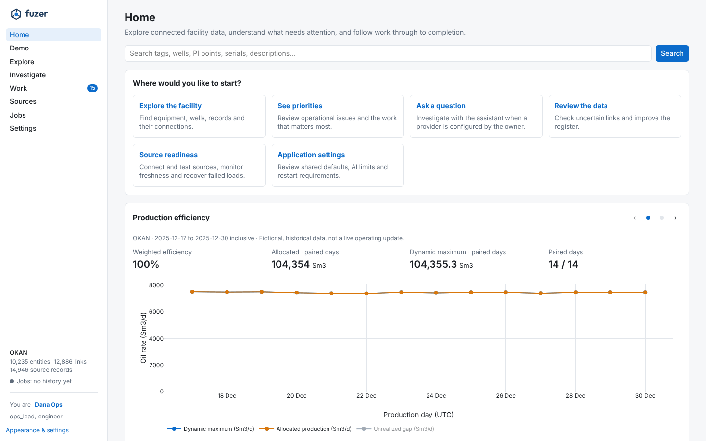{ loading=lazy }
*Home on the Okan demo (fictional, historical data). The panel at the foot of the sidebar names the facility
the database holds.*

## Add a data source

A data source is three rows in the [source catalog](sources.md#the-source-catalog): a **system** (where the
data comes from), a **connection** (how Fuzer reaches it) and a **dataset** (one table or feed), plus an
approved **mapping version** that says what each column means. No code is needed for anything the built-in
readers handle: CSV, Parquet, Delta, Excel, JSON and GeoJSON in a folder, PI Web API and ADX.

There are two routes, and they produce the same catalog rows:

| | From the UI | As YAML |
|---|---|---|
| Best for | A steward adding a table to a running deployment | A developer adding a built-in source, reviewed in a PR |
| Mapping | Suggested from the columns, edited column by column | Written by hand, or exported from the UI |
| Result | Dataset, approved mapping version and a first load | A seed mapping in `src/fuzer/mappings/`, imported by `fuzer sources seed` |

### From the UI

The worked example is a contractor's equipment list, `incoming/contractor_equipment_list.csv` in the Okan
demo data: one row per item with its tag, description, manufacturer, model, serial number, install date and
dry weight. The goal is to load it as **equipment** matched to the SAP and Maximo copies of the same items.

Open **Sources → + Add a source**. The five steps are one page; nothing loads until the last one.

**1. Which system is it from?** Pick a system, or add one. Here a new system `contractor` (kind `erp`,
owner Sam Planner) is added; its name is what every record will cite as its source.

**2. Where is the data?** Use one of the system's connections, or add one. A *folder* connection can point
anywhere; `incoming` is resolved against the project's data folder. Connections are tested on the spot,
and secrets are stored as references such as `env:PI_PASSWORD`, never as values.

**3. Which table?** The connection lists what it holds that no dataset covers yet.

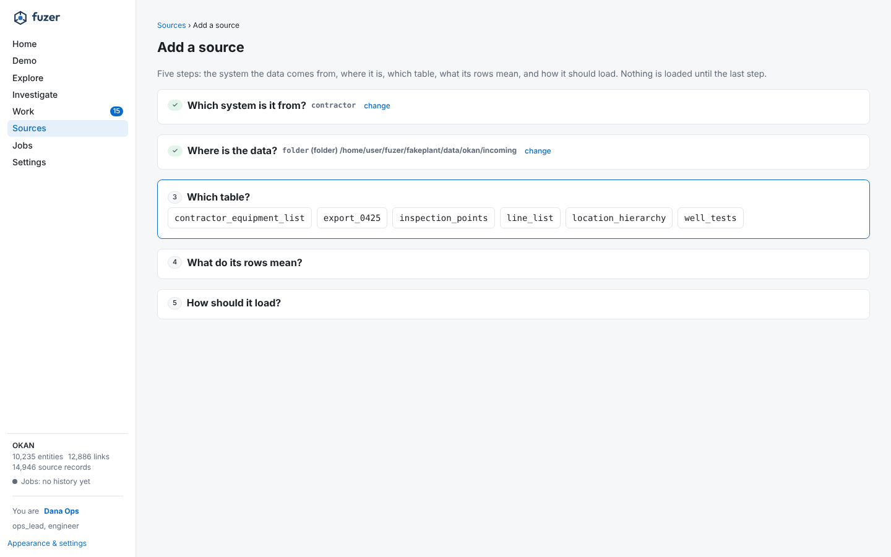{ loading=lazy }

**4. What do its rows mean?** Fuzer profiles a sample and suggests a mapping from the column names, value
patterns (the pack's tag and well grammars, dates, units, known manufacturers) and values that are keys of
records it already holds. Edit the suggestion column by column: what each column is kept as, and what it
links the record to. **Ask Claude** names columns the rules could only call `code` or `other`; it is
optional, costs money and is cached.

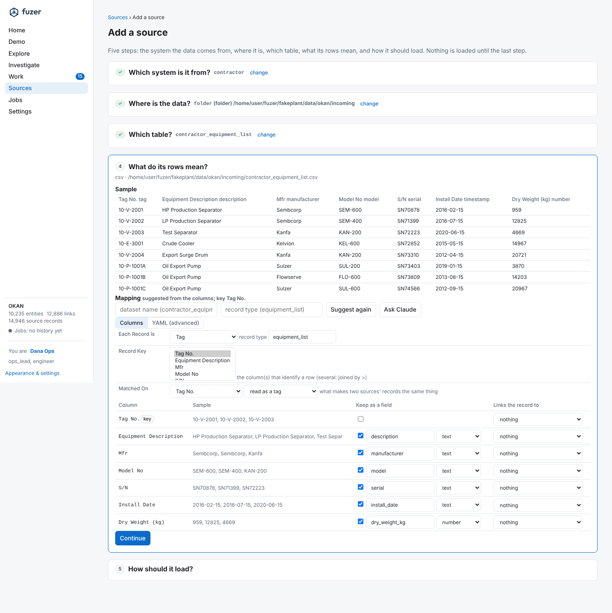{ loading=lazy }

!!! tip "Check what each record *is*"
    In this example the rules suggest each record is a **Tag**, because the first column is a tag. The rows
    are physical items with serial numbers, so choose **Equipment**, key it on `S/N` read as a serial, and
    link it to the tag it is installed at. That is how SAP equipment is mapped, so the contractor's copy of
    an item meets SAP's on the same serial.

**5. How should it load?** Pick the load mode (`snapshot`, `incremental` or `append`), a schedule, how often
a delivery is expected (after that the dataset is stale and its owner is told), and the owner.

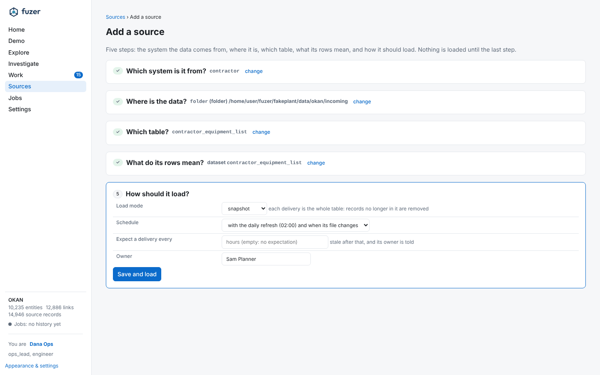{ loading=lazy }

**Save and load** creates the dataset and its approved mapping version and loads it. A held first load says
why (duplicate keys with examples, a failing check, changed columns) and where to fix it. A banner then
offers **Rebuild now**, so the new records are matched into the graph.

Afterwards, the dataset has its own page with **Overview**, **Settings**, **Mapping**, **Runs**, **Quality**,
**Matching** and **History**. The **Mapping** tab is the same column editor; an edit becomes a draft that is
diffed against the version in use, with what it would do to the register, before anyone approves it.

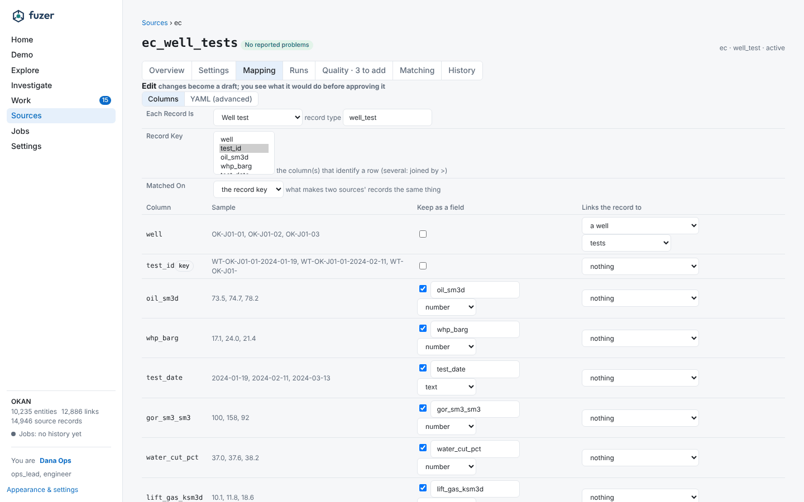{ loading=lazy }

### As YAML

A mapping file has the source, record type, shape and dataset, the key, the entity it makes and the links
and measurements it carries. This is the contractor list mapped as equipment:

```yaml
# src/fuzer/mappings/contractor_equipment.yaml
# Contractor equipment list: physical items, matched on serial number and the tag they are installed at.
source: contractor
record_type: equipment
shape: records
dataset: contractor_equipment_list
key: S/N
entity:
  kind: equipment
  key: {from: S/N, as: serial}          # the serial grammar normalises SN70878 and 70878
  block: {from: Tag No., as: tag}       # only compare with equipment at the same tag
  fields:
    - [description, {from: Equipment Description}]
    - [manufacturer, {from: Mfr}]
    - [model, {from: Model No}]
    - [serial, {from: S/N}]
    - [install_date, {from: Install Date}]
    - [dry_weight_kg, {from: Dry Weight (kg), as: number}]
links:
  - rel: installed_at
    to: {kind: tag, from: Tag No., as: tag}
```

The shapes are `records`, `hierarchy`, `network`, `timeseries`, `events`, `measurements`, `limits`,
`documents`, `geospatial`, `reference` and `curves`; [sources and ingestion](sources.md) describes each,
and the 34 built-in mappings in
[`src/fuzer/mappings/`](https://github.com/areed145/fuzer/tree/main/src/fuzer/mappings) are working
examples of all of them. [`ec_well_test.yaml`](https://github.com/areed145/fuzer/blob/main/src/fuzer/mappings/ec_well_test.yaml)
shows a `measurements` block, which lands values against a well with units.

Load it through the catalog. A mapping in `src/fuzer/mappings/` is seeded into every deployment by
`fuzer sources seed`; keep a mapping that belongs to one deployment elsewhere and import it. The commands
read the project's data folder, so run them with `--project <name>`, `--data <folder>` or `FUZER_DATA_DIR` set:

```sh
export FUZER_DATA_DIR=fakeplant/data/okan
uv run fuzer sources add-system contractor --set kind=erp --set "owner=Sam Planner"
uv run fuzer sources import contractor_equipment.yaml           # prints {"draft": <version id>, ...}
uv run fuzer sources add-dataset contractor_equipment_list contractor \
    --set location=incoming/contractor_equipment_list.csv
uv run fuzer sources approve <version id>                       # the draft becomes the mapping in use
uv run fuzer sources preview contractor_equipment_list          # sample rows, schema and what they make
uv run fuzer sources run contractor_equipment_list && uv run fuzer rebuild
```

Every new system starts with a `files` connection to the project's data folder, and a new dataset uses
the system's first connection, so a `location` relative to the data folder is enough here. For a folder
elsewhere, add a connection (`fuzer sources add-connection contractor lake folder --config path=/mnt/lake`)
and give the dataset `--set connection_id=<id>`. This sequence was run against the Okan demo: it loaded
224 records.

`fuzer sources impact` compares a proposed mapping with the one in use over the stored records, and
`fuzer sources why <entity> <field>` traces a golden value back to the record, mapping version and rule that
chose it. Every command is in the [command line](cli.md#fuzer-sources) reference.

**When you need code.** Logic that truly is source-specific is a named hook or transform in
[`sources/extract.py`](https://github.com/areed145/fuzer/blob/main/src/fuzer/sources/extract.py) (tag, well,
serial and number transforms; FLOC, AF path and EC node resolvers). A new *live* system is a new
connection type in `sources/connections.py`, implementing `connector`, `test` and `discover`. Neither
changes the ingest rules: loads share `sources.ingest.ingest` selection, validation and result semantics
across every adapter.

**Tests.** `uv run pytest tests/sources` for mappings and ingest. Add the planted cases to the fake plant
and an answer key under `fakeplant/` when the source changes matching, so `fuzer eval` scores it.

## Write a source pack

A **source pack** brings one type of system to Fuzer in a single YAML file: the system, how Fuzer reaches it,
the datasets it exports with their mappings and checks, the work its records raise and who owns that work,
and the detectors it relies on. A steward installs it from **Sources > Import a source pack** (or
`fuzer sources import-pack`) and everything lands at once: datasets on Sources, types of work on Routing,
detectors on Detection. The built-in systems are packs too, in
[`src/fuzer/source_packs/`](https://github.com/areed145/fuzer/tree/main/src/fuzer/source_packs).

This walkthrough writes a pack for a lab that reports water cut and oil-in-water on well samples. CI builds
this exact pack from this page and runs the conformance suite on it (`tests/sources/test_pack_conformance.py`),
so the example always installs and loads.

### 1. Lay out the folder

A pack is its YAML file and a **fixture**: a folder of sample exports, as the system writes them. The
conformance suite loads the fixture, and a project without the real system can try the pack on it.

```text
lab/
  pack.yaml
  samples/
    water_cut_samples.csv
```

### 2. Write the sample export

One file per dataset, named after the dataset. Dates may be relative (`today-30d`), so the sample stays
recent:

```csv title="lab/samples/water_cut_samples.csv"
sample_id,well,sampled,water_cut_pct,oil_in_water_mgl
LS-001,KR12-03H,today-30d,18.5,12
LS-002,KR12-03H,today-23d,19.1,14
LS-003,KR12-03H,today-16d,27.4,15
LS-004,A1FT1002,today-9d,4.2,31
```

### 3. Write the pack

```yaml title="lab/pack.yaml"
fuzer_source_pack: 1
fixture: samples                  # the sample exports, relative to this file
detectors: [source_health]        # a stale, held or failing lab feed raises work
system:
  name: lab
  kind: lims
  owner: ana
connections:
- name: export
  type: folder
  config: {path: lab/samples}     # where the real exports land; the installer can point it elsewhere
datasets:
- name: water_cut_samples
  connection: export
  record_type: water_cut_sample
  key: [sample_id]
  load_mode: snapshot
  mappings:
  - source: lab
    record_type: water_cut_sample
    yaml: |
      source: lab
      record_type: water_cut_sample
      shape: measurements
      dataset: water_cut_samples
      key: [sample_id]
      measurements:
        of: {from: well, as: tag_or_well}
        at: sampled
        values:
        - {quantity: water_cut, from: water_cut_pct, unit: "%"}
        - {quantity: oil_in_water, from: oil_in_water_mgl, unit: mg/L}
  checks:
  - {kind: range, column: water_cut_pct, params: {min: 0, max: 100}, blocking: true}
exception_types:
- name: water_cut_jump
  label: Water cut jump
  role: role:production_engineer
  description: A well sample came back with a water cut above its expected band; confirm it and review the well.
exception_rules:
- name: high_water_cut
  dataset: water_cut_samples
  type: water_cut_jump
  when: {water_cut_pct: {gt: 25}}
  key: '{sample_id}'
  refs: [{from: well, as: tag_or_well}]
  title: 'Water cut {water_cut_pct}% on {well} ({sampled})'
  priority: 0.5
```

What each part does:

- `system`, `connections`: the system type and how Fuzer reaches it. Secrets are references (`env:NAME`),
  never values.
- `datasets`: one per export, each with the mapping in use ([As YAML](#as-yaml) describes mappings) and its
  quality checks. A blocking check holds a load that fails it.
- `exception_types` and `exception_rules`: the work the system's records raise, and the role that owns each
  type. They appear on Routing, and the rule raises a *Water cut jump* for LS-003.
- `detectors`: registered detectors the pack needs, switched on when it is installed.
- `optional` (not used here): datasets not every site exports, loaded when the fixture has them.

### 4. Run the conformance suite

```sh
uv run fuzer sources conformance lab/pack.yaml     # on a scratch database
```

It installs the pack, installs it again and expects nothing to change, loads the fixture through the pack's
own mappings and expects no dataset held, failed or missing, and checks every detector it names is
registered. Each problem is named; a pack conforms when there are none. Then install it for real from
Sources: the card lists what it added on each page, linked there.

## Add an agent skill

The operations assistant is an orchestrator and seven domain specialists
([agents and capabilities](agents.md)). A **skill** is a method a specialist follows (which tools to call,
in what order, and what it may and may not conclude), written as Markdown and registered in a catalog. A
**tool** is a read-only function over the graph, declared once with `@capability`.

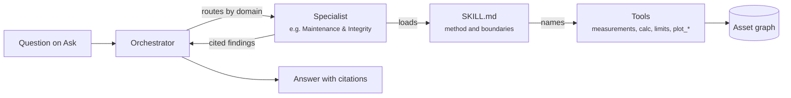

### 1. Write the skill

Add `src/fuzer/agents/skills/<owning-agent>/<name>/SKILL.md`. The front matter's `description` is shown
on the Ask page and in [capabilities](capabilities.md); the body is the method. Name every tool in
backticks: the catalog reads the tool list from there. Excerpt from the integrity skill:

```markdown
---
name: integrity
description: Asset integrity and inspection evidence - wall loss and remaining life at CMLs, overdue
  statutory and internal inspections, integrity operating window excursions, and risk ranking.
---

# Integrity and inspection

Each finding gives the item, the survey or plan date and the source. Say what was measured and what was not.

1. **Wall loss.** `plot_wall_thickness()` ranks the items losing wall fastest; `measurements(ref,
   "wall_thickness")` gives the readings (mm) and the fitted `per_year`. `calc("wall_loss", ref,
   min_required_mm=...)` gives remaining life. Without a stated minimum thickness there is no retirement
   date: say so rather than assume one.
...
Fitness for service, integrity acceptance, inspection deferral and any shutdown are accountable human
decisions. Present evidence for them; do not make them.
```

Good skills state their **coverage** (what to report when data is missing) and their **boundary** (the
human decision they inform but don't make).

### 2. Register it

Add a `SkillDefinition` to `SKILL_CATALOG` in
[`agents/capabilities/catalog.py`](https://github.com/areed145/fuzer/blob/main/src/fuzer/agents/capabilities/catalog.py):

```python
SkillDefinition(
    f"{_MAINT}/integrity", (_MAINT,),                 # path under agents/skills; owner first, then reusers
    (INTEGRITY_ENGINEER, INSPECTION_SPECIALIST),       # personas it serves
    "Wall thickness at CMLs, inspection plans, integrity operating windows and excursions.",   # data
    "Wall loss and remaining life ranked by item, overdue inspections and IOW excursions.",   # output
    "Fitness for service, integrity acceptance and inspection deferral are accountable human decisions."),
```

Every agent that loads the skill must have every tool it names. The agent's prompt is built from its
catalog entry, so its limits and human decisions reach the model; the same entry feeds the docs and the
Ask page.

### 3. Add a tool, if the skill needs one

Declare it with `@capability`, naming the domains that may act on its evidence and its kind. Keep the
computation in its domain module (`analysis`, `ops`, `graph`) and the tool a thin, read-only wrapper that
returns compact, cited, dated results:

```python
# src/fuzer/agents/capabilities/studies.py
@capability("production-surveillance", "wells-subsurface", "field-operations-facilities", kind="query")
def process_values(ref: str, at: str | None = None, hours_before: int = 48, hours_after: int = 24) -> dict:
    """Process values (PI points on the unit and its instruments) around a time: per point min / max /
    mean / last and the provider used. For an incident, at defaults to its start."""
    from ...analysis import values
    with db.connect() as conn:
        fid, err = _resolve(conn, ref)
        if err:
            return err
        out = values.around(conn, fid, at, min(hours_before, 720), min(hours_after, 720), pack=mcp_server.PACK)
    ...
```

The same function is an MCP tool for outside clients, so it must be safe to call by anyone with access.

**No data, no skill.** If the method needs a source the deployment doesn't have, add it to `UNAVAILABLE` in
the catalog instead of a skill that estimates. The assistant then says what is missing.

### 4. Test and regenerate

```sh
uv run pytest tests/agents
uv run python -m fuzer.agents.capabilities > docs/capabilities.md
```

Add a question that needs the skill to `answer_keys/assistant.json` with the facts the answer must name and
the domain it should route to; `uv run fuzer eval --agents` then scores routing, facts and citations (it
calls the model and costs money). Offline tests drive the whole team with a scripted client.

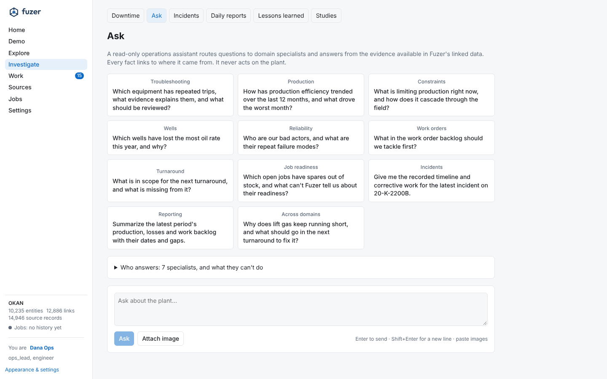{ loading=lazy }
*The Ask page lists the specialists and what they can't do, read from the same catalog.*

## Add a workflow

Work moves through BPMN processes on Fuzer's own engine ([workflow and scheduled jobs](workflow.md)).
A process routes steps between **agents** (service tasks) and **people** (user tasks, by role), with SLAs,
escalation, timers and messages. Every step is a row and every change an event, so cases are auditable.

The worked example is an equipment handover: when a contractor equipment list is loaded, the Maintenance &
Integrity agent compares it with the register, then a maintenance planner accepts it or sends it back.

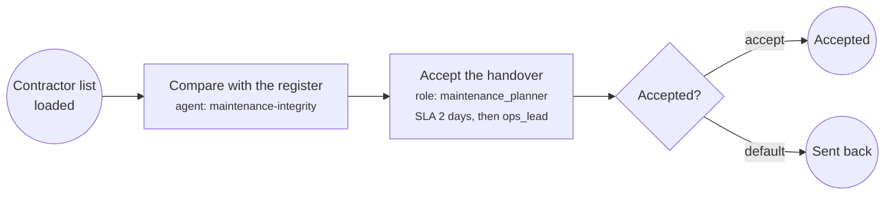

### 1. Draw it

Open **Work → Processes**, enter a key and name under **New process** and **Create draft**. On the
**Model** tab, drag components onto the canvas, connect them and select a step to set its parameters
(role, SLA, escalation, form, agent and instructions). The **Workflow drafting agent** can propose a first
draft from a description, which you review on the canvas before saving. **Check** lists anything that
would stop it publishing; **Publish** needs the workflow admin role. Running cases stay on the version they
started with.

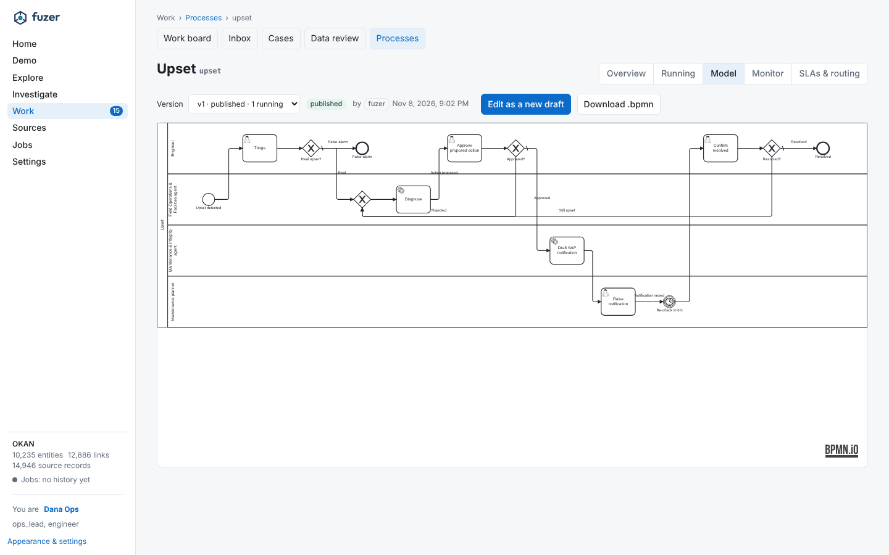{ loading=lazy }
*The built-in upset process: lanes for the engineer, two agents and the maintenance planner.*

### 2. Or write the BPMN

Built-in processes are files in
[`src/fuzer/workflow/definitions/`](https://github.com/areed145/fuzer/tree/main/src/fuzer/workflow/definitions),
imported and published by `fuzer work load` (and on every `fuzer up`) when they differ from what is
published. Fuzer's properties are attributes in the `fuzer:` namespace:

| Element | Attribute | Meaning |
|---|---|---|
| process | `fuzer:workItemType` | the case type shown on All work and the board; `=case_type` takes it from the start data |
| process | `fuzer:correlationKey` | an expression over the start data; messages and repeat starts find the open case by it |
| process | `fuzer:ownerRole` | who gets a step that fails |
| lane | `fuzer:role` / `fuzer:agent` | the person role or agent role for steps in the lane; a role starting with `=` is an expression over the process data (`=role`), read when the step starts, so one process can serve every queue (#509) |
| userTask | `fuzer:role`, `fuzer:assignee` | override the lane |
| userTask | `fuzer:sla`, `fuzer:escalateTo` | ISO 8601 duration, and the role an overdue step moves to |
| userTask | `fuzer:form`, `fuzer:requiresHuman` | the task form's key; an agent may never complete it |
| serviceTask | `fuzer:agent`, `fuzer:fallbackRole` | the agent, and the role that gets the step if the agent keeps failing |
| serviceTask | `fuzer:instructions`, `fuzer:component` | parameters passed to the agent worker; the canvas preset |

The supported subset is start and end events, user and service tasks, exclusive and parallel gateways,
timer and message events (intermediate and boundary) and call activities. Conditions are small Python
expressions over the process data, such as `handover_decision == "accept"`.

```xml
<bpmn:process id="equipment_handover" name="Equipment handover" isExecutable="true"
    fuzer:workItemType="handover" fuzer:correlationKey="dataset" fuzer:ownerRole="maintenance_planner">
  <bpmn:laneSet id="LaneSet_handover">
    <bpmn:lane id="Lane_agent" name="Maintenance &amp; Integrity agent" fuzer:agent="maintenance-integrity">
      <bpmn:flowNodeRef>compare</bpmn:flowNodeRef>
    </bpmn:lane>
    <bpmn:lane id="Lane_planner" name="Maintenance planner" fuzer:role="maintenance_planner">
      <!-- loaded, accept, accepted, done, rejected -->
    </bpmn:lane>
  </bpmn:laneSet>
  <bpmn:startEvent id="loaded" name="Contractor list loaded"><bpmn:outgoing>f1</bpmn:outgoing></bpmn:startEvent>
  <bpmn:serviceTask id="compare" name="Compare with the register" fuzer:fallbackRole="maintenance_planner"
      fuzer:instructions="List items in the contractor list with no SAP equipment at the same tag, and serials that disagree.">
    <bpmn:incoming>f1</bpmn:incoming><bpmn:outgoing>f2</bpmn:outgoing>
  </bpmn:serviceTask>
  <bpmn:userTask id="accept" name="Accept the handover" fuzer:requiresHuman="true" fuzer:sla="P2D"
      fuzer:escalateTo="ops_lead" fuzer:form="handover-accept">
    <bpmn:incoming>f2</bpmn:incoming><bpmn:outgoing>f3</bpmn:outgoing>
  </bpmn:userTask>
  <bpmn:exclusiveGateway id="accepted" name="Accepted?" default="f_no">
    <bpmn:incoming>f3</bpmn:incoming><bpmn:outgoing>f_yes</bpmn:outgoing><bpmn:outgoing>f_no</bpmn:outgoing>
  </bpmn:exclusiveGateway>
  <!-- end events and sequence flows; f_yes carries: handover_decision == "accept" -->
</bpmn:process>
```

This definition passes the publish checks (`fuzer.workflow.bpmn.check`). Files without diagram
information open on the canvas too; save from the modeler to keep a layout.

### 3. Add the task form

A user task's form is a [form-js](https://bpmn.io/toolkit/form-js/) schema whose `id` is the key the task
names. Built-in forms sit beside the BPMN as `<key>.form`; others are made under **Processes → Task forms**.
The values a person submits become process data, so the gateway can read `handover_decision`:

```json
{
  "id": "handover-accept",
  "type": "default",
  "schemaVersion": 19,
  "components": [
    {"type": "text", "id": "intro", "text": "Check the agent's comparison against the contractor list, then accept the handover or send it back."},
    {"type": "radio", "id": "handover_decision", "key": "handover_decision", "label": "Decision",
     "values": [{"label": "Accept the handover", "value": "accept"},
                {"label": "Send it back to the contractor", "value": "send_back"}],
     "validate": {"required": true}},
    {"type": "textarea", "id": "handover_note", "key": "handover_note", "label": "Why", "validate": {"required": true}}
  ]
}
```

### 4. Start it

A process starts when something calls the engine, usually the domain code that noticed the event. The IOW
scan does it this way, with correlation so a repeat breach adds to the open case instead of opening another:

```python
from fuzer.workflow import engine
engine.start_or_correlate(conn, "equipment_handover", {"dataset": "contractor_equipment_list"},
                          by="agent:sources", title="Handover: contractor equipment list")
```

Over HTTP, `POST /work/processes` with `{"process_key", "by", "data", "title", "correlate"}` does the same,
and `POST /work/messages` delivers a message to the open case with a correlation key. People can open an
ad hoc case from **Cases → New work item**.

### 5. Route and watch it

Roles, their default SLAs, escalation chains and assignment rules (queue, round-robin, least loaded) are
data on **Teams & routing**, so a new role is usable at once. The case appears on **Cases**, its waiting
steps in each person's **Inbox**, and its health (cycle time, steps waiting and overdue, SLA misses) on the
process's **Monitor** tab.

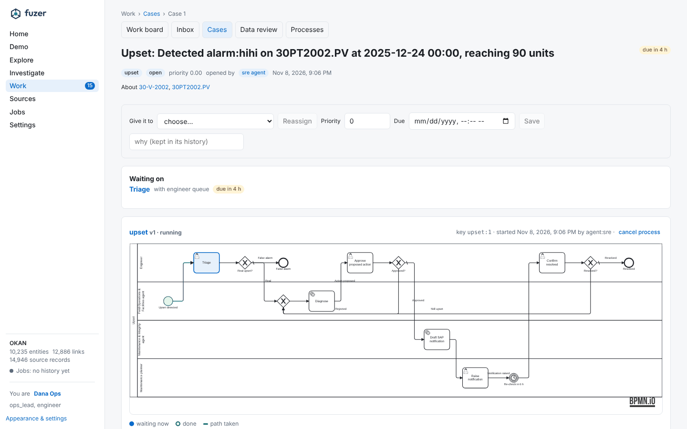{ loading=lazy }

**Tests.** `uv run pytest tests/workflow`. The BPMN tests in `tests/workflow/bpmn` run the same files on
SpiffWorkflow as a cross-check.

## Before you open a pull request

- [ ] The change lives in its owning domain; adapters only translate.
- [ ] Missing data is reported, not estimated; synthetic data is labelled.
- [ ] Tests for the affected area pass (`tests/sources`, `tests/agents`, `tests/workflow`), plus
      `tests/api/test_access_api.py` if you added an HTTP route.
- [ ] Generated reference pages are regenerated (`capabilities.md`, `settings.md`, `cli.md`, `schema.md`).
- [ ] An answer key or eval covers new matching or assistant behaviour where it can.
- [ ] `uv run mkdocs build --strict` passes if you touched the docs.
