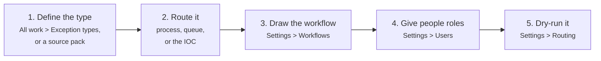
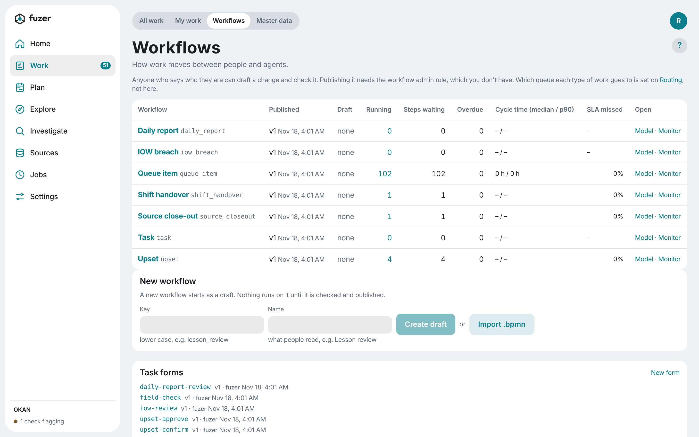
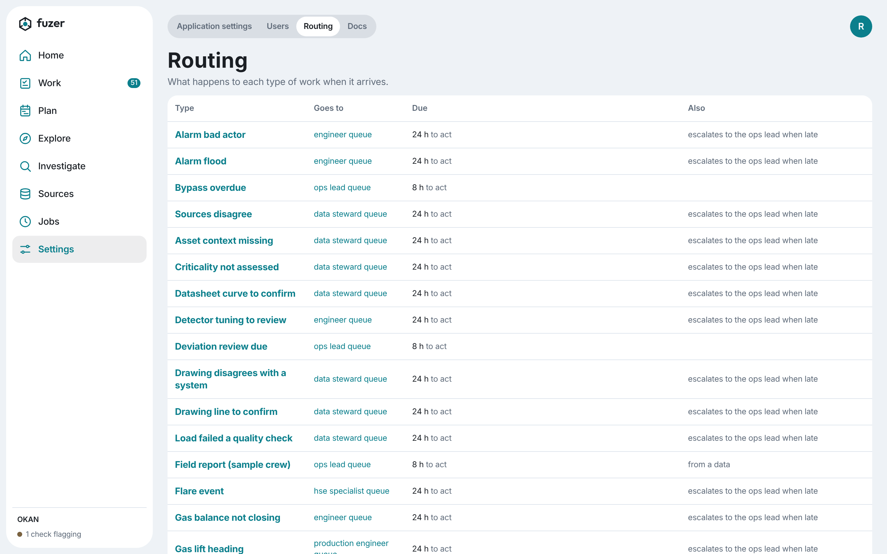
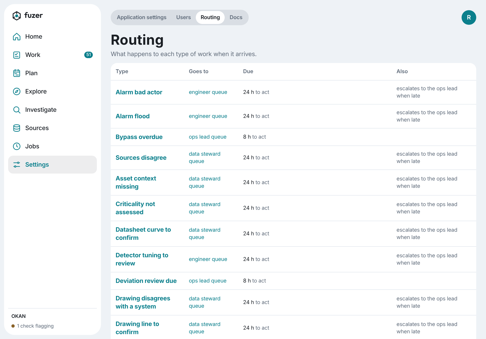

# Configurer

You set up how work flows: which types of work exist, where each one goes when it arrives, the workflow it runs,
and who holds each role. None of this needs code. A type of work is a row in the routing table; a workflow is a BPMN
drawing; a role is a list of people.

## 1. Define a type of work

On **All work**, open **Exception types** and choose **Define type**: a type name and label, the queue it goes to
(picked from the person roles, never typed), whether it joins an open event on the same asset, and its due policy by
priority (for example `1:24,2:72`: priority 1 due in 24 hours, priority 2 in 72). The card also lists the reference
forms this register matches (tags, wells, serial numbers, SAP equipment), each with an example, so the system
raising it knows what to send.

Another system then raises it with `POST /exceptions`. A source pack can declare its types in YAML instead
(`exception_types`), so a new system brings its work with it ([extend: write a source pack](../extend.md#write-a-source-pack)).

## 2. Route it

A type starts one of three things: a named **workflow**; the standard one-step **queue item** workflow in a role's
queue, with the role's SLA and escalation; or nothing, waiting on **All work > To dispatch** for the IOC.
[How work is routed](../work-routing.md#4-the-routing-table-decides-what-happens-next) explains the table.

## 3. Draw the workflow

**Settings > Workflows** lists each BPMN workflow with its health, and opens **Overview**, **Running**, **Model**,
**Monitor** and **SLAs & routing**. The modeler draws lanes for roles, person steps with forms, agent steps run by
the assistant's specialists, timers and escalations. Reusable components such as **Field check** send a step to the
field and bring it back. Task forms are edited beside the workflow.

{ loading=lazy }

[Extend: add a workflow](../extend.md#add-a-workflow) walks through drawing one, its form, starting it and watching it.

## 4. Give people their roles

**Settings > Users** has two views. **Accounts & access** (owners only) approves new accounts and grants application
permissions. **Workflow assignments & routing** puts people in workflow roles, sets each role's default SLA and who
it escalates to, and records who is away. Who may use the app and who gets which work are kept apart on purpose:
an owner spans every human role, and a disabled account keeps its assignments for a deliberate handoff.

## 5. Dry-run it

**Settings > Routing** shows the whole table. Pick a type to see its workflow drawn with who holds each lane (lanes
nobody holds are flagged), then dry-run an intake: give references, a key, a priority and who it would be dispatched
to, and see the entities it matches, the case it would join, where it would go and when it would be due. Nothing
is written.

=== "Desktop"

    { loading=lazy }

=== "iPad"

    { loading=lazy }

## Settings worth knowing

| Setting | What it does | Default |
|---|---|---|
| `exceptions.join_hours` | How recently an open event must have been seen for new work on the same asset to join it (0 turns joining off) | 48 |
| `exceptions.max_shelve_days` | The furthest ahead work can be shelved | 30 |
| `exceptions.suppress_planned_work` | Planned work (not only shutdowns) holds back what it explains | on |
| `handover.shift_times` | When shift handovers are drafted, in the project's time zone | `06:00,18:00` |
| `intake.sap_notifications` | Raise open SAP notifications with no work order as work | on |
| `work.agent_fallback_minutes` | How long an agent step waits for a worker before going to a person queue | 30 |

The [settings reference](../settings.md) lists every one.
