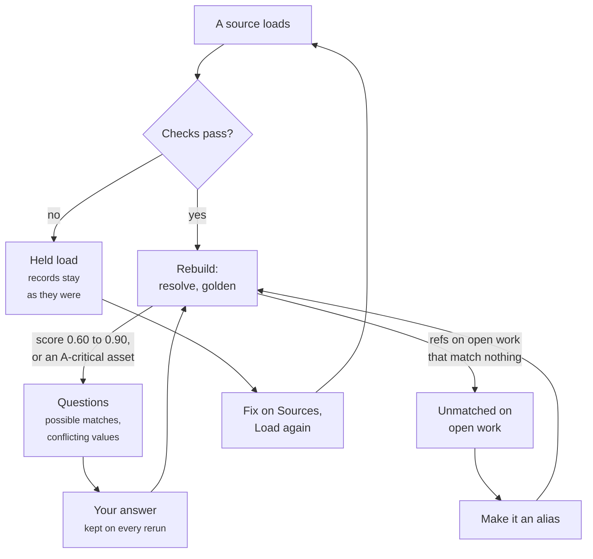
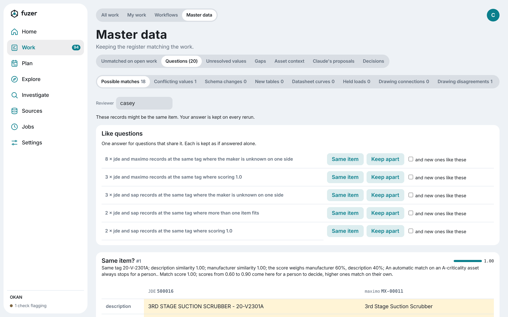
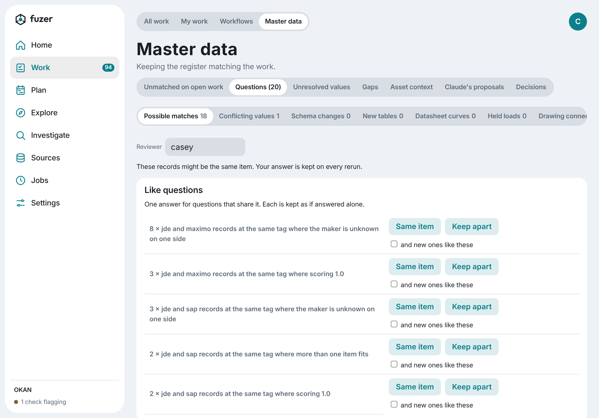
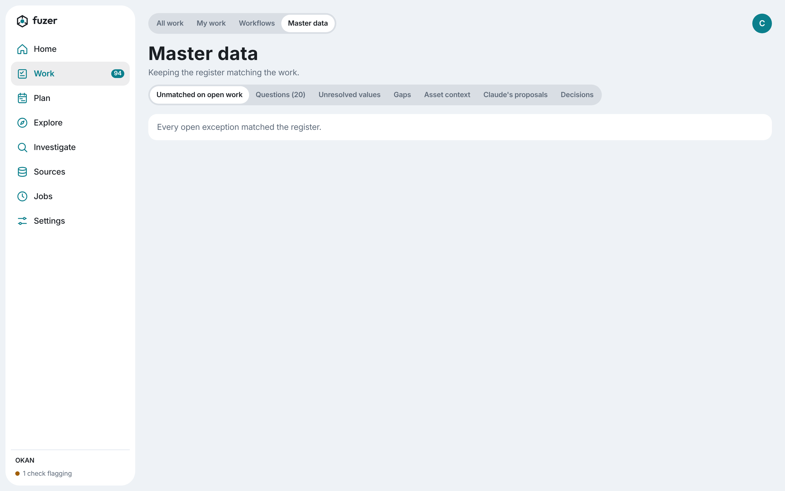
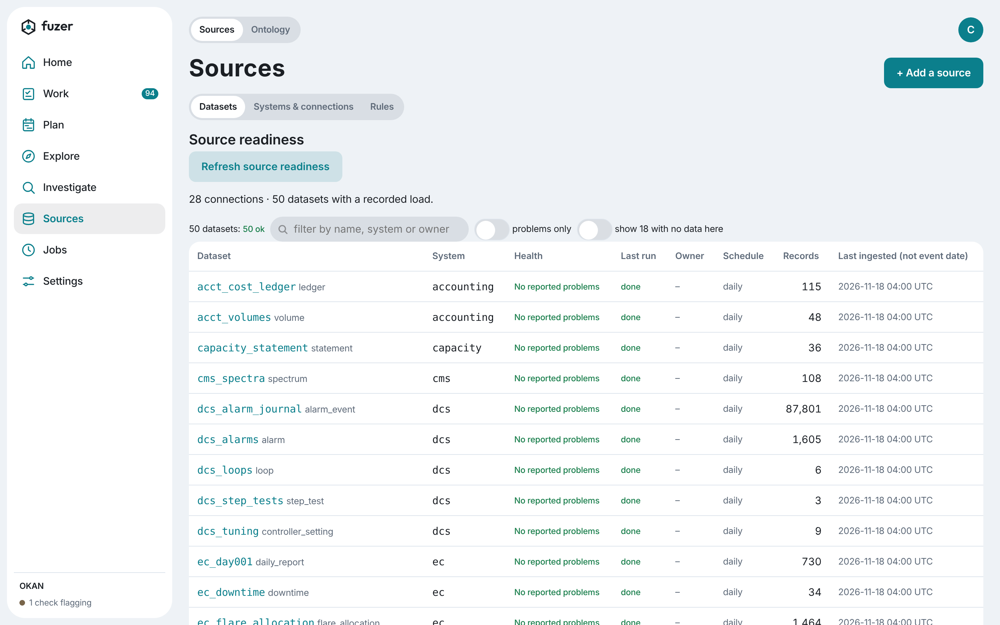

# Data steward

You keep the register matching the work. Every routed job depends on it: a field job can only say where to go and
what happened there lately if the SAP notification, the PI point and the operator log all landed on the same asset.
When Fuzer is unsure, it asks you, and your answer is kept on every rebuild.

Your work arrives two ways: as cases in the **data steward** queue on **My work** (source problems, records that
match nothing, links that name nothing, asset context missing), and on **Work > Master data**, which gathers every
question the register has.

## Answer the register's questions

Open **Master data > Questions**. The counts along the top say what is waiting: possible matches, conflicting
values, schema changes, new tables, datasheet curves, held loads, drawing connections and disagreements, and
measurement roles.

For a **possible match**, Fuzer shows both records side by side with why it thinks they are the same item: the same
tag, how alike the descriptions and makers are, and the score. Scores from 0.60 to 0.90 come to a person; higher ones
match on their own, except on an A-criticality asset, which always stops for a person. Choose **Same item** or
**Keep apart**.

**Like questions** groups questions that share an answer ("8 JDE and Maximo records at the same tag where the maker
is unknown on one side"). One click answers all of them, and with **and new ones like these**, the ones that arrive
later too. Each is kept as if answered alone, so it can be reversed one by one under **Decisions**.

=== "Desktop"

    { loading=lazy }

=== "iPad"

    { loading=lazy }

## Match a reference nothing matched

**Master data > Unmatched on open work** lists references on live work that matched no asset: a tag spelled the
way only one system spells it, an old equipment number. These matter most, because the job they are on cannot show
the asset. Pick the asset it means and choose **Make it an alias**; the next exception that uses it matches, and
the rebuild re-links what is already there.

{ loading=lazy }

The other tabs: **Unresolved values** (links in records that name nothing), **Gaps** and **Asset context** (assets
missing what the field needs, such as criticality or a location), **Claude's proposals** (fixes an agent suggested,
for you to accept), and **Decisions** (everything answered, with who and when, and a way to reverse it).

## Fix a held load

A load is held, not applied, when its rows would damage the register: duplicate keys, a failing blocking check, or
an export whose columns changed. The dataset's records stay as they were until you decide. A held load shows on
**Master data > Questions > Held loads** and on the dataset's page in **Sources**, with why.

1. Open the dataset from the held load. Its header says why the load was held, with examples (the duplicate keys,
   the failing check, the columns that changed).
2. Fix the cause where it belongs: edit the **Mapping** (an edit is a draft, shown as a diff against the version in
   use with what it would do to the register, then approved), adjust a check under **Quality**, or switch a dataset
   with repeated keys to keep the latest row.
3. Choose **Load again**. Sources confirms what it will do before it runs, and links the run under **Runs**.
4. If the banner says loads or mapping changes are not in the register yet, choose **Rebuild now**.

{ loading=lazy }

## Good to know

- Most steward work closes by itself: answer the question and its case in your queue closes with it. You do not
  need to find the case and close it too.
- **Criticality not assessed** is usually the longest list on a new register. Rate the assets work is open on
  first: their cases cannot be ranked by consequence until you do.

- Your answers are pinned: they survive every rebuild and every change to the matching rules.
- Corrections flow back: a value you correct can be drafted as an update to the source system
  ([sources: corrections flow back](../sources.md#corrections-flow-back-to-the-source)).
- [Identity and golden records](../identity.md) explains how matching and golden values work.
