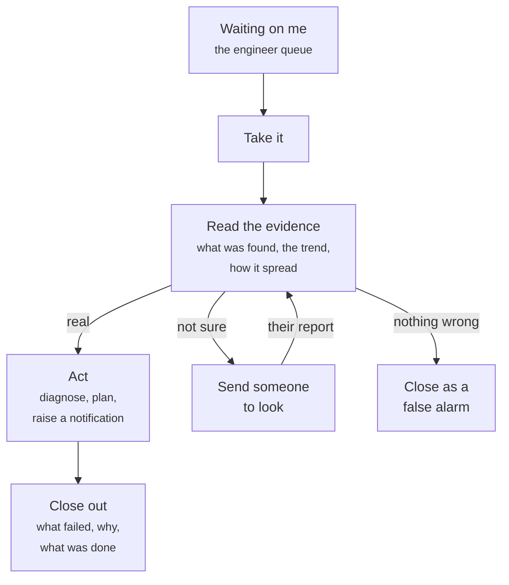
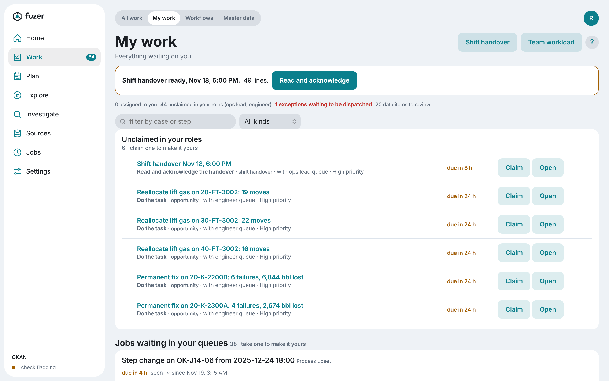
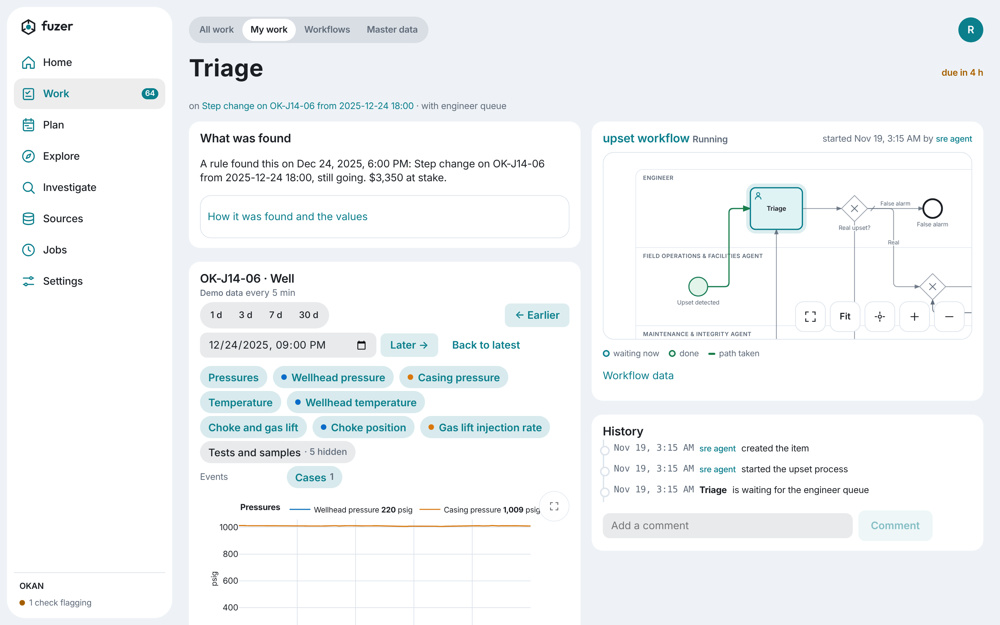
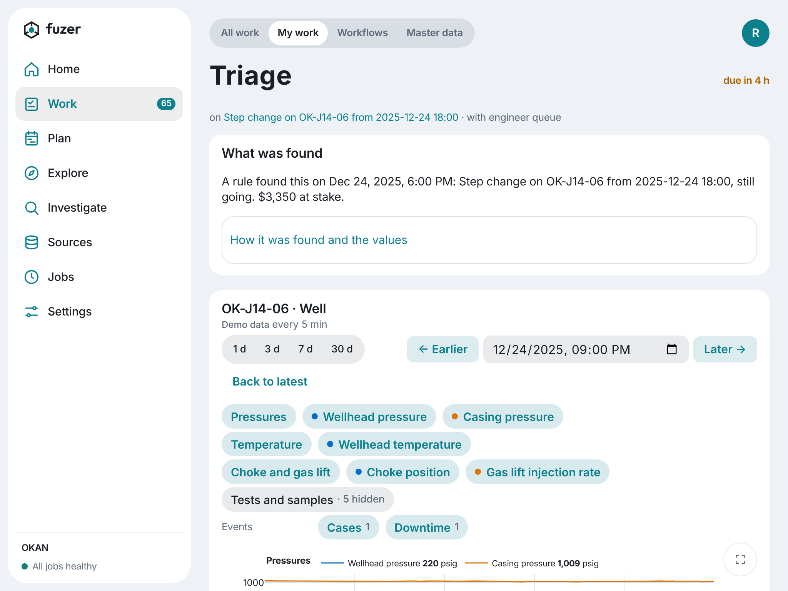
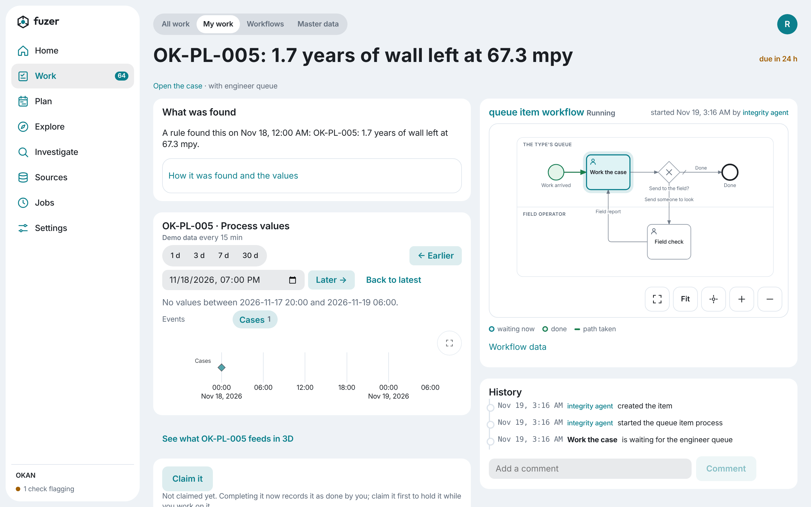

# Engineer

You are the desk most findings land on. The detectors, the inspection records, the alarm system and the rotating
machinery screen all raise work for the engineer queue: a process upset to triage, a line running out of wall, a
machine near surge, an alarm that will not clear. Your job is to say what each one is, send someone to look when
the data cannot tell you, and close it with what it turned out to be, so the next one like it is easier.

## What arrives in your queue

Open **Work > List** and pick **Waiting on me**. Beside your own steps is what waits unclaimed in the engineer queue,
with **Take it** on its row.
Each row says what kind of work it is, the asset, and when it is due. A step is usually due a day after it arrives
(a triage sooner) and is marked escalated in the engineer queue if nobody takes it.

| Kind of work | Where it comes from | What it usually needs |
|---|---|---|
| **Process upset** | The detectors, grouped by time and plant topology | Triage: real, not sure, or a false alarm |
| **IOW breach** | An integrity operating window held past its allowed time | A review, then a notification |
| **Compressor or pump trip** | The trip detectors, with the likely first cause | The checks before restart, often a field visit |
| **Machine health** | The rotating machinery screen: vibration, surge margin, seals, efficiency | A decision to watch, plan or act |
| **Inspection or wall loss finding** | Thickness readings and inspection plans | Plan the inspection or the repair |
| **Pig run anomaly, leak repair not holding** | In-line inspection runs and leak surveys | A repair that fixes the cause, not the leak |
| **Alarm flood, alarm bad actor** | The alarm system against ISA-18.2 and EEMUA 191 | Rationalise the alarm, or fix the instrument |
| **Loop cycling, quality drift, gas balance not closing** | Process data and lab samples | A look at the loop, the sample point or the meter |
| **Proof test, temporary change or limit change with no record** | The safeguard and change registers | Plan the test, or link the record |
| **An opportunity** | The daily scan: lift gas to move, a well below its decline, a repeat failure worth a permanent fix | Accept it, or say why not |

[Work types](../work-types.md) lists every type with what finds it.

{ loading=lazy }

## Triage an upset

Open a **Triage** step. The page is laid out in the order you need it:

- **What was found**: the finding in one sentence, with what is at stake. **How it was found and the values** opens
  the detector, its method and the numbers.
- **The asset's trend**, with the event marked, grouped by what the points measure. Step the window back and
  forward, or open it full screen.
- **How it spread**: every detection in time order, the first being the likely first cause, and other upsets
  around the same time marked as a likely cause, a likely knock-on, or seen together before. Time and links are
  leads, never causes.
- **Around the event** (on the case): the alarms that sounded and the operator log entries that mention the asset.
- On the right, **where the case is in its workflow**, and its history.

Then decide:

| Choice | What happens next |
|---|---|
| **Real upset: diagnose it** | The field operations agent drafts a diagnosis with cited evidence; you approve or reject its proposed action; the maintenance planner raises the notification; six hours later you confirm it is resolved |
| **Not sure: send someone to look** | A field operator gets a **Field check** on their phone with what you asked them to check. Their report comes back to this step |
| **False alarm: close it** | The case closes, and the pattern is remembered: later upsets with the same pattern say how often people called it a false alarm |

**Claim it** first if you want to hold it while you work; completing an unclaimed step records it as done by you.

=== "Desktop"

    { loading=lazy }

=== "iPad"

    { loading=lazy }

!!! tip "When no agent is running"

    The diagnosis step belongs to an agent. Where no AI provider is configured, the case says so at once and offers
    **Take it over**, which makes the step yours. Nothing waits silently: after 30 minutes with no worker, the step
    goes to a person's queue by itself.

## Work a finding from the records

An inspection finding, a machine health flag or an alarm bad actor arrives as one step, **Work the case**. The page
shows what was found and the values behind it (for a line: the governing reading, the corrosion rate and the years
of wall left), the asset's process values, and the same workflow picture.

From here you can:

- **Complete** it with a note, once you have done what it needs.
- **Send to the field**, with what to check. It comes back to you with the operator's note, photo or reading.
- **Hand off to someone else**: a person, another role's queue, or an agent.
- Put the work on the plan from **All work** (**More > Plan for a day**) when the answer is "at the next shutdown".

Many of these close by themselves. A finding stays open while its condition holds, and clears when a later survey,
a completed plan or a fixed instrument makes it untrue. You do not need to chase those.

{ loading=lazy }

## Close out, so it counts

Closing a case asks what it was: a real problem, a false alarm, a duplicate, or a data problem. For a real problem
it asks what failed, why and what was done, from the ISO 14224 lists, pre-filled from the case's own words so you
confirm rather than type; each filled field says so beside it. Off equipment those terms are optional, folded away
and left blank: only what you open and set there is saved. That is what makes closed work countable and comparable: how each detector's cases
turned out, on **How the work is running** and **Settings > Detection**, is read from these answers.

A real problem's close-out sets a re-check. When it is due you get a short case asking whether the fix held. "No"
reopens the first case as a repeat, and so does a new case on the same asset with the same failure mode.

## Keep the detectors honest

Every false alarm you close teaches the system something:

- **Settings > Detection** lists each detector with what it needs, when it last ran, what it raised, and how its
  cases were closed out. Switch one off for an asset, or change a threshold for one equipment class, with a reason
  that is kept.
- A **detector tuning** case arrives when one detector's cases on one equipment class keep closing as false alarms
  or duplicates. It proposes a quieter value, replayed on history so you can see what it would have missed.
- The **agentic watch** reads each process area the way an engineer scans the day and proposes what looks unusual
  that no detector raised. By default it only keeps and scores its proposals. In live mode, which an owner turns
  on per asset once the watch has passed its bar, each proposal arrives in your queue as **Proposed by the watch**,
  to confirm or close as a false alarm.

## Good to know

- One event is one case. A trip, a machine health flag and an SAP notification on the same compressor arrive as one
  row with three sources, and one triage covers all three.
- Work on a machine that is down for planned work is held back, not lost. **All work** shows how many findings are
  suppressed and by which windows.
- A safety case (an IOW breach) is never shelved and never held back by planned work.
- **Ask about this case**, at the top of a case, opens the assistant with the case as context. Each question is a
  deliberate, metered call, and needs an AI provider.
