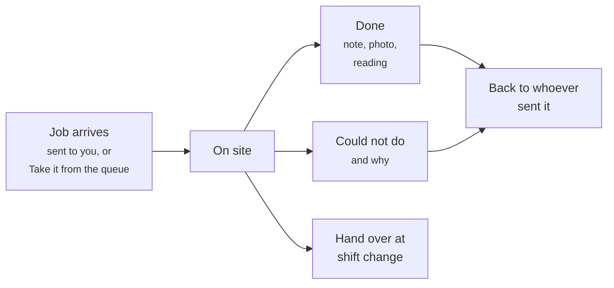
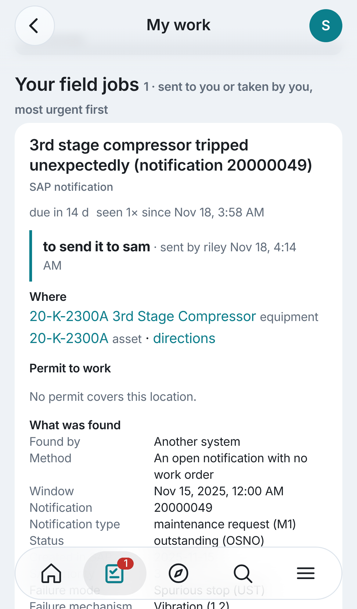
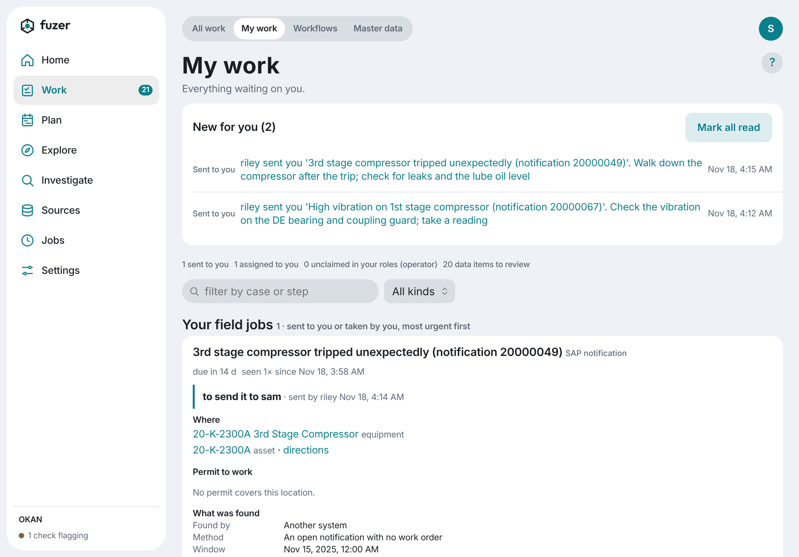
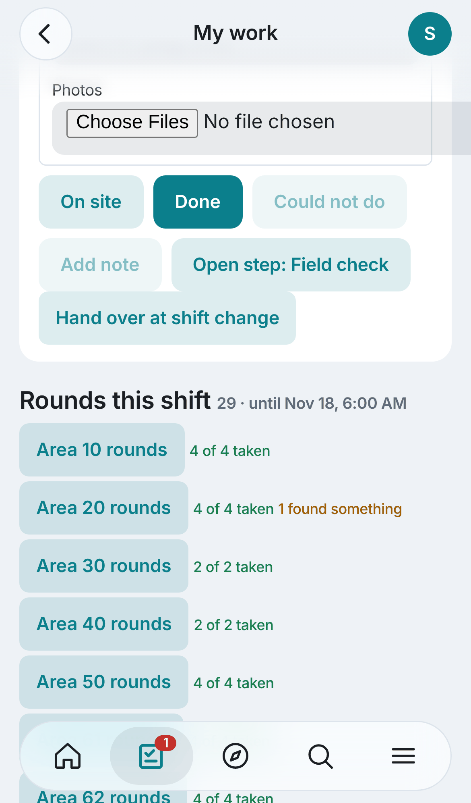

# Field operator

You are the one the IOC sends. Your phone is your whole interface: the jobs sent to you, the jobs waiting in your
crew's queue, this shift's rounds, and the few things you need to say back. It works with a glove on and with no
signal.

## Install it on the phone

Open the site in Safari (iPhone) or Chrome (Android) and add it to the home screen (**Share > Add to Home Screen**,
or **Install app**). It then opens on its own like an app: no browser bar, an in-app **Back** that never leaves the
app, and the bottom bar holds **Home**, **My work**, **Explore** and **Investigate** in thumb reach. Opened again
later, it resumes on the last page.

## Pick up a job

Open **My work**. Jobs sent to you come first, then jobs waiting in your roles' queues. Each job card carries:

- the IOC's instruction: what to check or do;
- **Where**: the asset by its tag and description, with directions in the phone's own maps app;
- **What was found**: the evidence that raised it, and which systems reported it;
- **Lately at this asset**: the recent work, incidents and log entries on it;
- **Before you start**: anything to check first, such as a permit to have in hand, and any **checks before
  restart**.

A job in a queue shows just what, where and how urgent, so a queue of three is not twenty screens long. Choose
**Take it** and the rest comes with it.

=== "Phone"

    { loading=lazy width="390" }

=== "iPad"

    { loading=lazy }

## Report back

On the job, tap **On site** when you get there. When you are finished:

- **Done**, with a note, a photo or a reading. Dictation works in the note field.
- **Could not do**, with why: no access, parts missing, needs a different trade.
- **Add note** for anything in between.

Every report lands on the case the IOC sees, and Done or Could not do hands the job back to whoever sent it. You do
not need to close anything yourself; the IOC closes it out. The one exception is a job nobody sent (raised straight
into your queue and taken from there), which Done closes.

If the shift ends before the job does, **Hand over at shift change**: who takes it, what was done, what is left, and
anything unsafe to leave. The incoming operator accepts the handover on their phone.

## Walk your rounds

**Rounds this shift** on My work lists each area's rounds and how many points are taken. Open a round and take each
point: a reading (checked against the point's limits on the phone, so you know at once if it is out) or a check
(**Passed** or **Found something**). Something found, or a reading outside its limits, goes to the IOC as a round
finding and arrives on All work like any other work.

{ loading=lazy width="390" }

## With no signal

The day's work is kept on the phone. When My work loads with signal, each of your jobs' assets, their documents and
drawings, a 72-hour trend and the rounds are kept in the background. With no signal:

- My work opens with the kept jobs, and the top bar says there is no signal and since when;
- asset pages you need say "No signal: kept on this phone";
- reports, readings, close-outs and handover accepts wait in the **outbox** on the phone, shown on their job as
  waiting to send, and go by themselves when the signal returns, oldest first;
- taking a job from a queue needs signal, and says so.

A report the server refuses stays on the phone with its reason, so you can send it as a note, send it to another
job, or discard it. Nothing is sent twice.

## Good to know

- **Coming up** on My work lists planned work you are booked on; **Started** and **Done** update the plan.
- **How you are told** at the foot of My work sets whether new jobs also reach you by email, Teams or Slack.
- The full field behaviour, including checking an installed app on real iOS and Android devices, is in
  [workflow: the installed app on a phone](../workflow.md#the-installed-app-on-a-phone).
