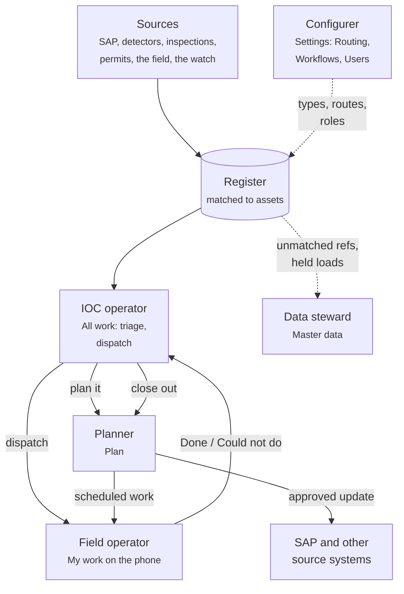

# Guides by role

Fuzer is built around the people who run an integrated operations centre (IOC) and the people it sends to site.
Each guide follows one role's real jobs from start to finish on the Okan demo, on the device that role really uses.

- **[IOC operator](ioc-operator.md)**

    Triage what came in, dispatch it to the field, close out what comes back, answer a question, hand over the shift.

- **[Field operator](field-operator.md)**

    Pick up a job on the phone, go on site, report Done or Could not do, walk a round, work with no signal.

- **[Planner](planner.md)**

    Put work on the integrated plan, read the critical path, level a schedule against crews and cranes, approve the
    update that goes back to SAP.

- **[Data steward](data-steward.md)**

    Answer the register's questions, match a reference nothing matched, fix a held load.

- **[Configurer](configurer.md)**

    Define a new type of work, route it, draw its workflow, and give people their roles.

## How work moves between them

Work arrives from many sources, is matched to an asset in the register, and goes where the routing table sends it.
Each role picks it up at one point in that path. [How work is routed](../work-routing.md) explains the machinery.

## Roles in the demo

The Okan demo has a sample crew working its queue on today's clock, so there is always live work to follow. A
person can hold several roles, and an owner spans all of them.

| Role | Workflow role | Sample crew | Default SLA |
|---|---|---|---|
| IOC operator / ops lead | `ops_lead` | riley | 1 day |
| Field operator | `operator` | sam, alex | 4 hours |
| Planner | `maintenance_planner` | pat | 2 days |
| Data steward | `data_steward` | | 1 day |
| Engineer | `engineer`, `production_engineer` | | 1 day |

Roles are assigned under **Settings > Users** and are separate from sign-in access: who may use the app is an
application permission; who gets which work is a workflow role ([page ownership](../page-ownership.md)).

## Find your way around

The menu holds eight destinations. On a phone, the bottom bar keeps Home, My work, Explore and Investigate in
thumb reach, and **Menu** opens the rest, including Plan.

| Destination | What it is for | Main pages |
|---|---|---|
| **Home** | Where attention is needed now, on the field map and as a list | Home |
| **Work** | Everything that came in, and what waits on you | All work, My work, Workflows, Master data |
| **Plan** | Every planned activity from every source on one timeline | Plan, Schedules, Resources |
| **Explore** | Assets and how they connect | Browse, Map, Network, 3D |
| **Investigate** | Evidence and analysis | Downtime, Ask, Incidents, Daily reports, Metrics, Lessons, Studies |
| **Sources** | Connect, load and recover source data | Sources, Ontology |
| **Jobs** | Scheduled jobs and their runs | Jobs |
| **Settings** | Application settings, people and routing | Application settings, Users, Routing, Docs |
