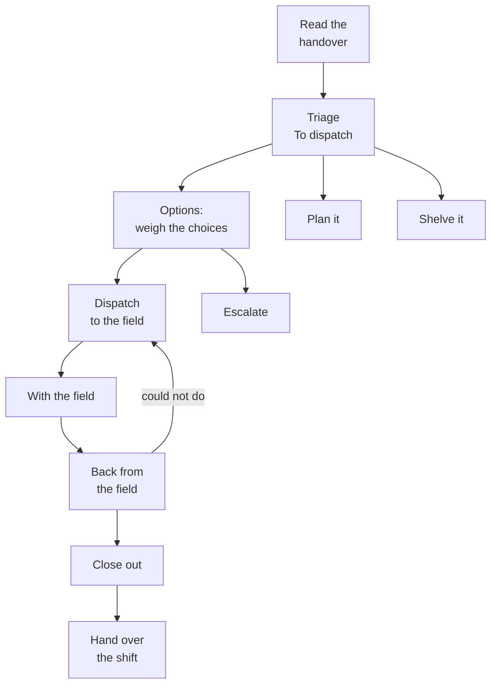
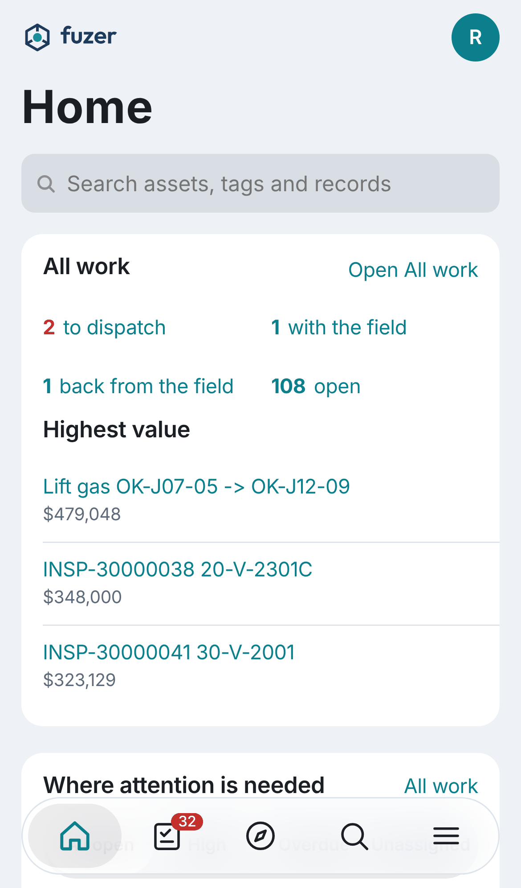
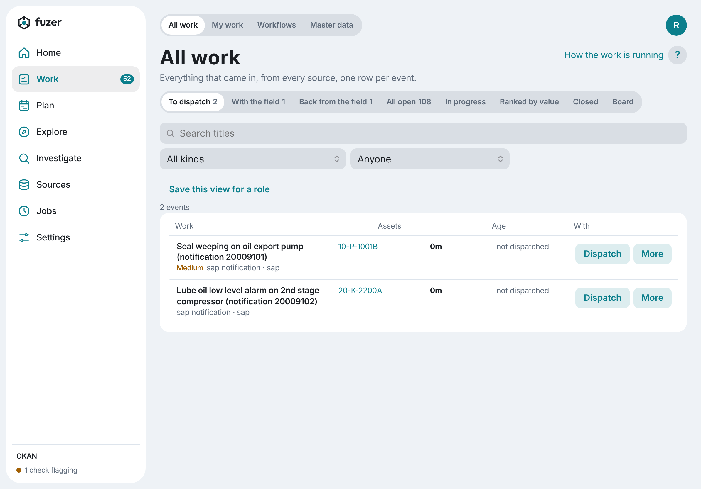
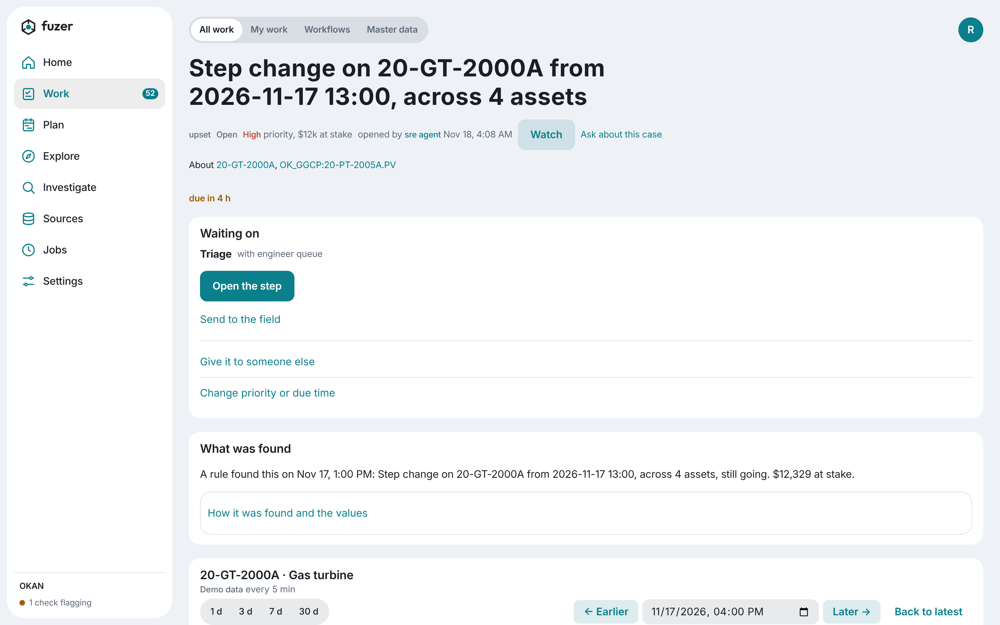
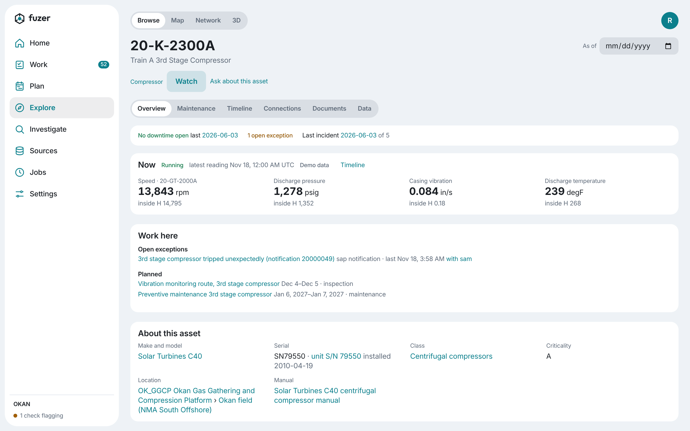

# IOC operator

You sit in the integrated operations centre. Work from every system arrives on one list, already matched to the
asset it is about. Your job is to decide what each piece needs, send the right person, read what comes back, close
it out, and hand the shift over cleanly. Most of this happens on a desktop or an iPad; all of it works on a phone.

## Start the shift

**Home** shows where attention is needed: open work gathered at the places it is about, on the field map and as a
ranked list, with filters for high priority, overdue and unassigned. Tap a place to open the List filtered to it.

=== "Desktop"

    { loading=lazy }

=== "iPad"

    { loading=lazy }

=== "Phone"

    { loading=lazy width="390" }

From the shift change until you acknowledge it, **Waiting on me** opens with a banner for the **shift handover**: what the
last shift left open by priority, what came back from the field and waits on you, what escalated or went overdue,
what was dispatched and to whom, and records to check. Every line links to its case. Read it, then
**Acknowledge**; that goes on the case history with your name and the time.

{ loading=lazy }

## Triage what came in

Open **Work > List** (titled All work). It is the IOC's one list, one row per event however many systems reported
it. Pick a **preset** at the top to follow the work through its life:

| Preset | What is in it |
|---|---|
| **Waiting on me** | Your steps, the unclaimed steps in your roles' queues, and, for the ops lead, everything To dispatch |
| **To dispatch** | Raised, matched to an asset, and waiting for you to decide |
| **Back from the field** | The field said Done or Could not do; waiting for you to close out or send again |
| **Overdue** | Anything past its due time |
| **Data questions** | The data steward's queue |
| All open work (no preset) | Every open event and case, whoever holds it |

The **Stage** filter does the rest: With a desk, On the plan, With the field, Closed. Sort by **Most valuable** to rank
everything outstanding by what it is worth. **Work > Board** shows the same rows in columns, one per stage.

Not everything starts under **To dispatch**. Work a desk owns goes straight to that role's queue: an inspection or wall
loss finding for the engineer, parts not ready for the planner, a permit lapsed with plant still isolated for the ops
lead. It shows on the holders' **Waiting on me** with **Take it**, and on the List as With a desk. You can still act on
it from its row: **Send to** gives it to a person or sends it to the field. [Every source of work](../work-sources.md)
says which road each source takes.

One filter bar (kind of work, stage, who holds it, team, source, facility, area, asset, words in the title) is shared
by the List and the Board and kept in the link, so you can switch without losing it, or send a colleague the exact list
you are looking at. A filter you use every shift can be saved as a view for your role.

=== "Desktop"

    { loading=lazy }

=== "iPad"

    { loading=lazy }

=== "Phone"

    { loading=lazy width="390" }

Each row names the work, its priority and the systems that reported it, the asset by its tag and description, how
long it has waited and who holds it. Click the title to open the **case**: what it is waiting on and who holds it (with **Open the step**, **Send to
the field** and **Give it to someone else**), the evidence each source saw, the asset's live trend, the alarms and log
entries **around the event**, and where the case sits in its workflow.

{ loading=lazy }

## Dispatch it to the field

For field work (an SAP notification, an upset, a trip, a lapsed permit, a round finding), start with **Options** on
the row. It sets four choices side by side: **Dispatch now**, **Ride along with the next visit** already booked on the
same equipment, **Shelve** until the area's next turnaround, and **Escalate** to the engineer. Each says when the work
would be done, the production deferred until then in barrels and dollars, the risk of waiting (only when its
criticality or a hazard is on record), and whether it is ready. One is recommended, with the reason; Shelve never is,
though you may choose it. Taking it is one tap; taking another takes an optional why, kept on the case. **Add to the
visit** gives the visit's operator (the operator queue when nobody is booked) a field job on the visit's day, asking
what was reported. A message that only asks a question, passes on a bulletin or says something is already over gets no
options: answer it and close it out.

To send it yourself, choose **Send to** on the row. Pick a person (shown with their roles, how much they hold, and
marked if they are away) or a role's queue, and say what to check or do: they see it on their job. Before you send,
Fuzer checks the job is ready from the equipment's records, such as whether the work centre's crew is free, whether
a valid permit covers it, and whether the parts reserved on the job's own work order are in stock (a job with no order
has no parts to wait on). If it is not ready you can still send it, with a reason that is kept on the case. A send to
the maintenance planner is never held: planning the parts and the crew is their work. A job sent
to a queue waits there until one of its holders chooses **Take it**.

{ loading=lazy }

Not everything needs someone now. Under **More**:

- **Plan for a day** puts it on the [integrated plan](planner.md), where it can ride along with other work on the
  same equipment or wait for a shutdown. On its day it comes back to To dispatch.
- **Shelve until a date** takes a standing condition that can wait (a known seal weep until the next outage) off
  the list and off every queue, with a reason, for at most 30 days. It comes back by itself when the date passes, or sooner with **Back on
  the list**. Safety work such as an IOW breach cannot be shelved.

Where several sources reported one event, the row lists each one. **Split out** gives a source that turns out to be a
different event its own case.

## Read what comes back

When the field reports **Done** or **Could not do**, the job comes back to the ops lead queue, not to whoever sent it
in person, so it is waiting for whoever is on shift. Pick the **Back from the
field** preset: each row carries the operator's note (and photo or reading, if they took one). **Close** on the row
opens the close-out, or open the case and either:

- **Close it out**, saying what it was and, for a real problem, what failed, why and what was done, from the
  ISO 14224 lists. The form comes pre-filled from the case's own words, so you confirm rather than type. Closing
  closes the case and every exception on it. Where the work came from
  another system, the update for that system is drafted for the planner to approve, so an SAP notification is
  completed in SAP rather than raised again.
- **Send it round again** if it could not be done, to the same person or someone else.

{ loading=lazy }

## Answer a question

Someone asks "what's going on with the 3rd stage compressor?". Search for the tag at the top of any page, or open
**Explore > Browse**. The asset page shows its golden values and which system each came from, its open work, recent
incidents, process trends, documents and drawings, and where it sits in the flow. **Investigate > Ask** puts the
question to the operations assistant, which answers only from loaded evidence and cites every fact. Each question
is a deliberate, metered call.

{ loading=lazy }

## Hand over the shift

At each shift change (06:00 and 18:00 by default, in the project's time zone) a handover is drafted from live work.
Before you leave, open it from the banner on **Waiting on me** (or **Shift handover** in the List's preset picker), add **outgoing notes**
for what the lines do not say (plans, risks, asks), and **Save notes**; both sit at the top, above what changed this
shift. **Draft the handover** brings it up to date from live work if the shift has moved on since it was drafted. The
incoming lead acknowledges it. The rest of the open work is on **All work**.

## Good to know

- **How the work is running**, in the List's preset picker, shows how fast work is triaged and closed, how each
  detector's cases turned out, and rounds done and missed per shift.
- A row with no asset means its reference matched nothing in the register. It can still be dispatched; the
  [data steward](data-steward.md#match-a-reference-nothing-matched) can make the reference an alias so the next one
  matches.
- A job that clashes with another (the same asset at once, hot work beside a line break) is flagged at Dispatch
  and is only sent with a reason.

- One event, one case: when SAP, a detector and an IOW breach all report the same compressor, you see one row with
  three sources. [How work is routed](../work-routing.md#3-one-event-one-case) explains how.
- Planned work suppresses what it explains: a trip on a compressor that is down for a scheduled shutdown is counted
  under the shutdown, not raised. All work shows how many findings were held back, and by which windows.
- What you dispatch is due by the work type's policy (SAP priority, for example) or the role's SLA, and is marked
  escalated in its queue if nobody acts.
