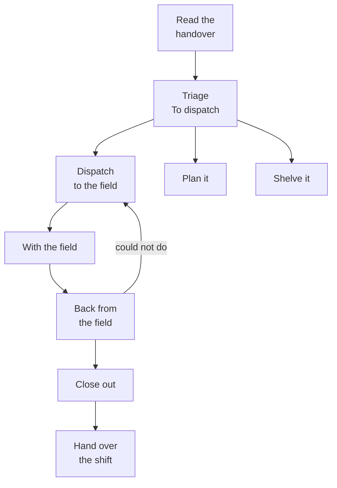
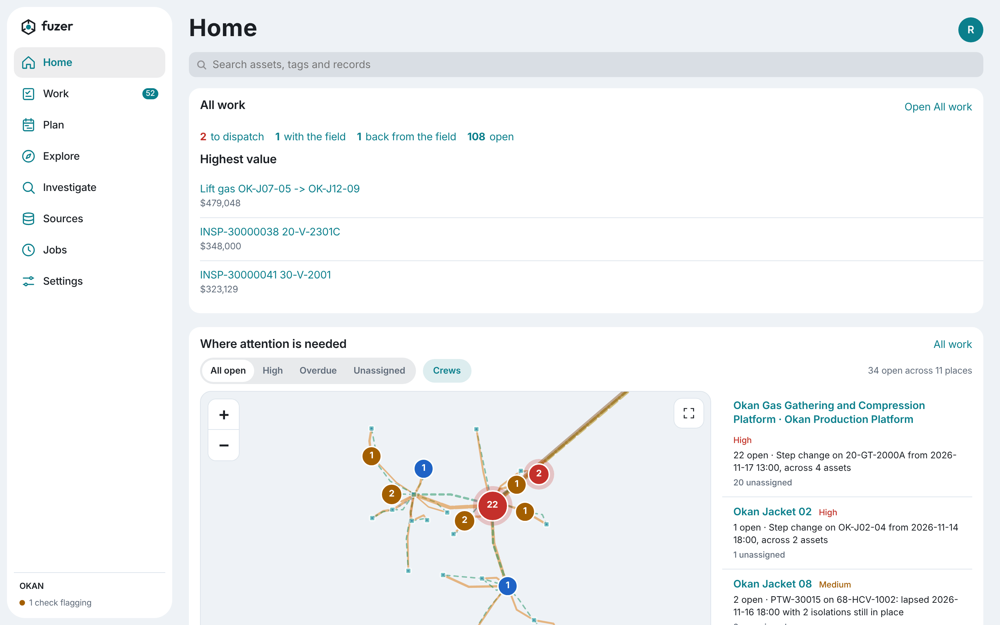
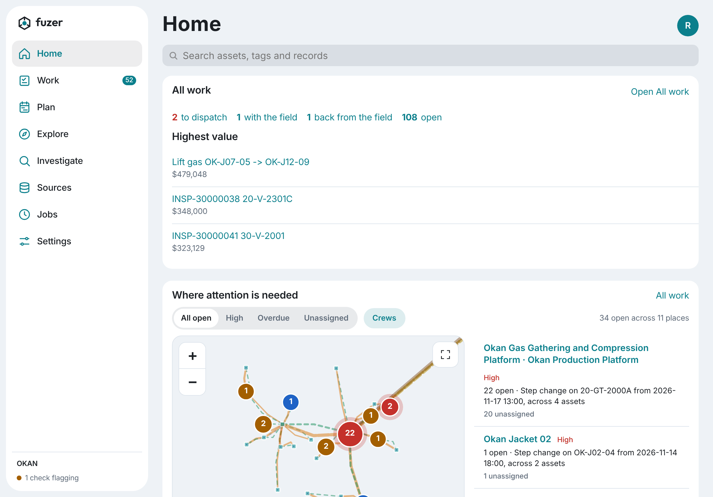
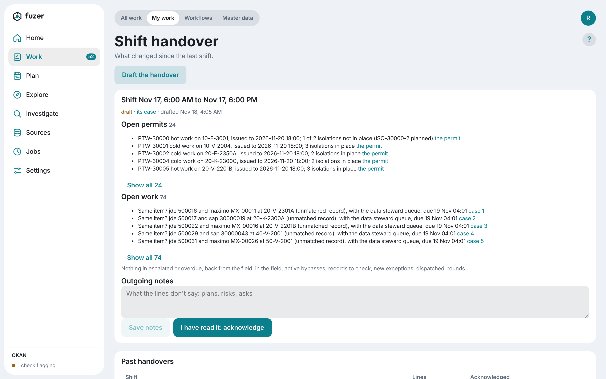
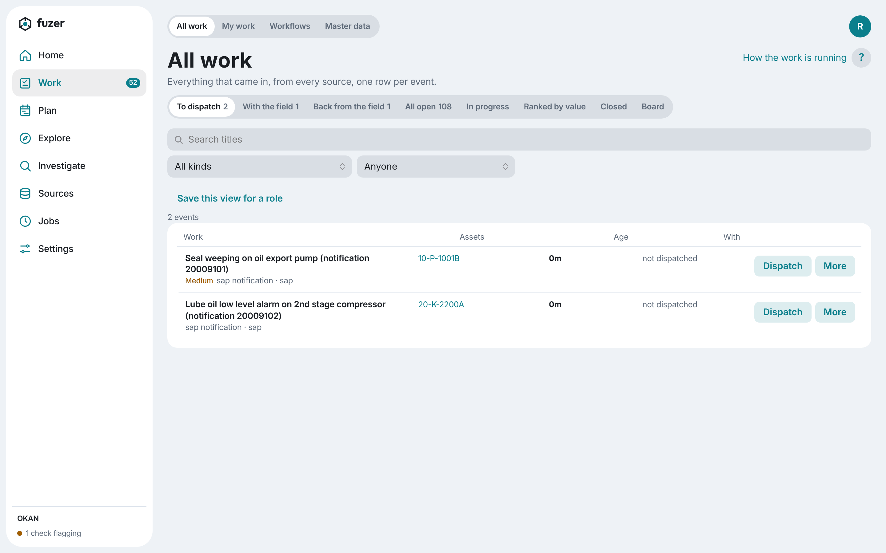
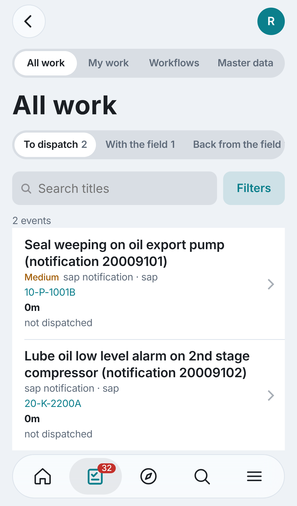
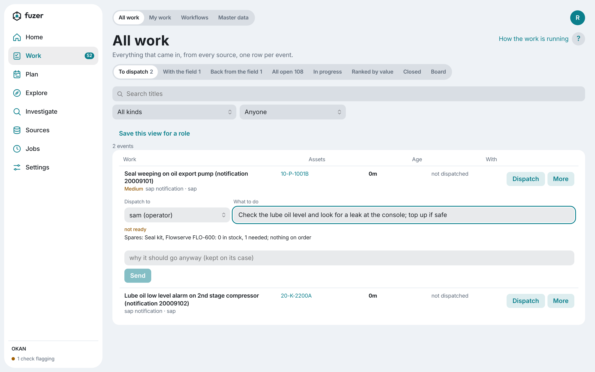
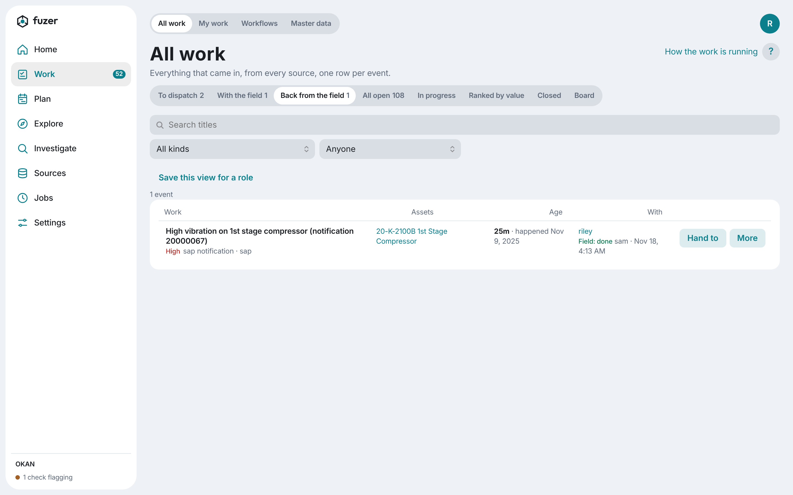

# IOC operator

You sit in the integrated operations centre. Work from every system arrives on one list, already matched to the
asset it is about. Your job is to decide what each piece needs, send the right person, read what comes back, close
it out, and hand the shift over cleanly. Most of this happens on a desktop or an iPad; all of it works on a phone.

## Start the shift

**Home** shows where attention is needed: open work gathered at the places it is about, on the field map and as a
ranked list, with filters for high priority, overdue and unassigned. Tap a place to open **All work** filtered to it.

=== "Desktop"

    { loading=lazy }

=== "iPad"

    { loading=lazy }

=== "Phone"

    { loading=lazy width="390" }

From the shift change until you acknowledge it, **My work** opens with a banner for the **shift handover**: what the
last shift left open by priority, what came back from the field and waits on you, what escalated or went overdue,
what was dispatched and to whom, and records to check. Every line links to its case. Read it, then
**Acknowledge**; that goes on the case history with your name and the time.

{ loading=lazy }

## Triage what came in

Open **Work > All work**. It is the IOC's one list, one row per event however many systems reported it. The views
along the top follow the work through its life:

| View | What is in it |
|---|---|
| **To dispatch** | Raised, matched to an asset, and waiting for you to decide |
| **With the field** | Sent to someone; they have not reported back yet |
| **Back from the field** | The field said Done or Could not do; waiting for you to close out |
| **All open** | Every open exception |
| **In progress** | Every open case, including workflow steps with engineers and planners |
| **Ranked by value** | Everything outstanding, ranked by what it is worth: backlog, PMs, incidents, opportunities |
| **Closed** | What is finished |
| **Board** | The open work by stage, one column per view |

Not everything starts under **To dispatch**. Work a desk owns goes straight to that role's queue and shows under
**All open** and **In progress**: an inspection or wall loss finding for the engineer, parts not ready for the
planner, a permit lapsed with plant still isolated for the ops lead. You can still act on it from its row: **Hand
to** gives it to a person or sends it to the field. [Where work goes](../work-map.md) shows which road each source
takes.

One filter bar (kind of work, who holds it, words in the title) is shared by every view and kept in the link, so you
can switch views without losing it, or send a colleague the exact list you are looking at.

=== "Desktop"

    { loading=lazy }

=== "iPad"

    { loading=lazy }

=== "Phone"

    { loading=lazy width="390" }

Each row names the work, its priority and the systems that reported it, the asset by its tag and description, how
long it has waited and who holds it. Click the title to open the **case**: what it is waiting on and who holds it (with **Open the step**, **Send to
the field** and **Give it to someone else**), the evidence each source saw, the asset's live trend, the alarms and log
entries **around the event**, and where the case sits in its workflow.

{ loading=lazy }

## Dispatch it to the field

On the row, choose **Dispatch**. Pick a person (shown with their roles, and marked if they are away) or a role's
queue, and say what to check or do: they see it on their job. Before you send, Fuzer checks the job is ready from
the equipment's records, such as whether the work centre's crew is free and whether a valid permit covers it. If it
is not ready you can still send it, with a reason that is kept on the case.

{ loading=lazy }

Not everything needs someone now. Under **More**:

- **Plan for a day** puts it on the [integrated plan](planner.md), where it can ride along with other work on the
  same equipment or wait for a shutdown.
- **Shelve until a date** takes a standing condition that can wait (a known seal weep until the next outage) off
  the list, with a reason, for at most 30 days. It comes back by itself when the date passes. Safety work such as an
  IOW breach cannot be shelved.
- **Split out** gives a source that turns out to be a different event its own case.

## Read what comes back

When the field reports **Done** or **Could not do**, the job comes back to whoever sent it. Open **Back from the
field**: each row carries the operator's note (and photo or reading, if they took one). Open the case and either:

- **Close it out**, saying what it was and, for a real problem, what failed, why and what was done, from the
  ISO 14224 lists. The form comes pre-filled from the case's own words, so you confirm rather than type. Closing
  closes the case and every exception on it. Where the work came from
  another system, the update for that system is drafted for the planner to approve, so an SAP notification is
  completed in SAP rather than raised again.
- **Send it round again** if it could not be done, to the same person or someone else.

{ loading=lazy }

## Answer a question

Someone asks "what's going on with the 3rd stage compressor?". Search for the tag at the top of any page, or open
**Explore > Browse**. The asset page shows its golden values and which system each came from, its open work, recent
incidents, process trends, documents and drawings, and where it sits in the flow. **Investigate > Ask** puts the
question to the operations assistant, which answers only from loaded evidence and cites every fact. Each question
is a deliberate, metered call.

{ loading=lazy }

## Hand over the shift

At each shift change (06:00 and 18:00 by default, in the project's time zone) a handover is drafted from live work.
Before you leave, open it from **My work** (or **Work > All work > How the work is running**), add **outgoing notes**
for what the lines do not say (plans, risks, asks), and **Save notes**. **Draft the handover** brings it up to date
from live work if the shift has moved on since it was drafted. The incoming lead acknowledges it.

## Good to know

- **How the work is running**, at the top of All work, shows how fast work is triaged and closed, how each
  detector's cases turned out, and rounds done and missed per shift.
- A row with no asset means its reference matched nothing in the register. It can still be dispatched; the
  [data steward](data-steward.md#match-a-reference-nothing-matched) can make the reference an alias so the next one
  matches.
- A job that clashes with another (the same asset at once, hot work beside a line break) is flagged at Dispatch
  and is only sent with a reason.

- One event, one case: when SAP, a detector and an IOW breach all report the same compressor, you see one row with
  three sources. [How work is routed](../work-routing.md#3-one-event-one-case) explains how.
- Planned work suppresses what it explains: a trip on a compressor that is down for a scheduled shutdown is counted
  under the shutdown, not raised. All work shows how many findings were held back, and by which windows.
- What you dispatch is due by the work type's policy (SAP priority, for example) or the role's SLA, and escalates
  along the role's chain if nobody acts.
