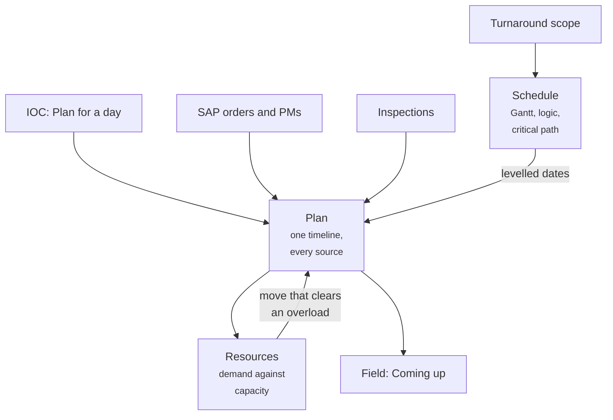
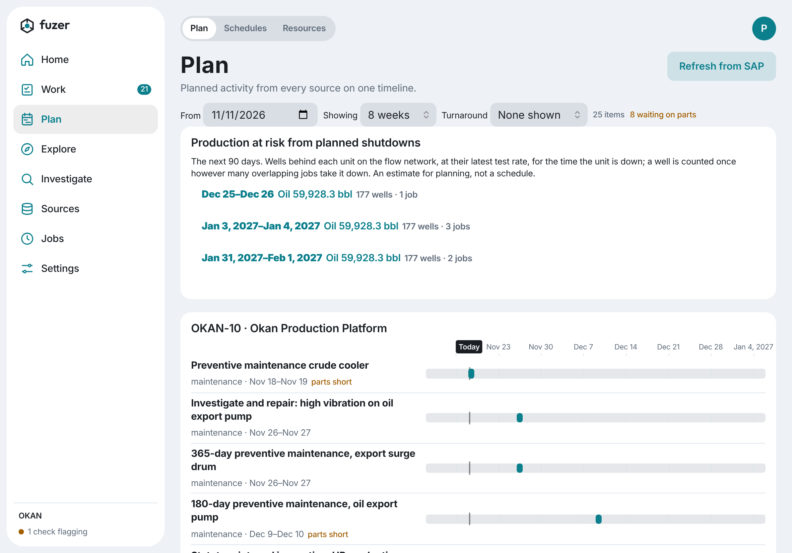
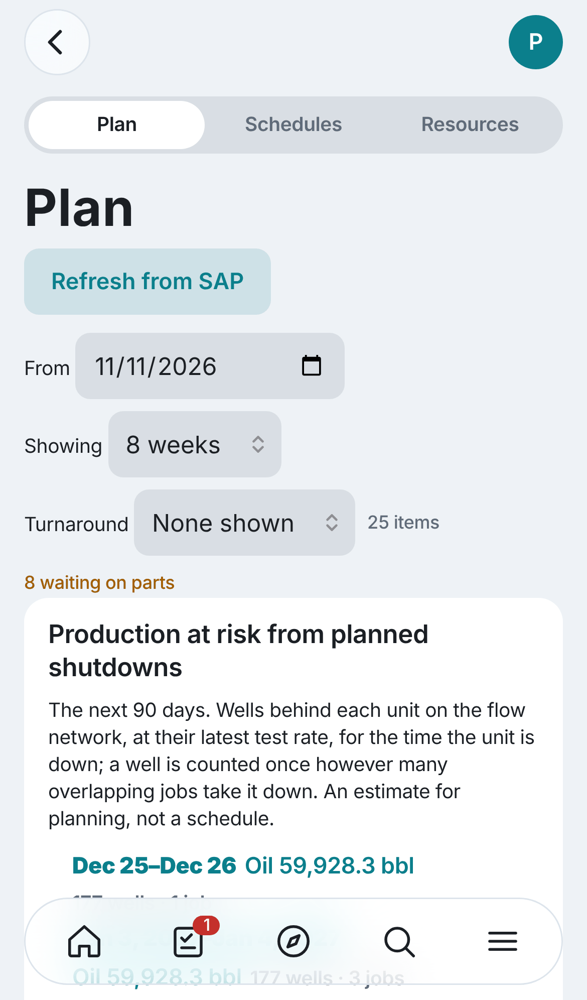
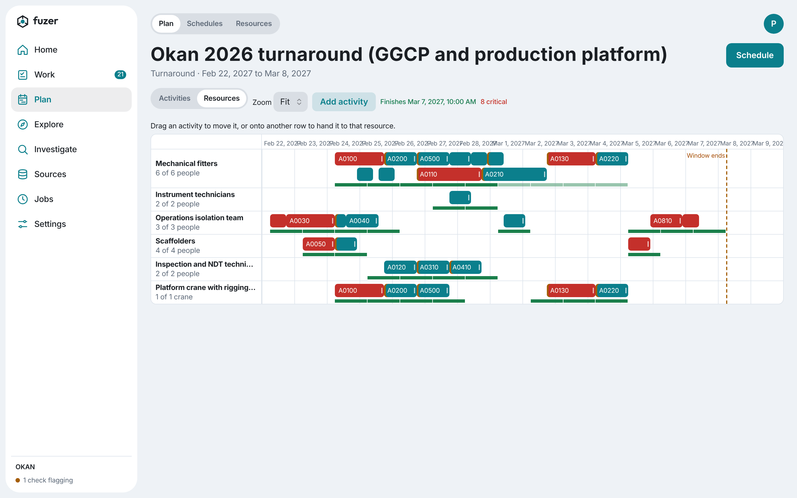

# Planner

You decide when work happens. **Plan** puts every planned activity from every source on one timeline, so two jobs
on one asset, a crew booked twice, and work that could ride along with a shutdown all show before they happen. A
turnaround, project or campaign opens as an interactive Gantt with its logic, critical path and resource levelling.
You also approve the updates that go back to SAP when the field closes work another system raised.

## Read the plan

Open **Plan**. Each area has its own lane on the timeline; each bar is an activity with its kind, dates and flags
such as **parts short** or **shutdown**. Choose a range of 2 to 26 weeks and shade a turnaround's window. Above the
timeline, **Production at risk from planned shutdowns** estimates the oil and gas behind each unit for the time it is
down over the next 90 days, counting each well once however many overlapping jobs take it down.

=== "Desktop"

    { loading=lazy }

=== "iPad"

    { loading=lazy }

=== "Phone"

    { loading=lazy width="390" }

Work reaches the plan from SAP orders and preventive maintenance plans (**Refresh from SAP**), inspection plans,
turnaround scope, and exceptions the IOC chose to **Plan for a day** instead of sending someone now. A count at the
top says how many activities are waiting on parts; **Parts not ready for planned work** also arrives as routed work,
so the IOC sees it too.

## Work a turnaround schedule

Open **Plan > Schedules** and pick one (for example **OK-TAR-2026**, the Okan 2026 turnaround) to open it as a Gantt board. Activities are grouped by work order with
their logic drawn; switch **Rows** to **Resources** to see the same work by crew, crane or other shared resource.

{ loading=lazy }

- Drag a bar to hold its start; drag its right edge to change how long it takes.
- Select an activity and drag its dot to another bar to link them (finish to start, start to start, finish to
  finish, start to finish).
- Click an activity to edit its properties, **Predecessors** and what it **Needs** from each resource.
- In the Resources rows, drag work onto another resource's row to hand it over.

Every change recalculates the critical path (shown in red, with the count of critical activities) and the finish,
levelled against every shared resource with other planned work on them counted. **Undo** walks changes back.
When it is right, **Schedule** puts the levelled dates on the plan.

{ loading=lazy }

=== "By resource"

    { loading=lazy }

=== "Phone"

    { loading=lazy width="390" }

## Balance shared resources

**Plan > Resources** is the resource owners' view: each crew, crane, bed or seat's demand from every source on the
plan, day by day against its capacity, split by where it comes from (each schedule, SAP orders on the work centre,
campaigns, operator rounds). Each overload lists the jobs in it and the **Move** that clears it at the least cost
(the job with the most float, or work with no schedule logic behind it). **Change capacity** or **Set for a while**
records a capacity window such as leave, a certification lapsing or a vessel in dock; **Add a resource** adds one.

{ loading=lazy }

## Approve the update that goes back to SAP

When the field reports Done or Could not do on work SAP raised, the update for SAP is drafted and lands in the
maintenance planner queue on **My work**: a completion with the field's note and the closed status, or a follow-up
notification saying what still needs doing and why. Open it, edit the text if needed, and **approve** it or decide
not to send it. Once SAP applies it, the next intake sees the new status and the work is not raised again.

How each system's updates go back (not at all, drafted for approval, or sent) is set per system on **Sources**.

## Ask about the plan

On **Investigate > Ask**, the Work Management specialist can name a turnaround's critical activities, its
unconstrained and levelled finish and the resource that drives it, citing the records, and draw a Gantt.
