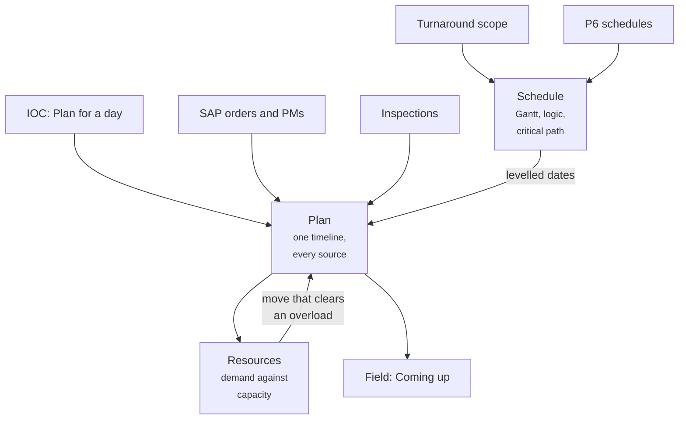
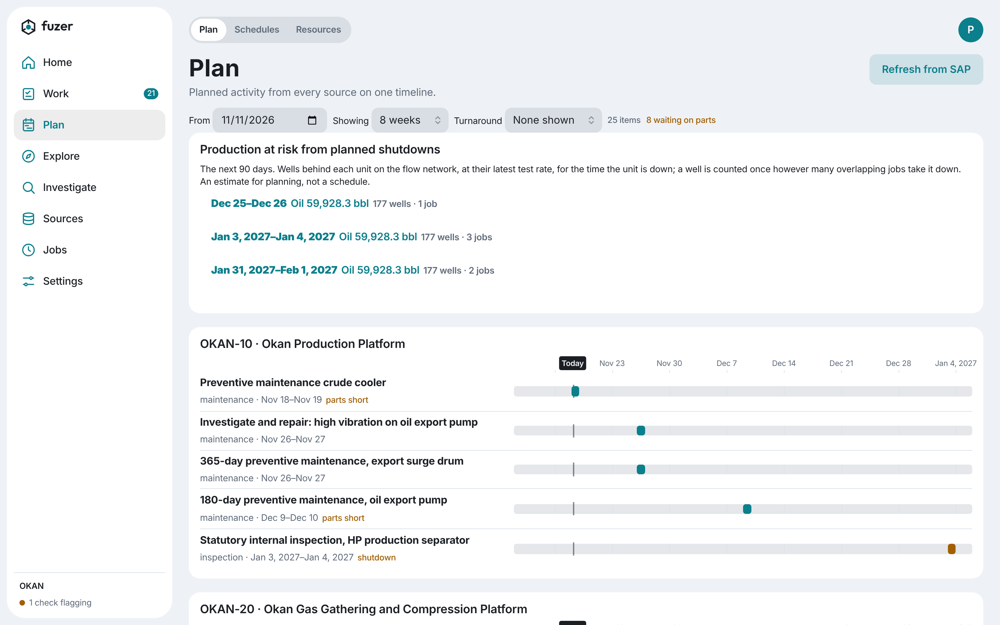
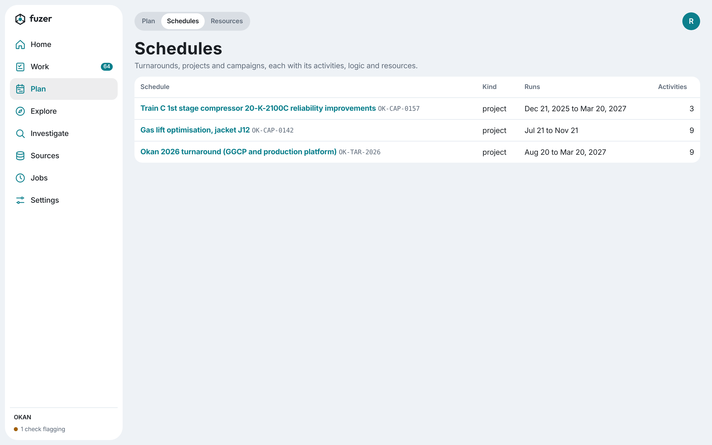
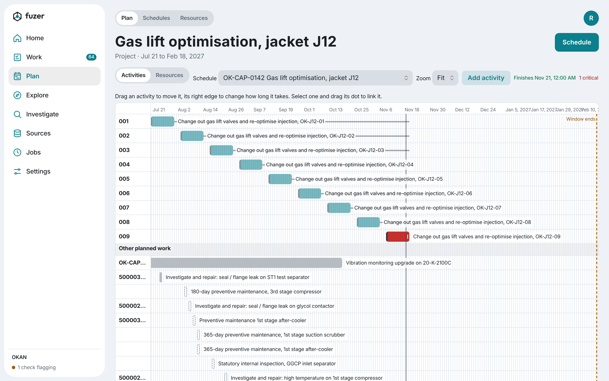
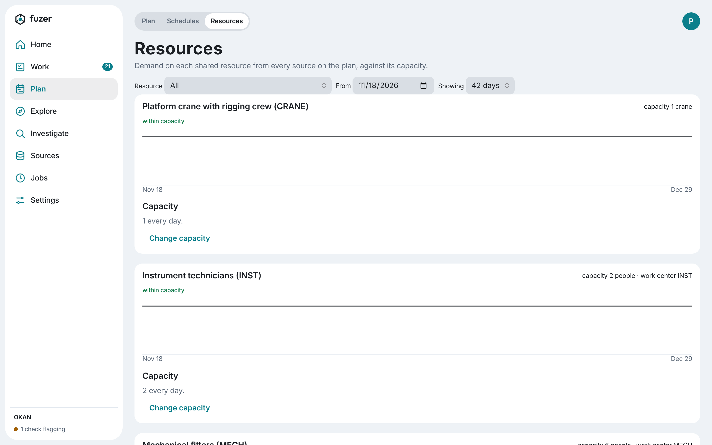

# Planner

You decide when work happens. **Plan** puts every planned activity from every source on one timeline, so two jobs
on one asset, a crew booked twice, and work that could ride along with a shutdown all show before they happen. A
turnaround, project or campaign opens as an interactive Gantt with its logic, critical path and resource levelling.
You also approve the updates that go back to SAP when the field closes work another system raised.

## Read the plan

Open **Plan**. It opens on today, one day long, with the hours marked and **Now** above them; choose a range of 1 to
26 weeks for longer and shade a turnaround's window. It lists the work still to do: a job that is done or cancelled
leaves it, and a field job leaves it when the field says **Done**. Each area has its own lane on the timeline; each
bar is an activity with its kind, dates and flags such as **parts short** or **shutdown**. Exceptions the field raised about one piece of equipment are
one row, named for it with how many there are; it opens to each of them. Above the
timeline, **Production at risk from planned shutdowns** estimates the oil and gas behind each unit for the time it is
down over the next 90 days, counting each well once however many overlapping jobs take it down.

=== "Desktop"

    { loading=lazy }

=== "iPad"

    { loading=lazy }

=== "Phone"

    { loading=lazy width="390" }

Work reaches the plan from five places, and none of it is typed twice:

| Source | What lands on Plan | When |
|---|---|---|
| SAP work orders | Each open order with dates: released ones as scheduled, the rest as proposed. An order on a revision is marked as needing the shutdown | After every register build, and **Refresh from SAP** |
| SAP maintenance and inspection plans | The next due date of each plan, as a proposed job on that day | The same |
| A planning system (Primavera P6) | Each top activity with activities under it, as a schedule under **Schedules** | The same |
| Turnaround, project and campaign templates | A schedule with logic and resource needs, from the facility's bundle | When the facility is set up |
| The IOC | An exception sent to **Plan for a day** instead of to someone now | When the IOC chooses |

A count at the top says how many activities are waiting on parts. A planned order whose reserved parts will not
arrive by the day it needs them also arrives as routed work, **Parts not ready for planned work**, in the
maintenance planner queue, on **Waiting on me**, with every late or short line on one case. It closes by itself when
stock or an order due in time covers every line.

{ loading=lazy }

!!! tip "Reading the flags on a bar"

    **clash** (red): another job on the same asset at the same time, a person booked twice, or two jobs whose permits
    must not run side by side. **bundle** (green): the job falls near a shutdown of its area and could be done in
    it. **parts short**: a part reserved on the job's own work order is not covered by stock; open the job to read
    which under **Spares**. A job with no order has no parts to be short of. **shutdown**: the
    job needs the unit down, so it counts in production at risk and holds back trips and upsets on that unit while it
    runs.

## Work a turnaround schedule

Open **Plan > Schedules** and pick one (for example **OK-TAR-2026**, the Okan 2026 turnaround) to open it as a Gantt board. Activities are grouped by work order with
their logic drawn; switch **Rows** to **Resources** to see the same work by crew, crane or other shared resource.

{ loading=lazy }

A schedule that came from a planning system arrives at the export's dates with its percent complete, the assets
each activity is located at, and the SAP order it executes as its group. The export carries no logic and no
resource needs, so Fuzer makes none up: add them here if you want it levelled. Dates you move by hand are kept, and
progress always follows the export.

{ loading=lazy }

- Drag a bar to hold its start; drag its right edge to change how long it takes.
- Select an activity and drag its dot to another bar to link them (finish to start, start to start, finish to
  finish, start to finish).
- Click an activity to edit its properties, **Predecessors** and what it **Needs** from each resource.
- In the Resources rows, drag work onto another resource's row to hand it over.

Every change recalculates the critical path (shown in red, with the count of critical activities) and the finish,
levelled against every shared resource with other planned work on them counted. **Undo** walks changes back.
When it is right, **Schedule** puts the levelled dates on the plan.

Under the schedule's own activities, **Other planned work** lists everything else active in its span: SAP orders
(released ones filled, planned ones outlined), campaigns and other schedules' jobs. That is the work competing for
the same crews and the same plant, without leaving the Gantt.

{ loading=lazy }

=== "By resource"

    { loading=lazy }

=== "Phone"

    { loading=lazy width="390" }

## Balance shared resources

**Plan > Resources** is the resource owners' view: each shared resource's demand from every source on the plan,
day by day against its capacity, split by where it comes from (each schedule, SAP orders on the work centre,
campaigns, operator rounds). Each overload lists the jobs in it and the **Move** that clears it at the least cost
(the job with the most float, or work with no schedule logic behind it). **Change capacity** or **Set for a while**
records a capacity window such as leave, a certification lapsing or a vessel in dock; **Add a resource** adds one.

| Resource | What counts against it |
|---|---|
| **Crews** | The people each activity needs, and the SAP orders on the crew's work centre |
| **Cranes and other equipment** | The activities that need them |
| **Beds** | Everyone offshore: the visiting crews on top of the core crew |
| **Seats** | Each crew flying out at its peak size the day its first job starts, and back the day its last one ends |
| **Vessel support** | The jobs that need the supply vessel alongside |
| **Operators** | The shift's rounds: every round point once a shift, before any planned job is counted |
| **Production capacity** | What each shutdown job takes offline, in BOE/d, counting each well once however many jobs take it down |

{ loading=lazy }

## Approve the update that goes back to SAP

When the field reports Done or Could not do on work SAP raised, the update for SAP is drafted and lands in the
maintenance planner queue, on **Waiting on me**: a completion with the field's note and the closed status, or a follow-up
notification saying what still needs doing and why. Open it, edit the text if needed, and **approve** it or decide
not to send it. Once SAP applies it, the next intake sees the new status and the work is not raised again.

How each system's updates go back (not at all, drafted for approval, or sent) is set per system on **Sources**.

## Good to know

- **Coming up** on a field operator's My work lists planned work they (or a role they hold) are booked on as crew.
  Open a bar on Plan and choose **Who**: a person or a role's queue from the roster is who it is booked on, and a
  crew books that many of its people (**People**, then **Book**) on the crew's capacity. Their **Started** and
  **Done** update the plan.
- A job planned from an exception stays linked to its case: the row on All work says it is planned, and it leaves
  **To dispatch** until the day.
- Scheduled work holds back findings it explains. If the IOC asks why a trip did not raise a case, the answer is
  often a bar on your plan.
- A clash does not stop you saving. It is checked again when the job is dispatched, where it is only sent with a
  reason.

## Ask about the plan

On **Investigate > Ask**, the Work Management specialist can name a turnaround's critical activities, its
unconstrained and levelled finish and the resource that drives it, citing the records, and draw a Gantt.
