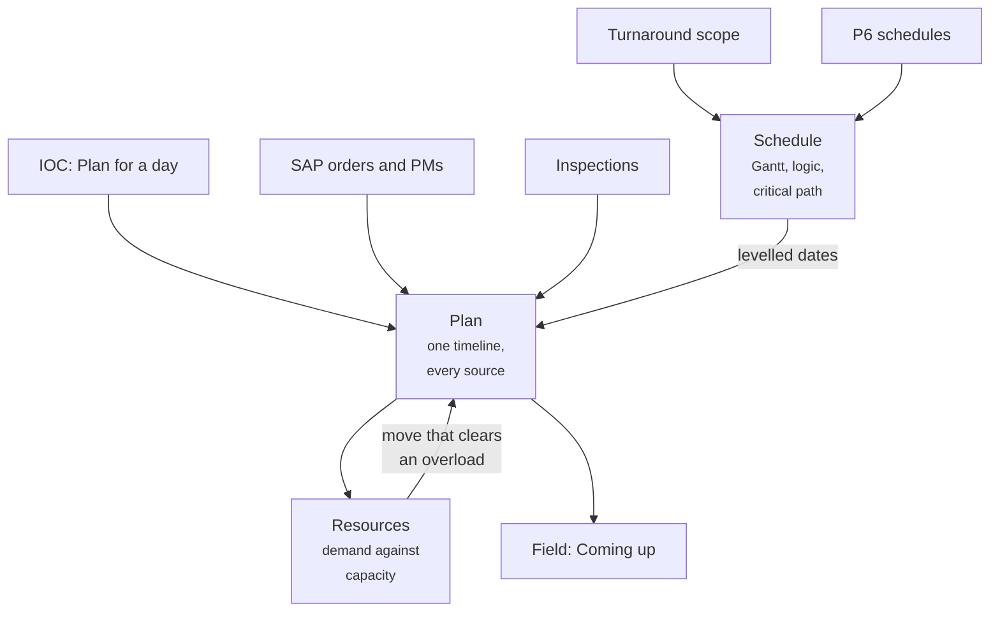
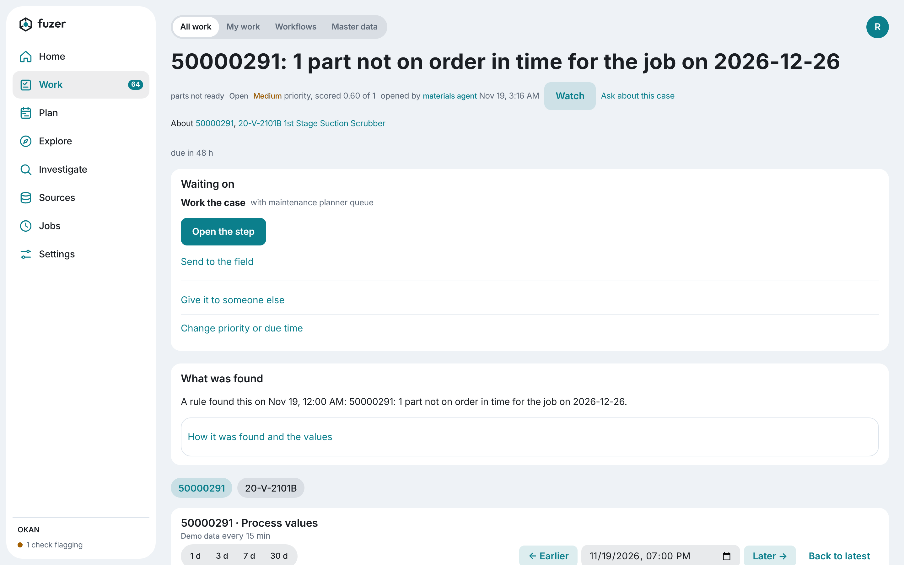
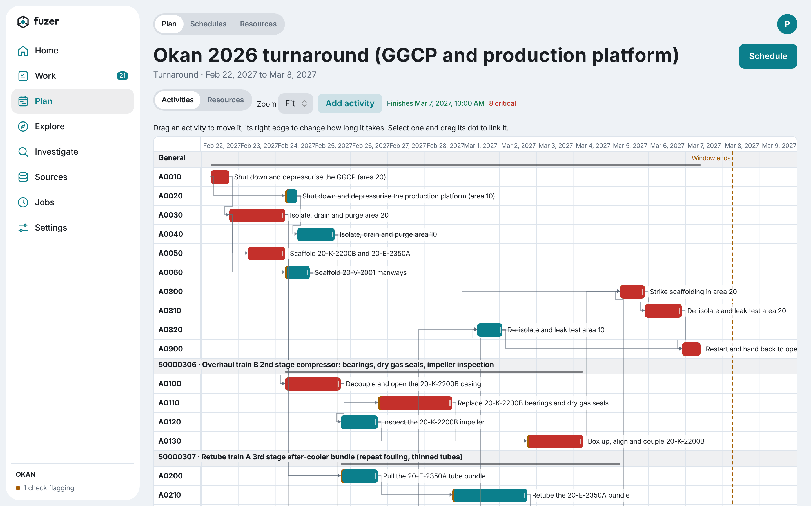
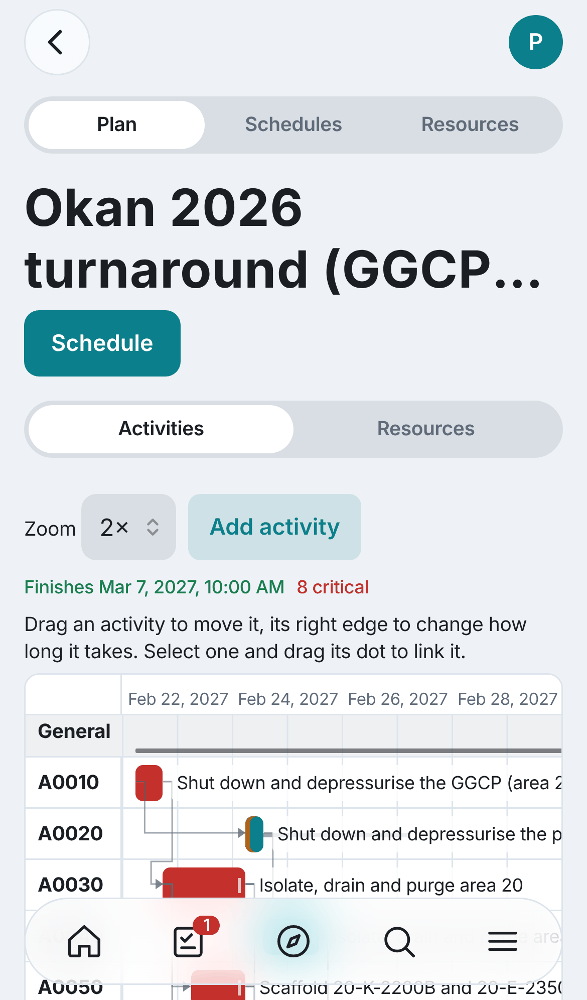

# Planner

You decide when work happens. **Plan** puts every planned activity from every source on one timeline, so two jobs
on one asset, a crew booked twice, and work that could ride along with a shutdown all show before they happen. A
turnaround, project or campaign opens as an interactive Gantt with its logic, critical path and resource levelling.
You also approve the updates that go back to SAP when the field closes work another system raised.

## Read the plan

Open **Plan**. It opens on today, one day long, with the hours marked and **Now** above them; choose a range of 1 to
26 weeks for longer and shade a turnaround's window. It lists the work still to do: a job that is done or cancelled
leaves it, and a field job leaves it when the field says **Done**. Each area has its own lane on the timeline; each
bar is an activity with its kind, dates and flags such as **parts short** or **shutdown**. Exceptions the field raised about one piece of equipment are
one row, named for it with how many there are; it opens to each of them. Above the
timeline, **Production at risk from planned shutdowns** estimates the oil and gas behind each unit for the time it is
down over the next 90 days, counting each well once however many overlapping jobs take it down.

=== "Desktop"

    { loading=lazy }

=== "iPad"

    { loading=lazy }

=== "Phone"

    { loading=lazy width="390" }

Work reaches the plan from five places, and none of it is typed twice:

| Source | What lands on Plan | When |
|---|---|---|
| SAP work orders | Each open order with dates: released ones as scheduled, the rest as proposed. An order on a revision is marked as needing the shutdown | After every register build, and **Refresh from SAP** |
| SAP maintenance and inspection plans | The next due date of each plan, as a proposed job on that day | The same |
| A planning system (Primavera P6) | Each top activity with activities under it, as a schedule under **Schedules** | The same |
| Turnaround, project and campaign templates | A schedule with logic and resource needs, from the facility's bundle | When the facility is set up |
| The IOC | An exception sent to **Plan for a day** instead of to someone now | When the IOC chooses |

A count at the top says how many activities are waiting on parts. A planned order whose reserved parts will not
arrive by the day it needs them also arrives as routed work, **Parts not ready for planned work**, in the
maintenance planner queue, on **Waiting on me**, with every late or short line on one case. It closes by itself when
stock or an order due in time covers every line.

{ loading=lazy }

!!! tip "Reading the flags on a bar"

    **clash** (red): another job on the same asset at the same time, a person booked twice, or two jobs whose permits
    must not run side by side. **bundle** (green): the job falls near a shutdown of its area and could be done in
    it. **parts short**: a part reserved on the job's own work order is not covered by stock; open the job to read
    which under **Spares**. A job with no order has no parts to be short of. **shutdown**: the
    job needs the unit down, so it counts in production at risk and holds back trips and upsets on that unit while it
    runs.

## Work a turnaround schedule

Open **Plan > Schedules** and pick one (for example **OK-TAR-2026**, the Okan 2026 turnaround) to open it as a Gantt board. Activities are grouped by work order with
their logic drawn; switch **Rows** to **Resources** to see the same work by crew, crane or other shared resource.

{ loading=lazy }

A schedule that came from a planning system arrives at the export's dates with its percent complete, the assets
each activity is located at, and the SAP order it executes as its group. The export carries no logic and no
resource needs, so Fuzer makes none up: add them here if you want it levelled. Dates you move by hand are kept, and
progress always follows the export.

{ loading=lazy }

- Drag a bar to hold its start; drag its right edge to change how long it takes.
- Select an activity and drag its dot to another bar to link them (finish to start, start to start, finish to
  finish, start to finish).
- Click an activity to edit its properties, **Predecessors** and what it **Needs** from each resource.
- In the Resources rows, drag work onto another resource's row to hand it over.

Every change recalculates the critical path (shown in red, with the count of critical activities) and the finish,
levelled against every shared resource with other planned work on them counted. **Undo** walks changes back.
When it is right, **Schedule** puts the levelled dates on the plan.

Under the schedule's own activities, **Other planned work** lists everything else active in its span: SAP orders
(released ones filled, planned ones outlined), campaigns and other schedules' jobs. That is the work competing for
the same crews and the same plant, without leaving the Gantt.

{ loading=lazy }

=== "By resource"

    { loading=lazy }

=== "Phone"

    { loading=lazy width="390" }

## Balance shared resources

**Plan > Resources** is the resource owners' view: each shared resource's demand from every source on the plan,
day by day against its capacity, split by where it comes from (each schedule, SAP orders on the work centre,
campaigns, operator rounds). Each overload lists the jobs in it and the **Move** that clears it at the least cost
(the job with the most float, or work with no schedule logic behind it). **Change capacity** or **Set for a while**
records a capacity window such as leave, a certification lapsing or a vessel in dock; **Add a resource** adds one.

| Resource | What counts against it |
|---|---|
| **Crews** | The people each activity needs, and the SAP orders on the crew's work centre |
| **Cranes and other equipment** | The activities that need them |
| **Beds** | Everyone offshore: the visiting crews on top of the core crew |
| **Seats** | Each crew flying out at its peak size the day its first job starts, and back the day its last one ends |
| **Vessel support** | The jobs that need the supply vessel alongside |
| **Deck space** | The jobs whose parts are laid down on deck while they are out, in m² |
| **Operators** | The shift's rounds: every round point once a shift, before any planned job is counted |
| **Production capacity** | What each shutdown job takes offline, in BOE/d, counting each well once however many jobs take it down |

{ loading=lazy }

Weather is a capacity window on what it stops: fog that closes the helideck takes the seats to 0 for the day, wind
over a crane's limit takes the crane to 0 for those hours. A turnaround's template can carry its forecast windows,
and the owner sets more with **Set for a while** and a reason that says what it is. Levelling keeps a schedule's
activities out of a crane's or a crew's window; seats follow the schedule, so a crew due to fly out on a fog day is
an overload.

### The constraint check

Every overload on every resource, from all sources at once, is the constraint check. A job in one carries an
**over capacity** flag on the Plan timeline, with a count at the top; open it to read each resource it is over on,
the need against the capacity, the dates and the reason of any window behind it (**Weather: fog forecast, helideck
closed**), linked to the resource on **Resources**. A crew's trip in an overload names the job it flies out for or
back after, and that job carries the flag: moving it moves the trip. On Resources each overload lists the jobs in it
and the moves that clear it.

### Rules typed in words

**Rules** on Plan holds the planner's own rules. Type one and choose **Add rule**; Fuzer reads it without a model,
says it back as it read it (**A0130 done by Wed 15 Apr 00:00**) with its form, and lists each job breaking it. Each of
those jobs carries **breaks a rule** on the timeline and a red mark around its bar; open it to read the rule and how it
breaks it. Untick a rule to switch it off (it stays, and marks nothing); **Remove** takes it out.

| Form | You type | A job breaks it when |
|---|---|---|
| deadline | A0130 done by 15 Apr | it finishes after that day (an activity, an SAP order with its operations, or a whole schedule) |
| duration | no job longer than 36 h, no MECH job longer than 36 h | it runs longer, on that resource when one is named |
| gap | at least 12 h between jobs on MECH | it starts sooner than that after the job before it on the resource ends |
| overlap | no overlap on crane | another job on the resource runs at the same time |
| sequence | A0220 before A0130 | it is a job of the second and starts before the last job of the first is done |

A resource is named by its code, its kind (crane) or a word of its name (fitters). Anything else is not guessed at:
Fuzer says which forms it reads.

### Auto-assign

**Auto-assign** on Plan asks Fuzer for a crew for each field job on the dates shown that has no person or crew booked
on it (a schedule's activities are booked by their schedule). It arrives as a **Plan change to review** on your work,
and Plan opens it. Each job gets the first crew that does its work and can take it, one person for the job's dates:

1. the crew of its SAP order's work center (**does SAP work center MECH's orders**)
2. a crew named for its kind of work (**does inspection work**)
3. the crews booked on the plan's other jobs of its kind

A crew is skipped when booking it would take it over capacity or break one of your rules; a job no crew can take
says why and is left with none. Pick another crew (or **No crew**) on any line and the rest is worked out again
around it; a pick that breaks a rule or a crew's capacity says so, and the plan change can't be approved until it is
changed. **Approve** books each job on its crew; nothing is booked before.

## Outages and the customers they hit

Where a customer and contract register is loaded (the contracts source), Plan shows an **Outages** card over the next
90 days. A schedule whose activities need the plant down is one outage, first start to last finish; any other job
that needs a shutdown is one on its own. An outage hits each contract whose delivery point it takes down, or leaves
with no feed on the flow network, while the contract runs: its daily volume for those hours, at its rate.

The card reads one set of outages three ways:

- **By customer**: each customer an outage hits, what it loses over the 90 days in dollars and barrels (a contract's
  hours counted once where two outages overlap), and the outages. A customer hit at two or more separate times is
  flagged "hit 2 times": the shipper who would otherwise find out by complaining.
- **By asset**: the areas the outages' jobs are in (a station, the mainline) and the units they take down (a meter, a
  tank).
- **By person**: each crew and person booked on an outage, flagged over capacity where the constraint check finds
  them over it. The rules typed on Plan mark the jobs breaking them as before, each time a job moves.

### Windows for an outage

**Propose windows** on an outage asks Fuzer for three windows, as a plan change on your case. Fuzer moves the outage's
jobs as one, a day at a time, to every start from a week to eight weeks ahead, and ranks them by what the customers it
hits lose (an hour it shares with another outage on the same contract is lost once). The cheapest are levelled for
real against every crew and your rules; the first three that do not overlap, keep every crew within capacity and break
no rule are proposed, the cheapest recommended. Each says why: how far from the plan it is, the outage it shares hours
with, a contract not running then, a customer still hit more than once, the crews, when it is done. The case also
lists similar past work: planned downtime on the same plant and how long it took.

Pick another window and say why; a typed constraint works the windows out again. **Approve** moves the outage there
(the schedule starts then and is levelled from there), queues SAP's schedule changes for you, drafts a notice to each
crew and person on it and to each customer it hits, and keeps your pick against Fuzer's recommendation with the other
choices between options. Fuzer's proposal and each person's pick are on the case's history. Revert puts the schedule
back where it was planned.

## When something breaks

A trip, a late part or a lapsed permit that lands on planned work arrives as routed work, **Plan change to review**,
in the maintenance planner queue on **Waiting on me**. Fuzer has already worked out what it does to the plan:

| What broke | What it holds |
|---|---|
| A trip | The work on the machine that needs it running, for the hours a trip is allowed for (24 h, as **If this trips** reckons). Work on it that needs it down and fits that window is listed as worth pulling forward. |
| A late part | Every job on its order, until the latest part arrives |
| A lapsed permit | The work not yet done on the plant it holds isolated, until it is reissued (24 h allowed) |

The case says what happened and the constraint it puts on the work (**20-K-2200B tripped: down until Sat 25 Oct
12:00**). Under it is the proposal: the held jobs moved, each schedule they belong to levelled again against every
shared resource, and every job that moves with the constraint behind it: the disruption itself, a crew it now
waits for, or an activity it follows. The finish, the oil deferred by shutdowns and the overloads in the constraint
check are shown before and after. Nothing on the plan moves until the change is approved; the case clears by itself
once nothing on the plan is held any more.

On the case, **Plan change** draws each moved job on one track: its dates now as a dashed outline and where it goes as
a bar, with the reason under it, and a table of the finish, deferred oil and overloads now and with the change. Type a
constraint and choose **Work it out again**; the proposal is levelled again with every constraint typed so far, and
**Remove** takes one back out. Fuzer reads three forms:

| You type | What it does |
|---|---|
| keep A0200 on 12 Apr | Holds that schedule activity, or SAP order, to start no earlier than that day |
| no crane work before 10 Apr | Gives every crane resource no capacity until that day |
| crew MECH max 4 | Caps that crew at 4 for the next 90 days from the disruption |

Anything else is not guessed at: Fuzer says which forms it reads and the proposal stays as it was.

**Approve** (a maintenance planner) moves the plan as proposed and closes the case:

- Each moved job keeps why it moved; a field operator booked on it reads **Moved because 20-K-2200B tripped** on
  Coming up and on the job. A job that was released goes back to unreleased, with a note on its case to release it
  again for the new dates.
- Each moved SAP order's new start and finish is drafted as a schedule change in the write-back queue, on your own
  work, for you to approve before SAP is written (see below). The plan change links each one.
- A notice is drafted for each crew whose work moved, each person or queue booked on a moved job and, for a trip,
  the units downstream that lose their feed (to the ops lead). Edit one and choose **Send**: it goes on the case of
  each moved job it is about, and the plan change keeps who sent it.

### What a plan change did, and Revert

Fuzer works each plan change out as the planner's agent, so the case keeps its **History**: each thing done to it,
when and by whom, oldest first (Fuzer working it out, each constraint or crew picked, the approval, each notice
sent). Once approved, **What it changed** lists each job's fields before and after (start, end, status, who, why it
moved), each booking on a crew and each capacity window it added.

**Revert** (a maintenance planner) puts all of that back as it was: the jobs return to their dates and crews, the
bookings and capacity windows go, and each SAP schedule change it queued that has not been approved to go is
rejected (one already on its way is named, to change in SAP). Each moved job's case says it moved back, and the
plan change's case says it was reverted. If any of it has changed again since it was approved, Revert is refused and
names what changed: put those back by hand. The notices of a reverted plan change can no longer be sent.

## Approve the update that goes back to SAP

When the field reports Done or Could not do on work SAP raised, the update for SAP is drafted and lands in the
maintenance planner queue, on **Waiting on me**: a completion with the field's note and the closed status, or a follow-up
notification saying what still needs doing and why. Open it, edit the text if needed, and **approve** it or decide
not to send it. Once SAP applies it, the next intake sees the new status and the work is not raised again.

How each system's updates go back (not at all, drafted for approval, or sent) is set per system on **Sources**.

## Good to know

- **Coming up** on a field operator's My work lists planned work they (or a role they hold) are booked on as crew.
  Open a bar on Plan and choose **Who**: a person or a role's queue from the roster is who it is booked on, and a
  crew books that many of its people (**People**, then **Book**) on the crew's capacity. Their **Started** and
  **Done** update the plan.
- A job planned from an exception stays linked to its case: the row on All work says it is planned, and it leaves
  **To dispatch** until the day.
- Scheduled work holds back findings it explains. If the IOC asks why a trip did not raise a case, the answer is
  often a bar on your plan.
- A clash does not stop you saving. It is checked again when the job is dispatched, where it is only sent with a
  reason.

## Ask about the plan

On **Investigate > Ask**, the Work Management specialist can name a turnaround's critical activities, its
unconstrained and levelled finish and the resource that drives it, citing the records, and draw a Gantt.
Asked what is over capacity, it runs the same constraint check and names each overload with its jobs and the window
behind it.
