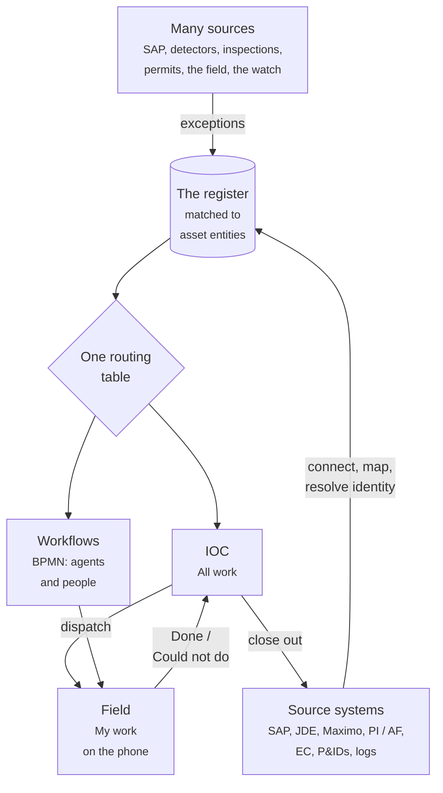
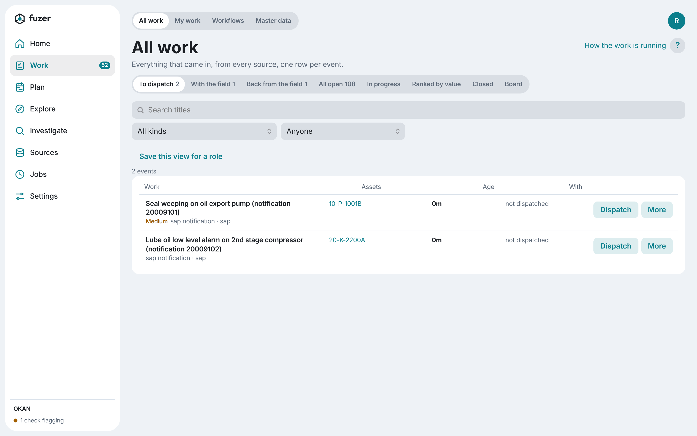

# fuzer { .fz-visually-hidden }

  
  
  
One router for the work of an oil &amp; gas operations centre

Fuzer is one front door for the work of an integrated operations centre. Work arrives from many sources (SAP
notifications and work orders, P6 schedules, Fuzer's own detectors, inspection, parts and permit findings, field
reports and rounds, an agentic watch, any system that can post one), is matched to the asset it concerns through Fuzer's register, and is routed to
the right person or workflow: triaged by the IOC, dispatched to the field, brought back and closed out, with the
update drafted for the system it came from.

The register underneath pulls asset data from many systems (SAP, JDE, Maximo, PI and PI AF, Energy Components,
P&IDs, operator logs), works out which records describe the same real thing, and links them into one graph that
people, workflows and AI agents share.

- **Use it**

    [Guides by role](guides/index.md): the IOC operator, field operator, engineer, planner, data steward and configurer,
    each doing their real jobs start to finish, on phone, iPad and desktop.

- **Understand it**

    [Where work goes](work-map.md): every source, and the page for each stage from creation to completion. Then
    [how work is routed](work-routing.md), [the system at a glance](system.md) and the
    [architecture](architecture.md) generated from the code.

- **Run it**

    [Getting started](getting-started.md) takes you from a clean checkout to the Okan demo;
    [a tour of the app](tour.md) shows each page.

- **Build on it**

    [Extend Fuzer](extend.md): a facility, a data source, an agent skill or a workflow, each as configuration or one
    small, named addition.

{ loading=lazy }
*All work on the Okan demo: a fictional field with synthetic data, worked by a sample crew on today's clock.*

## Reading order

1. [Overview and principles](overview.md): what it is and the decisions it rests on. Then
   [where work goes](work-map.md), [the system at a glance](system.md), [how work is routed](work-routing.md) and
   [architecture](architecture.md): the components, generated from the code, with diagrams.
2. [Data model and ontology](data-model.md), [sources and ingestion](sources.md) and
   [identity and golden records](identity.md): how records become one graph.
3. [Time series](timeseries.md) and [analyses](analyses.md): what it computes from the graph and the process data.
4. [Agents and capabilities](agents.md) and [workflow and scheduled jobs](workflow.md): who acts on it, and when.
5. [Evals and quality](evals.md) and [deployment and settings](deployment.md).
6. [Extend Fuzer](extend.md): a new facility, source, skill or workflow.

The reference pages ([work types](work-types.md), [detectors](detectors.md), [tools](capabilities.md), [settings](settings.md), [command line](cli.md),
[database schema](schema.md)) are generated from the code.
