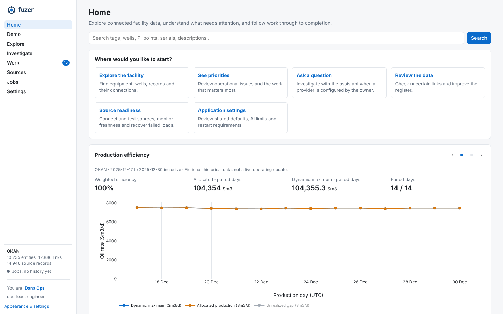
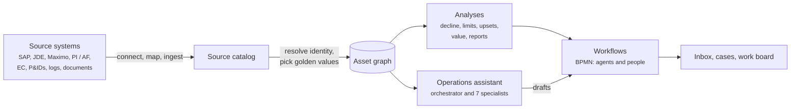

# fuzer { .fz-visually-hidden }

  
  
  
The asset data graph for oil &amp; gas facilities

Fuzer pulls asset data from many systems (SAP, JDE, Maximo, PI and PI AF, Energy Components, P&IDs, operator
logs), works out which records describe the same real thing, links them into one graph, and runs agents and
workflows on it: upset detection, diagnosis, daily reports, opportunities and an operations assistant.

New here? [Getting started](getting-started.md) takes you from a clean checkout to the Okan demo and the evals;
[a tour of the app](tour.md) shows each page on the demo data; [from a well test to an answer](walkthrough.md)
follows one record through the system; the [glossary](glossary.md) explains the terms.

Building on it? [Extend Fuzer](extend.md) shows how to add a facility, a data source, an agent skill and a
workflow, each as configuration or one small, named addition.

{ loading=lazy }
*Home on the Okan demo: fictional, historical data.*

## Reading order

1. [Overview and principles](overview.md): what it is and the decisions it rests on. Then
   [architecture](architecture.md): the components, generated from the code, with diagrams.
2. [Data model and ontology](data-model.md), [sources and ingestion](sources.md) and
   [identity and golden records](identity.md): how records become one graph.
3. [Time series](timeseries.md) and [analyses](analyses.md): what it computes from the graph and the process data.
4. [Agents and capabilities](agents.md) and [workflow and scheduled jobs](workflow.md): who acts on it, and when.
5. [Evals and quality](evals.md) and [deployment and settings](deployment.md).
6. [Extend Fuzer](extend.md): a new facility, source, skill or workflow.

The reference pages ([tools](capabilities.md), [settings](settings.md), [command line](cli.md),
[database schema](schema.md)) are generated from the code.
