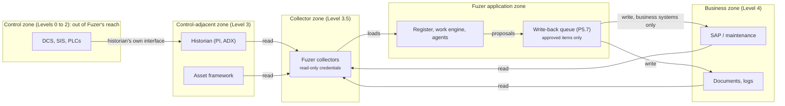

# OT security, read and write paths, and site scoping

This is the design note for roadmap epic R.7 (OT security, roles and multi-site tenancy). The epic is delivered with
the pilot, but two of its rules shape work that comes much earlier: the approved write-back queue (P5.7) and the
cross-asset views (P7.5). This page fixes those rules now so neither is built twice. It follows the zone and conduit
model of IEC 62443-3-2 as Fuzer applies it; check clause numbers against your licensed copy before relying on one.

Read it as an IOC lead would: Fuzer watches the plant and routes work, it never touches the control system, and a
person who works one site sees that site and nothing else.

## Decisions

| # | Decision | Why |
|---|---|---|
| D1 | Reading and writing are separate paths with separate credentials. A collector only reads. | A compromised or buggy collector then cannot change anything, whatever code it runs. |
| D2 | The write-back queue (P5.7) is the only code path that writes to any external system, and every item in it carries a named person's approval. | One place to audit, rate-limit, and switch off. |
| D3 | Fuzer never writes to a system classed `control`. Write-back targets are business systems only (SAP, maintenance, historian annotations, document stores, operator logs). | The control system is out of scope for an operations router; a write there is a safety question, not a workflow. |
| D4 | Every connection declares its class (`control`, `control_adjacent`, `business`) and its direction (`read`, `write`). A `control` or `control_adjacent` connection can only be `read`. | Makes D1 and D3 checkable from configuration instead of code review. |
| D5 | A project is the unit of tenancy: one site (one asset or operating area) is one project, in its own database schema, with its own secrets and audit trail. | This is how Fuzer already isolates Okan and Kestrel (`core/db.py`, `core/projects.py`); tenancy builds on it rather than adding a second scoping model. |
| D6 | A person sees a project only through a grant to it. Owners span all projects. A cross-site view (P7.5) reads only the projects the person is granted, and shows which ones it left out. | The default is no access; a fleet view is a union of grants, never a bypass. |
| D7 | Inside a project, role-based access by area and function narrows what a person can act on, never what exists. Areas come from the register (the plant hierarchy), not from a separate list. | One register, asset-type agnostic; an area grant follows the asset tree the matcher already builds. |
| D8 | Agents act as named agent identities with no grant of their own beyond read and propose. Every surface (API, MCP, CLI, worker) checks the same permission at the server. | Matches P4.4: the human-decision boundary is enforced by the server, not the prompt. |
| D9 | Every write, approval, permission change and sign-in lands in the project's audit record, exportable per project. | An operator or regulator asks about one site at a time. |

## Zones and conduits

There is no conduit from Fuzer into the control zone. Values reach Fuzer only through the historian, which the plant
already operates as the boundary to Levels 0 to 2. The write-back queue has conduits to business systems and nowhere
else; historian annotations are written through the historian's business-facing interface, never to point values.

## The audit record (D9)

An owner exports one project's audit record for a time window from `GET /auth/audit` (JSON or CSV) or
`fuzer audit export`. There is no separate audit table: `core/audit.py` reads every table that names who did
something (a `by`, `actor` or `<verb>_by` column) from the project's own schema, with the shared access events,
settings, project row and cover filtered to that project. Each row says whether its source keeps every change (work
events, write-back events, source and ontology audits, setting history, access events, gate decisions) or only the
latest (a decision column is overwritten when someone decides again). Account-private assistant conversations are
left out, and `GET /auth/audit/coverage` lists every exclusion with its reason. Sign-ins and account changes are
deployment-wide: they join the record of each project the account can open, and accounts granted nowhere yet are in
the database's first project. Every export is itself an access event. `tests/core/test_audit.py` fails when a new
actor column joins the schema without a time column or an exclusion.

## Area grants (D7)

An owner can narrow an account, in one project, to areas of the register (an area or facility):
`PUT /auth/accounts/{id}/projects/{project}/areas`. With no area grants a person acts across the whole project, as
before. With them, they still read everything, but the server refuses their actions on a case, step, process or
exception whose subjects all sit outside their areas, found by walking the register's containment upwards
(`part_of`, `installed_at`, `located_at`). Work about nothing in the register (facility-wide work) stays shared, and
owners span every area. The check sits beside the workflow-role check at the server's work boundary
(`api/security.py`), so it applies to every route that acts on work; each change is an `areas_set` access event in
the project's audit record.

## Restricted documents (#29)

Area grants narrow what a person can act on. A restricted document class narrows what they can *see*.

An owner restricts a document class to a named group in one project. The class is the document's `doc_type`, such as `oem_manual` for licensed manuals. The owner then puts people in groups:

- `PUT /auth/projects/{project}/document-groups` sets the restricted classes.
- `GET` on the same path lists every class the register holds, with document counts.
- `PUT /auth/accounts/{id}/projects/{project}/groups` puts an account in groups.

Each change is an access event (`document_groups_set` or `groups_set`) in the project's audit record.

Someone outside a class's group can't see its documents, their sections, or ids merged into them:

- **API:** every route that names one by path answers 404, including the file download. Every JSON response leaves out the records that name one, at the access boundary in `api/security.py`. A response that is one of them answers 404.
- **Assistant:** each tool is served guarded (`core/capabilities.py`). While a signed-in person asks, the model never sees those documents in a tool result.

Owners see everything. A class with no restriction is open to everyone who can read the project, as before.

Not yet covered:

- **Trusted local mode and local MCP** have no signed-in person and are not filtered.
- **Shared text written before the restriction** may still hold content from these documents: an asset brief, an assistant memory, or a case note. Records citing the documents are dropped, but text that quotes them without an id is not.
- **Teams threads** are not a source yet, so there is nothing to restrict.

## What this means for the code today

These hold now and are checked by `tests/architecture/test_read_write_paths.py`:

- **PI Web API**: the collector issues GET requests, and its one POST is `/batch`, whose sub-requests are all `GET`
  (`sources/pi_web_api.py`).
- **ADX**: the collector posts only to the query endpoint (`/v1/rest/query`), which does not run control commands;
  management commands go to `/v1/rest/mgmt`, which Fuzer never calls (`sources/adx.py`).
- **Folders**: read from the project's data folder.

What each later epic must do:

| Epic | Must |
|---|---|
| P5.7 Write-back queue | Be the only module that sends to an external system. Refuse a target whose connection is not `business` and `write`. Hold its write credentials apart from every collector's. |
| P3.7 Source packs | Declare each connection's class and direction (D4) in the pack. |
| P7.5 Across assets | Read through the person's project grants (D6) and name the projects left out. |
| P4.4 Agents as accountable workers | Give agents no permission beyond read and propose, checked at the server on every surface (D8). |
| R.5 Access, audit and retention | Keep the audit record per project and export it per project (D9). |
| R.7 itself, with the pilot | Area and function grants (D7), the per-project secret store, and the documented deployment zones. |

## Open questions for review

1. **Is one site always one project?** The recommendation is yes for the pilot. A large site with several operating
   areas stays one project and uses area grants (D7); a second operating company is always a second project.
2. **Historian annotations.** They are writes to a control-adjacent system. The recommendation is to allow them only
   through the historian's annotation interface with a separate write identity, classed `business` for that purpose,
   and to drop them if the site's OT security owner says no.
3. **Read-only proof.** Fuzer can show that its code only reads; it cannot prove a credential cannot write. The
   recommendation is that the deployment checklist asks the site to issue collector credentials from a read-only
   role and records who confirmed it.
