# Overview and principles

What Fuzer is, the decisions it rests on and how the parts fit.

Fuzer pulls asset data
from many systems, works out which records describe the same real thing, links
them into one graph, and serves that graph to apps, AI agents and engineers.

The current reference project is the Okan field demo. Asset-specific behavior is
isolated in an **asset pack**; Okan is the only supported pack and project.

## Decisions

| Topic | Decision |
|---|---|
| Hosting | Azure, next to ADX. Login with Entra ID later. |
| Architecture | Postgres-first modular monolith. Seams left so we can add a lakehouse / graph DB later. |
| Equipment master | SAP S/4 is the long-term master. JDE and Maximo are legacy sources matched against it. |
| P&IDs | Mix of smart files, text PDFs and scanned images; each handled differently. |
| Time series | Stays in PI and ADX. Fuzer stores only metadata and pointers. |
| Matching | Sure matches merge on their own; unsure ones go to a review queue. Reviewer answers are pinned and survive reruns. |
| Source conflicts | Per-field priority rules, plus human review for fields we care about (manufacturer, model). |
| History | Links have `valid_from` / `valid_to`, so "what was true on date X" works. |
| AI | Claude, for messy text (operator logs, documents) and hard P&ID images, and the operations assistant. |
| Access | Everyone signed in sees everything. |
| Users | API for apps/dashboards, MCP server for AI agents, web UI for engineers. |
| Languages | Python backend, TypeScript/React web UI. |

## Big picture

```mermaid
flowchart LR
  subgraph SRC["Sources (fake exports today)"]
    direction TB
    ERP["SAP S/4, JDE, Maximo<br/>assets, notifications, work orders, materials"]
    PI["PI points, PI AF"]
    EC["Energy Components<br/>network, downtime, DAY001"]
    PID["P&ID sheets<br/>smart, text PDF, scans"]
    TXT["Operator logs"]
    DOC["Manuals, guides, procedures"]
  end

  subgraph PG["Postgres"]
    direction TB
    RAW[("source_record<br/>+ history")]
    LLM[("llm_extraction<br/>cached Claude readings")]
    REG[("entity, crosswalk, golden,<br/>edge, knowledge_index, lesson")]
    REV[("review_item, pinned_link,<br/>feedback")]
  end

  subgraph RB["Rebuild (no model calls)"]
    direction TB
    EXT["Extract<br/>pack grammars"] --> RES["Resolve<br/>match, stable IDs"]
    RES --> GOLD["Golden records"] --> TAX["ISO 14224 classes<br/>and models"]
    TAX --> GR["Graph links"] --> INC["Incidents"]
    INC --> KN["Knowledge index<br/>and lessons"]
  end

  SRC -->|"ingest (COPY)"| RAW
  RAW --> EXT
  LLM --> EXT
  KN --> REG
  REV <--> RES

  CL["Claude readers<br/>logs, comments, P&IDs, sections"]
  RAW -.->|"fuzer llm-link"| CL -.-> LLM

  TS["Time-series provider<br/>PI Web API, ADX or synthetic"]

  subgraph OUT["Users"]
    direction TB
    API["FastAPI"] --> UI["React web UI"]
    MCP["MCP server<br/>AI agents"]
  end
  REG --> API & MCP
  REV <--> API
  TS --> API & MCP

  DAG["Dagster<br/>sensor, schedules, checks"] -.->|"runs"| SRC
  DAG -.-> RB
  DAG -.-> CL
  PACK["Asset pack (YAML)<br/>+ ISO 14224 standard"] -.-> RB
```

The pipeline is: **land → extract → resolve → golden → taxonomy → graph →
incidents → knowledge → serve**.
Every step after landing can be rerun from scratch at any time. That is the
point: we can change matching rules and rerun without losing anything, because
raw data and reviewer decisions are kept separately.

## One graph, many views
All entities share one node table. Each "ontology" is a set of edge types:

| View | Edges | From |
|---|---|---|
| Physical | `part_of`, `installed_at`, `sidetrack_of` | SAP, PI AF |
| Flow / allocation | `flows_to` (dated) | Energy Components, later P&IDs |
| Data | `has_timeseries` | PI AF attributes, PI point names |
| Documents / text | `mentions` | P&IDs, operator logs |

Edges have `valid_from` / `valid_to`, so you can trace "which wells fed the
production separator on 2024-01-01".

## Asset packs
Everything asset-specific lives in `src/fuzer/packs/okan.yaml`: tag function
codes, area digits, well platforms, phrase aliases, and matching thresholds and
survivorship rules that seed the source catalog's rules (edited there afterwards).
The `okan` project (`FUZER_PROJECT`) selects the pack for the API, MCP server and
jobs.
