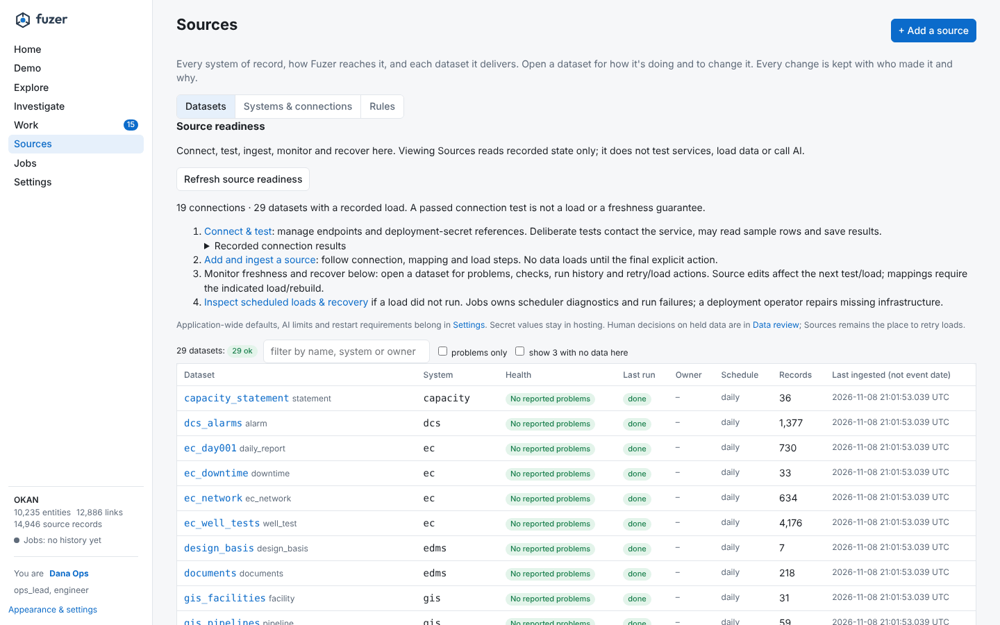
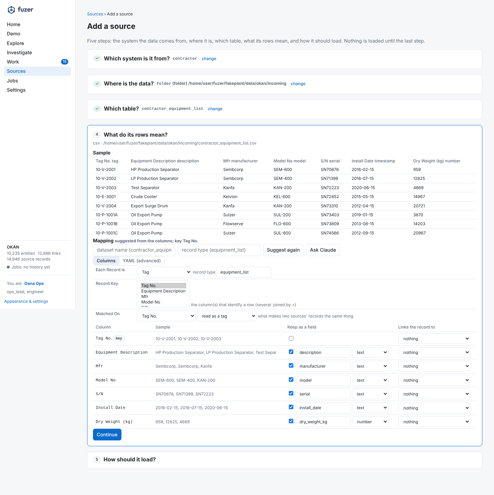

# Sources and ingestion

How records come in: the source catalog, connections, shapes, mappings and text.

## The source catalog

Every system of record, how Fuzer reaches it, each dataset it delivers and what each column means are rows in
the database (#225), so a deployed Fuzer is set up and changed from the Sources page, the API or `fuzer sources`,
with history, and nothing about a source is read from repository files at runtime.

| Table | What it holds |
|---|---|
| `source_system` | One per system of record (`sap`, `pi`, `ec`, ...): kind, owner, steward, how it writes numbers and dates (decimal, date format, timezone, encoding), its survivorship rank |
| `source_connection` | How to reach a system: `folder` (the project's data folder, or a path), `pi_web_api`, `adx`. Config plus secrets as references (`env:NAME`), never values. A system can have several |
| `source_dataset` | One table or feed: its connection, location, key, watermark, load mode (`snapshot`, `incremental`, `append`), schema-drift policy (`hold_breaking`, `hold_any`, `ignore`), status (`draft`, `active`, `paused`, `retired`), schedule (cron), expected delivery (hours), owner, and its state at the last load |
| `mapping_version` | What the columns mean, per source and record type. The latest *approved* version is in use; drafts wait; a rollback approves a copy of an older one |
| `source_run` | One row per load that changed something: trigger, status (`done`, `held`, `failed`), rows read / new / changed / unchanged / removed, the mapping versions used |
| `source_profile` | A profile of each load: per column type, fill %, distinct values, top values, samples; key duplicates; what changed since the profile before |
| `source_check`, `source_check_result` | Expectations per dataset (`key_unique`, `not_null`, `range`, `accepted`, `row_count`, `freshness`, `coverage`) and their results |
| `source_match_stat` | Per source after each rebuild: link coverage (with the values that named nothing the register knows, for review), how its records matched, entities shared with other sources, golden fields won, open reviews |
| `source_rule` | Field survivorship rules and match thresholds per entity kind (the default priority is the systems' rank) |
| `source_audit` | Every change above: who, when, old and new, why |

**Seeding.** The mapping files in `src/fuzer/mappings/` and the nested-export readers (PI AF tree, EC network,
P&ID sheets, document manifests) are seed data. `fuzer sources seed` imports them, idempotently; an empty catalog
seeds itself the first time it is read, and `fuzer ingest` and `fuzer up` seed first. A seed never overwrites
what a person changed: a built-in mapping that moved ahead of an edited one becomes a draft and is reported as
`ahead`. The old `sources.pi.*` and `sources.adx.*` settings seed a connection the first time a URL is set.
`$FUZER_MAPPINGS` folders still seed, with a deprecation warning. `fuzer sources export` writes the catalog back
to YAML (the mapping files as written, plus a `catalog:` block with how each loads, and `systems.yaml`) for code
review and other environments; `fuzer sources import` makes a mapping file a draft.

**Source packs** carry one system to another project or database in one file (#227): `fuzer sources export-pack
planning --out planning.yaml` (or `GET /sources/systems/{name}/pack`) writes the system, its connections (secrets
as references only), and each dataset with how it loads, its mapping in use and its checks. `fuzer sources
import-pack planning.yaml --config export.path=/data/lake` (or `POST /sources/packs`) adds or updates them, with
a connection's config changed on the way in. It is safe to repeat: what is already the same is left alone. A new
dataset's mapping is approved, since the pack is the reviewed setup. A mapping that differs from one a person
approved here becomes a draft for review. `tests/api/test_source_packs.py` exports a source added from the UI
alone, imports it into a fresh copy of the project, and checks the records and links come out the same. On the
Sources page, each system has **Download source pack**, and **Import a source pack…** takes a file or pasted YAML,
asks where each folder connection's folder is here, and refuses a folder that isn't there before writing anything
(#458). A folder of documents whose files (by content, whatever the folder is called) already load through a
manifest or another folder isn't offered again, and a document saved twice in one folder is read once.

**The source pack contract** (P1.5, `sources/packs.py`). A pack is what one system type brings: its connection
template, datasets with their mappings and checks, the work types it raises (`exception_types`, shown on Routing),
the registered detectors it brings (`detectors`, switched on when it is installed and shown on Detection) and a
`fixture`, a folder of sample exports relative to the pack file. Installing (`import-pack`, or `POST
/sources/packs`) does all of it in one step. Every pack must pass the conformance suite: it installs, installs
again with nothing changed, and its fixture loads through its own mappings with no dataset held or missing.
`fuzer sources conformance FILE` runs it on the current project (use a scratch database), and
`tests/sources/test_pack_conformance.py` runs it for every shipped pack on both Okan and Kestrel.
The built-in sources are packs too: `src/fuzer/source_packs/<system>.yaml` names each system's datasets, its
`optional` ones (loaded when a site exports them) and its detectors, and the full pack is assembled from the
built-in mapping files, so a mapping still lives in one place. `fuzer sources conformance sap` runs one against the
project's own exports, and the test runs the SAP, PI, PI AF, EC, DCS, LIMS, inspection, P&ID, operator log, IOW, GIS,
Maximo, OEM and EDMS packs on both bundles.

**The work a system brings** (#465, `sources/workflows.py`). A pack can also declare the exception types its
system raises and the rules that turn its loaded records into exceptions, so onboarding a SCADA, LIMS or
measurement system also puts its work in the right Inbox queue, without code:

```yaml
exception_types:
  - {name: short_gas_day, label: Short gas day, role: role:operator, description: ...,
     due_hours: "1:24,2:72"}             # optional: when a dispatched one is due, by its evidence's priority
exception_rules:
  - name: short_day
    dataset: daily_volumes
    type: short_gas_day
    when: {flow_hours: {lt: 23.5}}          # every condition holds: eq ne in not_in gt ge lt le present absent contains
    clear_when: {flow_hours: {ge: 23.5}}    # optional; default: clears when the record no longer meets `when`
    key: "{meter_id}:{gas_day}"             # default: the record's key
    refs: [{from: meter, as: tag_or_well}]  # or templates such as "tag:{tag}" or "sap/{equipment}"
    title: "Short gas day on {meter}: {flow_hours} h"
    priority: 0.6                           # 0 to 1
    value_usd: "{lost_usd}"                 # a number or a column
```

Types are defined through the exception contract as data, marked with the system that brought them. Rules run
after every load over the dataset's current records: a record that meets a rule raises (or refreshes) its
exception, which routes as its type says; an open one the rule raised clears when its record meets `clear_when` (or
no longer meets `when`) or is gone. A failing rule never fails a load. `PUT /sources/systems/{name}/rules/{rule}`
adds or changes one and runs it at once.

A system's **webhook**, `POST /hooks/{system}` with header `X-Fuzer-Secret`, takes the `POST /exceptions` payload
(or `{"type", "key", "clear": true}`) for the types the system brought, so another system sends work without a
Fuzer client or a sign-in. The system holds only a reference to the shared secret (`webhook_secret: env:NAME`); a
missing or wrong secret is refused before the body is read. The Sources page shows, per system, the types it
brings with how many are open, its rules, and whether its webhook secret resolves.
`fakeplant/bundles/kestrel/packs/measurement.yaml` is Kestrel's gas measurement system as such a pack.

**One finding contract** (P1.1). Whatever raises work hands over the same record, a `Finding`
(`fuzer.core.findings`): its detector, its origin (`deterministic` for a rule or a calculation, `agentic` for an
agent, `external` for another system's own detection or record), the method and the standard behind it, the time
window, its confidence where the detector can say, the checks before the work, and the evidence as labelled items
with their units. The assets it is about and the value at stake travel with it (`refs`, `value_usd`).

```python
from fuzer.core.exceptions import raise_exception
from fuzer.core.findings import DETERMINISTIC, Finding, asset, at, fact

raise_exception(conn, "iow_breach", iow, title, by, refs=[point_id], finding=Finding(
    "limits.iow", DETERMINISTIC, method="Time outside an integrity operating window", standard="API RP 584",
    start=first_outside,
    items=(fact("Limit", 85.0, "barg"), fact("Peak", 91.2, "barg"), at("First outside", first_outside),
           asset("Measured on", point_id)),
    data={"iow": iow, "level": "critical"}))
```

A raiser writes no evidence keys of its own: what people read goes in `items` under the words they read it by,
and one component renders every finding on the case, the task and the phone, with times in local time and assets
by tag and description. `data` holds only the variables the type's process routes on and is never shown. A webhook
or `POST /exceptions` body keeps sending `evidence` in the sender's own keys; `findings.external` turns it into a
finding in one place. A test fails when a raiser under `src/fuzer` passes anything else.

**Data problems are routed work** (P2.3, `graph/data_work.py`). Every open question the build leaves becomes a case in
the data steward's queue, with its own work type on the Routing page and the role's SLA. That covers a possible
match, sources that disagree, a drawing that disagrees with a system, a drawing line or datasheet curve to
confirm, an export whose columns changed, a suggested mapping, and a load a check held. These cases are worked in
the same engine as the IOC's, so they show in My work and All work. Each case is keyed to its question and synced
at every rebuild. An answer clears the case, and so does a question that no longer arises, so the queue always
matches the questions. Steward cases don't join the IOC's cases about the same asset. The questions themselves are
the **Questions** tab of Master data, which replaced the separate Data review page (#505; old `#/review` links land
there). Each case's evidence links to its question, opened on it (a `page()` item in the finding).

**Missing criticality is the steward's to fill** (`graph/criticality.py`). An asset's criticality ranks its work by
consequence and decides where the human gates always stop for a person, so an asset without one is neither treated
as the most nor the least critical. Each asset (a tag not part of another, or a well) with no criticality is one open
`criticality_not_assessed` case in the data steward's queue, keyed by the asset, so rebuilds never duplicate it.
Setting a criticality, by a fix on Master data or the source's next load, clears it at the next rebuild. Until
then, the value score and the matching gate say "not assessed": compliance still counts the overdue days at the
lowest factor, saying so, and risk is left unknown rather than guessed. A register that rates no asset at all
raises nothing, since its source is the gap.

**Like questions answered once** (P2.3c, `graph/review.py`). Questions are like each other when the same answer
is right for all of them for the same reason. That covers conflicts on one field between the same systems (written
differently, or genuinely different), possible matches between the same two registers on the same evidence, and
drawing disagreements from one check. **Like questions**, above each kind on the Questions tab, answers a whole
group at once, for example "Use sap's value" or "Keep each pair apart". Each question is decided and pinned as if
answered alone (a pinned link, a review assertion), so the answer survives rebuilds, and the group's cases close
together. A question the answer can't apply to is left for a person, with the reason. Ticking **and new ones like
these** makes it a standing answer: at each rebuild it decides new questions in the group as the person who set it
(`review_rule`), until it is withdrawn. A standing answer to matches pins them at that rebuild, so their records
merge or stay apart from the next one.

**Master data stewardship** (#476, Work > Master data). Work only routes when it matches the register, so the
register is maintained, not just built. An exception whose ref matched nothing shows **Match…** beside the ref:
search the register, pick the asset, and (by default) remember the value. The asset becomes a subject of the
exception and its case (`POST /exceptions/{id}/resolve`); one no case works yet joins the open case about that
asset; and remembering records an **alias** (`sources/aliases.py`, table `entity_alias`): the value as another
name for the entity, by one of its keys. Exceptions match aliases as they are raised (`tag:FLARE-TIP-9` and
`FLARE-TIP-9` alike), and each rebuild lays them over the pack's aliases, so resolvers link records that wrote the
value. The Master data page lists refs on open exceptions that matched nothing (matching one there matches every
open exception that carries it), the link values each source wrote that named nothing on the last rebuild (make one
an alias), and the decision log: every alias and pinned match with who, when and why, searchable, each reversible
(an alias is retired, a pin removed; audited in `source_audit`).

On an entity page a steward corrects the matching itself (`graph/curation.py`). **Same as…** finds another entity
of the same kind and previews the merge (the records and keys it would have, the fields where the two disagree, any
earlier "not the same" it reverses); **Not this record** beside a source record previews the split (what stays, the
values the record takes with it). Either is written as pinned links (a merge one must-link, a split a cannot-link
to each other record) sharing a batch, so it holds on every rebuild, shows in the decision log as one decision, and
one undo reverses it. A rebuild is queued when it is made (`POST /stewardship/merge`, `/stewardship/split`, each
with a `GET …/preview`).

The **Gaps** tab (`graph/gaps.py`) lists what the register itself says is off. It shows a value written several
ways within a field (case, spacing, punctuation or a company suffix apart, the usual spelling first): pick the one
to keep and it is set on the others as a reviewer's choice (`POST /stewardship/fixes`), which holds on every
rebuild and is undone from the decision log. It shows fields that most entities of a kind carry and a few lack,
which are fixed in the source. And it shows open conflicts between sources, which are decided on the Review page.
Derived values (classes, models) aren't listed, because they follow the records they come from.

**Claude's proposals** (`graph/proposals.py`, the Master data page's proposals tab). Claude is asked four kinds of
question built from the register:

- which entity an unresolved value or an unmatched exception ref means;
- whether two records the matcher was unsure of are one item;
- which of the sources' disagreeing values is right;
- whether two near spellings in a field are one value.

Each question carries numbered options, so Claude can say "none" but can't invent an asset or a value. Each answer
has a confidence, a one-line reason and the evidence it relied on, and is cached by the question's hash and the
prompt version (`POST /stewardship/proposals/run`). Rebuilds never call the model. Nothing changes until a person
accepts a proposal, or picks another of its options. Accepting does what a steward would do by hand: it records an
alias (which also resolves the open exceptions that carried the ref), pins the match, chooses the value, or fixes
the spelling. Each of these is reversible from the decision log. Bulk accept is offered only for proposals at or
above `stewardship.bulk_accept_at`. That setting is 0 (off) until a project sets it.

`fuzer.evals.steward_eval` measures how far the proposals can be trusted. It plants problems with known answers:
tags written other systems' ways (separators dropped, a hyphen before the suffix, a zero-padded loop), a near tag
that doesn't exist, and a manufacturer with a letter dropped. It then scores precision and recall at each
confidence threshold. Run it as `uv run python -m fuzer.evals.steward_eval` against a copy of a project. CI runs it
with a scripted client.

**Loading.** `ingest` loads each active dataset through its connection as its load mode says. An unchanged
dataset is skipped without reading a row. Before a load is applied, the staged rows are profiled and checked:
duplicate keys, or a failing *blocking* check, hold the dataset (its records stay as they were, its run is
`held`, a `check` review item says why); a schema change holds it as its drift policy says (a `schema` review
item). A dataset set to `duplicates: keep_latest` loads the latest row of each repeated key instead (the highest
watermark, else the row read last) and lists the rows it left out on the run; the held banner offers that switch. Each system's number and date formats are read before mapping (`formats.py`: a decimal comma, a date
format, a timezone moved to the project's), and CSVs in its encoding.

**Connections** (`connections.py`) share one contract: `connector` (the dataset's reader), `test` (reach,
authenticate, list, read a few rows, each step timed and kept on the connection) and `discover` (what it holds
that no dataset covers yet). A new live system plugs in as a new type.

**Quality and matching.** `fuzer sources health` (and the `source_health` MCP tool) gives each dataset's state:
stale (no delivery within its expected hours), held, failed, checks failing, profile drift; with its row trend,
coverage and open reviews. A problem opens one `source_issue` work item for the dataset's owner (else the
system's owner, else `role:data_steward`) and posts to the alert webhook; the item closes when the problem
clears. Rules (`rules.py`): survivorship priority and match thresholds come from the catalog at each rebuild,
seeded from the pack (a rule nobody edited follows the pack).

**Calibrated match confidence** (P2.2, `graph/calibration.py`). Equipment that shares no serial with another
system's record is scored on its tag, maker and description. Each rebuild keeps every scored pair with what it
did (`match_score`): merged, sent to review, ambiguous or left apart. **Measure**, on the Rules page (or
`fuzer sources calibrate`), labels those pairs from the stewards' match decisions and the project's answer key
(`answer_keys/matches.json` in its data folder). It then gives each source what its scores are worth:

- its precision and recall at each threshold, with the lower bound of the 95% interval,
- a calibrated probability per score (isotonic),
- a straight-through threshold at 99% measured precision,
- a review floor that rejects no true match it saw.

A pair belongs to the register being matched in, the less trusted of its two systems by rank, so a contractor
register is measured on its own records. A record that fits two items always goes to a person, so it is counted
but not measured. **Use the measured thresholds** sets each source's match rule (`equipment/<source>`, audited),
and a pair is held to the stricter of its two sources' thresholds from the next rebuild. The cautious direction
(a higher straight-through threshold, a lower review floor) is adopted on any evidence. The other direction
needs at least 30 labelled pairs, since 100% of ten pairs is not 99%. On Kestrel, the glycol pump's driver
(same maker, a close name, the pump's tag) scores 0.90, enough for the pack's threshold. Measuring puts Maximo's
threshold above it. `tests/graph/test_calibration.py` holds straight-through at 99% or better on both bundles.

**The human gate on automatic matches** (P5.10, `core/gates.py`). A pair the thresholds would merge still asks
the `auto_match` gate. It goes through only when its confidence meets the gate's threshold: 99% by default, and
never on an A-criticality asset. The criticality is the tag's, read from the records the same rebuild loads.
Where the pair's source has been measured, its confidence is the precision measured at that score or above, so
the two agree: a measured source's threshold is set where its matches reach 99%. A source not yet measured has
only its score, so its pairs below 0.99 stop for a person whatever the pack's threshold says. The two checks run
in order. The source's threshold decides whether a pair is a candidate to merge at all, and the gate decides
whether it may merge without a person. The stricter one wins. A stopped pair becomes a match question like any
other. Its case shows the confidence, the threshold it needed and why it stopped, and every gate decision, went
ahead or stopped, is kept in `gate_decision`. Matches on the same key (a shared serial) are the same item by
definition, and the gate is not asked. On Kestrel the gate holds the glycol pump's driver (0.90 unmeasured) even
before calibration, and asks a person about the amine reboiler because it is A-criticality.

**Before and after a change.** `fuzer sources impact` runs a proposed mapping beside the one in use over the
stored records and diffs what they make: entities and links added or removed, fields changed, golden values that
would flip. `fuzer sources why <id> <field>` (the entity page's *why?*, the `why_value` MCP tool) traces a value to
the records that say it, the mapping version that read each one, the run that delivered it and the rule that chose
it. A change takes effect on the next rebuild (`POST /sources/rematch`).

**Scheduling.** Dagster has a source asset and a `source_checks` asset check per dataset; a dataset with its own
cron loads then (`dataset_schedules` sensor); `source_health` runs every 30 minutes.

{ loading=lazy }

**On the Sources page**, **+ Add a source** walks through five steps: the system the data comes from (or a new
one), where it is (one of its connections, or a new one: a folder anywhere, PI Web API, ADX; tested on the spot),
which table (what the connection holds, new ones first), what its rows mean (a sample, a date-format hint for the
system, and a mapping suggested for the system, by rules or Claude, to edit), and how it loads (load mode,
schedule, expected delivery, owner). Save and load creates the dataset and its approved mapping and loads it; a
held first load says why (duplicate keys with examples, a failing check, changed columns) and where to fix it.
**Datasets** lists every dataset with its health, last run, owner and schedule (filter, problems only; datasets whose
data isn't in this project are hidden unless asked for). Each dataset has its own page: a header with its health
and, when its last load was held or failed, why and **Load again**; then **Overview** (connection, how and when it
loads, owner, records, open work items and review items, quick actions), **Settings** (how it loads, what to do
when columns change, schedule, expected delivery, owner; connection, key, location, reader and watermark under
Advanced; pause, retire or delete), **Mapping** (edited column by column: what each column is kept as, with a name and
type, and what it links the record to (a tag, a well, equipment, a functional location, a tag or a well), the record
key and what records are matched on; the YAML stays under Advanced, and anything the form doesn't show (hooks,
measurements, links of other shapes) is kept as it is. An edit becomes a draft; a draft or an older version is shown
as a line diff against the one in use with what it would do to the register, then approved, discarded or rolled back
to), **Runs**,
**Quality** (checks suggested from the profile, one click to add; checks and their results; the profile),
**Matching** and **History**. A banner on the Sources pages says when loads, mapping versions or rule changes aren't
in the register yet, with **Rebuild now**. **Systems & connections** edits each system and its connections (shown in
words: the project data folder, a path, a server) and lists what each connection holds, with an *add it* link per
new table; a system added here gets no connection until it needs one. **Rules** edits ranks and rules. Held loads
also show on the Data review page (**Held loads**), linked to their dataset.

{ loading=lazy }
*Adding a contractor equipment list. [Extend Fuzer](extend.md#add-a-data-source) walks through every step,
and the same source as a YAML mapping.*

The API behind Add a source: `GET /sources/connections/{id}/tables`,
`GET /sources/connections/{id}/tables/{table}` (preview and suggestion) and `POST` to the same path (save and load).

What the suggestion recognises, so the mapping can usually be accepted as offered (#227, #411;
`tests/api/test_add_source_ui_only.py` adds each from these calls alone, with no YAML written by hand):

- **Schedules** (P6 or MS Project exports): planned start and finish make each row an `activity`, part of its parent
  row, `located_at` its plant location (a tag, well, area or the facility, in whatever style it's written: the `place`
  resolver) and `executes` the SAP work order it names. Dates in the export's local format (31/12/2025) are detected,
  and the page offers the system's date format to read them.
- **Equipment lists** with serial and manufacturer (or model): `equipment` keyed on serial, blocked by tag, with an
  `installed_at` link dated by the install date, so a contractor's list matches SAP's equipment at once. Detected
  dates are kept as `date` fields.
- **Historian point lists**: names that are a tag or well with a signal suffix (`20PT3003.PV`, `OK_J12_04.GLIR`) make a
  `timeseries` per point, owned (`has_timeseries`) by the tag or well its name contains, with the unit as `uom`.
  Values stay in the historian; the project's time series provider reads them.
- **A folder of documents** (PDF, Markdown, text, and no tables) is one table: a row for each document and one per
  section (split on headings, with page numbers). The sections are part of their document, searchable, and linked to
  the tags and wells their text mentions. A folder a manifest already loads (`documents.json`) isn't offered again.

## Connectors, shapes and mappings

Every dataset is described by three independent things, so a new source is configuration, not code.

**Connector: how data arrives.** Each yields records plus a schema fingerprint;
a changed fingerprint (column added, renamed, retyped) sends the mapping back
for review instead of failing quietly.

| Connector | Examples | Reads |
|---|---|---|
| Lake table | Parquet / Delta in ADLS (SAP, EC, Maximo extracts) | Streamed with column projection; incremental by file, table version or watermark column |
| API | SAP OData, PI Web API, GIS feature services | Paged; incremental by change date |
| Time-series store | PI, ADX, OPC UA | Metadata only (AF templates / elements / attributes, ADX schemas and tag columns); values stay put and are read through `timeseries.Provider` |
| File / document store | EDMS, SharePoint, P&ID scans, inspection photos | Listed and fingerprinted; only changed files re-read |
| Messages | Teams, operator logs | Incremental by timestamp |
| Standard exchange file | DEXPI (smart P&IDs), CFIHOS handover, WITSML / PRODML, PODS, GeoPackage | Parsed by a standard reader into the shapes below, no Claude needed |

Built: CSV, Parquet (file or folder of part files), Delta, Excel, JSON and GeoJSON readers on folder
connections, and PI Web API and ADX live connections. Each dataset keeps its fingerprint, columns and watermark
on `source_dataset`, so unchanged datasets are skipped, added columns
load, removed or retyped columns hold the dataset behind a `schema` review item (or as its drift policy says),
and watermarked lake tables read only new rows. Nested JSON manifests and the live AF tree have no columns;
their JSON shape (typed field paths, with tag-keyed maps as one path) gets the same check. The Okan demo loads
the same records and eval scores from Parquet as from CSV.

Mappings: every source record type is a YAML mapping (a `mapping_version` row) read by one compiled
extractor (`mappings.py`). Its dataset says where the table is (`location`, relative to its connection's
folder or absolute; `book.xlsx#Sheet` for a sheet) and which reader to use (`connector`); by default it's
`<dataset>` in the folder, read by its file type; `extract.py` keeps only named value transforms
(tag, well, serial, number), resolvers that read kind and key together (FLOC,
AF path, EC node) and hooks (ISO 14224 codes, sidetracks, EC downtime,
document applicability, section failure modes, P&ID formats). The Okan demo is
the supported fixture for testing extraction.

Suggested mappings (`suggest.py`): profile a sample per column; rules name
meanings from headers, value patterns (pack grammars, dates, units, known
manufacturers) and values that are keys of records already held (ties between
overlapping number ranges go to the target whose key column has the same
name); Claude names columns rules could only call `code` or `other` (cached,
never in rebuilds). Drafts are `mapping` review items; an accepted one is approved as a
new mapping version and its dataset is added to the catalog. On the Sources page (New tables) a
new table is added in one flow: the draft from rules (or Claude), edited, saved
as a mapping version and loaded, without going through the queue. Eval on 18 fake tables
(12 built-in, 6 with messy headers): key 1.0, references 1.0, columns 0.99
(rules), 1.0 with Claude on the opaque table.

Geospatial: GeoJSON connector and `geospatial` shape; `geo_index` (box,
centre, geometry per located entity, rebuilt with the register) serves the map
and nearby queries without PostGIS (100k features: field-sized box 5 ms, wider
box 36 ms, entity map 12 ms). `spatial_links` rules in the pack link what GIS
didn't carry as IDs by distance (wells to pads / jackets, legacy pipeline ends
to facilities), scored by distance; Okan spatial-link evaluation:
precision 1.0, recall 1.0. PostGIS waits until polygons or exact geometry
operations are needed (Azure Database for PostgreSQL supports it).

Measurements: a `measurements` block in a mapping names what was measured
(a list of endpoints tried in order: tag, well, pipeline or the record itself),
when, how and where on it (a CML, a sample point), and one or more quantities
per row (a well test gives five; a LIMS row names its analyte). The rebuild lands
them in `measurement` against the resolved entity, after the graph. Units go
through reference data (`units.yaml`: stored unit, spellings, conversions), so a
2019 survey in inches is stored in mm with what the source said kept; "<5" is
kept as a below-detection-limit qualifier. They appear on the entity page next
to process values, in the troubleshooting brief and through the `measurements`
MCP tool, one series per quantity and location with the change per year (wall
loss, decline). Large asset: 89,710 readings on 1,190 entities; a well's test
history 0.6 ms (4 ms cold).

A `reference` mapping names each row's list, code, name, category and optional
standard code. These rows load with other datasets but do not create entities.
Maintenance and downtime hooks use the loaded entries first and retain the
asset pack's catalogs as defaults; codes found in neither are reported by the
`unmapped_site_codes` data-quality check.

**Shape: what kind of data it is.** One generic extractor per shape:

| Shape | Today | Anticipated |
|---|---|---|
| Records (things with attributes) | SAP equipment, JDE, Maximo, materials | Line lists, instrument index, cable schedules, vendors, contracts |
| Hierarchy | FLOCs, PI AF | ISA-95 site / area / unit, ISO 14224 trees, org units |
| Network (nodes + edges) | EC allocation, P&ID piping | Pipeline and gathering networks, electrical single-lines, cause & effect matrices and trip logic (input -> trips -> output) |
| Time-series metadata | PI points, AF attributes | ADX tables, SCADA, OPC UA nodes |
| Measurements (sparse, landed) | Well tests, LIMS results, inspection thickness readings (CMLs) | Vibration routes, emissions / LDAR surveys |
| Limits (per point, dated) | PI AF limit traits, DCS alarm exports, IOW registers | Safe operating limits, trip setpoints from cause & effect, equipment design envelopes |
| Events (time + text + references) | Logs, downtime, notifications, DAY001 | Teams threads, alarm journals, trips |
| Cases (records with a workflow) | Notifications, work orders | Management of change, permits to work, isolations, HAZOP / LOPA actions, inspection findings |
| Documents | Manuals, guides, procedures | Any PDF / Office file, datasheets, inspection reports |
| Geospatial features | none | GIS wells, pads, pipelines, rights-of-way, facility outlines |
| Positions along a line | none | Pipeline stationing and in-line inspection anomalies (PODS); well trajectories, completions and depth logs by MD / TVD (WITSML, LAS) |
| Reference data / code lists | SAP maintenance catalogs and EC downtime reasons; pack values are defaults | Site catalogs, units of measure, CFIHOS reference data library |

Measurements differ from PI data: they are few, manual and not in a historian,
so they are landed and kept. Drawings and documents are not shapes but
**extractions**: a reader (Claude, OCR, a DEXPI parser) turns a sheet or file into
derived records / network / references that flow through the shapes above,
each carrying a link back to the sheet, tile or page it came from. 3D plant
models and laser scans fit later as records with plant coordinates and a
viewer link.

**Mapping: what each column means.** A YAML mapping per source and record type names the shape, the Fuzer
kind or ISO 14224 class, and which column is key, tag, description, parent, from / to, timestamp, unit, value
or geometry; logic that truly is source-specific is a named hook. **Schema detection proposes the mapping**:
profile columns (types, uniqueness, distinct values, nulls), match values against the pack's tag / well / FLOC
grammars, spot dates, units, coordinates and from / to pairs, and let Claude name the rest from headers and
sample rows (structured output limited to Fuzer's field meanings). A person approves it; the mapping is
versioned in the catalog, and rebuilds never call Claude.

New linking methods come with new shapes: **spatial** (a well within 50 m of a
pad, a pipeline segment crossing a road) on PostGIS, which keeps the
Postgres-first decision, and **along-line** (an anomaly at station 12+340 on
segment X). Both produce scored candidate links like every other matcher;
identities, history, review and the graph stay as they are.

## Source plan

| Source | First version | Later |
|---|---|---|
| SAP S/4 | CSV export of FLOCs and equipment | OData / CDS views |
| JDE, Maximo | CSV export | Scheduled DB extracts until retired |
| PI AF | JSON export of element tree + attributes, or PI Web API | |
| PI points | CSV point list, or PI Web API; ADX series catalog | |
| Energy Components | JSON of network nodes and dated edges | EC database views |
| P&IDs | Smart: tag list. Text PDF: extracted text. Image: flagged `needs_ocr` | DEXPI parsing, OCR (Azure Document Intelligence), Claude vision, line tracing |
| Operator logs | CSV of entries | Claude for hard mentions and event extraction |
| EC DAY001 daily reports | CSV of DAY001 rows | Comments read by Claude into links and events |
| EC downtime / deferment | CSV: `downtime` with reason codes, lost oil, comments | EC database views |
| DCS alarms, IOW registers | CSV exports landed as point limits | DCS and AF limit traits read live |
| Lab, well tests, inspection | LIMS results, EC well tests, CML readings as measurements | |
| GIS | GeoJSON wells, facilities, pipelines | Feature services |
| Manuals, guides, procedures | EDMS manifest (JSON) of PDFs; sections linked to models, classes, tags | SharePoint / EDMS live |
| Teams channels | (planned) | Selected channels via Microsoft Graph; thread summaries and links |

## Piping from P&IDs
Smart P&IDs carry piping (DEXPI-style from / to / line number) and the Claude
drawing reader returns connections read off scans; both become directional
`pipes_to` links between tags, kept apart from Energy Components' `flows_to`
(allocation). The Network page switches between the two, flow traces can
follow either, and a comparison lists EC flows with no piping path on the P&IDs
and piping between EC nodes with no EC flow path (API and a Dagster check).

## Data tables and notes on P&IDs
A sheet's foot carries an equipment data table (design pressure, temperature, capacity), an alarm and trip
table (LL / L / H / HH per instrument) and numbered notes. Claude reads them off scans; smart sheets export
them. Design ratings land as measurements (`design_pressure`, `design_temperature`, method `pid_table`,
dated by the title block). Alarm and trip settings land in `point_limit` as basis `design`, source `pid`:
they never become the limit that counts, but the `drawing` check lists every point whose configured alarm
differs from its drawing, or that the drawing rates and no source configures. Notes keep the registered
tags they name. Rows naming a tag not in the register are findings.

## Drawing disagreements in Data review
Each rebuild turns every place a drawing and another system disagree into a `pid_mismatch` review item, so the
IOC triages them with the rest of the register's questions (Data review > Drawing disagreements): an alarm and trip
setting that differs from the configured alarm (`alarm`), a setting the drawing rates and no alarm source has
(`alarm_unset`), and an instrument the drawing shows on another item than SAP does (`placement`). Each names the
sheet, tag and both sides. The reviewer records which one needs changing: **the drawing is right** (the DCS, AF or
SAP needs changing), **the system is right** (the drawing needs a redline), or **not a disagreement** (a misread).
A decision changes neither side; it is kept on reruns while the values stay the same, and a disagreement that comes
back with different values is a new question. Questions no longer raised go stale.

## Source quality scorecard
Each dataset's Overview shows four measures, 0 to 100, kept with every rebuild so each has a trend
(`sources.scorecard`, `GET /sources/datasets/{name}/scorecard`): **completeness** (the mean fill of its columns, from
the latest profile), **validity** (the share of its checks passing, its key counted as one), **timeliness** (100 while
a delivery is on time, then the expected interval over the age) and **agreement** (of its source's records that join
an item another source also has, the share with no open disagreement). A measure that falls 15 points or more below
its best of the last 30 days raises one `source_quality_drop` case for the dataset, assigned to the system's owner
(else the dataset's, else the data steward), however many records it touches; it clears when the measures recover.

## How a new source matched
Each system's card on Sources says how its records contextualized themselves on the last rebuild
(`graph.contextualized`, `GET /sources/systems/{name}/context`): how many matched the register on their own (on a
canonical key, or scored above the auto-accept threshold and let through by the human gate), how many are new, and
how many need a steward: matches to confirm, values that disagree with another source, rows whose links named
nothing, and records that matched nothing of a kind whose records from that source otherwise match (never in the
source that holds most of that kind, the register its items are matched to). A new source
should leave under 10% for a steward. Every automatic match is listed with its confidence and basis; "Not this
record" on the entity page reverses one, and the reversal is a pinned decision every later rebuild keeps.

What matched nothing is one `unmatched_records` case per source in the data steward's queue, however many records it
is. One answer settles the group: **They are new items** on the system's card remembers them as new
(`source_new_record`), so later rebuilds don't ask again; to match one instead, open it and use **Same as…**.

The card also lists every link the source states, as the last rebuild resolved it (by its key, or read from text with
a confidence). **Not this link** leaves that source's statement of it out of every later build (`unlinked`, in the
source audit log); another source stating the same link keeps it, and **Take back** restores it.

Rows whose links named nothing (a parent, location, install position or historian point the register doesn't have)
are one `unresolved_links` case per source and link type in the data steward's queue, saying how many rows and which
values. Making each value an alias of the item it means on Master data, or fixing the source, resolves them, and the
case clears on the next rebuild.

## Corrections flow back to the source
An answer on the Questions tab that says a source is wrong drafts the fix for that source's owner (`ops.corrections`):
choosing a value on a conflict drafts a change to each system whose value differs, through the approved write-back
queue (a system that takes no write-backs gets a case for its owner); "the system is right" drafts a redline for the
drawing; "the drawing is right" drafts the register change, or a case for whoever owns the configured alarms; and
**Check it in the field** opens a case for the operators. The question stays answered while its correction is out,
so the next rebuild doesn't ask it again; each rebuild keeps what every source says on the fields a steward chose
(`reviewed_value`). The correction is done when its write-back is confirmed or the source's next load says what was
chosen. It comes back to the steward, reopened on the Questions tab and as a case in their queue with what
happened, when the owner rejects it, the source changes to something else, or the field check is answered.

## Asset context completeness
Each asset (a tag that is not part of another, or a well) is scored on what Fuzer knows about it
(`analysis.completeness`): an equipment class, a make and model, a maintenance record, historian points, measurement
roles on them, limits, a drawing position, documents and a criticality. An asset is only asked for what its class
usually has (at least half its assets of that class have it, in a class of three or more), so valves are not asked
for maintenance plans because pumps have them. Each gap says what it holds back: the detectors that need it and
apply to the asset's class, read from the detector registry. The 25 assets whose gaps hold back the most checks,
weighted by criticality, are open `context_gap` cases for the data steward, refreshed at every rebuild; a case
clears when its gaps are filled. The asset page shows its context in one panel, and Master data > Asset context
shows completeness by area and class with the top gaps.

## Where an instrument sits
Claude also says which item each instrument's process connection runs to. When the register has the instrument
part of a different item (SAP's functional locations), the drawing view lists it: a field change the maintenance
system never caught, or a wrong drawing, and either way work raised on the instrument goes to the item the
register names. Okan plants one: train B's 2nd stage suction pressure transmitter, clouded "RELOCATED" on its
sheet at the compressor, still under the scrubber in SAP.

## Process flow diagrams
PFDs come in the same sheet list as P&IDs (`drawing: pfd`) and go through the same reader. A PFD shows the main
equipment and numbered process streams, and trains built alike are drawn once with a tag like `20-K-2100A/B/C`,
which Fuzer expands to one tag per train: a stream between trains becomes one connection per train, a header into
them one per train, and ends that don't line up are not linked. Streams become `pipes_to` links marked with the
stream number and the PFD (a P&ID's line and off-page details win on the same pair). The heat and material
balance (one column per stream) lands as each stream's design case on the item it leaves: measurements
`design_case_pressure`, `design_case_temperature` and `design_case_flow`, method `pfd_design`, location
`stream N`. Okan has two: the oil plant (clean) and the gas plant (an old scan, three trains drawn once).

## Entity linking in text
Operator logs and P&ID text are scanned for:
- tags (tag grammar; area taken from context when missing),
- wells (well grammar),
- known phrases from the pack (`"test sep"` → `20-V-2002`).

A short tag like `PT-2001` exists in several areas; if it can't be pinned to one
it is left unlinked rather than guessed. Claude will later handle the hard
cases (pronouns, "the B pump", context from earlier entries).
