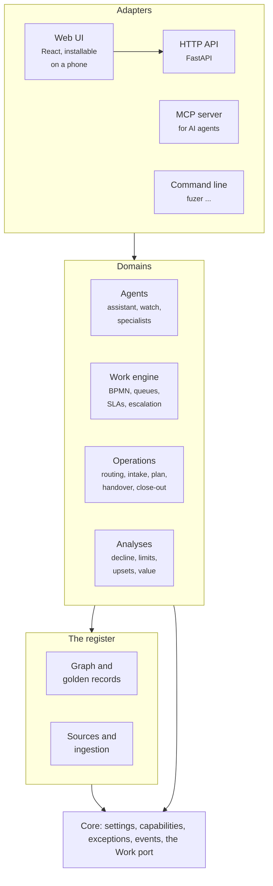
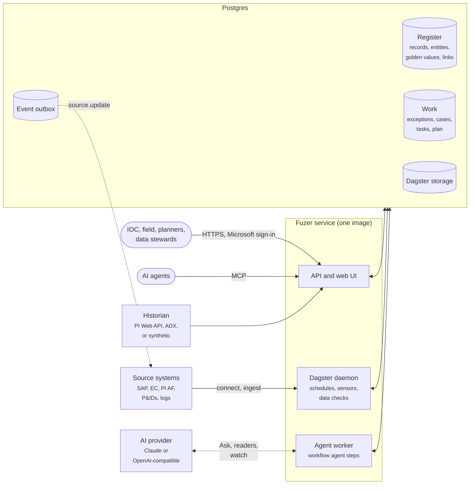
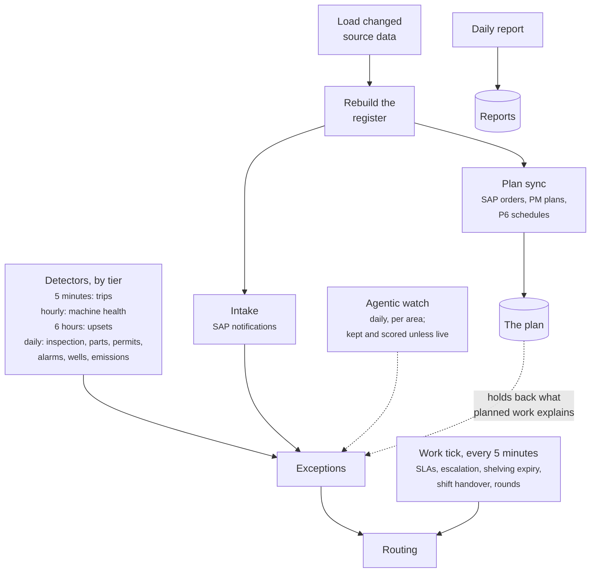

# The system at a glance

How Fuzer is put together and what runs where. For the package-by-package view generated from the code, see
[architecture](architecture.md); for the design decisions behind it, [overview and principles](overview.md).

## Layers

Fuzer is a Postgres-first modular monolith. Each layer uses only the ones below it, and the layer contract is
checked by the tests, so a business rule lives in exactly one place and every adapter (web UI, API, MCP, command
line) reaches it the same way.

The operations layer never imports the work engine directly. It opens and feeds cases through the Work port in
`fuzer.core.work`, and `fuzer.ops.routing` is the one module that opens a case for an exception.

## What runs where

One container image runs everything. On Render it is one web service with a persistent disk and a managed Postgres;
it can be split into a web service and a background worker against the same database
([deployment](deployment.md#jobs-on-their-own-service-optional)).

Time series stay in the historian: Fuzer keeps only metadata and pointers, and reads values on request. Every model
call is optional and metered against a monthly budget set in **Settings**; with no provider configured, everything
except reading messy text and the assistant still runs.

## The scheduled loop

The Dagster daemon runs the loop that keeps the register and the work current. The **Jobs** page shows each job's
schedule, recent runs and data checks.

Each detector runs in a tier matched to how fast its condition matters, and resumes from where its last good run
ended, so a missed run catches up and a condition is raised once. [Detectors](detectors.md) lists every one with
its tier; [work types](work-types.md) lists what each raises and where that goes.

## One register, many projects

Everything specific to a facility lives in its **asset pack** (YAML): naming grammars, source priorities, the
taxonomy, and the units and areas. Okan (an offshore oil field) is the main demo; Kestrel Ridge (a gas plant) and
Harrier (a crude pipeline and terminal with no wells) boot from their own seed bundles with no code of their own.
[Extend Fuzer](extend.md) shows how to add one.
