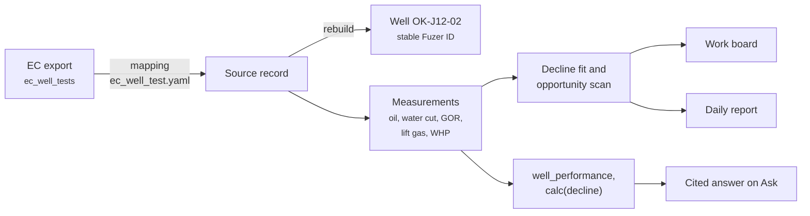
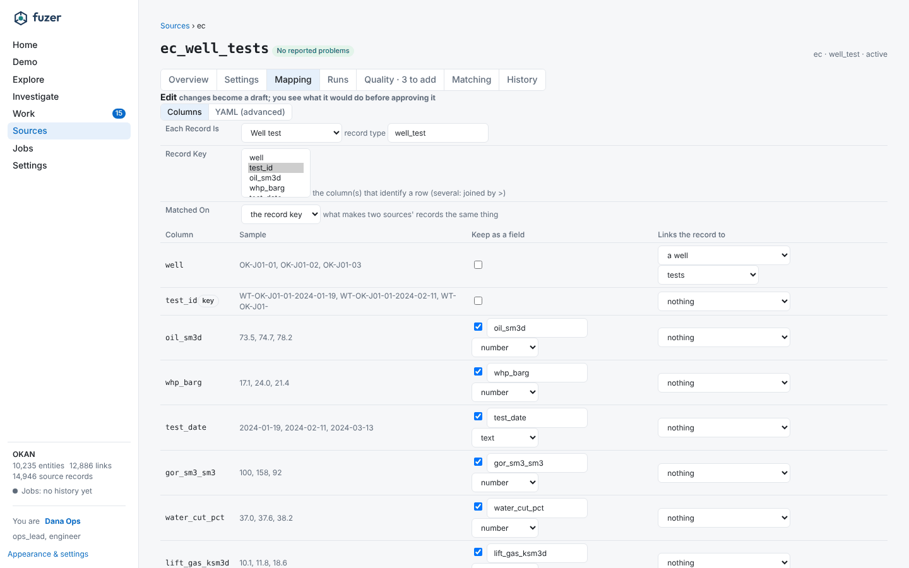
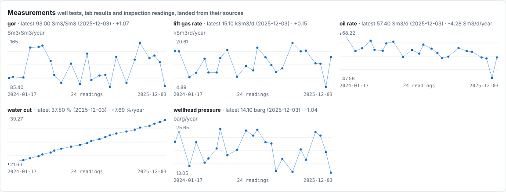

# From a well test to an answer

For a guided, keyless introduction in the app, choose **Start guided investigation**
in **Demo -> Trace an issue** after Okan has loaded and your signed-in account is approved,
or open the compatible `#/investigate/okan`. Follow the March 2024
train B issue through the asset, dated source evidence and a cited finding, including
April maintenance follow-up. This historical synthetic-data journey makes no writes
or AI calls; it does not establish a root cause or issue plant-operating instructions.
If its records are absent, it reports that rather than generating a replacement story.
Finish returns to Demo's registered agent showcase, then loaded workflow cases and your queue.
Questions are prepared in Ask and require deliberate paid-call confirmation; shared task actions
are confirmed on the existing task page, not executed by visiting the tour. Administrators can
hide or enable onboarding application-wide with `demo.enabled` in Settings (enabled by default).

This page follows one monthly well test on Okan, from the Energy Components export to the assistant's answer.
Every step is a file you can open.

## 1. The export

Energy Components exports well tests as a table, `ec_well_tests`, with one row per test: well, test date, oil rate,
water cut, GOR, lift gas and wellhead pressure. The connector for its format (CSV, Parquet, Delta, Excel or JSON)
reads it through the dataset's connection in the source catalog. `fuzer sources preview ec_well_tests` shows a sample, and what the rows would make, before anything loads.

## 2. The mapping

[`mappings/ec_well_test.yaml`](https://github.com/areed145/fuzer/blob/main/src/fuzer/mappings/ec_well_test.yaml) says what a row means, with no code. The file seeds the mapping's first version in the source catalog; later edits are new versions, approved on the Sources page (`fuzer sources show ec_well_tests` lists them):

- a **well_test** entity keyed by `test_id`, with its fields;
- a link from the test to its **well** (`tests`), with the well name normalised by the pack's well grammar, so
  the different ways sources write a well name meet on one well;
- **measurements** of the well at the test date: oil rate, water cut, GOR, lift gas rate and wellhead pressure, each
  with its unit.

On the Sources page, the dataset's **Mapping** tab shows the same file column by column: what each column is kept
as, and what it links the record to.

{ loading=lazy }

## 3. Ingest

`fuzer ingest` ([`sources/ingest.py`](https://github.com/areed145/fuzer/blob/main/src/fuzer/sources/ingest.py)) keeps each row as a **source record**,
with its source, key and a fingerprint. A row that hasn't changed is skipped next time. A table whose columns change
is held for review rather than loaded.

## 4. Identity and golden records

`fuzer rebuild` turns records into **candidates** and resolves them
([`graph/resolve.py`](https://github.com/areed145/fuzer/blob/main/src/fuzer/graph/resolve.py)). The test's well candidate matches the well that SAP, EC,
PI AF and GIS already describe, by exact keys first and then by scoring. The well keeps its stable Fuzer ID.
Each field becomes an **assertion** with its source, and [`graph/golden.py`](https://github.com/areed145/fuzer/blob/main/src/fuzer/graph/golden.py) picks
the **golden** value by the pack's source priorities. The measurements land in the `measurement` table
([`graph/measurements.py`](https://github.com/areed145/fuzer/blob/main/src/fuzer/graph/measurements.py)), next to the well's PI values.

The well's entity page shows the result: one value per field with the system it came from, the records from SAP,
GIS and EC that describe this well, and each measured quantity as a series with its change per year.

{ loading=lazy }
*Two years of EC well tests on OK-J12-02 (synthetic data). Water cut rises steadily while oil rate declines.*

## 5. Analyses

The test is now evidence:

- `calcs.decline` ([`analysis/calcs.py`](https://github.com/areed145/fuzer/blob/main/src/fuzer/analysis/calcs.py)) fits the well's decline and flags a test
  that falls below it;
- the opportunity scan's `wells_below_expectation` ([`ops/opportunities.py`](https://github.com/areed145/fuzer/blob/main/src/fuzer/ops/opportunities.py))
  turns a shortfall into an opportunity with its gain;
- the daily report's Wells section lists a test far from the well's previous one
  ([`ops/daily_report.py`](https://github.com/areed145/fuzer/blob/main/src/fuzer/ops/daily_report.py)).

## 6. The answer

Ask "Which wells are falling short of their decline?" The orchestrator routes the question to the production
specialist. It calls `well_performance` and `calc(check="decline")`
([capabilities](capabilities.md)), which return the numbers with their sources: the EC test, the fit and the
deviation. The answer cites them, and each citation opens the record it came from.
