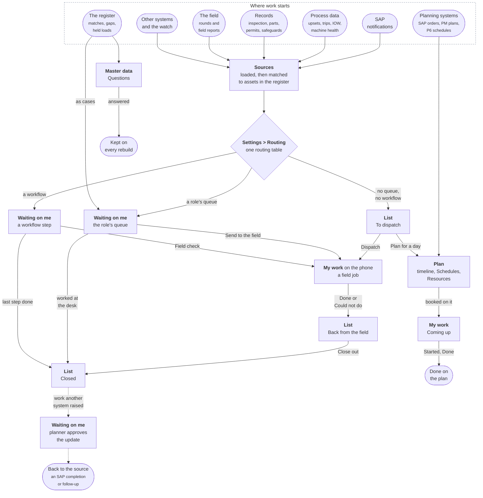
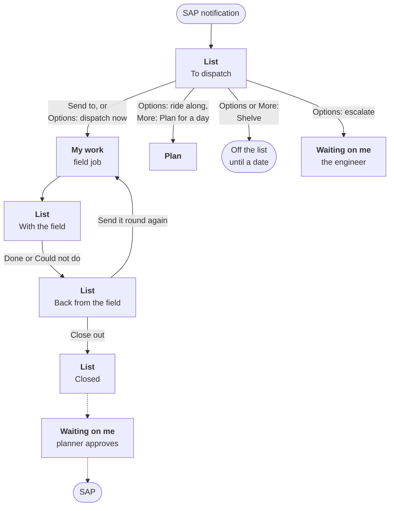
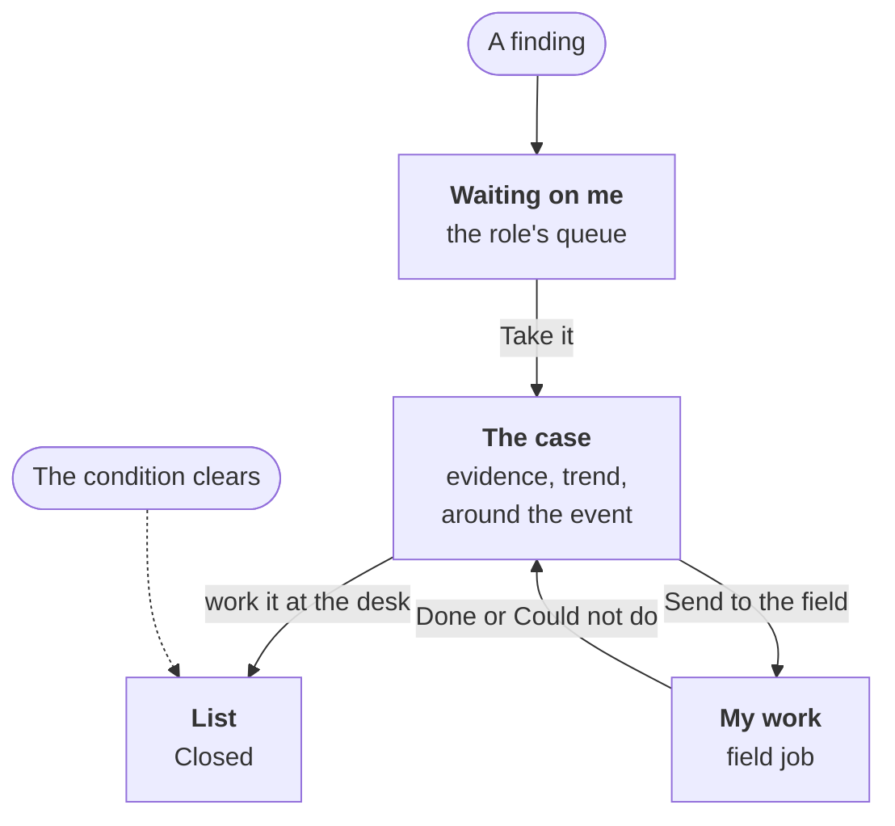
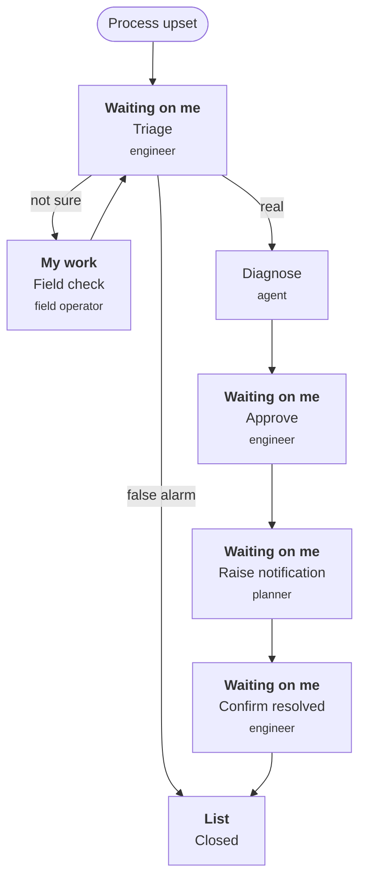
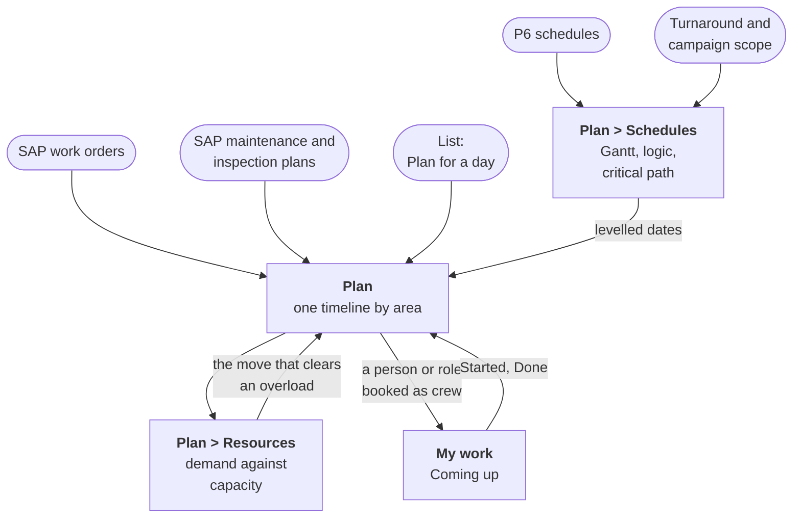
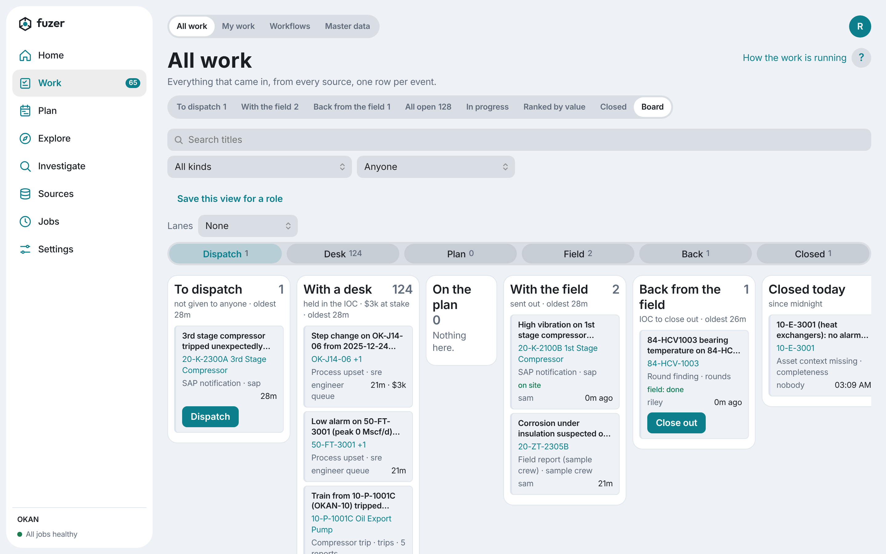

---
hide:
  - toc
---

# Where work goes

Every piece of work in Fuzer takes the same trip: it starts in some system, lands on a page where someone decides
what it needs, is done by a person (or an agent) on another page, and is closed on a third. This page draws that
trip for every source, and names the page in the menu where each stage happens. Use it to answer "where would I
see that?" and "where does it go next?".

This is how work moves today. [The work model](work-model.md) is where it is going: every source's work as a case,
field work through plan, schedule and release, and each system's statuses mapped both ways.

[Every source of work](work-sources.md) takes each source in turn; [how work is routed](work-routing.md) explains
the machinery behind it; [work types](work-types.md) lists every type with its queue, generated from the code.

## The whole map

Read it top to bottom. Rounded boxes are where work starts; square boxes are pages in the app, named as they are
in the menu; the last row is where the result goes. On a phone the map is small: the table under it and the four
roads below say the same thing at a readable size.

All of it is visible in one place while it is open: **Work > List** (All work) lists every piece of routed work whichever road it
took, and **Home** gathers it at the places it is about.

## Source by source

The same map as a table. Each row is one family of sources; each column is a stage, with the page it happens on.

| Work that starts as | Arrives on | Decided on | Done on | Closed on | Then |
|---|---|---|---|---|---|
| **An SAP notification** with no work order | List: To dispatch | Its row: Options, Send to, or More: Plan for a day or Shelve | My work: the field job, on a phone | List: Back from the field: Close, Send again or Plan for a day | The SAP update is drafted for the planner on My work |
| **A process upset** found by the detectors | Waiting on me: Triage, in the engineer queue | The Triage step: real, false alarm, or send someone to look | Waiting on me: Field check, Approve, Raise notification, Confirm resolved | List: Closed, when the last step is done | A re-check six hours on; a notification drafted for SAP |
| **An IOW breach** | Waiting on me: Review IOW breach, for the engineer | The review step | Waiting on me: Raise notification | List: Closed | Never shelved and never held back by planned work |
| **A trip or a machine health finding** | Waiting on me: the engineer queue | The case: Take it, then work it or Send to the field | My work: the field job, or the desk | List: Closed | Held back while planned work covers the machine |
| **An inspection or corrosion finding** | Waiting on me: the engineer queue | The case | The desk, usually by planning an inspection | List: Closed, or by itself when a later survey clears it | Planned work shows on Plan |
| **Parts not ready** for a planned job | Waiting on me: the maintenance planner queue | The case | The desk: expedite, or move the job on Plan | By itself, when stock or an order in time covers every line | Ordering and expediting stay with supply chain |
| **A permit lapsed** with plant still isolated | Waiting on me: the ops lead queue | The case: Take it, then work it or Send to the field | My work: the field job | By itself, when the permit is closed or back in date, or nothing on it is still isolated | |
| **A bypass, proof test or temporary change overdue** | Waiting on me: the ops lead or engineer queue | The case | The desk | By itself, when the register shows it done | Active bypasses are on every handover |
| **A round finding**: a reading out of limits or a failed check | Waiting on me: the ops lead queue; the List | The case: Take it, then work it or Send to the field | My work: the field job | List: Back from the field: Close, Send again or Plan for a day | |
| **A field report** | Waiting on me: the ops lead queue; the List | The case | My work: the field job | List: Back from the field: Close, Send again or Plan for a day | |
| **Alarm, flare, lab, well test and emissions findings** | Waiting on me: the engineer, production engineer or HSE queue | The case | The desk | List: Closed | Regulatory reports are reviewed under Reports > Regulatory |
| **The agentic watch** proposing something no detector raised | Kept and scored only (live mode is off by default); in live mode, Waiting on me: the engineer queue | The case | The desk, or the field | List: Closed | After three confirmed proposals of one pattern, the watch drafts a rule for it |
| **Another system's own type** (`POST /exceptions`, a source pack) | Wherever its type says: List: To dispatch, a queue, or a workflow | As above | As above | As above | Its update goes back the way its system is set up on Sources |
| **A register question**: a possible match, a conflict, a held load | Master data > Questions, and Waiting on me: the data steward queue | The question | Master data, or the dataset on Sources | By itself, when the question is answered | The answer is kept on every rebuild |
| **An SAP work order or maintenance plan** | Plan | Plan: move it, bundle it with a shutdown, book a crew | My work > Coming up, once a person or a role is booked on it | Plan, when the crew says Done or SAP closes the order | Its work centre's crew counts on Plan > Resources |
| **A P6 or turnaround schedule** | Plan > Schedules | The schedule's Gantt: logic, dates, resources | In the field, by the schedule | The Gantt, as each activity is progressed | A P6 schedule's progress follows its export; nothing is typed twice |
| **A shift handover** | Waiting on me: a banner for the ops lead | | | When the incoming lead acknowledges it | Kept and readable under past handovers |
| **A daily report** | Waiting on me: Review report, for the ops lead | | Reports > Daily operations | When it is published | |
| **An opportunity** the scan found | Waiting on me: the engineer queue; the List, sorted by value | The task, from Waiting on me | The desk | List: Closed | Not raised again unless the data changes |

!!! note "Two things that are not a road of their own"

    **Plan clashes** (two jobs on one asset at once, a person booked twice, hot work beside a line break) are not
    raised as work. They show as a red **clash** flag on the job's bar on **Plan**, and again at **Dispatch**, where
    a job that clashes is only sent with a reason.

    **Alarms and operator log entries** do not open cases either. They show beside the case they belong to, in its
    **Around the event** card.

## The four roads

Every row above is one of four roads. Which one a type takes is its row in the routing table.

### 1. It waits for the IOC

For work that needs a decision before anyone moves: a notification someone raised in SAP, a report another system
posted with no queue named. The ops lead's **Waiting on me** includes all of it.

| Stage | Page | Who |
|---|---|---|
| Arrives | **Work > List**, the **To dispatch** preset | IOC operator |
| Weighed | The row's **Options**: dispatch now, ride along with the next visit, shelve or escalate, each with what waiting defers and risks, one recommended | IOC operator |
| Sent | The row's **Send to** (or the chosen option): who, what to do, and whether the job is ready | IOC operator |
| Out | **My work** on the phone: the job card, **On site**, **Done**, **Could not do** | Field operator |
| Back | **Work > List**, the **Back from the field** preset: **Close** or **Send again** | IOC operator |
| Closed | The case's **Close out**, then the List's **Closed** | IOC operator |
| Returned | **Waiting on me**: the drafted update, to approve | Planner |

### 2. It goes to a role's queue

For work one desk owns: an inspection finding for the engineer, a lapsed permit for the ops lead, parts that will
not arrive for the planner. Most types take this road.

The step has the role's SLA from the moment it arrives and is marked escalated in its queue if nobody takes it in
time (it moves on only where a site has set the role's chain).
A holder of the role sees the step on **Waiting on me** with **Take it** on its row. The IOC sees these on the List
too, and can hand one to a person from its row (**Send to**) without waiting for the desk.
Much of this work closes by itself: when the permit is closed, the part is covered or a later survey shows the
wall is sound, the condition clears and its case closes with it.

### 3. It starts a workflow

For work with more than one step and more than one role. Fuzer ships seven workflows; a site draws its own under
**Settings > Workflows**.

| Workflow | Starts when | Steps, and whose Waiting on me they land on |
|---|---|---|
| `upset` | The detectors group findings into an upset | Triage (engineer), Field check (field operator), Diagnose (agent), Approve proposed action (engineer), Draft SAP notification (agent), Raise notification (maintenance planner), re-check in 6 hours, Confirm resolved (engineer) |
| `iow_breach` | An integrity operating window is held past its allowed time | Review IOW breach, Raise notification (engineer) |
| `queue_item` | Any type that names a queue arrives | Work the case (the type's queue), Field check (field operator) |
| `task` | Work no exception raised: an opportunity, a task the assistant drafted and a person confirmed | Do the task (the queue it was asked of) |
| `daily_report` | A production day closes | Draft report (agent), Review report (ops lead) |
| `shift_handover` | Each shift change | Read and acknowledge the handover (ops lead) |
| `source_closeout` | The field finishes work another system raised | Approve the update to the source system (that system's close-out role, the maintenance planner for SAP) |

A step for an agent that no worker picks up does not wait silently: the case offers **Take it over**, and after 30
minutes it goes to a person's queue.

### 4. It goes on the plan

For work with a date rather than a deadline. It does not pass through the routing table: it is a bar on a timeline.

Planned work and routed work meet in three places:

- **Plan for a day** on a List row, or **Ride along with the next visit** in its Options, turns routed work into a
  bar on Plan, linked to its case. On its day it comes back to To dispatch. When its work closes
  (closed out, or the condition cleared) the bar is done; taking the bar off the plan leaves the work open.
- **Planned work holds back what it explains.** A trip on a compressor that is down for a scheduled shutdown is
  counted under that shutdown and opens no case. The List shows how many findings were held back.
- **Parts not ready** is raised as routed work for the planner when a planned job's parts will not arrive in time.

## Which page, for which stage

The same thing read the other way: for each page, what part of the trip it holds.

**Work > Board** shows the stages side by side: to dispatch, with a desk, on the plan, with the
field, back from the field and closed today.

{ loading=lazy }

| Page | Stage | What you do there |
|---|---|---|
| **Home** | Seeing | Where open work is, on the field map and as a ranked list |
| **Work > List** (All work) | Arriving, tracking, closing | Every open event and case, filtered on any dimension. Presets: **Waiting on me**, **To dispatch**, **Back from the field**, **Overdue**, **Data questions**. Each row's next step: **Take it**, **Options**, **Send to**, **Close**, **More** |
| **Work > Board** | Tracking | The same rows in columns by stage (or kind, holder, team, source, place); not on a phone |
| **Waiting on me** (the List's preset) | Doing, at a desk | Your steps and your roles' unclaimed steps, escalated first; the handover banner for the ops lead |
| **My work** (on the phone) | Doing, in the field | Field jobs sent to you, this shift's rounds, planned work you are booked on, crew handovers; works with no signal |
| **A case** (opened from any row) | Deciding | The evidence each source saw, the asset's trend, alarms and log entries around the event, the Options card, where it sits in its workflow, its checklist, Close out |
| **Settings > Workflows** | Designing | Each workflow drawn, with its running cases, where work piles up, and its SLAs |
| **Master data** (the Data questions preset links to it) | Fixing the register | Questions, references on open work that matched nothing, gaps, decisions |
| **Plan** | Scheduling | One timeline of every planned job from every source, with clashes, bundling chances and parts readiness |
| **Plan > Schedules** | Scheduling | A turnaround, project or campaign as a Gantt with logic, critical path and levelling |
| **Plan > Resources** | Scheduling | Crews, cranes, beds, seats, vessel support, operator rounds and production capacity against demand: planned jobs, schedules and work sent to the field now, on one ledger that the ready check at dispatch also reads. A job is booked on a crew from its bar on Plan, and over capacity only with a reason |
| **Plan > Logistics** | Scheduling | Each day's crews and jobs, who travels and who stays aboard, seats and beds needed, cranes and vessels booked, materials to send |
| **Sources** | Intake, and going back | Each system's datasets, loads and held loads; how each system's updates go back |
| **Settings > Routing** | Configuring | The routing table, and a dry run of any intake |
| **Settings > Users** | Configuring | Who holds each role, its SLA, and who it escalates to |

## Where to look when something is missing

- **It is in SAP but not on the List.** Only open notifications with no work order, created in the last 60 days of
  data, are raised. One the field already closed is held until SAP's status for it changes.
- **Two systems reported it but there is one row.** That is one event, one case: the row lists each source under it.
  **More > Split out** gives a source its own case if it is a different event.
- **A detector should have raised it.** Look for **Suppressed** under the List: planned work on that asset may be
  holding it back. Then **Settings > Detection** shows whether the detector is on and has what it needs.
- **It was dispatched but the operator cannot see it.** Check who holds it on the row; a job sent to a queue waits
  in the queue, on each holder's **Waiting on me**, until someone chooses **Take it**.
- **It shows no asset.** Its reference matched nothing in the register. **Master data > Unmatched on open work**
  lists it; making it an alias fixes this one and the next.
- **It will not close.** A case with several sources stays open while any source still holds. A case that came from
  another system waits on the planner's approval before that system hears of it.
