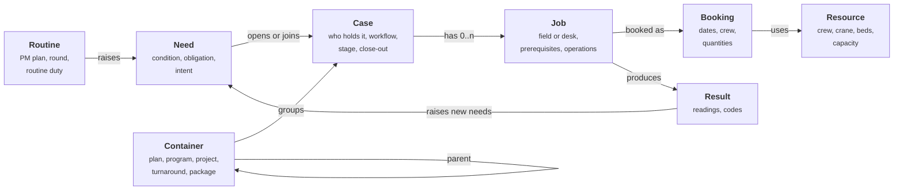

# The work model

Every piece of work in Fuzer, from a surveillance exception to a turnaround to a business plan line, is described by
the same eight objects. This page is the target model: where work is going, so that every source's work is seen in one
place, moves through one flow, and goes back to the system that owns it. [Where work goes](work-map.md) describes how
work moves today; the [plan](#moving-onto-the-model) at the end says how each part gets here.

## The objects

Asset links (to the register) and source links (to SAP, P6 and other systems) attach to every object.

| Object | What it is | What it holds | Today |
|---|---|---|---|
| **Need** | Why work should happen: a **condition** seen (exception, notification, round finding), an **obligation** falling due (PM due date, permit condition, report, routine occurrence) or an **intent** (project scope, opportunity, business plan line) | Kind, type, evidence, asset links, value and risk, due by, source links; open, covered, cleared, satisfied or cancelled | `exception_record`; PM dues and opportunities elsewhere |
| **Case** | Who is accountable and where the work stands | Holder, queue, workflow and steps, stage, checklist, history, close-out with ISO 14224 codes | `work_item`, `work_process`, `case_disposition` |
| **Job** | One piece of execution: done at a place, by a kind of crew, in a window | Where (field or desk), assets, instruction, duration, prerequisites, logic links, operations, status | half of `plan_item` |
| **Booking** | When a job is planned to happen and with which resources | Start, end, crew, people, quantity per resource; proposed or committed | `plan_item` dates and crew, `plan_demand` |
| **Resource** | Something work uses and can run out of | Kind (crew, person, equipment, space, transport, production capacity), unit, capacity calendar, qualifications | `plan_resource`, `plan_resource_capacity`, `work_person`, `work_role` |
| **Container** | A group of cases with a shared window, budget or goal | Kind, parent, window, budget, owner, governing case | `plan_project`, `board_project`, turnaround revisions |
| **Routine** | A standing rule that raises needs when they fall due | Trigger, anchor, targets, job template, lead time, tolerance, owner role | SAP maintenance plans, the rounds pack, workflow timers |
| **Result** | What a job produced | Actual times and people, readings, photos, checks, materials used, findings raised, failure data | exception evidence, `round_reading`, `field_photo`, `case_disposition` |

An **operation** is a step inside a job when the source has them (an SAP operation, a P6 step).

## How cases fit

The case is the unit of **accountability**, not of execution. Every piece of work has exactly one case.

- **Below the case are jobs.** A desk case (a review, an approval, a data question) has none. Corrective maintenance
  usually has one. A turnaround scope item can have many.
- **Above the case are needs and containers.** A need opens a case or joins an open one: several reports of one event
  are one case, as now. A container groups cases and is governed by a case of its own, which runs its gates
  (a project's select, define, execute; a turnaround's scope freeze and readiness review).
- **A case's stage comes from its jobs.** With no open job it is To dispatch or With a desk, from its step. Otherwise it
  takes the earliest stage of its open jobs: Planned, Scheduled, Ready, With the field, Back from the field.
- **Field work reaches the field only through Release.** A field job passes Planned, Scheduled and Ready, and the IOC
  releases it. Urgent work (Dispatch now) skips to the field but is still a bar on the plan, booked to the field
  operator it went to; it books no maintenance crew, whose capacity is for the work orders it does.

## Hierarchy

One container with a `kind` and a `parent` covers every level a site has:

1. Business plan
    1. Program or campaign
    2. Project
    3. Turnaround or shutdown
        1. Package (a work pack or WBS element)
            1. Case
                1. Job
                    1. Operation

- **One parent each**, so totals roll up without double counting. An SAP order that is also turnaround scope is placed
  in the turnaround and keeps its source link to the order.
- **Bundling is re-parenting.** Riding along with a turnaround moves the case under its package and the job into its
  window. Nothing is copied.
- **Roll-ups are read, not stored.** Progress, cost, crew load and deferment are added up from cases and jobs on the
  server, in one place.

## Recurrence

A **routine** raises an obligation need each time it falls due. One object covers SAP maintenance and inspection plans,
operator rounds, routine duties (sampling, well tests, chemical checks), shift handovers, daily reports and regulatory
reports.

| Field | Meaning | Examples |
|---|---|---|
| Trigger | When it falls due | Every 90 days; every shift; every 4,000 running hours; when a reading crosses a limit |
| Anchor | What the next due date counts from | The last due date (fixed) or the last completion (floating) |
| Targets | Assets, or a register query | One compressor; every well in an area; a round's points |
| Template | The job it makes | Instruction, checklist, duration, crew type, materials, field or desk |
| Lead time | How far ahead an occurrence becomes a need and a case | 14 days for PM; the start of the shift for rounds |
| Tolerance | How late before it is overdue or missed | 10 percent of the interval; the end of the shift |
| Owner | The role accountable | Maintenance planner; operator; ops lead |
| Source | Who keeps the rule | SAP (Fuzer reads it) or Fuzer |

- **Heavy occurrences get their own case**: a PM due date is one case with one job.
- **Light, frequent occurrences share a period case**: a shift's rounds are one case with a job per round. A reading out
  of limits raises its own condition need and case, as now.
- **Routine load reserves capacity** on its crew for each period ahead, before other work is booked on it.

## Lifecycles

| Object | States |
|---|---|
| Need | open, covered (a case holds it), then cleared, satisfied or cancelled |
| Case | open (its stage worked out from its jobs and steps), then closed with a disposition |
| Job | planned, scheduled, ready, released, in progress, done or could not do, closed; cancelled from any state |
| Booking | proposed, committed, then superseded or consumed |
| Container | its governing case's workflow |

**Prerequisites decide Ready.** A job carries a list of prerequisites, each satisfied or not: materials covered, crew
within capacity, permit approved and isolations in place, seats, beds and lifts within limits, no unresolved clash or
SIMOPS conflict, the unit down for a job that needs it, engineering or MOC approval where the work type asks. A job is
ready when all are satisfied. A new check (a gas test, a weather window) is a new prerequisite type, not a change to the
gate. Release with one open needs a reason, kept on the case.

## Work types on the model

| Work type | Need | Case | Jobs | Container | Routine | Field? |
|---|---|---|---|---|---|---|
| Surveillance exception | Condition from the detectors | Upset or queue workflow | A field check, when triage sends one | | | Sometimes |
| Corrective maintenance | Condition: notification, round finding, field report | Field job workflow | Order operations, or one job | Package, if bundled | | Yes |
| Preventive maintenance | Obligation: PM due date | One per due date | Order operations | Turnaround package, if it needs the unit down | SAP maintenance plan | Yes |
| Inspection and integrity | Obligation (interval, RBI) or condition (wall loss) | Field job workflow | Inspection job | Campaign | Inspection plan | Yes |
| Project | Intent: a scope item | One per scope item; the project's own case runs its gates | P6 activities | Project, packages | | Mixed |
| Turnaround | Intent, plus obligations bundled in | One per scope item or order | P6 activities, order operations | Turnaround, packages | The turnaround interval | Yes |
| Campaign (well intervention, leak survey) | Intent or obligation per site | One per site or well | One per visit | Campaign | Sometimes | Yes |
| Business plan | Intent lines with estimates | The plan's own case: approval, quarterly review | Placeholder jobs with estimates | Business plan, programs | Annual | |
| Routine duty (rounds, sampling, well tests) | Obligation from the routine | A period case per routine | One per occurrence | | The routine | Yes |
| Shift handover, daily report | Obligation from the routine | The existing workflows | A desk job | | Shift, daily | No |
| Regulatory obligation | Obligation: a permit condition or report due | Review workflow | Desk job, or a field job | | Its frequency | Mixed |
| Opportunity | Intent from the scan | Task workflow | None, or a project later | Program, if adopted | | Mostly no |
| Register question | Condition: a match or held load | Data steward queue | None | | | No |
| Write-back approval | From another case's close-out | Source close-out workflow | None | | | No |

## Sources

The register separates what a system says (records) from what Fuzer believes (golden records). The work model follows
the same line: an SAP order is a record in the register; the case and job are Fuzer's working objects, tied to it by a
**source link**.

- **A source link is the system, the object's key there and its status there.** The status is read through that
  system's status mapping (below) into a Fuzer state, and a Fuzer move goes back through it as a drafted update.
- **Source links are many to many and own fields.** A job can carry an SAP order and a P6 activity at once. Each link
  says which fields its system owns (SAP the status and order text, P6 the dates and percent complete, Fuzer the
  booked crew), so a re-sync never overwrites what a person decided. This generalises today's `moved_by` rule.
- **A source pack declares its work objects**: which of its objects become needs, cases, jobs, operations, containers,
  routines or resources, its status mapping (below) and the write-back kinds it accepts.
- **One intake for needs.** Every source raises needs through the exception contract (`POST /exceptions`, findings), so
  routing, joining, shelving and suppression work the same for a new system on day one.
- **Attributes are typed per kind.** Each work type declares its own fields in the ontology, as entity kinds do; the
  core tables stay fixed.
- **A new work type** is a routing row, a workflow and optionally a job template. No new page, table or stage.

### Status mapping

Fuzer keeps one short list of states per object. Each connector translates its system's statuses into them and back,
which is what lets work from SAP, JD Edwards, Maximo or P6 sit on one list and still move in its own system.

- **The mapping is data, edited on Sources**: each system's statuses, the Fuzer state each means, and the status to send
  back for each Fuzer move. It is versioned and approved like a register mapping; a source pack seeds it.
- **Rows match combinations.** SAP carries system and user statuses together, so a row can match REL with user status
  WMAT (released, waiting on materials: a prerequisite open). The most specific row wins.
- **Unknown statuses are flagged, not guessed.** A status with no row holds the object at its last known state and
  raises a register question for the data steward, as a held load does.
- **Moves go back as drafts.** A Fuzer state change on an object another system owns drafts the matching write-back for
  that system's approving role. Nothing is sent silently unless the system's pack says that kind goes straight through.
- **The owner wins on its fields.** When a source moves an object backwards or disagrees with Fuzer, the source's value
  stands for the fields it owns and the case shows the conflict.

| System | Object | Source status | Fuzer state | Fuzer move, sent back |
|---|---|---|---|---|
| SAP PM | Notification | OSNO | Need open | Case opened: NOPR |
| SAP PM | Notification | NOCO | Need satisfied | Case closed: NOCO, with ISO 14224 codes |
| SAP PM | Order | CRTD | Job planned | |
| SAP PM | Order | REL | Job can be scheduled | Released: the site's dispatched user status, where it has one |
| SAP PM | Order | PCNF, CNF | Job in progress, done | Done: a confirmation |
| SAP PM | Order | TECO, CLSD | Job closed | Closed: TECO, for the planner to approve |
| JD Edwards | Work order | The site's 00 to 99 codes | One row per code in use | The code the site assigns to each move |
| Maximo | Work order | WAPPR, APPR, WSCH, INPRG, COMP, CLOSE | Planned, can be scheduled, scheduled, in progress, done, closed | The matching status |
| Primavera P6 | Activity | Not started, in progress, completed | Planned or scheduled, in progress, done | Progress is read from P6, not sent back |

These rows are examples to seed a pack; each site edits its own.

## Standards

The model borrows each standard's shape and keeps Fuzer's plain screen words; standard terms stay in code, docs and
exports. This is a working alignment to check against licensed copies, as `standards/iso14224.yaml` notes.

| Fuzer | ISA-95 (IEC 62264) | ISO 14224 | ISO 55000 | SAP PM / PS | Primavera P6 |
|---|---|---|---|---|---|
| Need | Work request | Failure or maintenance event | Asset need | Notification; maintenance plan call | |
| Case | (Fuzer's accountability layer) | Maintenance record, with failure and activity data at close | | Notification and order together | |
| Job | Job order | Maintenance activity | | Order | Activity |
| Operation | Job order segment | | | Operation | Step |
| Booking | Work schedule | | | Capacity requirement, dates | Resource assignment, dates |
| Resource | Personnel, equipment, physical asset, material | | Resources | Work centre | Resource |
| Container | | | Asset management plan (business plan level) | WBS element, revision | EPS, project, WBS |
| Routine | Work master | Preventive maintenance | | Maintenance plan, task list | |
| Result | Job response, work performance | Failure mode, mechanism, cause, activity, down time | Performance evaluation | Confirmation, technical completion | Actuals, percent complete |
| Asset link | Equipment hierarchy | Taxonomy levels 3 to 9 | Asset portfolio | Functional location, equipment | |

- **ISA-95 Part 3**'s maintenance activities (request, detailed scheduling, dispatching, execution, data collection,
  tracking, analysis) line up with Planned, Scheduled, Ready, Released, With the field, Back from the field and Closed.
- **ISA-95 Part 4**'s objects give integration names; jobs and responses could be exchanged as B2MML messages.
- **ISO 14224** sets the asset taxonomy and the failure and maintenance codes the close-out captures. Extending asset
  links to subunit and maintainable item (levels 7 and 8) makes reliability analysis work at component level.
- **ISO 55000** frames the business plan: work is justified by value and risk against the asset management plan,
  which is the priority needs carry (value in $, risk, due by).

## Built for later

Not planned yet; each fits the model without changing its shape.

| Capability | Where it fits |
|---|---|
| What-if scenarios | Bookings carry a scenario; the committed plan is one of them |
| Auto-scheduling | A solver reads jobs, prerequisites, links and capacity and writes proposed bookings for a person to commit |
| Cost and budget | Estimates on jobs, actuals on results, rolled up through containers to the business plan |
| Skills and qualifications | Resources gain qualifications and jobs require them |
| Contractors | A resource with an owner organisation and a contract that sets its capacity |
| Agents doing work | An agent is a resource; its jobs are booked on it and its results come back like any other |
| Offline phones | The job is the unit a phone downloads: instruction, assets, prerequisites, checklist, last results |
| Several sites | Containers and resources carry their site; a shared crew or vessel serves several sites from one calendar |

## Words on screen

The objects above are the model's names. On screen the [glossary](glossary.md) governs: a case is a **case**; a job is
a **field job** or a **desk job** (the **Jobs** page stays the technical schedules and runs); a container is shown by
its kind (**project**, **turnaround**, **package**); a booking shows as the crew and dates on a bar.

## Moving onto the model

Each step is a pull request that ships on its own. The first three fix today's gaps in the plan, schedule and dispatch
flow before the larger moves.

1. **Close the bar with its case.** Closing a case marks its plan item done, and so does the field's Done on its field job;
   cancelling a plan item with an open case asks first.
2. **The plan item becomes a job.** `plan_item` gains its case (`item_id`), where it happens (field or desk) and a link to its result.
3. **Bookings and one crew capacity.** Crew is picked from the resources, with capacity and clashes shown on booking.
   Urgent dispatches and released jobs book demand, and the ready check reads that one ledger.
4. **Needs, and cases from arrival.** `exception_record` gains a need kind (condition, obligation or intent) and opens
   its case when it arrives; To dispatch and planned become stages of cases. A case nothing routes opens at the To
   dispatch step, held by nobody; sending it puts that same case on its process, and an event that joins another's
   case has its waiting case cancelled. Events from before this step get their case at the next reconcile.
5. **Prerequisites, the field job workflow and Release.** Ready is computed from prerequisites; a `field_job` workflow
   enforces the stages; Release, Reschedule and the SAP confirmation draft arrive. First part done: a bar's prerequisites (scheduled, the ready
   checks, no clash, the unit down when it needs it) decide Ready on Plan; Release sends its waiting case to the crew,
   with a reason when one is open; Reschedule keeps its reason and sends a released job back to wait. Each bar carries
   its job stage (planned, scheduled, released, in progress, done, cancelled). The SAP order confirmation draft comes
   with SAP orders as jobs in step 8; a notification's close-out already drafts back to SAP.
6. **One container.** `plan_project`, `board_project` and turnaround revisions become containers with a parent and a
   governing case. Done as `work_container` (`ops/containers.py`, `/containers`): schedules, open board
   projects and SAP revisions become containers on each sync, their jobs placed in them; a container made here opens
   its governing case, held by its owner. The source records stay where they are and the container points at them.
7. **Routines.** SAP maintenance plans, rounds and routine duties become routines raising obligation needs. Done for
   SAP maintenance and inspection plans and routine duties kept in Fuzer (`work_routine`, `ops/routines.py`,
   `/routines`): each occurrence within its lead time raises a `routine_due` obligation, its case in the owner role's
   queue and its job on the plan (for SAP, the bar the plan sync made); it clears when the job is done, and a Fuzer
   routine rolls forward. Rounds, handovers and reports keep their own flows for now, and reserving routine load on
   crews comes later.
8. **SAP orders and P6 activities as cases and jobs**, with source links, field ownership and the status mapping
   (SAP's rows first). Another system such as JD Edwards or Maximo is then its own mapping table, not new code. First part done:
   `work_source_link` and `work_status_map` (`ops/source_links.py`, `/status-map`, `/source-links`). Each SAP order's
   job carries its source link (SAP owns its status and text) and its status is read through the mapping, seeded with
   the rows below for SAP, P6 and Maximo; a status no row maps holds the job and asks the data steward, and clears
   when a row is added. Every order's job has one case: its notification's case, else a `sap_order` case in the
   maintenance planner's queue that closes when SAP closes the order. Each P6 activity's job carries its link too (P6 owns
   its dates and progress) and works the case of the order it executes, else its schedule container's governing case.
   A job done here that its system still holds open drafts the move the mapping names for done, for that system's
   approver: for an SAP order, its confirmation (CNF), once.
9. **Business plan.** Intent lines with estimates under a plan container, matched to real cases for plan against actual. Done as
   `work_plan_line` and `work_plan_match` (`ops/business_plan.py`, `/containers/{id}/plan`, `/plan-lines`): a planner
   writes each line's kind, assets, period and estimates; cases whose jobs are on its assets in its period match it
   (a person can match or move any case, and a case counts against one line). Each line reads its estimate against
   its cases' actuals (hours done and still booked, SAP's cost on their orders), and cases in the plan's containers
   that no line covers are the unplanned work.
