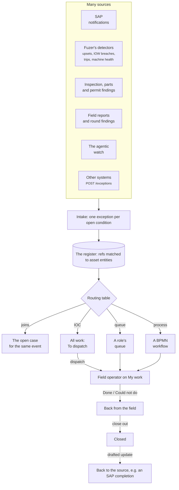
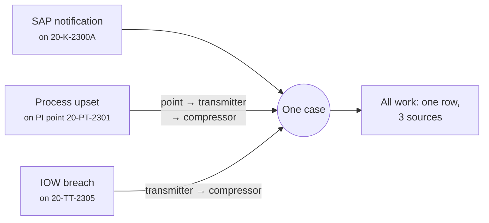
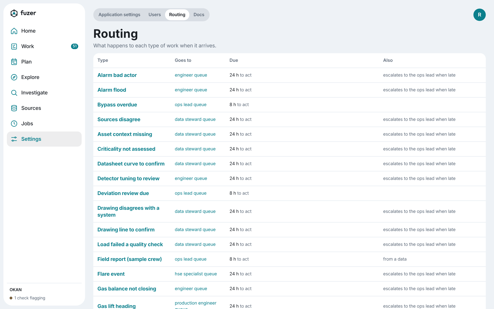
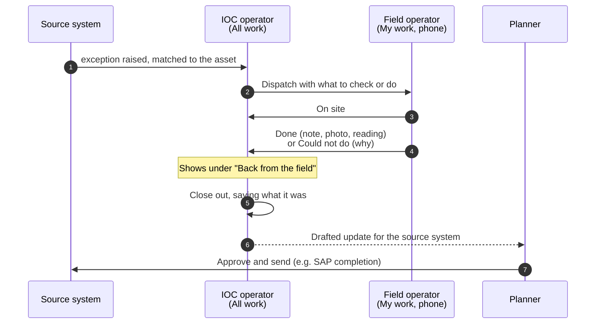
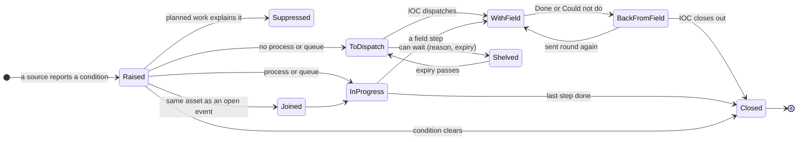
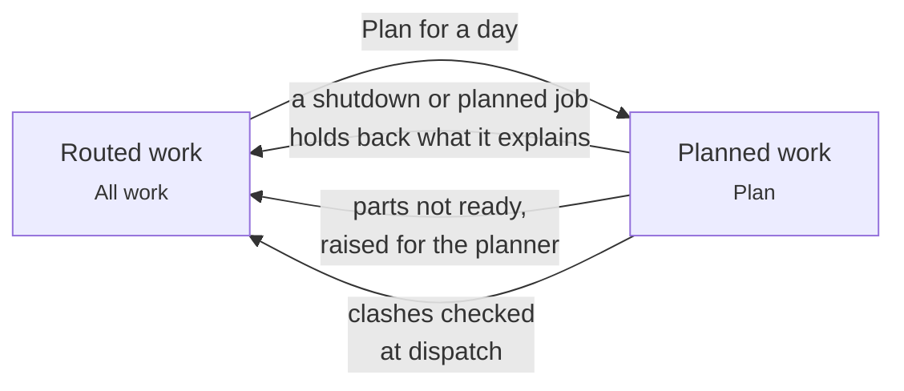

# How work is routed

Fuzer is one front door for operational work. A notification in SAP, an upset the detectors found, an inspection
finding, a permit that lapsed with plant still isolated, a reading a field operator logged on a round: each arrives
from a different system, and each lands in the same place, matched to the asset it is about through the register,
routed by one table, and worked to a close by people and agents. This page shows that path end to end.
[Where work goes](work-map.md) is the companion for users: every source, and the page in the menu for each stage.

## 1. Work arrives as an exception

Every source raises the same thing: an **exception**, one per open condition, with the evidence it saw and
references to what it is about (a tag, a serial number, an SAP equipment number, a well name, a PI point). A
condition that is still open adds evidence to its exception rather than raising another, and one that clears drops
off by itself. Fuzer declares its types of work in code, and a deployment adds its own as data or in a source
pack. [Work types](work-types.md) lists every one with its queue, generated from the code. By where they come from:

| Where it comes from | Types of work (examples) |
|---|---|
| Maintenance and materials systems | SAP notification with no work order, parts not ready for planned work |
| Process data, by Fuzer's detectors | Process upset, IOW breach, compressor trip, machine health, gas lift heading, loop cycling, flare event, alarm flood, alarm bad actor |
| Integrity and inspection | Inspection or wall loss finding, pig run anomaly over the screen, leak repair not holding |
| Safety and permits | Permit lapsed with plant still isolated, bypass overdue, proof test overdue, safeguard demand to review, temporary MOC overdue |
| The field | Round finding; a field report, once a site defines the type (the demo's sample crew raises them) |
| Regulatory | Regulatory report coming due, regulatory report to review |
| Data quality | Source problem, source quality dropped, records that match nothing, links that name nothing, asset context missing |
| Agents | Proposed by the watch (live mode only, off by default), detector tuning to review, skill change to review |

Another system can raise its own type with `POST /exceptions` once the type is defined (on **All work** or in a
source pack's `exception_types`). The [sources](sources.md) page covers how a source pack declares one.

## 2. The register matches it to assets

Each reference on an exception is matched to an entity in the register: the golden record that SAP, PI AF, the
P&IDs and the operator logs all describe ([identity and golden records](identity.md)). That match is what makes
the rest possible. A field job shows where to go and what happened on the asset lately; the case shows the alarms
that sounded and the log entries that mention it; the planner sees other work on the same equipment.

A reference that matches nothing is not dropped. The exception comes back with a note saying so, and
**Master data > Unmatched on open work** lists it for the data steward, who can make it an alias of the right asset so the next
one matches.

## 3. One event, one case

When several systems report the same event, the IOC works it once. A new exception about the same asset as an open
one from another source joins that case instead of opening another. "The same asset" follows the register's links:
a historian point counts as its transmitter, equipment as the tag it is installed at, and a transmitter as the
compressor it belongs to. All work shows one row with every source under it.

Planned work suppresses what it explains: a trip on a compressor that is down for a scheduled shutdown is counted
under that shutdown instead of opening a case. Safety types (an IOW breach) are never suppressed or shelved.

## 4. The routing table decides what happens next

Every case goes through one routing step, which reads one table: for each type of work, where it was declared,
whether it joins an open event and within how many hours, what it starts, and when it is due by priority.

| A type that names... | Starts | Example |
|---|---|---|
| a process | that BPMN workflow, step by step | A process upset: triage by an engineer, then a field check if needed |
| a queue | the standard one-step **queue item** workflow in that role's queue, with the role's SLA and escalation | A round finding goes to the operator queue |
| neither | waits on **All work > To dispatch** for the IOC | An SAP notification |

**Settings > Routing** shows the table. Pick a type to see its workflow drawn with who holds each lane (lanes nobody
holds are flagged), and dry-run an intake: the entities its references match, the case it would join, where it
would go and when it would be due, without writing anything.

{ loading=lazy }

## 5. Dispatch, the field, and back

The instruction travels with the job. Done or Could not do hands the job back to whoever sent it, so it reappears
on the IOC's list with the field's note. The IOC closes it out, which closes the case and every exception on it.
Where the work came from another system, the update for that system is drafted for the planner to approve, so the
SAP notification is completed in SAP and is not raised again.

## 6. The life of a case

## 7. Planned work takes the plan, not the table

Work with a date rather than a deadline does not pass through the routing table. SAP work orders, the next due date
of each SAP maintenance and inspection plan, a planning system's schedules (Primavera P6) and turnaround scope are
put on the integrated plan after every register build, each matched to the assets it touches, and the IOC adds to
it with **Plan for a day**. The plan and the table meet in three places:

[Where work goes](work-map.md#4-it-goes-on-the-plan) shows the pages; the [planner's guide](guides/planner.md)
does the jobs.

## Where each part lives

| Part | Code | Docs |
|---|---|---|
| Exception types and raising | `fuzer.core.exceptions` | [workflow](workflow.md#exceptions-dispatch-and-the-field) |
| SAP intake | `fuzer.ops.intake` | [workflow](workflow.md#exceptions-dispatch-and-the-field) |
| Matching refs to entities | `fuzer.graph` | [identity](identity.md) |
| The routing table and `route()` | `fuzer.ops.routing` | this page |
| Workflows (BPMN) and queues | `fuzer.workflow` | [workflow](workflow.md#workflows) |
| Field jobs and offline reports | `ui/src/pages/Field.tsx`, `ui/src/fieldOffline.ts` | [workflow](workflow.md#the-installed-app-on-a-phone) |
| Close-out to the source | `fuzer.ops.closeout` | [workflow](workflow.md#exceptions-dispatch-and-the-field) |
| The plan, schedules and resources | `fuzer.ops.plan`, `fuzer.ops.schedule`, `fuzer.ops.simops` | [planner's guide](guides/planner.md) |
| Inspection, parts and permit work | `fuzer.ops.integrity`, `fuzer.ops.materials`, `fuzer.ops.permits` | [work types](work-types.md) |
| Shift handover | `fuzer.ops.handover` | [IOC operator guide](guides/ioc-operator.md#hand-over-the-shift) |
| The agentic watch | `fuzer.ops.watch` | [agents](agents.md#the-agentic-watch), and its portable [guidance README](https://github.com/areed145/fuzer/blob/main/src/fuzer/ops/watch_guidance/README.md) |
