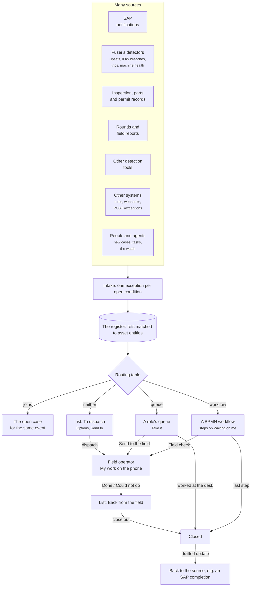
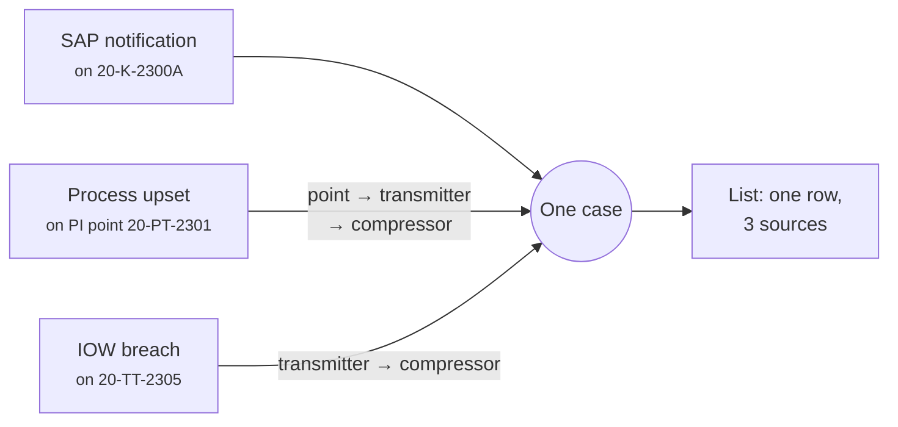
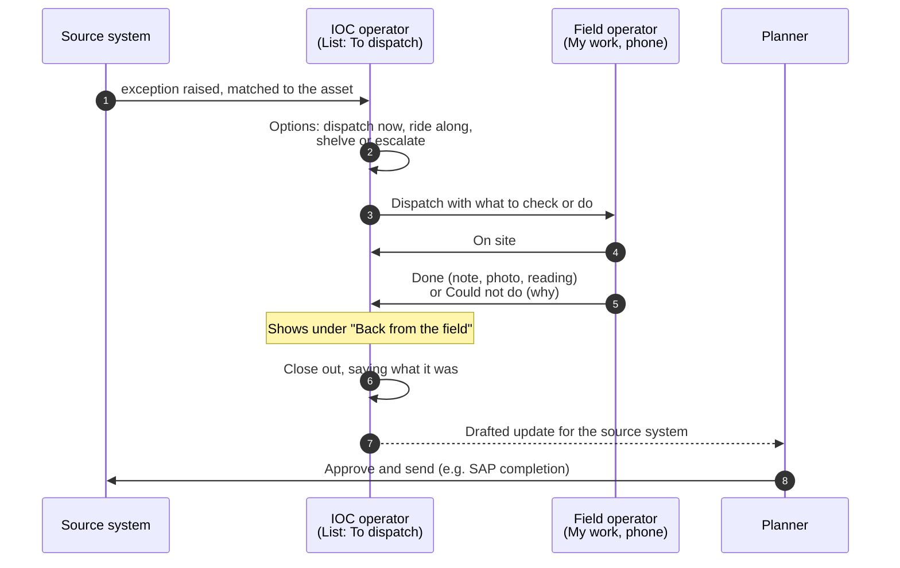
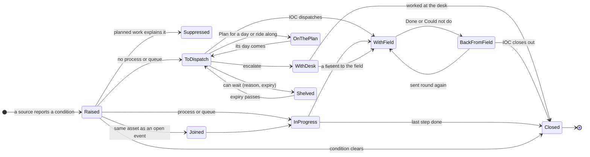
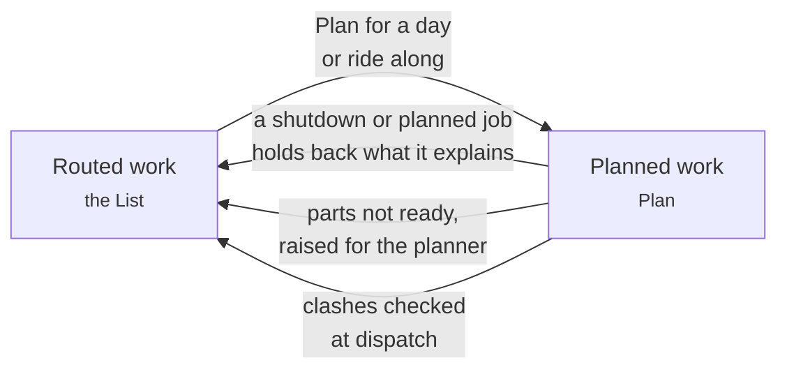

# How work is routed

Fuzer is one front door for operational work. A notification in SAP, an upset the detectors found, an inspection
finding, a permit that lapsed with plant still isolated, a reading a field operator logged on a round: each arrives
from a different system, and each lands in the same place, matched to the asset it is about through the register,
routed by one table, and worked to a close by people and agents. This page shows that path end to end.
[Every source of work](work-sources.md) lists each source with how it is matched, routed, dispatched and closed;
[Where work goes](work-map.md) names the page in the menu for each stage.

## 1. Work arrives as an exception

Every source raises the same thing: an **exception**, one per open condition, with the evidence it saw and
references to what it is about (a tag, a serial number, an SAP equipment number, a well name, a PI point). A
condition that is still open adds evidence to its exception rather than raising another, and one that clears drops
off by itself. Fuzer declares its types of work in code, and a deployment adds its own as data or in a source
pack. [Work types](work-types.md) lists every one with its queue, generated from the code. By where they come from:

| Where it comes from | Types of work (examples) |
|---|---|
| Maintenance and materials systems | SAP notification with no work order, parts not ready for planned work |
| Process data, by Fuzer's detectors | Process upset, IOW breach, compressor trip, machine health, gas lift heading, loop cycling, flare event, alarm flood, alarm bad actor |
| Other detection tools | A vendor's condition monitoring or predictive health alert, through a source pack's `detection_providers` |
| Integrity and inspection | Inspection or wall loss finding, pig run anomaly over the screen, leak repair not holding |
| Safety and permits | Permit lapsed with plant still isolated, bypass overdue, proof test overdue, safeguard demand to review, temporary MOC overdue |
| The field | Round finding; a field report, once a site defines the type (the demo's sample crew raises them) |
| Regulatory | Regulatory report coming due, regulatory report to review |
| Data quality | Source problem, source quality dropped, records that match nothing, links that name nothing, asset context missing |
| Agents | Proposed by the watch (live mode only, off by default), detector tuning to review, skill change to review |
| People | A new case on the List, a task the assistant drafted and a person confirmed, a checklist item sent to another queue |
| Fuzer's own follow-ups | Did the fix hold, an update to approve before it goes back to a system, a write-back the system refused, the shift handover |

Another system can raise its own type with a rule on its loaded records, through its webhook, or with
`POST /exceptions`, once the type is defined (on **Settings > Routing** or in a source pack's `exception_types`). The
[sources](sources.md) page covers how a source pack declares one; [every source of work](work-sources.md) covers each
of the rows above.

## 2. The register matches it to assets

Each reference on an exception is matched to an entity in the register: the golden record that SAP, PI AF, the
P&IDs and the operator logs all describe ([identity and golden records](identity.md)). That match is what makes
the rest possible. A field job shows where to go and what happened on the asset lately; the case shows the alarms
that sounded and the log entries that mention it; the planner sees other work on the same equipment.

A reference that matches nothing is not dropped. The row on the List shows it as *unmatched* with a control to
match it there, and **Master data > Unmatched on open work** lists it for the data steward. Matching it as an alias
fixes the next exception that carries it too.

## 3. One event, one case

When several systems report the same event, the IOC works it once. A new exception of a type that joins (SAP
notifications, upsets, IOW breaches, trips, machine health, round findings, and any site type set to join), about the
same asset as an open one raised within `exceptions.join_hours` (48 by default), joins that case instead of opening
another. "The same asset" follows the register's links:
a historian point counts as its transmitter, equipment as the tag it is installed at, and a transmitter as the
compressor it belongs to. The List shows one row with every source under it, and **More > Split out** separates one that
is a different event.

Planned work suppresses what it explains: a trip on a compressor that is down for a scheduled shutdown is counted
under that shutdown instead of opening a case. Safety types (an IOW breach) are never suppressed or shelved.

## 4. The routing table decides what happens next

Every case goes through one routing step, which reads one table: for each type of work, where it was declared,
whether it joins an open event and within how many hours, what it starts, and when it is due by priority.

| A type that names... | Starts | Example |
|---|---|---|
| a process | that BPMN workflow, step by step | A process upset: triage by an engineer, then a field check if needed |
| a queue | the standard one-step **queue item** workflow in that role's queue, with the role's SLA and escalation | A round finding goes to the ops lead queue |
| neither | opens its case at **To dispatch**, held by nobody, and waits on the List for the IOC; sending it sends that case | An SAP notification |

**Settings > Routing** shows the table. Pick a type to see its workflow drawn with who holds each lane (lanes nobody
holds are flagged), and dry-run an intake: the entities its references match, the case it would join, where it
would go and when it would be due, without writing anything.

{ loading=lazy }

## 5. Working it on the List

Routed work is worked from one list. **Work > List** (titled All work) is every open event and every case, as a
table on a desk or tablet and as cards on a phone; **Work > Board** shows the same rows in columns by stage. Both
read one list from the server, so a count on Tower, the Work badge or the handover always equals the List it opens.

Each row's **stage** is decided once, on the server:

| Stage | Means |
|---|---|
| To dispatch | Open, its case (opened when it arrived) held by nobody, and not planned for a later day |
| With a desk | A case held by a person or queue that is not the field |
| On the plan | Planned for a later day; it comes back to To dispatch on its day |
| With the field | Held by a field operator or the operator queue, or the field said On site |
| Back from the field | The field reported Done or Could not do, and it waits for whoever sent it |
| Closed | No longer open |

**Presets** set the filters for a job. Any role can save its own view.

| Preset | Shows | Who it is for |
|---|---|---|
| **Waiting on me** | Steps assigned to you, unclaimed steps in your roles' queues, and for the ops lead everything To dispatch. Old My work links open it. | Everyone with a desk role |
| **To dispatch** | What nothing routed, waiting for the IOC | IOC operator, ops lead |
| **Back from the field** | Jobs the field reported, waiting to be closed out or sent again | IOC operator, ops lead |
| **Overdue** | Anything past its due time | Leads |
| **Data questions** | The data steward's queue | Data steward |

A field operator with jobs sent to them keeps **My work** as their own page on the phone, with the report buttons,
rounds and planned work they are booked on, and it works with no signal. Anyone else opening My work lands on the
List's **Waiting on me**.

### What each row offers

The row's buttons depend on its stage, so the next step is always one tap.

| Button | When | What it does |
|---|---|---|
| **Take it** | A step waits unclaimed in a queue of a role you hold | Makes the step yours, without opening the case |
| **Options** | Field work in To dispatch or Back from the field (also a card on the case, With a desk too) | The choices side by side (below) |
| **Send to** / **Send again** | Any open event | A person or a queue, what to do (they see it), and whether it is ready; a job that is not ready goes only with a reason |
| **Close** | Back from the field | Opens the case's close-out, pre-filled from the field's answer |
| **More** | Any open event | **Plan for a day** (a bar on Plan, linked back) or **Shelve until a date** (with a reason; it comes back by itself; never for safety work) |
| **Back on the list** | A shelved event | Ends the shelf early |

### Options

Options apply to work the field does: a type the field sees (SAP notifications, upsets, IOW breaches, trips, machine
health, lapsed permits, round findings, and site types such as field reports). For each it shows four choices side
by side:

| Option | What happens | When it is done |
|---|---|---|
| **Dispatch now** | Sent to a field operator, or the operator queue, with *why now* on the job | The operator queue's SLA |
| **Ride along with the next visit** | Put on the plan with a job already booked on the same area or assets | That visit, within `options.window_days` (21) |
| **Shelve** | Off the list until the area's next turnaround or shutdown | At most `exceptions.max_shelve_days` (30) |
| **Escalate** | Sent to the engineer, or past the engineer to the ops lead | The engineer queue's SLA, then a dispatch |

Each option says the production it defers until then (in bbl and $, from the wells it reaches at their latest test),
the risk of waiting, whether it is ready (crew, permit, spares, simultaneous operations, MOC) and its clashes on the
plan. One is recommended by the same rule on every case: wait while waiting leaves no high risk and defers less than a
separate trip costs (`options.trip_usd`); dispatch now when waiting costs more; escalate when it should go now and
can't. Taking the recommended option is one tap; another needs a reason. The choice, the recommendation and the
reason go on the case's history, and **Work performance** shows how often the recommendation was taken, per type.

## 6. Dispatch, the field, and back

The instruction travels with the job, with when it is wanted back. Done or Could not do hands the job back to whoever
sent it, so it reappears under **Back from the field** with the field's note. A job sent to a queue waits there until
someone chooses **Take it**. The IOC closes it out, saying what it was (a real problem with its failure mode, cause
and action, a false alarm, a duplicate or a data problem), which closes the case and every exception on it. A real
problem gets a *did the fix hold?* check 30 days later.
Where the work came from another system, the update for that system is drafted for the planner to approve, so the
SAP notification is completed in SAP and is not raised again.

## 7. The life of a case

## 8. Planned work takes the plan, not the table

Work with a date rather than a deadline does not pass through the routing table. SAP work orders, the next due date
of each SAP maintenance and inspection plan, a planning system's schedules (Primavera P6) and turnaround scope are
put on the integrated plan after every register build, each matched to the assets it touches, and the IOC adds to
it with **Plan for a day**. The plan and the table meet in three places:

[Where work goes](work-map.md#4-it-goes-on-the-plan) shows the pages; the [planner's guide](guides/planner.md)
does the jobs.

## Where each part lives

| Part | Code | Docs |
|---|---|---|
| Exception types and raising | `fuzer.core.exceptions`, `fuzer.ops.exceptions` | [workflow](workflow.md#exceptions-dispatch-and-the-field) |
| SAP intake | `fuzer.ops.intake` | [every source](work-sources.md#maintenance-and-materials) |
| Other systems' rules and webhooks | `fuzer.sources.workflows` | [sources](sources.md) |
| Other detection tools | `fuzer.sources.providers` | [sources](sources.md) |
| Matching refs to entities | `fuzer.ops.exceptions.match`, `fuzer.graph` | [identity](identity.md) |
| The routing table and `route()` | `fuzer.ops.routing` | this page |
| The List, its stages and counts | `fuzer.ops.worklist`, `fuzer.ops.exceptions.stage` | this page |
| Options on a case | `fuzer.ops.options` | [workflow](workflow.md#exceptions-dispatch-and-the-field) |
| Readiness at dispatch | `fuzer.ops.readiness` | [IOC operator guide](guides/ioc-operator.md#dispatch-it-to-the-field) |
| Workflows (BPMN) and queues | `fuzer.workflow` | [workflow](workflow.md#workflows) |
| Field jobs and offline reports | `ui/src/pages/Field.tsx`, `ui/src/fieldOffline.ts` | [workflow](workflow.md#the-installed-app-on-a-phone) |
| Close-out and re-checks | `fuzer.ops.disposition` | [engineer's guide](guides/engineer.md#close-out-so-it-counts) |
| Close-out to the source | `fuzer.ops.closeout`, `fuzer.ops.writeback` | [workflow](workflow.md#exceptions-dispatch-and-the-field) |
| Corrections to a source | `fuzer.ops.corrections` | [sources](sources.md#corrections-flow-back-to-the-source) |
| The plan, schedules and resources | `fuzer.ops.plan`, `fuzer.ops.schedule`, `fuzer.ops.simops` | [planner's guide](guides/planner.md) |
| Inspection, parts and permit work | `fuzer.ops.integrity`, `fuzer.ops.materials`, `fuzer.ops.permits` | [work types](work-types.md) |
| Shift handover | `fuzer.ops.handover` | [IOC operator guide](guides/ioc-operator.md#hand-over-the-shift) |
| The agentic watch | `fuzer.ops.watch` | [agents](agents.md#the-agentic-watch), and its portable [guidance README](https://github.com/areed145/fuzer/blob/main/src/fuzer/ops/watch_guidance/README.md) |
