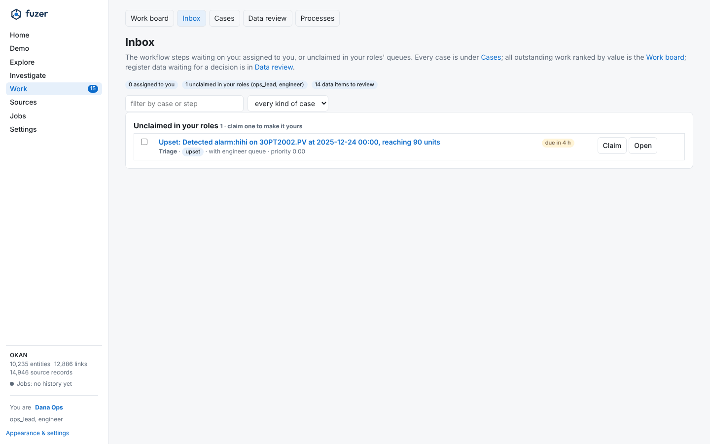
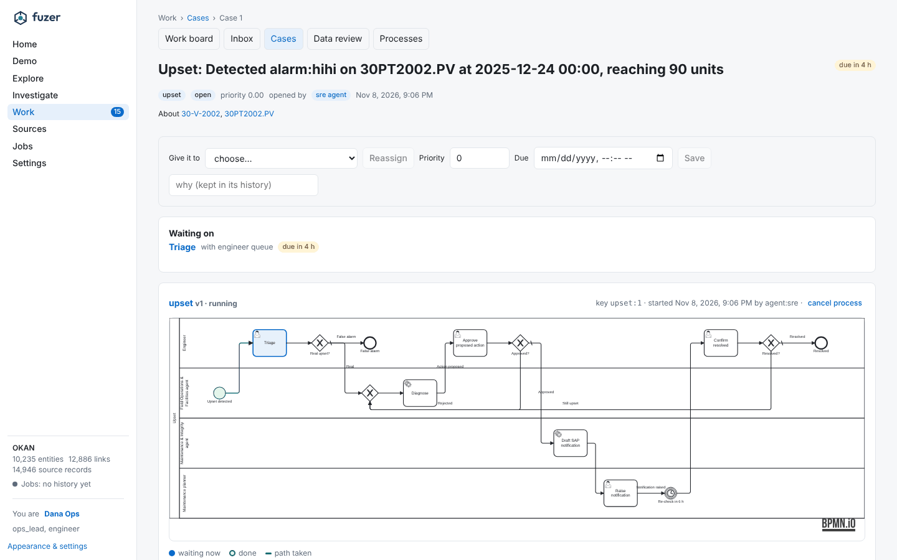
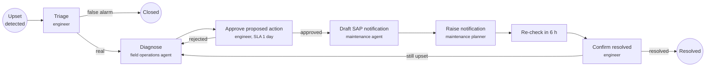
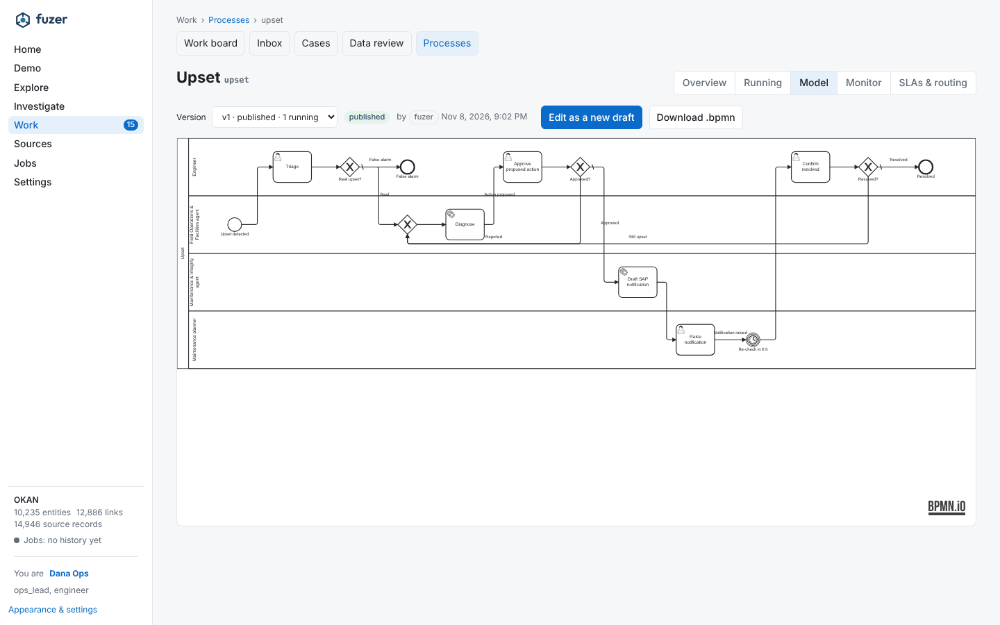
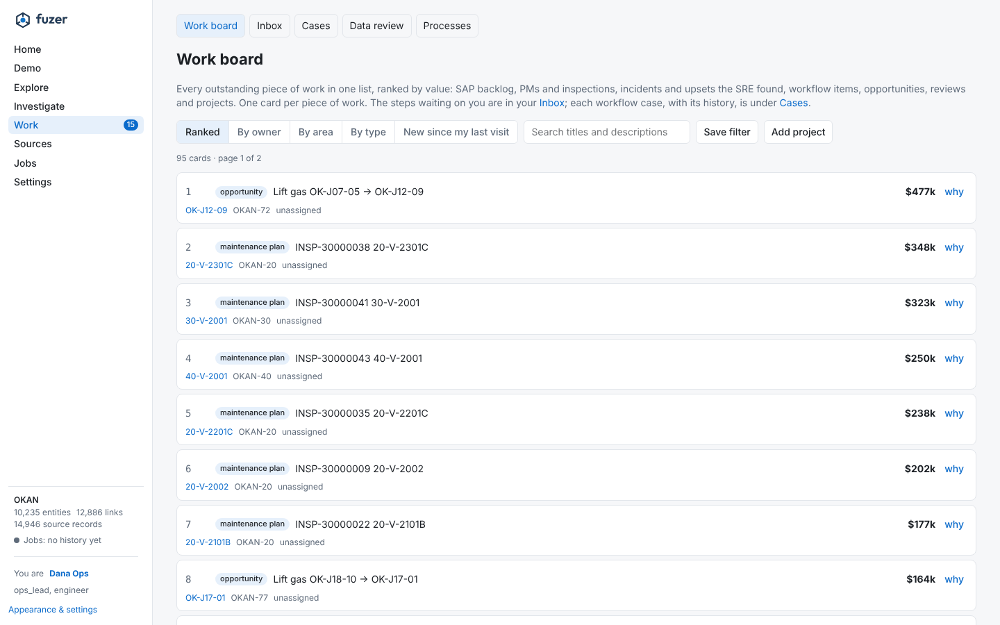
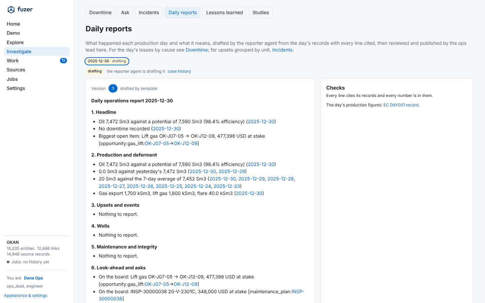

# Workflow and scheduled jobs

Workflows (who does what, by when, and what happens when it's late), the work board, daily reports and the jobs
that run on a schedule.

## Workflows

Work moves through BPMN processes on Fuzer's own engine: person steps, agent steps, timers, messages and called
processes, every step a row, every change an event. Its implementation is split across `workflow/definitions.py`
(process and form lifecycle), `workflow/runtime.py` (execution), `workflow/assignment.py` (tasks and inboxes), and
`workflow/work_items.py` (work-item operations and reads); `workflow/engine.py` remains the stable API facade.
The Workflows section is where people do it and manage it:

- **My work** (`#/inbox`): what's waiting for you, most urgent first: escalated to you, jobs the IOC sent you,
  assigned to you (or to someone away you cover for), unclaimed in your roles' queues, field jobs waiting there and
  what you're planned onto. It replaces the separate Inbox and My jobs pages (#503); `#/field` redirects here, and a
  case with a field job shows once, as its job card. A task opens as a page: its form and evidence,
  claim / release / hand off (to a person, a role's queue or an agent), where it sits in its process, the case's
  history. Who you are is set once, in the sidebar.
- **Cases** (All work's In progress and Closed views, `#/exceptions?list=progress`; `#/cases` redirects there): every
  work item, open or closed, with filters and bulk reassign; a case page (`#/cases/:id`) shows its
  process diagram, open steps, details and history, and takes reassign, priority, due date (on a running process,
  its open steps' SLA clock), close and cancel.
- **Processes** (`#/processes`): each process with its health (running, steps waiting and overdue, median and p90
  cycle time, share of person steps that missed their SLA); a process opens with Overview, Running (its cases),
  Model (draft, check, compare, publish), Monitor (where work piles up) and SLAs & routing.
- **Teams & routing** (`#/teams`): roles, people and agents.

{ loading=lazy }

{ loading=lazy }

The built-in processes are `upset` (triage, diagnosis by the Field Operations & Facilities agent, approval,
a notification drafted by the Maintenance & Integrity agent, then a timed re-check), `iow_breach` and
`daily_report`:

[Extend Fuzer](extend.md#add-a-workflow) shows how to add a process of your own, with its form and how
domain code starts it.

### Modeling a workflow

{ loading=lazy }

Open a process's **Model** tab (or create a draft). Drag named components onto the canvas, connect their
handles, and select steps or connections to edit parameters. Undo, redo, delete and fit controls are above
the canvas. **Advanced BPMN tools** retain pools, lanes and supported event variants. BPMN is maintained
under the hood; existing `.bpmn` import and download remain available.

**Anomaly detection** and **Data detection** are reusable agent steps. They use the Field Operations & Facilities agent's
existing `detections` and `detect_changes` tools respectively, inspecting available detections or changed
source records rather than starting an ingestion or detector job. Set the subjects, detector, time window
and expected results in **Instructions / parameters**. The worker passes these with the process data;
findings remain proposals, recorded under the step's ID as an `answer`, not automatic plant actions.

The embedded **Workflow drafting agent** accepts a natural-language description when `ANTHROPIC_API_KEY`
is configured. It proposes steps, connections and layout without saving, publishing or running anything.
Inspect its preview, choose **Review on canvas**, and confirm replacing the current canvas. Refine the
draft before **Save draft**, **Check**, comparison and **Publish**; reported problems must be fixed before
publishing. **Restore previous canvas** is available until the replacement is saved. Generation uses
`POST /work/definitions/{id}/generate`; published versions require a new draft first.

Existing execution and versioning are unchanged: publishing needs the workflow admin role, new cases use
the published version, and running cases stay on their original version.

**Routing and escalation are data** (`workflow/roles.py`, `work_role`, `work_person`):

- A **role** is a person role or an agent role, with what it's for, a **default SLA** for person steps that set
  none, **escalate_to** (where an overdue step goes when the step names nowhere itself) and an **assignment**:
  steps wait in the queue to be claimed, or go to members round-robin or to the least loaded. Roles are edited on
  Teams & routing; the BPMN checks read them, so a new role can be used in a process straight away.
- **Escalation**: when a person step's SLA passes (the `work_tick` job, every 5 minutes), it moves to the step's
  `escalateTo`, then along the role chain, each hop with the next role's own SLA, up to three hops. The reason
  (which SLA, who had it) is kept on the case.
- **Away**: a person can be away until a time, with a delegate. What they hold, and anything assigned or handed to
  them while away, goes to the delegate (or back to the role's queue when no one covers); auto-assignment skips
  them; the delegate's inbox shows what was theirs.
- A role nobody available holds, but a published process uses, is flagged: its steps would wait.
- **Field or overarching** (#497): most people are on one field's roster (`work_person`, per project). Specialists
  and monitoring desks whose work cuts across fields are **overarching** (`fuzer.work_person_cover`, shared by the
  instance): their roles count in every field they cover (all fields, or the ones named), on top of any roles a
  field's own roster gives them. Their Inbox lists their work in the other fields too (`/work/inbox/fields`), only
  for fields the viewer may open: covering a field is routing, never an access grant. Set on Users, workflow
  assignments (`PUT /work/people/{name}/cover`).

API: `/work/inbox`, `/work/items` (cases) and `/work/items/{id}/set|reassign|transition`, `/work/tasks/{id}/...`,
`/work/stats`, `/work/instances`, `/work/definitions/{id}/routing`, `/work/roles/catalog`, `/work/roles/{name}`,
`/work/people/{name}` and `/work/people/{name}/away`, `/work/workload`.

## Exceptions, dispatch and the field

Work from every source arrives as an **exception** on **All work** (`#/exceptions`, #502): one per open condition, matched to the assets
it concerns. Fuzer's detectors raise them (SRE upsets, IOW breaches, source problems), open SAP notifications with no
work order are raised on each register refresh (`intake.sap_notifications`, on by default, for notifications from the
last 60 days of data), and other systems raise their own through `POST /exceptions` once their type is defined on the
page. A type with a process starts it; one with a queue starts the standard **queue item** process, one step in that
role's queue with the role's SLA and escalation (#509); the rest wait for the IOC.

- **One front door.** Every case an exception opens goes through one routing step (`fuzer.ops.routing`, #509), which
  reads one routing table: each type, where it is declared (code, data or a source pack), whether it joins one
  event's case and within how many hours, what it starts (a process, a queue, or the IOC's dispatch) and its due
  policy. Any type can carry one (`due_hours`, priority to hours such as `1:24,2:72`, set on the type or in a source
  pack's `exception_types`): a dispatched case is due that long after it was raised, by the priority its evidence
  gives. SAP notifications' policy is their type's, read from `intake.sap_notifications.due_hours` (#494). `GET /routing` lists the table, and
  `GET /routing/{type}/explain?refs=…&key=…` dry-runs an intake without writing anything: the entities its refs
  match, the open exception it would add to or the event's case it would join, the process with each step's lane and
  who holds it (or the queue and its holders), and with `to=` and `priority=`, a dispatch and when it would be due.
  **Settings > Routing** (#507) is the page on top: the table, and for a type, its process drawn with who holds
  each lane, lanes nobody holds flagged, and a form that dry-runs an intake (refs, key, priority, dispatch to).
  Processes are edited on Processes and role SLAs and escalation under Users, as before; anyone who can read work
  can read the page.
- **Queue item.** `queue_item.bpmn` is the standard process for a type that names a queue and no process: its lane's
  role is `=role` and its case type `=case_type`, both from the type, so one process serves every queue and each
  case still shows as its own kind of work. Its one step has the role's default SLA (Users, workflow assignments)
  and escalates along the role's chain like any process step. Clearing the condition or the field's **Done** still
  closes it as it closed a plain queue case; **Could not do** hands the step back. A dispatch from All work runs as
  queue_item too: the step opens in the lane of the role it was sent to (for a person, the type's queue when they
  hold it, else their first role), the dispatcher hands it to them with the reason, so Could not do comes back to
  the dispatcher, and it is due by the type's policy (SAP priority) or the role's SLA. Someone who takes a job from
  the queue and hands it back returns it to whoever sent it to the queue. A queue no person role backs and a case
  raised for a named person still open a plain case.
- **Task.** `task.bpmn` is the same one step for work no exception raised: an opportunity the scan finds (the
  engineer's queue), a draft the assistant proposed and a person confirmed, and `POST /work/items` asked of a role.
  Its start data names the role, the case type and a `task_key` (one open task per key). Both standard processes are
  marked `fuzer:closeWithCase="true"`, so their case still hands off and closes as a plain case did
  (`/work/items/{id}/hand-off` and `/transition` act on the step). Work for a named person, and any case raised
  before the starting processes are loaded, is a plain work item. Outside the work engine only `fuzer.ops.routing`
  opens a case (`tests/ops/test_front_door.py`).
- **Cases opened before.** When the server starts, after it loads the starting processes, every open case that
  has no process is moved onto the one `route()` starts today (`routing.adopt_open_cases`): a queue case onto
  queue_item, a handover and a close-out onto theirs, an opportunity, an assistant's task or a task asked of a role
  onto task. Whoever held it still holds its step and a due date it had stays; one with none is due by the role's
  SLA counted from the move, so nothing turns overdue at once. Cases for a named person, and ones whose type has its
  own process (which would begin again from the start), stay as they are. The history says when a case moved.

- **One event, one case.** When several systems report the same event, the IOC works it once. A new exception
  about the same asset as an open one from another source joins that one's case instead of opening another. "The
  same asset" means the same entity, or one sharing the tag or unit it stands for: a historian point counts as its
  transmitter, equipment as the tag it is installed at, and a transmitter as the compressor it is part of (up to
  three links). Areas and the facility don't count, or a whole area would be one event. The open one must have been
  seen within `exceptions.join_hours` (48 by default; 0 turns joining off). An exception waiting to be dispatched
  joins the case the next source opens, or the one the IOC opens by dispatching a match. Exceptions shows one row
  with every source under it ("3 sources: SAP notification, IOW breach, Process upset"). The task page lists what
  each source saw, and the field job card says which systems reported it. Dispatch and field reports on any source go to the
  shared case, and finishing the case closes every source. A source that clears drops off and the case stays open
  while another holds. **Split out** gives a source that turns out to be a different event a case of its own
  (`POST /exceptions/{id}/split`). A type declared with `joins=False`, such as source problems, never joins.
- **Around the event.** Alarms and operator log entries aren't exceptions, so they don't join a case: the case and
  task pages show them beside what did, in an **Around the event** card (`GET /work/items/{id}/around`). It lists
  the alarms that sounded (a point past an enabled alarm limit while its unit ran) on points of the event's assets,
  and the log entries that mention those assets, read the same way the join reads "the same asset". The window runs
  from the earliest finding on the case to the latest, widened by `exceptions.around_before_hours` (4) and
  `exceptions.around_after_hours` (6). A finding that gives only a day (an SAP notification's) sets the window only
  when nothing on the case gives a time. Replaying Kestrel's compressor trip gives one case with the trip, the
  machine health finding and SAP notification 10004001 on it, B1-VT-2003's high and high-high alarms, and the
  control room's entries from the trip to the restart (`tests/evals/test_one_case_kestrel.py`).
- **Suppression.** Planned work and shutdowns explain what a machine's detectors see while they run. A trip, a
  machine health finding or a process upset (types that declare `suppress=True`) about an asset with a shutdown or
  turnaround, or other planned work, scheduled or in progress on the plan at the finding's time is recorded under
  that window instead of opening a case. It is counted, not lost: All work shows **Suppressed: N findings, raised M
  times**, the windows holding them and what each held back (`GET /exceptions/suppressed`). A safety case type (an IOW
  breach) and another system's report are never suppressed. `exceptions.suppress_planned_work` (on) turns off
  suppression for planned work other than shutdowns. A person can set a window of their own on some assets with a
  reason (`POST /exceptions/suppressions`) and end it early (`POST /exceptions/suppressions/{id}/end`). A condition
  still holding when its window ends opens as usual on its next raise.
- **Shelving.** A standing condition that can wait (a known seal weep until the next outage) can be shelved from
  All work with a reason and an expiry, at most `exceptions.max_shelve_days` (30) ahead
  (`POST /exceptions/{id}/shelve`). It leaves the open list, and shows under the **shelved** state with who shelved it
  and why. New raises still add their evidence without bringing it back. When the expiry passes, the work tick puts
  it back on the list and says so on its case. **Back on the list** does that early (`POST /exceptions/{id}/unshelve`).
  A safety case type (an IOW breach) can't be shelved. Shelving an exception that joined another's case shelves the
  event (its host), since the event is one row. The case itself is left as it is.
- **Dispatch.** The IOC sends an exception to a person, with what to check or do. Its case (or the case's open
  person step) goes to them, and the instruction travels with it.
- **Field jobs** on My work are the operator's phone view: jobs sent to them, then jobs waiting in their roles' queues
  (**Take it**), each with the IOC's instruction, where to go, what was seen and what happened there lately. They
  report **On site**, **Done**, **Could not do** (with why) or a note; every report lands on the exception and the
  case history.
- **Back to the IOC.** Done on a case without a process closes it and its exception. Done on a process case, or Could
  not do on any, hands the job back to whoever sent it (the engineer queue's Triage step goes back to that queue),
  so the decision reappears in the IOC's Inbox with the field's note.
- **Field check, a step of its own.** The upset process has a **Field check** step in a Field operator lane. Triage
  can choose "Not sure: send someone to look" (with what to check), and dispatching an upset from Exceptions to
  someone outside the engineer role does the same: Triage declares `fuzer:dispatch="triage=field_check"`, so it is
  completed with that choice and the Field check is handed to whoever was picked. The engineer's form never lands in
  the operator's list. The operator's Done or Could not do completes the Field check (`field_result`, `field_note`)
  and Triage comes back to whoever sent them. Any process can do the same with the **Field check** component in the
  modeler and `fuzer:dispatch` on the step that sends to it.
- **Seeing it come back.** The task page shows a **From the field** box above the form, the Inbox says why a step
  came back ("Back from the field: done: gauge reads 13 barg"), and Exceptions filters to **back from the field**.
  A field job card only offers to open a step in the operator's own roles.
- **Picked, not typed.** Dispatch picks a person (shown with their roles) or a role's queue; a new exception type
  picks its queue from the person roles on Teams & routing, and the API refuses a queue that isn't one. Equipment
  reads as the tag it is installed at and its description ("20-K-2100B 1st stage compressor") rather than its serial
  number. The exception types card lists the ref forms this register matches (`GET /exceptions/refs`), each with an
  example, and a raised exception whose refs matched nothing comes back with an `unmatched_note` saying so.
- **A fresh demo's team.** Where nobody is on the roster, the demo is on and names are attribution (local mode),
  My work and All work offer a sample IOC team (riley the ops lead, sam the field operator, pat the planner)
  to follow work from triage to the field. A real deployment's roster is never touched.
- **Agent steps nobody will run.** Without an agents provider no agent worker runs; the case says so straight away
  (not after 10 minutes) and offers **Take it over**, which hands the agent's step to you as a person step.
  If nobody takes it over and no worker picks it up within `work.agent_fallback_minutes` (30 by default), the
  work tick hands it to the step's `fuzer:fallbackRole` queue (or the process owner's) with the reason on the case
  history, so it never waits silently. The case says when that will happen. Set the minutes to 0 to wait forever.
- **SAP notifications done in the field** close with their case and are held, not raised again, while SAP shows the
  status they had when the field closed them.
- **Close-out goes back to the source** (#466, `ops/closeout.py`). When the field reports *done* or *could not do*
  on work another system raised (an SAP notification, or a type a source pack brought), the update for that system
  is drafted: a completion with the field's note and the closed status, or a follow-up record saying what still
  needs doing and why. Each system's `closeout` setting on Sources says how it goes back: `none`, `draft` (a
  `source_closeout` case on its `closeout_role` queue, run as the `source_closeout` process so the step carries that
  role's SLA and escalation; SAP drafts to `maintenance_planner` unless set otherwise) or
  `send`. The planner edits the text on the case and approves (`POST /closeouts/{id}/approve`) or doesn't send it
  (`/discard`). A sent update is published on the outbox as `source.update` for the system's adapter. The demo has
  no SAP, so with `closeout.apply_to_exports` on, the update is written to the system's export file (the
  notification's status, or a new notification for a follow-up): the next load and intake see SAP move, the hold
  ends, and a follow-up comes back to the IOC as a new notification. `tests/api/test_closeout_to_source.py` walks it
  on Kestrel.
- **Shift handover** (#467, `ops/handover.py`, Work > Handover). At each shift change (`handover.shift_times`,
  local times in the project's timezone, default `06:00,18:00`; empty turns it off) the work tick drafts a handover
  from live work over the shift that just ended: open work by priority, what came back from the field and waits on
  the IOC, steps escalated or overdue, what was dispatched and to whom, new exceptions, and records to check (downtime with no log entry or
  notification and logged stops with no downtime, #344, see [analyses](analyses.md)). Every line cites its
  case or exception (`case:<id>`, `exception:<id>`), as the daily report cites its records. It opens a
  `shift_handover` case on the `ops_lead` queue, run as the `shift_handover` process so reading it has the ops
  lead's SLA and escalates if nobody does; the outgoing lead adds notes, and the incoming lead acknowledges it
  (`POST /handovers/{id}/acknowledge`), which goes on the case history with who and when and closes the case. Past
  handovers are listed (`GET /handovers`) and readable. **Draft now** refreshes an unacknowledged one from live work.

## The work board

`board.py` keeps all outstanding work in one ranked list (`board_card`), for people (`GET /board`) and
agents (MCP `board`, `next_work`). Cards come from what already exists:
- the #100 items: incidents, open work orders, PM and inspection plans, opportunities;
- SRE upsets with a priority;
- open workflow items: an IOW breach is valued at the #100 IOW compliance rate for each day outside;
- one card per open review queue (not valued);
- projects added on the board (`POST /board/projects`).

Records joined by an explicit link are one card, led by the highest-valued record. The links are an
incident listing an upset, an upset's work item, and a work order raised for a
notification an incident includes.

Cards are ranked by value, highest first, with unvalued cards last. A person can pin a card's rank or
value with a reason (`POST /board/pins`). Pins are kept by record key in `board_pin`, so they survive
refreshes and register rebuilds. Each refresh records rank changes in `board_history` and says why a
card moved ("up 4 places: value 12,000 -> 40,000", "pinned", "new"). The board refreshes after every
register build and every SRE run, and with `fuzer board refresh`. Pages are read in rank order from
indexes on rank, area and unit.

{ loading=lazy }

**All work, Ranked by value.** The board is a view of All work (`#/exceptions?list=ranked`; old `#/board` links
redirect there, filters kept). It has five groupings: ranked (the default), by owner (the person or
role its work item is with), by area, by type, and new since the viewer's last visit. The views come from
facet counts under the same filters. A viewer can save named filters and filter by words in the title.
Each card shows its rank, why it moved, its value and owner, and any pin with its reason. "Why" opens:
- the #100 breakdown (production, risk, compliance, urgency, effort, what isn't known);
- its records, linked to their entities and work items;
- its rank history;
- a form to pin its rank or value (a reason is required) or unpin it.

Projects can be added from the page. Saved filters and the last visit are kept in the viewer's browser.

## Daily operations report

`daily_report.py` writes what happened on a production day and what it means, with every line citing its
records.
- **Facts:** tools work out the day's facts, never Claude's arithmetic, in a fixed outline:
  1. headline: production, the biggest loss with its status, the top board item;
  2. production and deferment, against yesterday and the 7-day average (DAY001, EC downtime);
  3. upsets and events (SRE upsets, incidents, log events);
  4. wells (tests 10% or more from the well's previous test);
  5. maintenance and integrity (notifications, work orders started and finished, IOW excursions,
     plans that went overdue);
  6. look-ahead and asks (plans due tomorrow, the top of the board).
  
  Each fact is a sentence with its numbers and the records it cites.
- **Draft:** `render` writes the facts as cited lines. Claude rewrites them as a report (`redraft`, or the
  reporter agent's `draft` step in the `daily_report` process), keeping every citation and using only
  the facts' numbers. The ops lead's comments on a draft sent back go with the next draft. The cost and
  time of each draft are kept.
- **Checks:** `check` lists lines with no citation, citations not in the day's facts, and numbers not
  in them. The reviewer sees them, and the eval counts them.
- **Versions:** `close_day` stores a version only when the day's facts changed, with what changed by
  section, and starts or updates the day's work item for the ops lead. The `day_close` job (07:00, or the
  `daily_report.close_cron` setting) closes the latest day and re-checks the six before it for late records.

{ loading=lazy }
*A template draft; the reporter agent rewrites it when the agent worker runs.*

Readers: the Reports page (`#/reports`: days, versions, checks, what changed), MCP
`get_daily_ops_report(day)`, `GET /reports/daily/{day}`, and `fuzer report --day [--claude]`. On Okan, the
day of train C's trip (5 November 2024) leads with "Biggest loss: Process trip, 146 Sm3 oil, back at
10:30" and the trip's downtime record.

## Regulatory and emissions reports

A regulatory report is a template filled for one period from registered records (`ops/reports.py`, P7.6). The first,
`flare_emissions_monthly`, is the month's flare and emissions report:

| Section | Figures | Each row, and where it drills to |
|---|---|---|
| Metered gas | Each meter's volume over the month | A gas day's volume: the measurement record |
| Flaring | Each flare flow point's volume over the month | A day's mean flow from the historian: the point's readings that day |
| GHG inputs | The flared volume, and its energy at the heating value of the gas metered that month | The flare figures; the heating value used |
| Flare events | The flare episodes, and those with no known cause | An episode with its cause or "cause unknown": its `flare_event` case |

Every figure and row carries its basis: measured, estimated or missing.

- **Estimated** covers a volume the measurement system estimated (status E), a flare day with under 90% of its
  readings, and the flared energy, which is an inventory input and not the inventory.
- **Missing** is a day with no volume or no readings.

A figure takes the worst basis of its rows. A figure resting on estimated or missing data is marked at the top of the
draft and in its review case, so the reviewer checks those first.

Drafting a period (`POST /reports/regulatory/{template}/{period}/draft`, or from the Reports page) keeps a new version
only when a figure changed, for example a late or corrected record. It raises or refreshes the period's
`regulatory_report` case for the HSE specialist. A month that isn't over is drafted through the data's last full day,
and the draft says so.

**Approving and submitting.** Approving is the `approve_report` fixed gate, so an agent is refused. A named person
approves the latest version. When figures are marked, they also write why the report can go as it is. The review case
then closes. A later change to the records drafts a new version, and the approved one stays as it was. The export is
a CSV of every figure and row with its basis and record, and a draft's export says DRAFT. Submitting the approved
version takes one of two routes:

- **Through the write-back queue** to a system that accepts `regulatory_report` write-backs. That queue's own
  approver sends it.
- **As the exported file**, which the person files themselves.

Either way, the version is kept as submitted, with the exact file and its hash.

**The obligations calendar.** An obligation names a template, the regulator, and when each period's report is due
(`due_days` after the period ends). It also says how many days before the due date the process starts
(`lead_days`), and whether the calendar drafts the report then (`draft_ahead`). Obligations live in
`report_obligation`, through `POST /reports/obligations`. The daily `report_calendar` job does three things:

- It drafts each report whose window has opened and has no draft.
- It raises `report_due` for the template's role when a report has no draft in progress, or is past due and not
  submitted.
- It clears that work once a draft is in progress before the due date, or once the report is submitted.

## The operating model as a package

The way a project operates (its roles and their SLAs, the work types it declares as data, its operating settings, and
its published processes and forms) can be exported as one versioned package folder and applied to another project
(`src/fuzer/workflow/operating_model.py`, P8.1). `fuzer operating-model export <folder> --name --version` writes one;
`fuzer operating-model apply <folder|standard>` makes this project run it and records the version and its digest;
`fuzer operating-model deviations <folder|standard>` lists every place this project differs from it, one row per
difference (changed, added or missing). `standard` is the built-in standard, version 1: the shipped processes and
forms, the built-in roles and no settings changed. Okan has no deviations from it.

Where a project differs from its model on purpose, the difference is named: why, and who owns it
(`fuzer operating-model name --part --key --reason --owner`). A bundle names its facility's deviations under
`operating_model.deviations` in `bundle.yaml`, and a settings deviation there carries its value;
`fuzer operating-model adopt` applies the model the bundle follows, sets those values and names them, and
`fuzer operating-model conformance` reports the model, whether it was applied as it is, and the deviations named and
unnamed. Okan adopts standard v1 with no deviations; Kestrel adopts it with one, its crews' 07:00 and 19:00 handover
(`handover.shift_times`, owned by ops_lead). `fuzer init` doesn't adopt by itself: applying resets a project's
operating settings, so it is a step someone takes. Adopting loads the shipped processes and forms first, as the
API's start does, so a project stood up from its bundle a moment ago adopts without anyone publishing them by hand.

**Conformance** (P8.2) shows every asset against its model in one view: Settings, Standards
(`GET /standards/conformance`, `fuzer operating-model fleet`, or `standing` for one project). For each asset it gives
the model and version, whether it was applied as it is, and each difference with its reason, owner and review date.
The verdict is `standard`, `justified` (it differs only where it says why) or `drifted` (a difference without a reason,
an overdue review, or not applied). It also shows whether the work follows the standard in practice over the last 28
days: person steps on time, overrides (sent to the field though not ready, started without a permit), steps left undone
when a case closed, and rounds done. A named deviation is reviewed a year after it is named unless its owner gives a
date (`--review-by`, or `review_by` on a bundle's deviation). Past that date the `deviation_reviews` detector raises
`deviation_review_due` for the owner, until it is reviewed (named again with a later date) or unnamed. The view reads
only granted projects and names the rest.

**Change control** (P8.3, `workflow/model_changes.py`) is how the standard changes. A change is proposed as a new
version: the latest published one with some roles, work types, settings, processes or forms changed. A changed
process must parse. It is test-run on up to 20 of this project's cases closed in the last 180 days, of the work types
it touches: each case's route and process before and after, and whether it would have met the new SLA. The run fails
if a changed process names a role the version doesn't hold. A person other than its author, with the workflow_admin
role, approves or rejects it with a note, and only after a test run. An approved version is published, then rolled
out one asset at a time. Each rollout records the version the asset ran before, so it can be rolled back. A rollout
or rollback keeps an asset's named setting deviations, and lists any other named difference the version replaced. A
local deviation that proved better is proposed the same way (`promote`). Conformance holds an asset to the version
last rolled out to it, and "current" means the latest published. It is on the CLI as `fuzer model-change`, through
`/standards/versions` and `/standards/rollouts`, and on Settings, Standards, where each step is a button. A process
change is made in the process editor first, then proposed from the asset's difference ("Propose as the standard")
(`tests/evals/test_model_changes.py` takes a process change live on Kestrel and Harrier and rolls Harrier back).

A package moved between databases runs the same: Okan's model, changed away from the standard and exported, applied
to a second copy of Okan that ran the standard, takes the loop eval the same way step for step
(`tests/evals/test_loop_operating_model.py`).

A package holds operating settings only (the Work, SRE, Signals, Alarms, Opportunities, Reports and Detection
groups); one holding anything else, or without a version, is refused.

## Scheduled jobs

Dagster runs everything on a schedule (`src/fuzer/ops/jobs.py`; `fuzer jobs`, or alongside the UI with `fuzer up`).
Times are in the project's timezone.

| Job or sensor | When | What |
|---|---|---|
| Source assets | on demand, by the jobs below | One per dataset in the source catalog; each loads only itself, as its load mode says |
| `new_exports` sensor | every minute | A changed export file in the data folder loads that dataset, then rebuilds |
| `dataset_schedules` sensor | every minute | A dataset with its own cron (`source_dataset.schedule`) loads when it is due, then rebuilds |
| `refresh_logs` | hourly | Operator logs, then rebuild |
| `refresh_all` | 02:00 | Every dataset (live PI and ADX ones included), then rebuild |
| `claude_reading` | 03:00, off by default | Claude reads new log entries, drawings and documents (Batches API, capped) |
| `work_tick` | every 5 minutes | Work-engine timers and SLA escalations |
| `sre_scan` | every 6 hours | Detect, group into upsets, prioritise, diagnose (capped) and hand off |
| `day_close` | `daily_report.close_cron` (07:00) | The daily operations report and debottleneck options |
| `detect_5min` … `detect_daily` | each tier's schedule | Each scheduled detector in its tier, from its own watermark: compressor trips every 5 minutes, machine health hourly, records gaps and the opportunity scan daily (`detectors.cadence@<name>` moves one, P3.2) |
| `studies_job` | every 5 minutes | Queued correlation and clustering studies |
| `source_health` | every 30 minutes | Stale, failed or held sources and failing checks become work items for their owners |
| `report_calendar` | 05:00 | Each regulatory report drafted as its obligation's window opens, and `report_due` work for one coming due with no draft, or past due and not submitted |
| `detector_tuning` | 04:30 | A tuning proposal for each detector whose closed cases on one class are mostly false alarms and duplicates (see below) |
| `providers_poll` | every 15 minutes | Each polled detection provider's alert table, read when it has changed |
| `alert_on_failure` sensor | on any failed run | Posts it to the alert webhook (`alerts.webhook`) with its project and a link to the run. A scheduled run a deploy interrupted (ended around a stop the instance recorded, `ops/stops.py`) is not a failure: its schedule starts it again, so it is not posted. A run started by hand or by a sensor is posted either way |
| `alert_on_tick_failure` sensor | every 5 minutes | Posts a sensor or schedule whose latest evaluation failed, once per failure; it starts no run, so nothing else would say. The Jobs page turns red and names it |

Asset checks: on the register (review backlog, PI points attached, tags in SAP, downtime reason codes, document
revisions, flow against piping) and on each source asset (its dataset's checks and health).

## Detectors tune from their close-outs

How a case closes out (P6.1) is counted against the detector that raised it and the equipment class it is about
(`ops/tuning.py`, P6.3). False alarms and duplicates are noise; real problems and data problems are not. The Detection
page shows each detector's noise rate, with a row per class when it has cases on more than one.

When a detector's cases on one class reach `tuning.min_cases` (5) closed and `tuning.noise_rate` (50%) noise, the
`detector_tuning` job tries quieter values of the parameter the detector names in `quieter`, in that direction only.
It replays the detector over the windows those cases came from, holding the value in the process and never writing it,
capped at `tuning.max_windows`. It proposes the smallest change that stops raising a noisy case and still raises every
real one, else the smallest that helps, naming the real cases it would miss. The proposal is `detector_tuning` work for
the engineer, listed on the Detection page with its replay before and after.

Accepting it is the limit-change gate: only a named person can, and the value lands in the settings history with the
case as its reason, as the detector's next version (shown beside its name). Setting it aside needs a reason. Either way
the case closes, and a new proposal can come once more cases close. Only window detectors (the SRE's) are replayed
today; other detectors are counted but not yet proposed for.

## Work the assistant proposes

Agents read; people decide. The assistant can't create or assign work, so when someone asks it to
route something, `draft_work_item` leaves a draft in `work_draft`: title, person role, summary and the
evidence behind it. The marker in its answer becomes a card on the Ask page. Nothing is in a queue yet.

- **Owned:** a draft belongs to the account that asked. Anyone else gets a 404, on both reading and
  confirming. The tool refuses to draft without someone signed in and asking.
- **Decided by a person:** `POST /work/drafts/{id}/confirm` needs `operate`, and the server records the
  signed-in person as the creator. The item is unassigned and waits in the role's queue.
- **Once:** the row lock and one transaction make it at most one item, so a double click, a resend or
  a retry after a lost response returns the same one.
- **Queues only:** a draft must name a person role, so an agent can't route work to itself or another
  agent, and the role is checked again at confirmation.

Cases also has **New work item**, for work with no process behind it.
