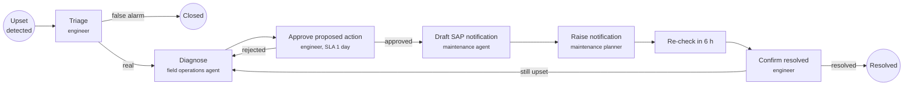

# Workflow and scheduled jobs

Workflows (who does what, by when, and what happens when it's late), the work board, daily reports and the jobs
that run on a schedule.

## Workflows

Work moves through BPMN processes on Fuzer's own engine: person steps, agent steps, timers, messages and called
processes, every step a row, every change an event. Its implementation is split across `workflow/definitions.py`
(process and form lifecycle), `workflow/runtime.py` (execution), `workflow/assignment.py` (tasks and inboxes), and
`workflow/work_items.py` (work-item operations and reads); `workflow/engine.py` remains the stable API facade.
The Workflows section is where people do it and manage it:

- **Inbox** (`#/inbox`): what's waiting for you, most urgent first: escalated to you, assigned to you (or to
  someone away you cover for), unclaimed in your roles' queues. A task opens as a page: its form and evidence,
  claim / release / hand off (to a person, a role's queue or an agent), where it sits in its process, the case's
  history. Who you are is set once, in the sidebar.
- **Cases** (`#/cases`): every work item, open or closed, with filters and bulk reassign; a case page shows its
  process diagram, open steps, details and history, and takes reassign, priority, due date (on a running process,
  its open steps' SLA clock), close and cancel.
- **Processes** (`#/processes`): each process with its health (running, steps waiting and overdue, median and p90
  cycle time, share of person steps that missed their SLA); a process opens with Overview, Running (its cases),
  Model (draft, check, compare, publish), Monitor (where work piles up) and SLAs & routing.
- **Teams & routing** (`#/teams`): roles, people and agents.

{ loading=lazy }

{ loading=lazy }

The built-in processes are `upset` (triage, diagnosis by the Field Operations & Facilities agent, approval,
a notification drafted by the Maintenance & Integrity agent, then a timed re-check), `iow_breach` and
`daily_report`:

[Extend Fuzer](extend.md#add-a-workflow) shows how to add a process of your own, with its form and how
domain code starts it.

### Modeling a workflow

{ loading=lazy }

Open a process's **Model** tab (or create a draft). Drag named components onto the canvas, connect their
handles, and select steps or connections to edit parameters. Undo, redo, delete and fit controls are above
the canvas. **Advanced BPMN tools** retain pools, lanes and supported event variants. BPMN is maintained
under the hood; existing `.bpmn` import and download remain available.

**Anomaly detection** and **Data detection** are reusable agent steps. They use the Field Operations & Facilities agent's
existing `detections` and `detect_changes` tools respectively, inspecting available detections or changed
source records rather than starting an ingestion or detector job. Set the subjects, detector, time window
and expected results in **Instructions / parameters**. The worker passes these with the process data;
findings remain proposals, recorded under the step's ID as an `answer`, not automatic plant actions.

The embedded **Workflow drafting agent** accepts a natural-language description when `ANTHROPIC_API_KEY`
is configured. It proposes steps, connections and layout without saving, publishing or running anything.
Inspect its preview, choose **Review on canvas**, and confirm replacing the current canvas. Refine the
draft before **Save draft**, **Check**, comparison and **Publish**; reported problems must be fixed before
publishing. **Restore previous canvas** is available until the replacement is saved. Generation uses
`POST /work/definitions/{id}/generate`; published versions require a new draft first.

Existing execution and versioning are unchanged: publishing needs the workflow admin role, new cases use
the published version, and running cases stay on their original version.

**Routing and escalation are data** (`workflow/roles.py`, `work_role`, `work_person`):

- A **role** is a person role or an agent role, with what it's for, a **default SLA** for person steps that set
  none, **escalate_to** (where an overdue step goes when the step names nowhere itself) and an **assignment**:
  steps wait in the queue to be claimed, or go to members round-robin or to the least loaded. Roles are edited on
  Teams & routing; the BPMN checks read them, so a new role can be used in a process straight away.
- **Escalation**: when a person step's SLA passes (the `work_tick` job, every 5 minutes), it moves to the step's
  `escalateTo`, then along the role chain, each hop with the next role's own SLA, up to three hops. The reason
  (which SLA, who had it) is kept on the case.
- **Away**: a person can be away until a time, with a delegate. What they hold, and anything assigned or handed to
  them while away, goes to the delegate (or back to the role's queue when no one covers); auto-assignment skips
  them; the delegate's inbox shows what was theirs.
- A role nobody available holds, but a published process uses, is flagged: its steps would wait.

API: `/work/inbox`, `/work/items` (cases) and `/work/items/{id}/set|reassign|transition`, `/work/tasks/{id}/...`,
`/work/stats`, `/work/instances`, `/work/definitions/{id}/routing`, `/work/roles/catalog`, `/work/roles/{name}`,
`/work/people/{name}` and `/work/people/{name}/away`, `/work/workload`.

## Exceptions, dispatch and the field

Work from every source arrives as an **exception** (`#/exceptions`): one per open condition, matched to the assets
it concerns. Fuzer's detectors raise them (SRE upsets, IOW breaches, source problems), open SAP notifications with no
work order are raised on each register refresh (`intake.sap_notifications`, on by default, for notifications from the
last 60 days of data), and other systems raise their own through `POST /exceptions` once their type is defined on the
page. A type with a process starts it; one with a queue opens a case in that role's queue; the rest wait for the IOC.

- **Dispatch.** The IOC sends an exception to a person, with what to check or do. Its case (or the case's open
  person step) goes to them, and the instruction travels with it.
- **My jobs** (`#/field`) is the operator's phone view: jobs sent to them, then jobs waiting in their roles' queues
  (**Take it**), each with the IOC's instruction, where to go, what was seen and what happened there lately. They
  report **On site**, **Done**, **Could not do** (with why) or a note; every report lands on the exception and the
  case history.
- **Back to the IOC.** Done on a case without a process closes it and its exception. Done on a process case, or Could
  not do on any, hands the job back to whoever sent it (the engineer queue's Triage step goes back to that queue),
  so the decision reappears in the IOC's Inbox with the field's note.
- **Field check, a step of its own.** The upset process has a **Field check** step in a Field operator lane. Triage
  can choose "Not sure: send someone to look" (with what to check), and dispatching an upset from Exceptions to
  someone outside the engineer role does the same: Triage declares `fuzer:dispatch="triage=field_check"`, so it is
  completed with that choice and the Field check is handed to whoever was picked. The engineer's form never lands in
  the operator's list. The operator's Done or Could not do completes the Field check (`field_result`, `field_note`)
  and Triage comes back to whoever sent them. Any process can do the same with the **Field check** component in the
  modeler and `fuzer:dispatch` on the step that sends to it.
- **Seeing it come back.** The task page shows a **From the field** box above the form, the Inbox says why a step
  came back ("Back from the field: done: gauge reads 13 barg"), and Exceptions filters to **back from the field**.
  My jobs only offers to open a step in the operator's own roles.
- **Picked, not typed.** Dispatch picks a person (shown with their roles) or a role's queue; a new exception type
  picks its queue from the person roles on Teams & routing, and the API refuses a queue that isn't one. Equipment
  reads as the tag it is installed at and its description ("20-K-2100B 1st stage compressor") rather than its serial
  number. The exception types card lists the ref forms this register matches (`GET /exceptions/refs`), each with an
  example, and a raised exception whose refs matched nothing comes back with an `unmatched_note` saying so.
- **A fresh demo's team.** Where nobody is on the roster, the demo is on and names are attribution (local mode),
  Inbox, My jobs and Exceptions offer a sample IOC team (riley the ops lead, sam the field operator, pat the planner)
  to follow work from triage to the field. A real deployment's roster is never touched.
- **Agent steps nobody will run.** Without an agents provider no agent worker runs; the case says so straight away
  (not after 10 minutes) and offers **Take it over**, which hands the agent's step to you as a person step.
- **SAP notifications done in the field** close with their case and are held, not raised again, while SAP shows the
  status they had when the field closed them; SAP never hears of a field close, so a planner still closes it there.

## The work board

`board.py` keeps all outstanding work in one ranked list (`board_card`), for people (`GET /board`) and
agents (MCP `board`, `next_work`). Cards come from what already exists:
- the #100 items: incidents, open work orders, PM and inspection plans, opportunities;
- SRE upsets with a priority;
- open workflow items: an IOW breach is valued at the #100 IOW compliance rate for each day outside;
- one card per open review queue (not valued);
- projects added on the board (`POST /board/projects`).

Records joined by an explicit link are one card, led by the highest-valued record. The links are an
incident listing an upset, an upset's work item, and a work order raised for a
notification an incident includes.

Cards are ranked by value, highest first, with unvalued cards last. A person can pin a card's rank or
value with a reason (`POST /board/pins`). Pins are kept by record key in `board_pin`, so they survive
refreshes and register rebuilds. Each refresh records rank changes in `board_history` and says why a
card moved ("up 4 places: value 12,000 -> 40,000", "pinned", "new"). The board refreshes after every
register build and every SRE run, and with `fuzer board refresh`. Pages are read in rank order from
indexes on rank, area and unit.

{ loading=lazy }

**Board page.** `#/board` in the UI has five views: ranked (the default), by owner (the person or
role its work item is with), by area, by type, and new since the viewer's last visit. The views come from
facet counts under the same filters. A viewer can save named filters and filter by words in the title.
Each card shows its rank, why it moved, its value and owner, and any pin with its reason. "Why" opens:
- the #100 breakdown (production, risk, compliance, urgency, effort, what isn't known);
- its records, linked to their entities and work items;
- its rank history;
- a form to pin its rank or value (a reason is required) or unpin it.

Projects can be added from the page. Saved filters and the last visit are kept in the viewer's browser.

## Daily operations report

`daily_report.py` writes what happened on a production day and what it means, with every line citing its
records.
- **Facts:** tools work out the day's facts, never Claude's arithmetic, in a fixed outline:
  1. headline: production, the biggest loss with its status, the top board item;
  2. production and deferment, against yesterday and the 7-day average (DAY001, EC downtime);
  3. upsets and events (SRE upsets, incidents, log events);
  4. wells (tests 10% or more from the well's previous test);
  5. maintenance and integrity (notifications, work orders started and finished, IOW excursions,
     plans that went overdue);
  6. look-ahead and asks (plans due tomorrow, the top of the board).
  
  Each fact is a sentence with its numbers and the records it cites.
- **Draft:** `render` writes the facts as cited lines. Claude rewrites them as a report (`redraft`, or the
  reporter agent's `draft` step in the `daily_report` process), keeping every citation and using only
  the facts' numbers. The ops lead's comments on a draft sent back go with the next draft. The cost and
  time of each draft are kept.
- **Checks:** `check` lists lines with no citation, citations not in the day's facts, and numbers not
  in them. The reviewer sees them, and the eval counts them.
- **Versions:** `close_day` stores a version only when the day's facts changed, with what changed by
  section, and starts or updates the day's work item for the ops lead. The `day_close` job (07:00, or the
  `daily_report.close_cron` setting) closes the latest day and re-checks the six before it for late records.

{ loading=lazy }
*A template draft; the reporter agent rewrites it when the agent worker runs.*

Readers: the Reports page (`#/reports`: days, versions, checks, what changed), MCP
`get_daily_ops_report(day)`, `GET /reports/daily/{day}`, and `fuzer report --day [--claude]`. On Okan, the
day of train C's trip (5 November 2024) leads with "Biggest loss: Process trip, 146 Sm3 oil, back at
10:30" and the trip's downtime record.

## Scheduled jobs

Dagster runs everything on a schedule (`src/fuzer/ops/jobs.py`; `fuzer jobs`, or alongside the UI with `fuzer up`).
Times are in the project's timezone.

| Job or sensor | When | What |
|---|---|---|
| Source assets | on demand, by the jobs below | One per dataset in the source catalog; each loads only itself, as its load mode says |
| `new_exports` sensor | every minute | A changed export file in the data folder loads that dataset, then rebuilds |
| `dataset_schedules` sensor | every minute | A dataset with its own cron (`source_dataset.schedule`) loads when it is due, then rebuilds |
| `refresh_logs` | hourly | Operator logs, then rebuild |
| `refresh_all` | 02:00 | Every dataset (live PI and ADX ones included), then rebuild |
| `claude_reading` | 03:00, off by default | Claude reads new log entries, drawings and documents (Batches API, capped) |
| `work_tick` | every 5 minutes | Work-engine timers and SLA escalations |
| `sre_scan` | every 6 hours | Detect, group into upsets, prioritise, diagnose (capped) and hand off |
| `day_close` | `daily_report.close_cron` (07:00) | The daily operations report, debottleneck options, the opportunity scan |
| `studies_job` | every 5 minutes | Queued correlation and clustering studies |
| `source_health` | every 30 minutes | Stale, failed or held sources and failing checks become work items for their owners |
| `alert_on_failure` sensor | on any failed run | Posts it to the alert webhook (`alerts.webhook`) |

Asset checks: on the register (review backlog, PI points attached, tags in SAP, downtime reason codes, document
revisions, flow against piping) and on each source asset (its dataset's checks and health).

## Work the assistant proposes

Agents read; people decide. The assistant can't create or assign work, so when someone asks it to
route something, `draft_work_item` leaves a draft in `work_draft`: title, person role, summary and the
evidence behind it. The marker in its answer becomes a card on the Ask page. Nothing is in a queue yet.

- **Owned:** a draft belongs to the account that asked. Anyone else gets a 404, on both reading and
  confirming. The tool refuses to draft without someone signed in and asking.
- **Decided by a person:** `POST /work/drafts/{id}/confirm` needs `operate`, and the server records the
  signed-in person as the creator. The item is unassigned and waits in the role's queue.
- **Once:** the row lock and one transaction make it at most one item, so a double click, a resend or
  a retry after a lost response returns the same one.
- **Queues only:** a draft must name a person role, so an agent can't route work to itself or another
  agent, and the role is checked again at confirmation.

Cases also has **New work item**, for work with no process behind it.
